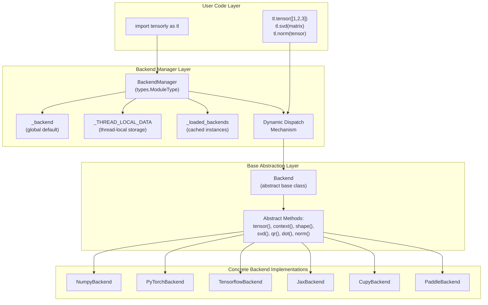
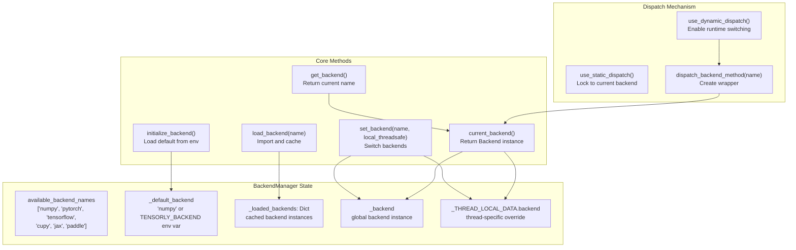
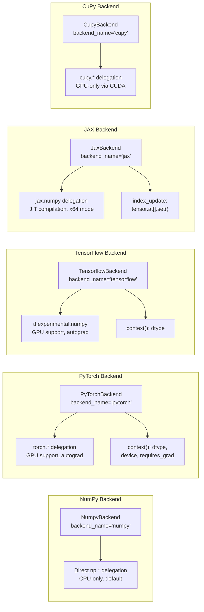
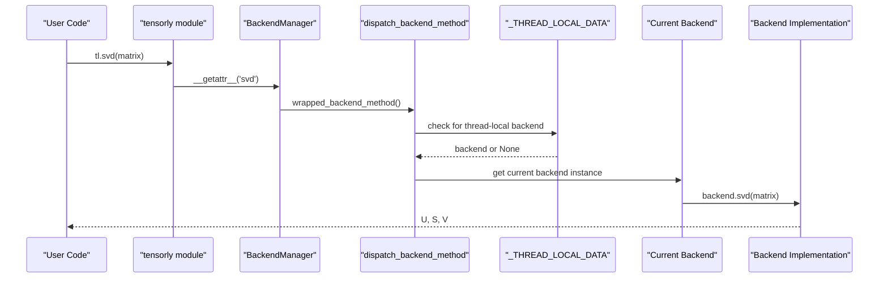
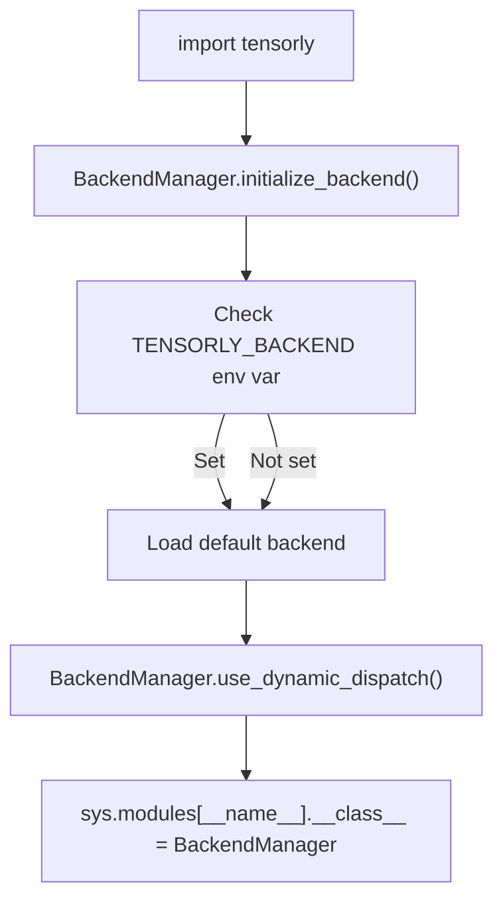

<!-- source: DeepWiki mcp.deepwiki.com · repo tensorly/tensorly · page 2 Backend System · fetched 2026-10-21 -->

# Backend System

<details>
<summary>Relevant source files</summary>

The following files were used as context for generating this wiki page:

- [tensorly/__init__.py](tensorly/__init__.py)
- [tensorly/backend/__init__.py](tensorly/backend/__init__.py)
- [tensorly/backend/core.py](tensorly/backend/core.py)
- [tensorly/backend/cupy_backend.py](tensorly/backend/cupy_backend.py)
- [tensorly/backend/jax_backend.py](tensorly/backend/jax_backend.py)
- [tensorly/backend/numpy_backend.py](tensorly/backend/numpy_backend.py)
- [tensorly/backend/pytorch_backend.py](tensorly/backend/pytorch_backend.py)
- [tensorly/backend/tensorflow_backend.py](tensorly/backend/tensorflow_backend.py)
- [tensorly/tests/test_backend.py](tensorly/tests/test_backend.py)

</details>


## Purpose and Scope

The Backend System is TensorLy's most critical architectural component, providing a unified abstraction layer that enables the library to work seamlessly with multiple numerical computing frameworks. This system allows users to write tensor decomposition code once and execute it on NumPy (CPU), PyTorch (CPU/GPU with autograd), TensorFlow (CPU/GPU), JAX (with JIT compilation), CuPy (GPU via CUDA), or Paddle, simply by switching the backend.

This page provides a comprehensive overview of the backend abstraction architecture, its core components, and how they work together. For implementation details of individual backend classes, see [Backend Abstraction Architecture](#2.1). For practical usage instructions, see [Using Different Backends](#2.2). For thread-safety and context management, see [Backend Context and Thread Safety](#2.3).

**Sources:** [tensorly/backend/__init__.py:1-360](), [tensorly/backend/core.py:1-91]()

## Architecture Overview

The backend system consists of three primary layers that work together to provide framework-agnostic tensor operations:



**Sources:** [tensorly/backend/__init__.py:34-360](), [tensorly/backend/core.py:91-106]()

## Core Components

### Backend Base Class

The `Backend` class in [tensorly/backend/core.py:91-1262]() defines the abstract interface that all concrete backends must implement. It uses Python's `__init_subclass__` hook to automatically register backend implementations.

| Component | Location | Purpose |
|-----------|----------|---------|
| `Backend` | [tensorly/backend/core.py:91-106]() | Abstract base class with auto-registration |
| `backend_types` | [tensorly/backend/core.py:14-24]() | Data types (`int32`, `float64`, `complex128`, etc.) |
| `backend_basic_math` | [tensorly/backend/core.py:25-40]() | Math operations (`exp`, `log`, `sin`, `cos`, etc.) |
| `backend_array` | [tensorly/backend/core.py:41-60]() | Array operations (`einsum`, `reshape`, `where`, etc.) |

The base class defines over 80 abstract methods covering:
- **Tensor creation**: `tensor()`, `zeros()`, `ones()`, `eye()`
- **Properties**: `context()`, `shape()`, `ndim()`, `is_tensor()`
- **Linear algebra**: `svd()`, `qr()`, `solve()`, `lstsq()`
- **Operations**: `dot()`, `tensordot()`, `norm()`, `transpose()`
- **Random generation**: `randn()`, `gamma()`, `check_random_state()`

**Sources:** [tensorly/backend/core.py:91-1262]()

### BackendManager

The `BackendManager` class in [tensorly/backend/__init__.py:34-353]() is implemented as a Python module (subclass of `types.ModuleType`) and manages backend state and dynamic dispatch.



**Key features:**
- **Thread-safe backend switching**: Thread-local storage allows different threads to use different backends ([tensorly/backend/__init__.py:132]())
- **Dynamic dispatch**: All backend functions are wrapped to dispatch to the current backend at runtime ([tensorly/backend/__init__.py:195-237]())
- **Lazy loading**: Backends are only imported when first requested ([tensorly/backend/__init__.py:291-317]())
- **Environment configuration**: Default backend can be set via `TENSORLY_BACKEND` environment variable ([tensorly/backend/__init__.py:133]())

**Sources:** [tensorly/backend/__init__.py:34-353]()

### Concrete Backend Implementations

Each backend implementation inherits from `Backend` and provides framework-specific implementations:



**Sources:** [tensorly/backend/numpy_backend.py:1-80](), [tensorly/backend/pytorch_backend.py:1-257](), [tensorly/backend/tensorflow_backend.py:1-195](), [tensorly/backend/jax_backend.py:1-109](), [tensorly/backend/cupy_backend.py:1-96]()

## Backend Registration and Dynamic Dispatch

### Registration Mechanism

Backends register themselves automatically using Python's `__init_subclass__` hook:

```python
class Backend:
    _available_backends = dict()
    
    def __init_subclass__(cls, backend_name, **kwargs):
        """When a subclass is created, register it in _available_backends"""
        if backend_name != "":
            cls._available_backends[backend_name.lower()] = cls
            cls.backend_name = backend_name
```

Each backend declares itself with a `backend_name` parameter:
- `class NumpyBackend(Backend, backend_name="numpy")` ([tensorly/backend/numpy_backend.py:11]())
- `class PyTorchBackend(Backend, backend_name="pytorch")` ([tensorly/backend/pytorch_backend.py:27]())
- `class TensorflowBackend(Backend, backend_name="tensorflow")` ([tensorly/backend/tensorflow_backend.py:20]())

**Sources:** [tensorly/backend/core.py:94-104]()

### Dynamic Dispatch Flow

When a user calls `tl.svd(matrix)`, the following dispatch chain executes:



The dispatch wrapper in [tensorly/backend/__init__.py:195-237]():

```python
def dispatch_backend_method(cls, name, method):
    def wrapped_backend_method(*args, **kwargs):
        """A dynamically dispatched method"""
        return getattr(
            cls._THREAD_LOCAL_DATA.__dict__.get("backend", cls._backend), 
            name
        )(*args, **kwargs)
    # ... copy metadata from method ...
    return wrapped_backend_method
```

**Sources:** [tensorly/backend/__init__.py:195-237](), [tensorly/__init__.py:155]()

## Supported Backends

| Backend | Implementation File | Key Features | Hardware | Special Capabilities |
|---------|-------------------|--------------|----------|---------------------|
| **NumPy** | [tensorly/backend/numpy_backend.py]() | Default, stable | CPU only | Standard NumPy operations |
| **PyTorch** | [tensorly/backend/pytorch_backend.py]() | Deep learning integration | CPU/GPU | Autograd, `requires_grad`, device placement |
| **TensorFlow** | [tensorly/backend/tensorflow_backend.py]() | Google ecosystem | CPU/GPU | TF 2.x with `tf.experimental.numpy` |
| **JAX** | [tensorly/backend/jax_backend.py]() | Functional programming | CPU/GPU/TPU | JIT compilation, x64 mode enabled |
| **CuPy** | [tensorly/backend/cupy_backend.py]() | NumPy-like GPU | GPU only | Direct CUDA acceleration |
| **Paddle** | (mentioned in tests) | PaddlePaddle integration | CPU/GPU | Chinese AI ecosystem |

### Backend-Specific Context

Each backend's `context()` method returns framework-specific metadata:

| Backend | Context Keys | Example |
|---------|--------------|---------|
| NumPy | `dtype` | `{'dtype': np.float32}` |
| PyTorch | `dtype`, `device`, `requires_grad` | `{'dtype': torch.float32, 'device': 'cuda:0', 'requires_grad': True}` |
| TensorFlow | `dtype` | `{'dtype': tf.float32}` |
| JAX | `dtype` | `{'dtype': jnp.float32}` |
| CuPy | `dtype` | `{'dtype': cp.float32}` |

**Sources:** [tensorly/backend/numpy_backend.py:13-14](), [tensorly/backend/pytorch_backend.py:29-34](), [tensorly/backend/tensorflow_backend.py:22-23](), [tensorly/backend/core.py:223-256]()

## Method Registration Patterns

Backends use two patterns to implement the required API:

### Pattern 1: Direct Registration

For operations that map directly to framework functions:

```python
# NumPy backend
for name in ['solve', 'qr', 'svd', 'eigh', 'lstsq']:
    NumpyBackend.register_method(name, getattr(np.linalg, name))
```

**Sources:** [tensorly/backend/numpy_backend.py:75-76](), [tensorly/backend/pytorch_backend.py:255-256]()

### Pattern 2: Custom Implementation

For operations requiring adaptation:

```python
# PyTorch backend - custom norm implementation
@staticmethod
def norm(tensor, order=None, axis=None):
    kwds = {}
    if axis is not None:
        kwds["dim"] = axis
    if order and order != "inf":
        kwds["p"] = order
    if order == "inf":
        res = torch.max(torch.abs(tensor), **kwds)
        if axis is not None:
            return res[0]  # ignore indices output
        return res
    return torch.norm(tensor, **kwds)
```

**Sources:** [tensorly/backend/pytorch_backend.py:121-135]()

## Initialization and Configuration

### Default Backend Initialization

On module import, TensorLy initializes the backend system:



**Sources:** [tensorly/backend/__init__.py:272-289](), [tensorly/backend/__init__.py:356-360]()

### Environment Configuration

Users can set the default backend via environment variable:

```bash
export TENSORLY_BACKEND=pytorch  # Use PyTorch by default
export TENSORLY_BACKEND=jax      # Use JAX by default
```

The environment variable is checked in [tensorly/backend/__init__.py:279]():

```python
backend_name = os.environ.get(cls._ENV_DEFAULT_VAR, cls._default_backend)
```

**Sources:** [tensorly/backend/__init__.py:133](), [tensorly/backend/__init__.py:272-289]()

## Integration with TensorLy Module

The top-level `tensorly` module exposes backend functions through two mechanisms:

### Direct Imports

Selected functions are imported directly in [tensorly/__init__.py:44-132]():

```python
from .backend import (
    context, tensor, shape, ndim, to_numpy,
    solve, qr, svd, lstsq,
    dot, norm, transpose,
    # ... and many more
)
```

### Dynamic Attribute Access

The module uses `__getattr__` for dynamic dispatch in [tensorly/__init__.py:155]():

```python
__getattr__ = backend.__getattribute__
```

This allows any backend method to be accessed as `tl.method_name()`, with the call dynamically routed to the current backend.

**Sources:** [tensorly/__init__.py:44-155]()

## Testing Framework

The test suite in [tensorly/tests/test_backend.py]() validates:

1. **Backend switching** ([tensorly/tests/test_backend.py:24-75]()):
   - Context manager behavior
   - Global vs thread-local settings
   - Invalid backend names

2. **Thread safety** ([tensorly/tests/test_backend.py:77-147]()):
   - Concurrent backend usage
   - Thread-local isolation
   - Backend context nesting

3. **Operation correctness** ([tensorly/tests/test_backend.py:186-272]()):
   - SVD accuracy across backends
   - Orthogonality of decompositions
   - Numerical stability

4. **API consistency** ([tensorly/tests/test_backend.py:435-451]()):
   - Matrix multiplication shapes
   - Norm calculations
   - Linear system solving

**Sources:** [tensorly/tests/test_backend.py:1-659]()

## Backend System Benefits

The backend abstraction provides several critical advantages:

1. **Framework Independence**: Write algorithms once, run on any backend
2. **Hardware Flexibility**: Seamlessly move between CPU and GPU
3. **Performance Optimization**: Choose JAX for JIT compilation or PyTorch for autograd
4. **Backward Compatibility**: Default NumPy backend ensures compatibility
5. **Gradual Migration**: Switch backends without rewriting application code
6. **Testing**: Validate algorithms across multiple numerical frameworks

**Sources:** [tensorly/backend/__init__.py:1-360](), [tensorly/backend/core.py:1-1262]()

---

