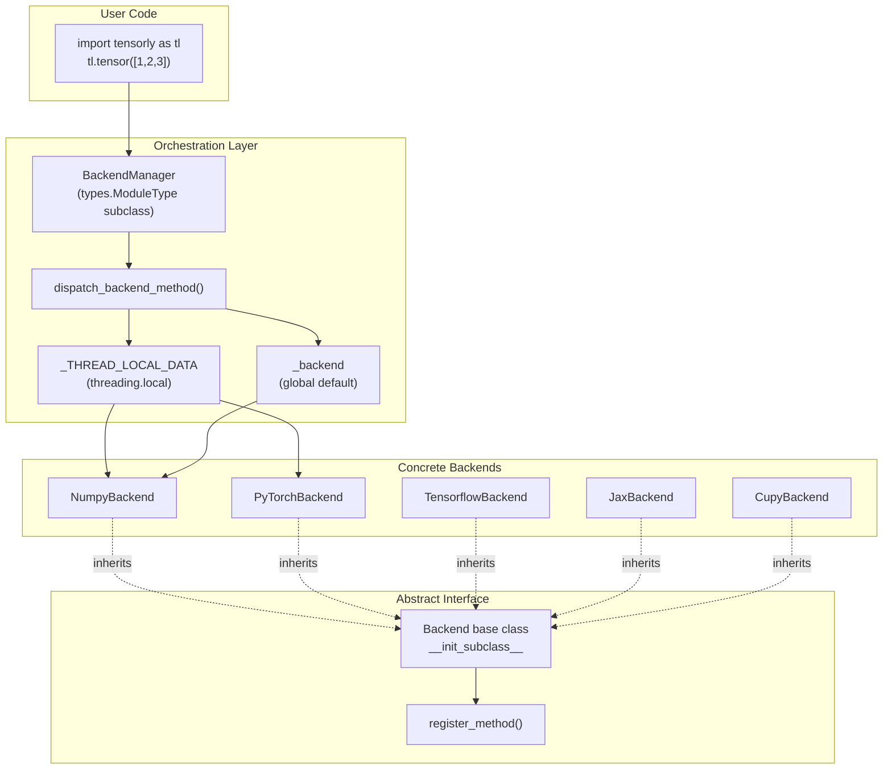
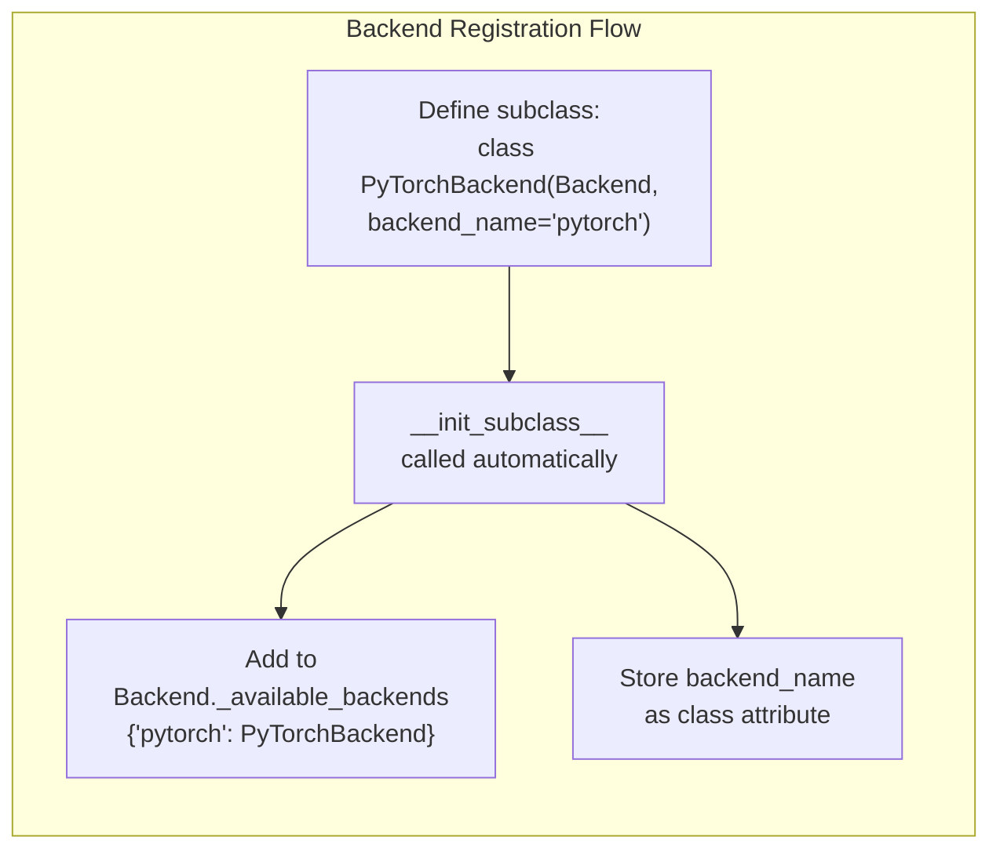
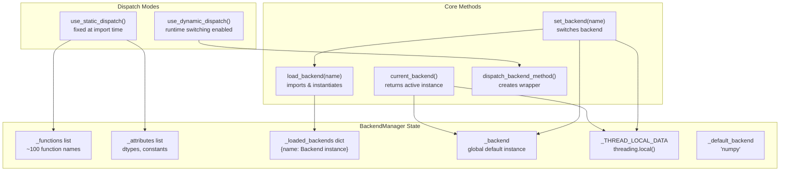
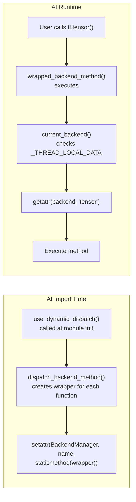
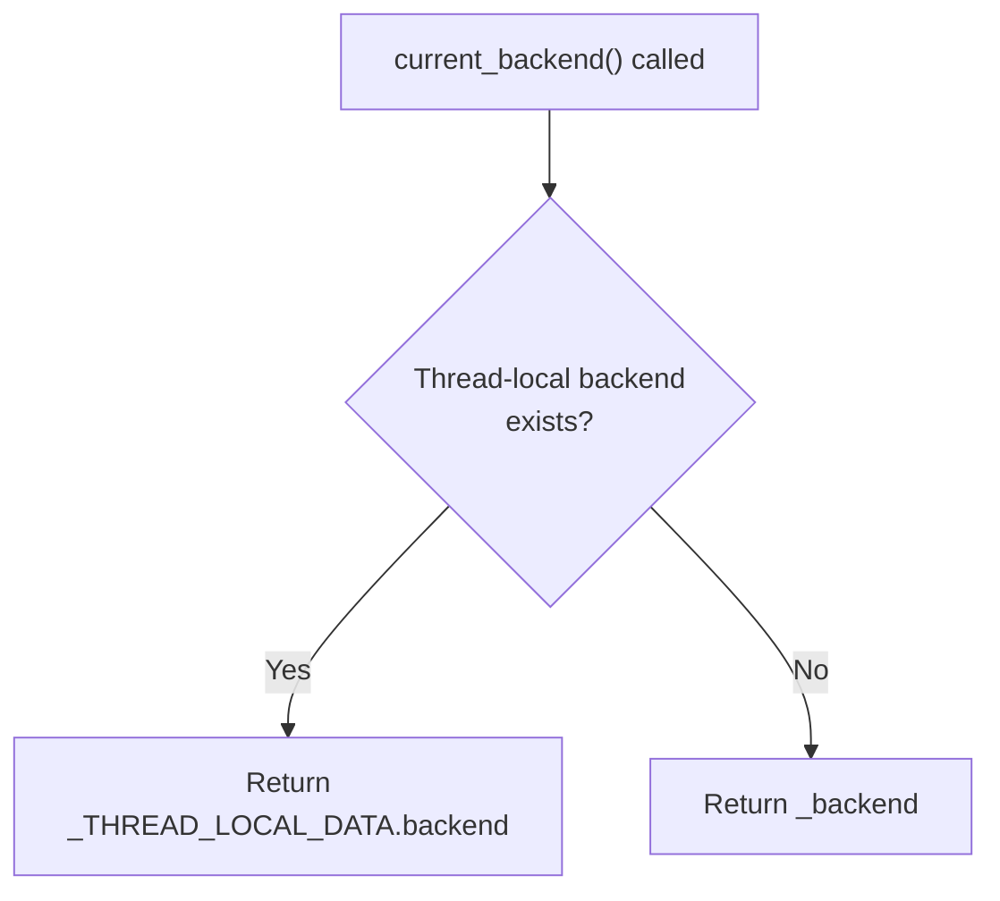
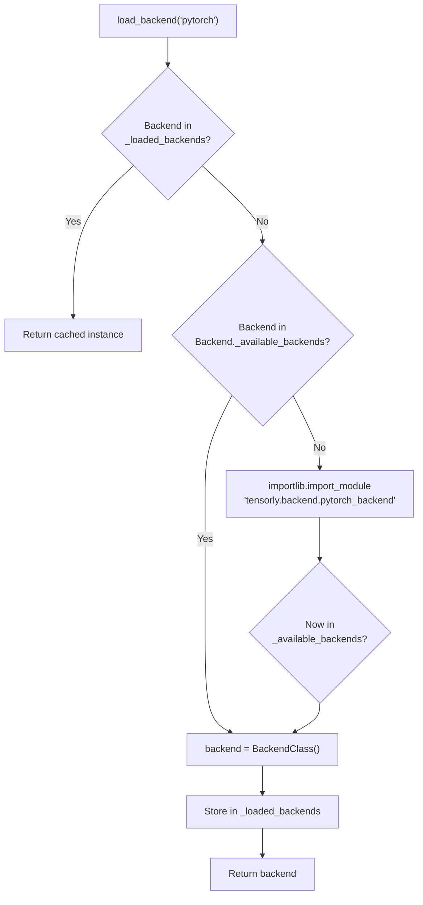
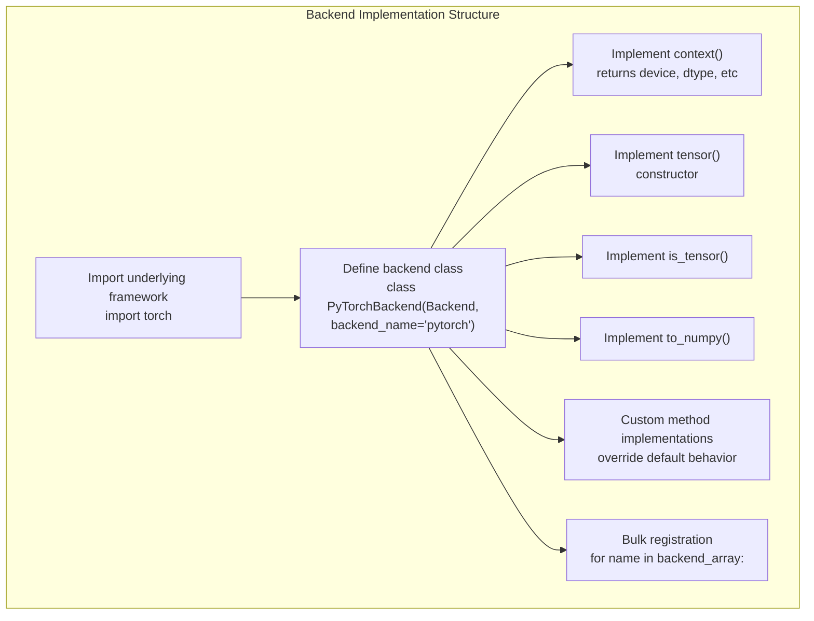

<!-- source: DeepWiki mcp.deepwiki.com · repo tensorly/tensorly · page 2.1 Backend Abstraction Architecture · fetched 2026-10-21 -->

# Backend Abstraction Architecture

<details>
<summary>Relevant source files</summary>

The following files were used as context for generating this wiki page:

- [tensorly/__init__.py](tensorly/__init__.py)
- [tensorly/backend/__init__.py](tensorly/backend/__init__.py)
- [tensorly/backend/core.py](tensorly/backend/core.py)
- [tensorly/backend/cupy_backend.py](tensorly/backend/cupy_backend.py)
- [tensorly/backend/jax_backend.py](tensorly/backend/jax_backend.py)
- [tensorly/backend/numpy_backend.py](tensorly/backend/numpy_backend.py)
- [tensorly/backend/pytorch_backend.py](tensorly/backend/pytorch_backend.py)
- [tensorly/backend/tensorflow_backend.py](tensorly/backend/tensorflow_backend.py)
- [tensorly/tests/test_backend.py](tensorly/tests/test_backend.py)

</details>


This document provides a detailed technical explanation of TensorLy's backend abstraction system, focusing on the internal architecture, dynamic dispatch mechanism, and how the `BackendManager` orchestrates multi-framework support. This covers the implementation details of the abstraction layer itself.

For guidance on switching backends and using backend-specific features, see [Using Different Backends](#2.2). For information about context managers and thread safety, see [Backend Context and Thread Safety](#2.3).

## Overview

The backend abstraction architecture enables TensorLy to support multiple numerical computing frameworks (NumPy, PyTorch, TensorFlow, JAX, CuPy, Paddle) through a unified API. The system consists of three layers:

1. **Abstract Interface Layer** - The `Backend` base class defining the contract
2. **Orchestration Layer** - The `BackendManager` handling backend selection and dispatch
3. **Implementation Layer** - Concrete backend classes for each framework



**Sources:** [tensorly/backend/__init__.py:1-360](), [tensorly/backend/core.py:1-1262]()

## Backend Base Class

The `Backend` class at [tensorly/backend/core.py:91-1262]() defines the abstract interface that all concrete backends must implement. It uses Python's `__init_subclass__` hook to automatically register backend implementations.

### Automatic Registration Mechanism



The registration occurs at [tensorly/backend/core.py:94-104]():

```python
def __init_subclass__(cls, backend_name, **kwargs):
    """When a subclass is created, register it in _known_backends"""
    super().__init_subclass__(**kwargs)
    
    if backend_name != "":
        cls._available_backends[backend_name.lower()] = cls
        cls.backend_name = backend_name
```

Each backend subclass specifies its name through the class definition syntax: `class PyTorchBackend(Backend, backend_name="pytorch")` at [tensorly/backend/pytorch_backend.py:27]().

**Sources:** [tensorly/backend/core.py:91-104](), [tensorly/backend/pytorch_backend.py:27](), [tensorly/backend/numpy_backend.py:11]()

### Abstract Method Categories

The `Backend` class organizes operations into categories defined by module-level lists:

| Category | List Name | Example Operations |
|----------|-----------|-------------------|
| Data types | `backend_types` | `int32`, `int64`, `float32`, `float64`, `complex64`, `complex128` |
| Basic math | `backend_basic_math` | `exp`, `log`, `sin`, `cos`, `tanh`, `arcsin` |
| Array operations | `backend_array` | `einsum`, `matmul`, `ones`, `zeros`, `reshape`, `eye` |
| Custom methods | Defined individually | `context`, `tensor`, `norm`, `svd`, `qr` |

These lists are defined at [tensorly/backend/core.py:14-60]() and used by concrete backends to bulk-register methods from their underlying frameworks.

**Sources:** [tensorly/backend/core.py:14-60]()

### Method Registration Pattern

Concrete backends use `register_method()` to bind framework functions to the backend interface. Two patterns exist:

**Pattern 1: Bulk registration from framework**
```python
# From numpy_backend.py
for name in (backend_types + backend_basic_math + backend_array + ['nan', 'moveaxis', ...]):
    NumpyBackend.register_method(name, getattr(np, name))
```

**Pattern 2: Custom implementation**
```python
# From pytorch_backend.py
@staticmethod
def context(tensor):
    return {
        "dtype": tensor.dtype,
        "device": tensor.device,
        "requires_grad": tensor.requires_grad,
    }
```

The `register_method()` implementation at [tensorly/backend/core.py:110-120]() uses `staticmethod` to add methods to the class.

**Sources:** [tensorly/backend/core.py:110-120](), [tensorly/backend/numpy_backend.py:41-76](), [tensorly/backend/pytorch_backend.py:29-34]()

## BackendManager: The Central Orchestrator

The `BackendManager` class at [tensorly/backend/__init__.py:34-353]() is the core orchestration component. Remarkably, it subclasses `types.ModuleType` to act as both a class and a module, enabling `import tensorly.backend` to directly access backend methods.

### Architecture Components



**Sources:** [tensorly/backend/__init__.py:34-353]()

### Dynamic Dispatch Mechanism

The dynamic dispatch system allows runtime backend switching. The key method is `dispatch_backend_method()` at [tensorly/backend/__init__.py:195-237]():

**Dynamic Dispatch Flow:**



The wrapper function at [tensorly/backend/__init__.py:198-204]():

```python
def wrapped_backend_method(*args, **kwargs):
    """A dynamically dispatched method
    
    Returns the queried method from the currently set backend"""
    return getattr(
        cls._THREAD_LOCAL_DATA.__dict__.get("backend", cls._backend), name
    )(*args, **kwargs)
```

This design ensures every function call queries the current backend, enabling seamless switching at runtime.

**Sources:** [tensorly/backend/__init__.py:136-237]()

### Thread-Local Backend Management

The system maintains two backend references:

1. **Global Default** (`_backend`) - Affects all threads by default
2. **Thread-Local Override** (`_THREAD_LOCAL_DATA.backend`) - Thread-specific override

The resolution logic in `current_backend()` at [tensorly/backend/__init__.py:170-178]():



When `set_backend(name, local_threadsafe=True)` is called at [tensorly/backend/__init__.py:320-340]():
- Sets `_THREAD_LOCAL_DATA.backend` (affects only current thread)
- Does NOT modify `_backend` (global default unchanged)

When `set_backend(name, local_threadsafe=False)` is called:
- Sets both `_THREAD_LOCAL_DATA.backend` and `_backend`
- Changes global default for all threads

**Sources:** [tensorly/backend/__init__.py:170-178](), [tensorly/backend/__init__.py:320-340]()

## Backend Lifecycle and Loading

### Lazy Loading Strategy

Backends are loaded on-demand rather than at import time. The `load_backend()` method at [tensorly/backend/__init__.py:292-317]() implements this:



The import triggers the backend module's class definition, which calls `__init_subclass__`, registering the backend in `Backend._available_backends`.

**Sources:** [tensorly/backend/__init__.py:292-317]()

### Initialization Sequence

At module load time, the following sequence occurs at [tensorly/backend/__init__.py:355-359]():

1. `BackendManager.initialize_backend()` - Checks `TENSORLY_BACKEND` environment variable
2. `BackendManager.set_backend(backend_name)` - Loads and sets the default backend
3. `BackendManager.use_dynamic_dispatch()` - Enables runtime switching
4. Module class replacement: `sys.modules[__name__].__class__ = BackendManager`

The final step is critical - it makes the `tensorly.backend` module an instance of `BackendManager`, enabling direct attribute access.

**Sources:** [tensorly/backend/__init__.py:272-289](), [tensorly/backend/__init__.py:355-359]()

## Integration with Top-Level API

The top-level `tensorly` module exposes backend functionality through dynamic attribute lookup. The implementation at [tensorly/__init__.py:145-155]():

```python
def __dir__():
    """Returns the module's __dir__, including the local variables
    and augmenting it with the dynamically dispatched variables from backend.
    """
    static_items = list(sys.modules[__name__].__dict__.keys())
    return backend.get_backend_dir() + static_items

__getattr__ = backend.__getattribute__
```

This design allows:
- `import tensorly as tl; tl.tensor([1,2,3])` - Direct access to backend methods
- `from tensorly import tensor` - Named imports work seamlessly
- `dir(tl)` includes all backend functions - Auto-completion support

**Sources:** [tensorly/__init__.py:145-163]()

## Concrete Backend Implementations

### Common Implementation Pattern

All concrete backends follow a standard structure:



**Sources:** [tensorly/backend/pytorch_backend.py:1-257](), [tensorly/backend/numpy_backend.py:1-80]()

### Framework-Specific Adaptations

Each backend makes framework-specific adaptations:

| Backend | Key Adaptations | Location |
|---------|----------------|----------|
| **NumPy** | Minimal - mostly direct delegation | [tensorly/backend/numpy_backend.py:11-80]() |
| **PyTorch** | Device management, `requires_grad` tracking, axis naming (`dim` vs `axis`) | [tensorly/backend/pytorch_backend.py:27-257]() |
| **TensorFlow** | Uses `tensorflow.experimental.numpy` (tnp), variable handling | [tensorly/backend/tensorflow_backend.py:20-195]() |
| **JAX** | Enables x64 mode, immutable tensor updates via `.at[].set()` | [tensorly/backend/jax_backend.py:6-109]() |
| **CuPy** | GPU-specific operations, CPU-GPU transfer | [tensorly/backend/cupy_backend.py:23-96]() |

### Context Implementation Differences

The `context()` method captures backend-specific tensor properties:

**NumPy** - Only dtype matters [tensorly/backend/numpy_backend.py:13-14]():
```python
@staticmethod
def context(tensor):
    return {"dtype": tensor.dtype}
```

**PyTorch** - Includes device and gradient tracking [tensorly/backend/pytorch_backend.py:29-34]():
```python
@staticmethod
def context(tensor):
    return {
        "dtype": tensor.dtype,
        "device": tensor.device,
        "requires_grad": tensor.requires_grad,
    }
```

**Sources:** [tensorly/backend/numpy_backend.py:13-14](), [tensorly/backend/pytorch_backend.py:29-34](), [tensorly/backend/tensorflow_backend.py:22-23]()

## Dynamic vs Static Dispatch Trade-offs

The `BackendManager` supports two dispatch modes:

### Dynamic Dispatch (Default)

Enabled by `use_dynamic_dispatch()` at [tensorly/backend/__init__.py:136-154]():
- Every function call resolves the backend at runtime
- Enables seamless backend switching during execution
- Small performance overhead from wrapper function call
- Required for `backend_context()` context manager to work

### Static Dispatch

Enabled by `use_static_dispatch()` at [tensorly/backend/__init__.py:157-167]():
- Functions bound directly to backend methods at dispatch time
- No runtime resolution overhead
- Backend cannot be changed after functions are imported
- Slightly better performance for tight loops

The implementation difference:

```python
# Dynamic: Creates wrapper that queries current backend
setattr(cls, name, staticmethod(
    cls.dispatch_backend_method(name, getattr(cls.current_backend(), name))
))

# Static: Direct binding to current backend
setattr(cls, name, staticmethod(getattr(cls.current_backend(), name)))
```

**Sources:** [tensorly/backend/__init__.py:136-167]()

## Class Attribute Dynamic Dispatch

Properties like `tl.float32` use the `dynamically_dispatched_class_attribute` descriptor at [tensorly/backend/__init__.py:13-31]():

```python
class dynamically_dispatched_class_attribute:
    __slots__ = ["name"]
    
    def __init__(self, name):
        self.name = name
    
    def __get__(self, instance, cls=None):
        if isinstance is None:
            return getattr(cls.current_backend(), self.name)
        else:
            return getattr(instance.current_backend(), self.name)
```

This descriptor pattern allows `tl.float32` to resolve to `np.float32`, `torch.float32`, etc., depending on the active backend.

**Sources:** [tensorly/backend/__init__.py:13-31](), [tensorly/backend/__init__.py:151-154]()

## Summary Table

| Component | File | Key Responsibilities |
|-----------|------|---------------------|
| `Backend` | [tensorly/backend/core.py:91-1262]() | Abstract interface, method signatures, registration hook |
| `BackendManager` | [tensorly/backend/__init__.py:34-353]() | Backend selection, dynamic dispatch, thread management |
| `NumpyBackend` | [tensorly/backend/numpy_backend.py:11-80]() | NumPy implementation, default backend |
| `PyTorchBackend` | [tensorly/backend/pytorch_backend.py:27-257]() | PyTorch implementation, GPU support, autograd |
| `TensorflowBackend` | [tensorly/backend/tensorflow_backend.py:20-195]() | TensorFlow implementation via tnp |
| `JaxBackend` | [tensorly/backend/jax_backend.py:31-109]() | JAX implementation, x64 mode, JIT compatible |
| `CupyBackend` | [tensorly/backend/cupy_backend.py:23-96]() | CuPy implementation for CUDA acceleration |

**Sources:** All files listed in table

---

