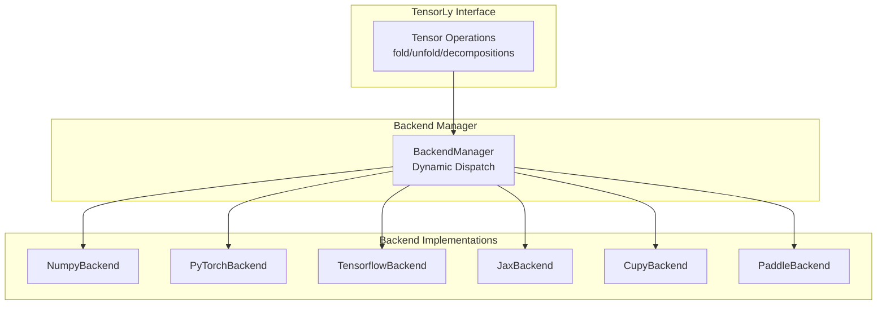
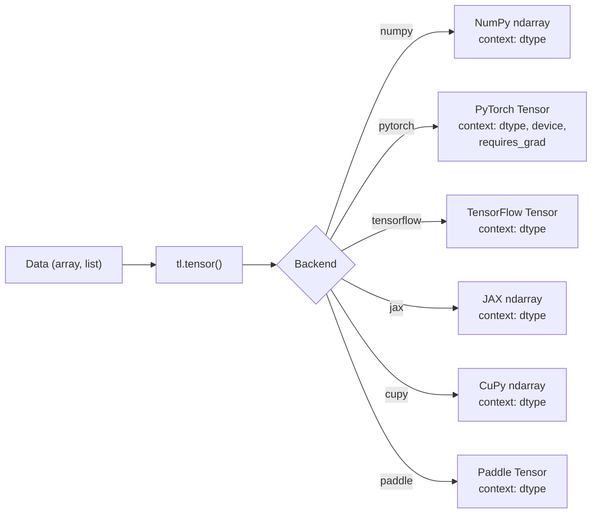

<!-- source: DeepWiki mcp.deepwiki.com · repo tensorly/tensorly · page 2.2 Using Different Backends · fetched 2026-10-21 -->

# Using Different Backends

<details>
<summary>Relevant source files</summary>

The following files were used as context for generating this wiki page:

- [tensorly/__init__.py](tensorly/__init__.py)
- [tensorly/backend/__init__.py](tensorly/backend/__init__.py)
- [tensorly/backend/core.py](tensorly/backend/core.py)
- [tensorly/backend/cupy_backend.py](tensorly/backend/cupy_backend.py)
- [tensorly/backend/jax_backend.py](tensorly/backend/jax_backend.py)
- [tensorly/backend/numpy_backend.py](tensorly/backend/numpy_backend.py)
- [tensorly/backend/pytorch_backend.py](tensorly/backend/pytorch_backend.py)
- [tensorly/backend/tensorflow_backend.py](tensorly/backend/tensorflow_backend.py)
- [tensorly/tests/test_backend.py](tensorly/tests/test_backend.py)

</details>


This page provides detailed instructions on how to configure and use different numerical computation backends in TensorLy. The backend system allows TensorLy to perform tensor operations using various libraries like NumPy, PyTorch, TensorFlow, JAX, CuPy, and Paddle, enabling flexibility across hardware platforms and integration with deep learning frameworks. For details on the overall backend architecture, see [Backend System](#2).

## Available Backends

TensorLy currently supports the following backends:

| Backend    | Hardware Support | Primary Use Cases                       | Additional Features                         |
|------------|------------------|----------------------------------------|---------------------------------------------|
| NumPy      | CPU              | General tensor computation             | Default backend, no external dependencies   |
| PyTorch    | CPU, GPU         | Deep learning integration              | Automatic differentiation, GPU acceleration |
| TensorFlow | CPU, GPU         | Deep learning, production deployment   | Distributed computation                     |
| JAX        | CPU, GPU, TPU    | Transformation of numerical functions  | JIT compilation, auto-differentiation       |
| CuPy       | GPU              | NumPy-compatible GPU acceleration      | Drop-in GPU replacement for NumPy           |
| Paddle     | CPU, GPU         | Deep learning                          | Similar to PyTorch with additional features |

Sources: [tensorly/backend/__init__.py:121-128](), [README.rst:22-23](), [conda/meta.yaml:40-46]()

## Backend System Architecture



Sources: [tensorly/backend/__init__.py:34-356](), [tensorly/backend/core.py:91-102]()

## Setting the Backend

TensorLy provides multiple ways to set the backend:

### Method 1: Using `set_backend()`

The most direct way to switch backends is to use the `set_backend()` function:

```python
import tensorly as tl
tl.set_backend('pytorch')  # Switch to PyTorch backend
```

This sets the backend for all operations in the current session. Available backend names are: `'numpy'`, `'pytorch'`, `'tensorflow'`, `'jax'`, `'cupy'`, and `'paddle'`.

Sources: [tensorly/backend/__init__.py:319-341](), [tensorly/__init__.py:44-50]()

### Method 2: Using Context Manager

To temporarily switch backends without affecting the global setting, use the `backend_context()` context manager:

```python
import tensorly as tl
# Default backend remains unchanged outside this block
with tl.backend_context('pytorch'):
    # Code using PyTorch backend here
```

The `local_threadsafe` parameter can be used to control whether the backend change affects only the current thread or all threads:

```python
# Only changes backend for current thread
with tl.backend_context('pytorch', local_threadsafe=True):
    # Code using PyTorch backend
```

Sources: [tensorly/backend/__init__.py:239-270](), [tensorly/tests/test_backend.py:24-74]()

### Method 3: Using Environment Variable

You can set the default backend using the `TENSORLY_BACKEND` environment variable:

```bash
export TENSORLY_BACKEND='pytorch'
python my_script.py
```

This is useful when you want to run an entire script or application with a specific backend without modifying any code.

Sources: [tensorly/backend/__init__.py:272-290](), [tensorly/tests/test_backend.py:162-167]()

## Backend-Specific Features

Each backend implementation has unique features and characteristics that affect how you work with tensors.

### Tensor Creation and Context



Sources: [tensorly/backend/numpy_backend.py:12-14](), [tensorly/backend/pytorch_backend.py:27-69](), [tensorly/backend/tensorflow_backend.py:21-58](), [tensorly/backend/jax_backend.py:32-38](), [tensorly/backend/cupy_backend.py:23-30]()

The `context()` method of each backend returns different information:

| Backend    | Context Information                        | Example                                     |
|------------|-------------------------------------------|---------------------------------------------|
| NumPy      | `dtype`                                   | `{'dtype': numpy.float32}`                  |
| PyTorch    | `dtype`, `device`, `requires_grad`        | `{'dtype': torch.float32, 'device': 'cuda:0', 'requires_grad': False}` |
| TensorFlow | `dtype`                                   | `{'dtype': tf.float32}`                     |
| JAX        | `dtype`                                   | `{'dtype': jnp.float32}`                    |
| CuPy       | `dtype`                                   | `{'dtype': cupy.float32}`                   |

Sources: [tensorly/backend/core.py:222-257](), [tensorly/backend/pytorch_backend.py:28-34](), [tensorly/backend/tensorflow_backend.py:21-23]()

### GPU Support

For backends that support GPU computation (PyTorch, TensorFlow, JAX, CuPy, Paddle), tensor creation can include device specification:

```python
# With PyTorch backend
tl.set_backend('pytorch')
tensor = tl.tensor([1, 2, 3], device='cuda:0')  # Create tensor on GPU 0

# With CuPy backend (automatically on GPU)
tl.set_backend('cupy')
tensor = tl.tensor([1, 2, 3])  # Already on GPU
```

The PyTorch backend supports specifying device and gradient tracking:

```python
tl.set_backend('pytorch')
tensor = tl.tensor([1, 2, 3], dtype=tl.float32, device='cuda:0', requires_grad=True)
```

Sources: [tensorly/backend/pytorch_backend.py:35-69](), [tensorly/backend/tensorflow_backend.py:33-58]()

## Backend Compatibility and Best Practices

### When to Use Each Backend

1. **NumPy**: For simple CPU computation and minimal dependencies
2. **PyTorch**: When working with deep learning models, need gradients, or GPU acceleration
3. **TensorFlow**: For production deployment of models or integration with TensorFlow ecosystem
4. **JAX**: For functional programming paradigms, transformable numerical functions
5. **CuPy**: For NumPy-like interface with GPU acceleration
6. **Paddle**: Alternative to PyTorch, particularly for certain specialized models

### Migrating Between Backends

When switching backends, use `tl.to_numpy()` to ensure compatibility:

```python
# Convert any tensor to NumPy regardless of current backend
numpy_array = tl.to_numpy(tensor)
```

Sources: [tensorly/backend/core.py:289-302](), [tensorly/backend/pytorch_backend.py:71-82](), [tensorly/backend/tensorflow_backend.py:63-73]()

### Testing with Different Backends

When running tests with different backends, set the environment variable:

```bash
TENSORLY_BACKEND='pytorch' pytest -v tensorly
```

Sources: [tensorly/tests/test_backend.py:24-74](), [README.rst:162-167]()

## Examples

### Basic Usage with Different Backends

```python
import tensorly as tl
import numpy as np

# NumPy backend (default)
tensor_np = tl.tensor(np.arange(12).reshape((3, 4)))

# Switch to PyTorch backend
tl.set_backend('pytorch')
tensor_pt = tl.tensor(np.arange(12).reshape((3, 4)))

# Switch to TensorFlow backend
tl.set_backend('tensorflow')
tensor_tf = tl.tensor(np.arange(12).reshape((3, 4)))

# Temporarily use JAX backend
with tl.backend_context('jax'):
    tensor_jax = tl.tensor(np.arange(12).reshape((3, 4)))
```

### Using Context Information

```python
import tensorly as tl

# PyTorch backend with device specification
tl.set_backend('pytorch')
tensor = tl.tensor([1, 2, 3], device='cuda:0')

# Create another tensor with same context
context = tl.context(tensor)
new_tensor = tl.tensor([4, 5, 6], **context)  # Also on cuda:0
```

## Conclusion

TensorLy's flexible backend system allows you to leverage different numerical libraries while maintaining a consistent API. By selecting the appropriate backend for your use case, you can optimize for performance, hardware utilization, or integration with other frameworks.

---

