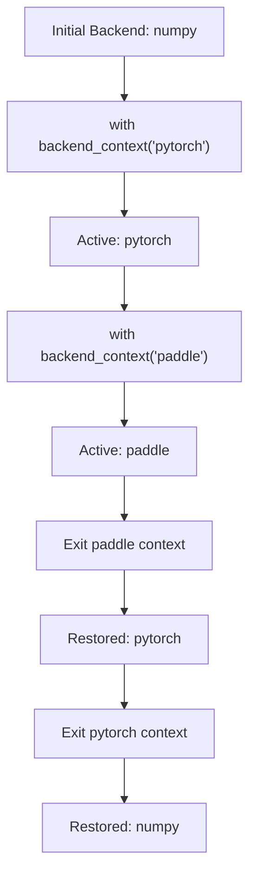
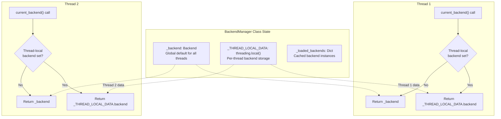
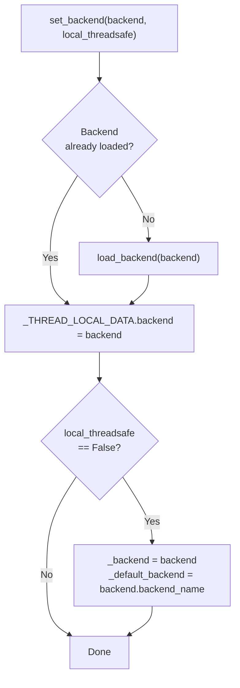
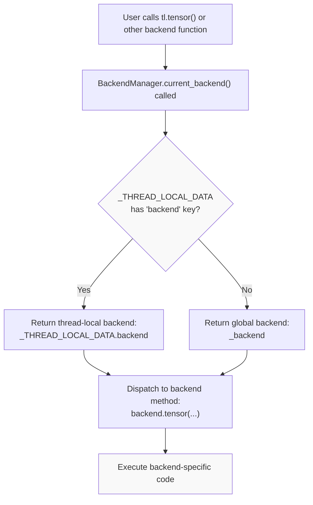

<!-- source: DeepWiki mcp.deepwiki.com · repo tensorly/tensorly · page 2.3 Backend Context and Thread Safety · fetched 2026-10-21 -->

# Backend Context and Thread Safety

<details>
<summary>Relevant source files</summary>

The following files were used as context for generating this wiki page:

- [tensorly/__init__.py](tensorly/__init__.py)
- [tensorly/backend/__init__.py](tensorly/backend/__init__.py)
- [tensorly/tests/test_backend.py](tensorly/tests/test_backend.py)

</details>


**Purpose**: This document explains TensorLy's backend context management system and thread-safety mechanisms, which allow temporary backend switching and safe concurrent backend usage across multiple threads.

For general information about backend switching and available backends, see [Using Different Backends](#2.2). For details about the underlying backend architecture, see [Backend Abstraction Architecture](#2.1).

## Overview

TensorLy provides two mechanisms for managing backend state:

1. **Backend Context Manager** (`backend_context`): Temporarily switches backend within a scope
2. **Thread-Local Configuration**: Isolates backend changes to specific threads without affecting others

These features enable safe multithreaded operations and temporary backend switching for specific computation blocks.

**Sources**: [tensorly/backend/__init__.py:239-269](), [tensorly/tests/test_backend.py:24-75]()

## Backend Context Manager

The `backend_context` function is a context manager that temporarily changes the active backend and automatically restores the previous backend upon exit.

### Basic Usage

```python
with tl.backend_context('pytorch'):
    # Operations use PyTorch backend
    tensor = tl.tensor([1, 2, 3])
    assert torch.is_tensor(tensor)
# Automatically reverts to previous backend
```

**Sources**: [tensorly/backend/__init__.py:240-269](), [tensorly/tests/test_backend.py:31-56]()

### Context Manager Nesting

Context managers can be nested arbitrarily. Each level correctly restores the previous backend:



**Sources**: [tensorly/tests/test_backend.py:37-54]()

### Implementation Mechanics

The context manager implementation follows this pattern:

1. **Store current backend**: `_old_backend = cls.current_backend()`
2. **Set new backend**: `cls.set_backend(backend, local_threadsafe=local_threadsafe)`
3. **Execute context block**: `yield`
4. **Restore previous backend**: `cls.set_backend(_old_backend)` in `finally` block

This ensures the previous backend is always restored, even if exceptions occur within the context.

**Sources**: [tensorly/backend/__init__.py:264-269]()

## Thread-Local vs Global Configuration

The `local_threadsafe` parameter controls whether backend changes affect only the current thread or all threads globally.

### Configuration Modes

| Mode | Parameter | Scope | Use Case |
|------|-----------|-------|----------|
| **Global** | `local_threadsafe=False` | All threads | Default behavior, changes affect entire process |
| **Thread-Local** | `local_threadsafe=True` | Current thread only | Concurrent operations with different backends |

**Sources**: [tensorly/backend/__init__.py:241-252]()

### Global Backend Changes

When `local_threadsafe=False` (default), backend changes affect all threads:

```python
# Global change affects all threads
tl.set_backend('pytorch', local_threadsafe=False)

# All threads will now use PyTorch
executor.submit(tl.get_backend).result()  # Returns 'pytorch'
```

**Sources**: [tensorly/tests/test_backend.py:90-93]()

### Thread-Local Backend Changes

When `local_threadsafe=True`, changes are isolated to the current thread:

```python
with tl.backend_context('numpy', local_threadsafe=True):
    assert tl.get_backend() == 'numpy'
    # Other threads unchanged
    assert executor.submit(tl.get_backend).result() == 'pytorch'
```

**Sources**: [tensorly/tests/test_backend.py:83-86](), [tensorly/tests/test_backend.py:95-104]()

## Thread Safety Architecture



**Sources**: [tensorly/backend/__init__.py:132](), [tensorly/backend/__init__.py:170-178]()

### Thread-Local Storage Implementation

The `BackendManager` uses Python's `threading.local()` to maintain per-thread backend state:

**Class Attribute**: `_THREAD_LOCAL_DATA = threading.local()` at [tensorly/backend/__init__.py:132]()

**Backend Resolution**: The `current_backend()` method checks thread-local storage first, then falls back to the global default:

```python
@classmethod
def current_backend(cls):
    return cls._THREAD_LOCAL_DATA.__dict__.get("backend", cls._backend)
```

**Sources**: [tensorly/backend/__init__.py:169-178]()

### Backend Setting Logic

The `set_backend()` method controls both thread-local and global state based on the `local_threadsafe` parameter:



**Key Points**:
1. Thread-local backend is **always** set: `cls._THREAD_LOCAL_DATA.backend = backend`
2. Global backend is **conditionally** set: Only when `local_threadsafe=False`
3. This design ensures thread-local changes don't affect other threads unless explicitly requested

**Sources**: [tensorly/backend/__init__.py:320-340]()

## Multithreaded Usage Patterns

### Pattern 1: Thread-Isolated Backends

Each thread uses a different backend without interference:

```python
from concurrent.futures import ThreadPoolExecutor

def worker_pytorch():
    with tl.backend_context('pytorch', local_threadsafe=True):
        # This thread uses PyTorch
        return tl.tensor([1, 2, 3])

def worker_numpy():
    with tl.backend_context('numpy', local_threadsafe=True):
        # This thread uses NumPy
        return tl.tensor([1, 2, 3])

with ThreadPoolExecutor(max_workers=2) as executor:
    pytorch_result = executor.submit(worker_pytorch)
    numpy_result = executor.submit(worker_numpy)
```

**Sources**: [tensorly/tests/test_backend.py:82-110]()

### Pattern 2: Global Backend Changes in Multithreaded Context

Testing that global changes propagate to all threads:

```python
global_default = tl.get_backend()

with ThreadPoolExecutor(max_workers=1) as executor:
    # Set global backend
    tl.set_backend('pytorch', local_threadsafe=False)
    
    # Verify it changed in spawned thread
    assert executor.submit(tl.get_backend).result() == 'pytorch'
    
    # Thread-local override in main thread doesn't affect worker
    with tl.backend_context('numpy', local_threadsafe=True):
        assert tl.get_backend() == 'numpy'
        assert executor.submit(tl.get_backend).result() == 'pytorch'
```

**Sources**: [tensorly/tests/test_backend.py:89-104]()

### Pattern 3: Nested Thread-Local Contexts Across Threads

Thread-local contexts work independently in each thread:

```python
def check():
    # Worker thread has its own context stack
    assert tl.get_backend() == 'pytorch'  # Global default
    
    with tl.backend_context('numpy', local_threadsafe=True):
        assert tl.get_backend() == 'numpy'  # Local override
    
    assert tl.get_backend() == 'pytorch'  # Restored

# Main thread
with tl.backend_context('numpy', local_threadsafe=True):
    assert tl.get_backend() == 'numpy'
    # Worker operates independently
    executor.submit(check).result()
```

**Sources**: [tensorly/tests/test_backend.py:98-104]()

## Backend State Resolution Flow



**Sources**: [tensorly/backend/__init__.py:169-178](), [tensorly/backend/__init__.py:195-237]()

## Implementation Details

### Threading Module Usage

TensorLy uses Python's standard `threading.local()` for thread-local storage:

- **Class Attribute**: `_THREAD_LOCAL_DATA = threading.local()` at [tensorly/backend/__init__.py:132]()
- **Storage Pattern**: `cls._THREAD_LOCAL_DATA.backend = backend` at [tensorly/backend/__init__.py:337]()
- **Retrieval Pattern**: `cls._THREAD_LOCAL_DATA.__dict__.get("backend", cls._backend)` at [tensorly/backend/__init__.py:178]()

The `.get()` method with a default ensures graceful fallback when no thread-local backend is set.

**Sources**: [tensorly/backend/__init__.py:132](), [tensorly/backend/__init__.py:337](), [tensorly/backend/__init__.py:178]()

### Backend Name Resolution

The `get_backend()` method returns the backend name (string), not the backend instance:

```python
@classmethod
def get_backend(cls):
    """Returns the *name* (str) of the currently used backend"""
    return cls._THREAD_LOCAL_DATA.__dict__.get("backend", cls._backend).backend_name
```

This accesses the `backend_name` attribute of the backend instance, whether thread-local or global.

**Sources**: [tensorly/backend/__init__.py:181-188]()

### Context Manager Cleanup

The context manager uses a `try-finally` block to ensure cleanup:

```python
@contextmanager
def backend_context(cls, backend, local_threadsafe=False):
    _old_backend = cls.current_backend()
    cls.set_backend(backend, local_threadsafe=local_threadsafe)
    try:
        yield
    finally:
        cls.set_backend(_old_backend)
```

This guarantees the previous backend is restored even if exceptions occur within the context block.

**Sources**: [tensorly/backend/__init__.py:240-269]()

## Testing Coverage

The backend context and thread safety features are extensively tested:

| Test Function | Coverage |
|---------------|----------|
| `test_set_backend` | Basic context manager nesting, backend restoration |
| `test_set_backend_local_threadsafe` | Thread-local isolation with PyTorch |
| `test_set_backend_local_threadsafe_paddle` | Thread-local isolation with Paddle |

Each test verifies:
1. Backend changes within context
2. Automatic restoration after context exit
3. Thread isolation when `local_threadsafe=True`
4. Global propagation when `local_threadsafe=False`

**Sources**: [tensorly/tests/test_backend.py:24-147]()

## Summary Table

| Feature | Mechanism | Key Code Reference |
|---------|-----------|-------------------|
| **Context Manager** | `backend_context()` | [tensorly/backend/__init__.py:240-269]() |
| **Thread-Local Storage** | `threading.local()` | [tensorly/backend/__init__.py:132]() |
| **Backend Resolution** | `current_backend()` | [tensorly/backend/__init__.py:169-178]() |
| **Thread-Safe Setting** | `set_backend(local_threadsafe=True)` | [tensorly/backend/__init__.py:320-340]() |
| **Global Setting** | `set_backend(local_threadsafe=False)` | [tensorly/backend/__init__.py:320-340]() |

**Sources**: [tensorly/backend/__init__.py:132-340]()

---

