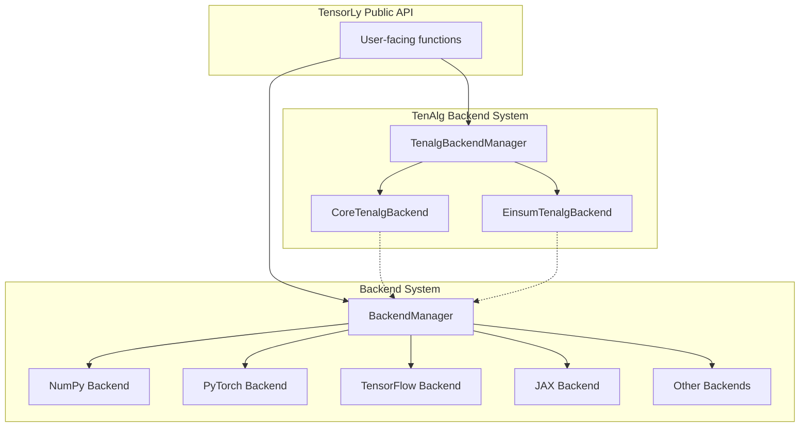
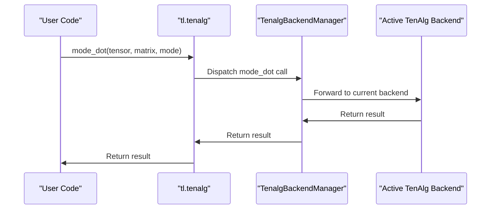
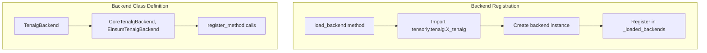

<!-- source: DeepWiki mcp.deepwiki.com · repo tensorly/tensorly · page 2.4 TenAlg Backend · fetched 2026-10-21 -->

# TenAlg Backend

<details>
<summary>Relevant source files</summary>

The following files were used as context for generating this wiki page:

- [doc/modules/api.rst](doc/modules/api.rst)
- [tensorly/decomposition/__init__.py](tensorly/decomposition/__init__.py)
- [tensorly/decomposition/tests/test_robust_decomposition.py](tensorly/decomposition/tests/test_robust_decomposition.py)

</details>


## Purpose and Overview

The TenAlg Backend is a specialized component within TensorLy that handles tensor algebra operations. While the main [Backend System](#2) provides a general abstraction layer for tensor operations across different numerical libraries (NumPy, PyTorch, TensorFlow, etc.), the TenAlg Backend provides different implementations specifically for tensor algebra operations like mode-n products, Kronecker products, and Khatri-Rao products.

This system allows users to choose between different implementations of tensor algebra algorithms based on their performance needs and compatibility requirements, without changing their code.

Sources: [tensorly/tenalg/__init__.py:1-11]()

## Architecture

The TenAlg Backend is structured as a secondary dispatching system built on top of the main Backend system. It uses the `TenalgBackendManager` class to manage and dispatch tensor algebra operations to the appropriate backend implementation.



The `TenalgBackendManager` is implemented as a class that inherits from `BackendManager`, providing similar functionality for managing tensor algebra backends as the main backend system does for numerical backends.

Sources: [tensorly/tenalg/__init__.py:15-36]()

### Dynamic Method Dispatching

When a tensor algebra operation (like `mode_dot` or `khatri_rao`) is called, the `TenalgBackendManager` dynamically dispatches the call to the currently selected backend implementation:



This dispatching is implemented through Python's metaprogramming capabilities, where the `TenalgBackendManager` dynamically creates methods that forward calls to the current backend.

Sources: [tensorly/tenalg/__init__.py:37-60](), [tensorly/tenalg/__init__.py:90-94]()

## Available TenAlg Backends

TensorLy provides two built-in implementations of tensor algebra operations:

1. **Core TenAlg Backend** (default): Direct implementations of tensor operations using basic tensor manipulations
2. **Einsum TenAlg Backend**: Implementations using Einstein summation notation (`einsum`)

### Core TenAlg Backend

The Core TenAlg Backend provides implementations of tensor algebra operations using direct tensor manipulation functions. It's the default backend and is generally more readable and easier to understand.

```python
# Example from Core TenAlg Backend
def unfolding_dot_khatri_rao(tensor, cp_tensor, mode):
    weights, factors = cp_tensor
    kr_factors = khatri_rao(factors, weights=weights, skip_matrix=mode)
    mttkrp = T.dot(unfold(tensor, mode), T.conj(kr_factors))
    return mttkrp
```

Sources: [tensorly/tenalg/core_tenalg/__init__.py:1-30](), [tensorly/tenalg/core_tenalg/mttkrp.py:9-50]()

### Einsum TenAlg Backend

The Einsum TenAlg Backend implements the same operations but uses Einstein summation notation (`einsum`), which can be more concise and sometimes more efficient for certain operations.

```python
# Example from Einsum TenAlg Backend
def unfolding_dot_khatri_rao(tensor, cp_tensor, mode):
    weights, factors = cp_tensor
    ndims = tl.ndim(tensor)
    
    if weights is None:
        weights = tl.ones(factors[0].shape[1], **tl.context(tensor))
    
    tensor_idx = "".join(chr(ord("a") + i) for i in range(ndims))
    rank = chr(ord("a") + ndims + 1)
    op = tensor_idx + "," + rank
    # ... build einsum expression
    return tl.einsum(op, tensor, weights, *factors)
```

Sources: [tensorly/tenalg/einsum_tenalg/__init__.py:1-31](), [tensorly/tenalg/einsum_tenalg/mttkrp.py:6-39]()

### Comparison

| Feature | Core TenAlg | Einsum TenAlg |
|---------|-------------|---------------|
| Implementation style | Direct tensor manipulations | Einstein summation notation |
| Readability | More explicit | More concise but can be harder to understand |
| Memory usage | Sometimes higher (creates intermediate tensors) | Often lower (operations fused) |
| Performance | Good baseline performance | Can be faster for certain operations |
| Default in TensorLy | Yes | No |

## Registered Tensor Operations

The TenAlg Backend system manages a set of fundamental tensor algebra operations that are critical for tensor decompositions and analysis. These operations are registered with each backend implementation.

```mermaid
flowchart TD
    subgraph "TenalgBackendManager"
        TBM["Dispatching System"]
        
        subgraph "Core Operations"
            mode_dot["mode_dot"]
            multi_mode_dot["multi_mode_dot"]
            kronecker["kronecker"]
            khatri_rao["khatri_rao"]
            inner["inner"]
            outer["outer"]
            batched_outer["batched_outer"]
        end
        
        subgraph "Advanced Operations"
            higher_order_moment["higher_order_moment"]
            tt_matrix_to_tensor["_tt_matrix_to_tensor"]
            unfolding_dot_khatri_rao["unfolding_dot_khatri_rao"]
            tensordot["tensordot"]
        end
    end
    
    TBM --> Core Operations
    TBM --> Advanced Operations
```

Sources: [tensorly/tenalg/__init__.py:16-28](), [tensorly/tenalg/core_tenalg/__init__.py:19-29](), [tensorly/tenalg/einsum_tenalg/__init__.py:18-30]()

### Key Operations

- **mode_dot**: Computes the n-mode product of a tensor with a matrix
- **multi_mode_dot**: Computes the n-mode product with several matrices
- **kronecker**: Computes the Kronecker product between matrices
- **khatri_rao**: Computes the Khatri-Rao product between matrices
- **inner**: Computes the inner product between tensors
- **outer**: Computes the outer product between tensors
- **batched_outer**: Computes the outer product between batched tensors
- **tensordot**: Generalized tensor contraction similar to NumPy's tensordot
- **unfolding_dot_khatri_rao**: Optimized operation for MTTKRP (Matricized Tensor Times Khatri-Rao Product), critical for CP decomposition

Sources: [tensorly/tenalg/__init__.py:16-28](), [tensorly/tenalg/core_tenalg/mttkrp.py:9-105](), [tensorly/tenalg/einsum_tenalg/outer_product.py:1-45]()

## Usage

### Selecting a TenAlg Backend

You can select the TenAlg Backend using the `set_backend` method:

```python
import tensorly as tl
import tensorly.tenalg as tlg

# To use the core implementation
tlg.set_backend('core')  # This is the default

# To use the einsum implementation
tlg.set_backend('einsum')
```

The TenAlg Backend can be configured independently of the main backend. For example, you can use PyTorch as the main backend while using either 'core' or 'einsum' as the TenAlg Backend.

### Memory-Efficient Operations

For some operations, TensorLy provides alternative implementations optimized for memory efficiency. For example, the MTTKRP operation has a memory-efficient version that can be used for large tensors:

```python
from tensorly.tenalg.core_tenalg.mttkrp import unfolding_dot_khatri_rao_memory
import tensorly.tenalg as tlg

# Replace the default implementation with the memory-efficient one
tlg.register_backend_method("unfolding_dot_khatri_rao", unfolding_dot_khatri_rao_memory)
tlg.use_dynamic_dispatch()
```

Sources: [tensorly/tenalg/core_tenalg/mttkrp.py:53-104]()

## Implementation Details

### Backend Loading and Registration

The TenAlg Backend system uses a dynamic loading mechanism to register backends and their methods. When a backend is first requested, it's loaded using Python's import system and registered with the `TenalgBackendManager`.



Each backend implementation (like `CoreTenalgBackend` or `EinsumTenalgBackend`) inherits from `TenalgBackend` and registers its method implementations using `register_method`.

Sources: [tensorly/tenalg/__init__.py:61-87](), [tensorly/tenalg/core_tenalg/__init__.py:15-29](), [tensorly/tenalg/einsum_tenalg/__init__.py:14-30]()

### Thread-Local Backend Selection

Like the main Backend system, the TenAlg Backend system uses thread-local storage to maintain the currently selected backend. This allows different threads to use different backends concurrently without interference.

Sources: [tensorly/tenalg/__init__.py:34]()

## Extending the System

You can extend the TenAlg Backend system by creating new backend implementations. To do this, you need to:

1. Create a new module with your backend implementation
2. Define a class that inherits from `TenalgBackend`
3. Register your implementations using `register_method`
4. Make your backend available by adding it to `available_backend_names`

The system is designed to be extensible, allowing researchers and developers to implement and experiment with different tensor algebra algorithms.

## Relationship with Main Backend System

The TenAlg Backend depends on the main Backend system for basic tensor operations but provides specialized implementations for tensor algebra operations. This separation allows TensorLy to optimize tensor algebra operations independently of the underlying numerical library.

Each TenAlg Backend implementation ultimately relies on the functions provided by the main Backend (NumPy, PyTorch, etc.) for fundamental operations like tensor creation, reshaping, and basic arithmetic.

Sources: [tensorly/tenalg/__init__.py:10](), [tensorly/tenalg/core_tenalg/mttkrp.py:3]()

---

