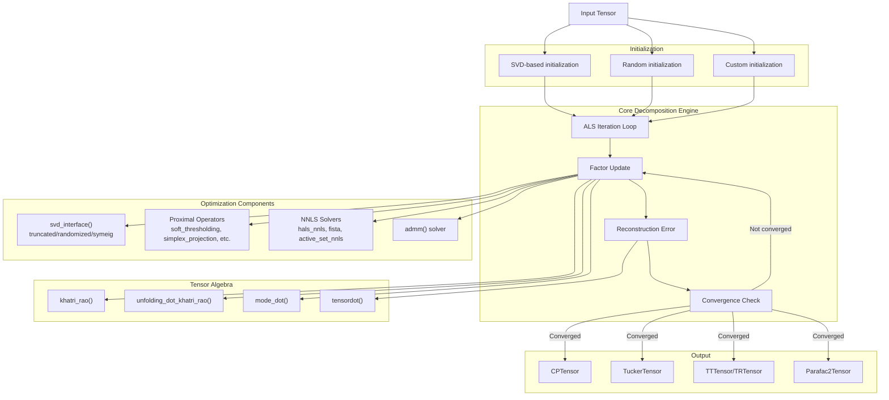
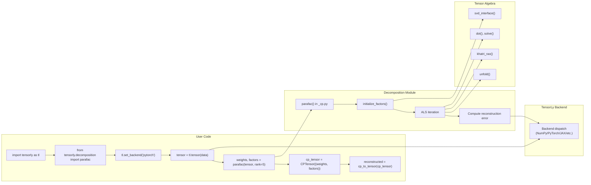

<!-- source: DeepWiki mcp.deepwiki.com · repo tensorly/tensorly · page 3 Tensor Decompositions · fetched 2026-10-21 -->

# Tensor Decompositions

<details>
<summary>Relevant source files</summary>

The following files were used as context for generating this wiki page:

- [doc/modules/api.rst](doc/modules/api.rst)
- [tensorly/decomposition/__init__.py](tensorly/decomposition/__init__.py)
- [tensorly/decomposition/tests/test_robust_decomposition.py](tensorly/decomposition/tests/test_robust_decomposition.py)
- [tensorly/random/__init__.py](tensorly/random/__init__.py)
- [tensorly/random/base.py](tensorly/random/base.py)
- [tensorly/random/tests/test_base.py](tensorly/random/tests/test_base.py)

</details>


## Purpose and Scope

This page provides an overview of tensor decomposition methods available in TensorLy. Tensor decomposition factorizes a high-dimensional tensor into a product of lower-dimensional factors, enabling dimensionality reduction, compression, and feature extraction. This page describes the available decomposition algorithms, their relationships, and guidance on selecting the appropriate method for specific use cases.

For detailed documentation on specific decomposition methods, see:
- CP (PARAFAC) decomposition: [#3.1](#3.1)
- Tucker decomposition: [#3.2](#3.2)
- Tensor Train decomposition: [#3.3](#3.3)
- PARAFAC2 decomposition: [#3.4](#3.4)
- Robust decomposition: [#3.5](#3.5)
- Constrained decompositions: [#3.6](#3.6)

For information on the tensor representation classes that store decomposed tensors, see [Tensor Representations](#4).

**Sources:** [doc/modules/api.rst:319-377](), [tensorly/decomposition/__init__.py:1-34]()

## Decomposition Methods Overview

TensorLy provides multiple tensor decomposition algorithms, each with specific characteristics and use cases. The following table summarizes the available methods:

| Decomposition | Function/Class | Key Features | Tensor Representation | Use Cases |
|---------------|----------------|--------------|----------------------|-----------|
| **CP (PARAFAC)** | `parafac`, `CP` | Sum of rank-1 tensors, unique under mild conditions | `CPTensor` | General-purpose, interpretable components |
| **Non-negative CP** | `non_negative_parafac`, `non_negative_parafac_hals` | CP with non-negativity constraints | `CPTensor` | Count data, positive-only interpretations |
| **Randomized CP** | `randomised_parafac`, `RandomizedCP` | Sampling-based, scalable to large tensors | `CPTensor` | Large-scale data, approximate solutions |
| **Symmetric CP** | `symmetric_parafac_power_iteration`, `SymmetricCP` | Exploits symmetry, power iteration | `CPTensor` | Symmetric tensors, moments |
| **Constrained CP** | `constrained_parafac`, `ConstrainedCP` | ADMM with proximal operators | `CPTensor` | Smoothness, sparsity, custom constraints |
| **Tucker** | `tucker`, `Tucker` | Core tensor with factor matrices (HOOI) | `TuckerTensor` | Higher-order SVD, mode-specific ranks |
| **Partial Tucker** | `partial_tucker` | Tucker on selected modes | `TuckerTensor` | Dimension reduction on specific modes |
| **Non-negative Tucker** | `non_negative_tucker`, `non_negative_tucker_hals` | Tucker with non-negativity | `TuckerTensor` | Non-negative data, parts-based models |
| **Tensor Train (TT)** | `tensor_train`, `TensorTrain` | Sequential factorization, MPS format | `TTTensor` | Large-scale, sequential structure |
| **TT-Matrix** | `tensor_train_matrix`, `TensorTrainMatrix` | TT for matrix-valued tensors | `TTMatrix` | Tensor operations, matrix approximation |
| **Tensor Ring (TR)** | `tensor_ring`, `TensorRing` | Cyclic boundary conditions | `TRTensor` | Circular symmetry, periodic data |
| **PARAFAC2** | `parafac2`, `Parafac2` | Varying mode dimensions, projection matrices | `Parafac2Tensor` | Irregular tensors, time series with varying lengths |
| **Robust PCA** | `robust_pca` | Low-rank + sparse separation | Two tensors | Outlier removal, corruption handling |

**Sources:** [tensorly/decomposition/__init__.py:6-33](), [doc/modules/api.rst:354-377]()

## Decomposition Classes and Functions

The following diagram shows the relationship between decomposition functions, classes, and tensor representations in the codebase:

```mermaid
graph TB
    subgraph "CP Family"
        parafac["parafac()"]
        CP["CP class"]
        non_negative_parafac["non_negative_parafac()"]
        non_negative_parafac_hals["non_negative_parafac_hals()"]
        CP_NN_HALS["CP_NN_HALS class"]
        randomised_parafac["randomised_parafac()"]
        RandomizedCP["RandomizedCP class"]
        symmetric_parafac_power_iteration["symmetric_parafac_power_iteration()"]
        SymmetricCP["SymmetricCP class"]
        constrained_parafac["constrained_parafac()"]
        ConstrainedCP["ConstrainedCP class"]
    end
    
    subgraph "Tucker Family"
        tucker["tucker()"]
        Tucker["Tucker class"]
        partial_tucker["partial_tucker()"]
        non_negative_tucker["non_negative_tucker()"]
        non_negative_tucker_hals["non_negative_tucker_hals()"]
    end
    
    subgraph "Tensor Train Family"
        tensor_train["tensor_train()"]
        TensorTrain["TensorTrain class"]
        tensor_train_matrix["tensor_train_matrix()"]
        TensorTrainMatrix["TensorTrainMatrix class"]
        tensor_ring["tensor_ring()"]
        TensorRing["TensorRing class"]
    end
    
    subgraph "Other Methods"
        parafac2["parafac2()"]
        Parafac2["Parafac2 class"]
        robust_pca["robust_pca()"]
    end
    
    subgraph "Tensor Representations"
        CPTensor["CPTensor\n(weights, factors)"]
        TuckerTensor["TuckerTensor\n(core, factors)"]
        TTTensor["TTTensor\n(factors list)"]
        TTMatrix["TTMatrix\n(factors list)"]
        TRTensor["TRTensor\n(factors list)"]
        Parafac2Tensor["Parafac2Tensor\n(weights, factors, projections)"]
    end
    
    parafac --> CPTensor
    CP --> CPTensor
    non_negative_parafac --> CPTensor
    non_negative_parafac_hals --> CPTensor
    CP_NN_HALS --> CPTensor
    randomised_parafac --> CPTensor
    RandomizedCP --> CPTensor
    symmetric_parafac_power_iteration --> CPTensor
    SymmetricCP --> CPTensor
    constrained_parafac --> CPTensor
    ConstrainedCP --> CPTensor
    
    tucker --> TuckerTensor
    Tucker --> TuckerTensor
    partial_tucker --> TuckerTensor
    non_negative_tucker --> TuckerTensor
    non_negative_tucker_hals --> TuckerTensor
    
    tensor_train --> TTTensor
    TensorTrain --> TTTensor
    tensor_train_matrix --> TTMatrix
    TensorTrainMatrix --> TTMatrix
    tensor_ring --> TRTensor
    TensorRing --> TRTensor
    
    parafac2 --> Parafac2Tensor
    Parafac2 --> Parafac2Tensor
```



**Sources:** [tensorly/decomposition/__init__.py:6-33](), [doc/modules/api.rst:328-349]()

## Decomposition Architecture

The decomposition system in TensorLy follows a consistent architecture with shared infrastructure. The following diagram illustrates the common workflow and components:



**Sources:** [tensorly/decomposition/__init__.py:1-34](), [doc/modules/api.rst:319-377]()

## Common Decomposition Parameters

Most decomposition functions share a common set of parameters that control the factorization process:

| Parameter | Type | Description | Default |
|-----------|------|-------------|---------|
| `rank` | int or tuple | Target rank(s) for the decomposition | Required |
| `n_iter_max` | int | Maximum number of iterations | Varies by method |
| `init` | str or tensor | Initialization method: 'svd', 'random', or custom factors | 'svd' |
| `tol` | float | Convergence tolerance based on reconstruction error | 1e-8 |
| `random_state` | int or RandomState | Seed for reproducibility | None |
| `verbose` | bool or int | Print iteration progress | False |
| `return_errors` | bool | Return reconstruction errors per iteration | False |
| `mask` | ndarray | Binary mask for missing values (0 = missing) | None |
| `svd` | str | SVD algorithm: 'numpy_svd', 'truncated_svd', 'randomized_svd', 'symeig_svd' | 'numpy_svd' |

Additional parameters specific to certain methods:
- **Non-negative methods**: `nn_modes` (which modes to constrain), solver options
- **Constrained methods**: `proximal_operators` (dict of constraints per mode)
- **PARAFAC2**: `nn_modes`, `normalize_factors`, `linesearch`
- **Robust PCA**: `reg_E` (regularization), `mu_max`, `learning_rate`

**Sources:** [doc/modules/api.rst:354-377]()

## Decomposition Workflow in Code

The following diagram shows the typical code flow when applying a decomposition:



**Sources:** [tensorly/decomposition/__init__.py:1-34](), [doc/modules/api.rst:354-377]()

## Choosing a Decomposition Method

The choice of decomposition method depends on several factors:

### By Data Characteristics

**Full Dense Tensors**
- Standard use case: `parafac()` or `tucker()`
- Large-scale: `randomised_parafac()` with sampling

**Sparse or Missing Data**
- Any method with `mask` parameter
- Robust to outliers: `robust_pca()`

**Non-negative Data**
- Count data, images: `non_negative_parafac()`, `non_negative_parafac_hals()`
- Tucker variant: `non_negative_tucker()`, `non_negative_tucker_hals()`

**Irregular Shape (varying mode dimensions)**
- PARAFAC2: `parafac2()`

**Symmetric Tensors**
- Exploits symmetry: `symmetric_parafac_power_iteration()`

### By Decomposition Structure

**Rank-1 Components (sum of outer products)**
- CP family: `parafac()`, `non_negative_parafac()`, etc.
- Pro: Interpretable, unique under conditions
- Con: Fixed rank across all modes

**Core Tensor with Factor Matrices**
- Tucker family: `tucker()`, `partial_tucker()`
- Pro: Different rank per mode, more flexible
- Con: Larger storage (core tensor)

**Sequential Factorization**
- Tensor Train: `tensor_train()`, `tensor_ring()`
- Pro: Extremely efficient for high-order tensors
- Con: Less interpretable

**Variable-Length Modes**
- PARAFAC2: `parafac2()`
- Pro: Handles irregular tensors
- Con: More complex, requires projection matrices

### By Constraints

**Custom Constraints (sparsity, smoothness, etc.)**
- Use: `constrained_parafac()` with proximal operators
- See [Constrained Decompositions](#3.6)

**Non-negativity Only**
- Use specialized: `non_negative_parafac()` or `non_negative_parafac_hals()`
- Generally faster than constrained variant

**Sources:** [doc/modules/api.rst:319-377](), [tensorly/decomposition/__init__.py:1-34]()

## Random Tensor Generation

TensorLy provides functions to generate random tensors in decomposed form, useful for testing and simulations:

| Function | Module | Description |
|----------|--------|-------------|
| `random_cp()` | `tensorly.random` | Random CP tensor with specified rank |
| `random_tucker()` | `tensorly.random` | Random Tucker tensor with core and factors |
| `random_tt()` | `tensorly.random` | Random Tensor Train with boundary conditions |
| `random_tt_matrix()` | `tensorly.random` | Random TT-Matrix format |
| `random_tr()` | `tensorly.random` | Random Tensor Ring with cyclic boundary |
| `random_parafac2()` | `tensorly.random` | Random PARAFAC2 with projection matrices |

**Example Usage:**
```python
import tensorly as tl
from tensorly.random import random_cp

# Generate random CP tensor
shape = (10, 15, 20)
rank = 5
cp_tensor = random_cp(shape, rank, full=False, orthogonal=True)
weights, factors = cp_tensor

# Generate full tensor
full_tensor = random_cp(shape, rank, full=True)
```

**Sources:** [tensorly/random/base.py:1-323](), [tensorly/random/__init__.py:1-10]()

## Decomposition Classes vs Functions

TensorLy provides both functional and object-oriented APIs for decompositions:

**Functional API** (recommended for simple use cases):
```python
from tensorly.decomposition import parafac
weights, factors = parafac(tensor, rank=5, n_iter_max=100)
```

**Class-based API** (recommended for integration with scikit-learn):
```python
from tensorly.decomposition import CP
estimator = CP(rank=5, n_iter_max=100)
cp_tensor = estimator.fit_transform(tensor)
# Access fitted parameters
weights = estimator.weights_
factors = estimator.factors_
```

The class-based API follows scikit-learn conventions with `fit()`, `transform()`, and `fit_transform()` methods, making it compatible with scikit-learn pipelines and cross-validation utilities.

**Available Classes:**
- `CP`, `RandomizedCP`, `CPPower`, `CP_NN_HALS`, `SymmetricCP`, `ConstrainedCP`
- `Tucker`
- `TensorTrain`, `TensorTrainMatrix`, `TensorRing`, `TensorRingALS`, `TensorRingALSSampled`
- `Parafac2`

**Sources:** [tensorly/decomposition/__init__.py:6-33](), [doc/modules/api.rst:328-349]()

## Shared Infrastructure Components

All decomposition methods leverage common infrastructure:

### Initialization Methods

Available via the `init` parameter:
- `'svd'`: SVD-based initialization (default, recommended)
- `'random'`: Random initialization
- Custom: Pass pre-initialized factors as tuple

**Sources:** [tensorly/decomposition/__init__.py:1-34]()

### SVD Interface

Unified interface `svd_interface()` in [tensorly.tenalg.svd]() supports:
- `'numpy_svd'`: Standard full SVD
- `'truncated_svd'`: Truncated SVD for large matrices
- `'randomized_svd'`: Randomized SVD (scalable)
- `'symeig_svd'`: Symmetric eigenvalue decomposition

**Sources:** [doc/modules/api.rst:274-281]()

### Proximal Operators

Available in [tensorly.tenalg.proximal]():
- `soft_thresholding()`: L1 sparsity
- `svd_thresholding()`: Nuclear norm
- `procrustes()`: Orthogonality
- Plus 9+ additional operators for various constraints

See [Proximal Operators](#5.2) for complete reference.

**Sources:** [doc/modules/api.rst:298-301]()

### NNLS Solvers

Non-negative least squares solvers in [tensorly.solvers.nnls]():
- `hals_nnls()`: Hierarchical Alternating Least Squares
- `fista()`: Fast Iterative Shrinkage-Thresholding
- `active_set_nnls()`: Active set method

**Sources:** [doc/modules/api.rst:425-432]()

### Error Calculation

All methods compute reconstruction error: `||X - X_reconstructed||_F / ||X||_F`

Enable error tracking with `return_errors=True`:
```python
cp_tensor, errors = parafac(tensor, rank=5, return_errors=True)
# errors is a list of reconstruction errors per iteration
```

## Integration with Other Systems

### Backend System

All decompositions are backend-agnostic and work with any configured backend (NumPy, PyTorch, JAX, TensorFlow, CuPy, Paddle). See [Backend System](#2).

```python
import tensorly as tl
tl.set_backend('pytorch')
# All decomposition functions now use PyTorch tensors
```

### Tensor Representations

Decomposition outputs are stored in specialized tensor classes (e.g., `CPTensor`, `TuckerTensor`) that provide operations like:
- `to_tensor()`: Reconstruct full tensor
- `to_vec()`: Vectorize
- `to_unfolded(mode)`: Unfold along mode
- `mode_dot()`: Contract with matrix

See [Tensor Representations](#4) for details.

**Sources:** [doc/modules/api.rst:162-258]()

### Regression

CP decomposition is used in tensor regression methods:
- `CPRegressor`: Tensor-to-scalar regression
- `CP_PLSR`: Partial Least Squares Regression

See [Regression and Applications](#7).

**Sources:** [doc/modules/api.rst:396-412]()

## Next Steps

For detailed information on specific decomposition methods:
- [CP Decomposition](#3.1) - Standard PARAFAC, non-negative variants, randomized methods
- [Tucker Decomposition](#3.2) - HOOI, partial Tucker, non-negative Tucker
- [Tensor Train Decomposition](#3.3) - TT, TT-Matrix, Tensor Ring
- [PARAFAC2 Decomposition](#3.4) - Variable mode dimensions, projection matrices
- [Robust Decomposition](#3.5) - Low-rank + sparse separation
- [Constrained Decompositions](#3.6) - ADMM framework with proximal operators

For understanding tensor representations:
- [Tensor Representations](#4) - Data structures for decomposed tensors

For backend configuration:
- [Backend System](#2) - Multi-framework support

---

