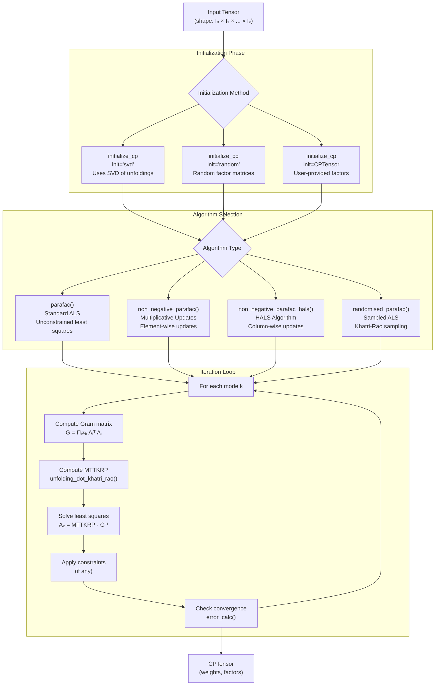
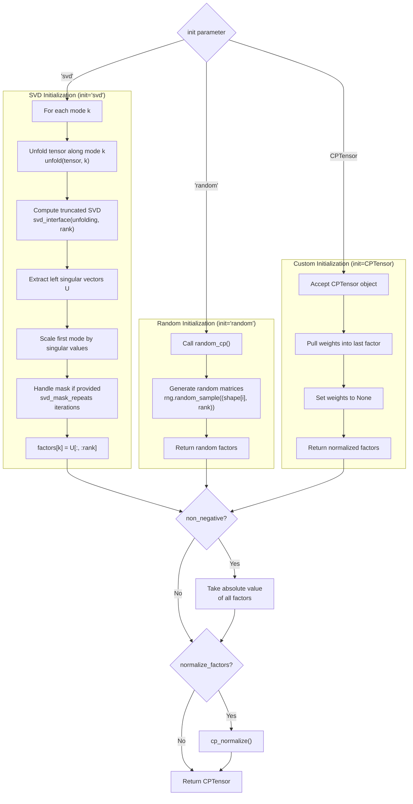
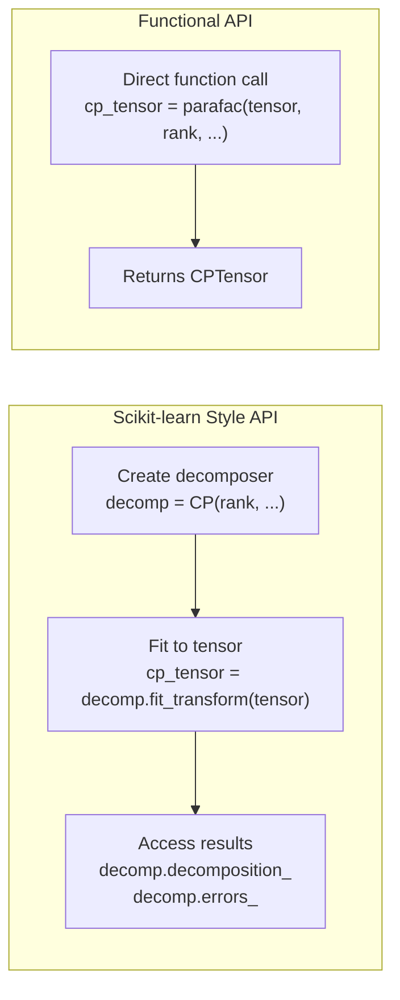

<!-- source: DeepWiki mcp.deepwiki.com · repo tensorly/tensorly · page 3.1 CP Decomposition · fetched 2026-10-21 -->

# CP Decomposition

<details>
<summary>Relevant source files</summary>

The following files were used as context for generating this wiki page:

- [tensorly/decomposition/_cp.py](tensorly/decomposition/_cp.py)
- [tensorly/decomposition/_nn_cp.py](tensorly/decomposition/_nn_cp.py)
- [tensorly/decomposition/tests/test_cp.py](tensorly/decomposition/tests/test_cp.py)
- [tensorly/random/__init__.py](tensorly/random/__init__.py)
- [tensorly/random/base.py](tensorly/random/base.py)
- [tensorly/random/tests/test_base.py](tensorly/random/tests/test_base.py)

</details>


## Purpose and Scope

This page documents the Canonical Polyadic (CP) decomposition, also known as CANDECOMP/PARAFAC, in TensorLy. CP decomposition factorizes a tensor into a sum of rank-one tensors, representing the tensor as `tensor = [|weights; factors[0], ..., factors[-1] |]` where each factor is a matrix and weights is a vector.

The page covers:
- Standard CP decomposition via Alternating Least Squares (ALS)
- Non-negative variants using multiplicative updates and HALS
- Randomized/sampled CP decomposition
- Initialization methods (SVD, random, custom)
- Implementation details including convergence, masking, and sparsity

For information about the CPTensor data structure and operations, see [CPTensor Class](#4.1). For constrained CP decomposition using ADMM and proximal operators, see [Constrained Decompositions](#3.6). For CP-based regression methods, see [CP Regression](#7.1) and [CP-PLSR](#7.2).

---

## CP Decomposition Overview

CP decomposition approximates a tensor as a sum of `rank` rank-one tensors. Given a tensor of shape `(I₀, I₁, ..., Iₙ)`, CP decomposition finds factor matrices `A⁽⁰⁾, A⁽¹⁾, ..., A⁽ⁿ⁾` where `A⁽ᵏ⁾` has shape `(Iₖ, rank)`, such that:

```
tensor ≈ Σᵣ wᵣ · a⁽⁰⁾ᵣ ∘ a⁽¹⁾ᵣ ∘ ... ∘ a⁽ⁿ⁾ᵣ
```

where `∘` denotes the outer product and `wᵣ` are weights.

### CP Decomposition Algorithm Family



**Sources:** [tensorly/decomposition/_cp.py:230-543](), [tensorly/decomposition/_nn_cp.py:26-183](), [tensorly/decomposition/_nn_cp.py:186-379]()

---

## Main CP Functions and Classes

### Function/Class Mapping

| Function/Class | Location | Purpose | Algorithm |
|---|---|---|---|
| `parafac()` | [_cp.py:230-543]() | Standard CP decomposition | ALS with least squares |
| `CP` | [_cp.py:765-916]() | Scikit-learn style wrapper | Wraps `parafac()` |
| `non_negative_parafac()` | [_nn_cp.py:26-183]() | Non-negative CP | Multiplicative updates |
| `CP_NN` | [_nn_cp.py:382-515]() | Wrapper for NN-CP | Wraps `non_negative_parafac()` |
| `non_negative_parafac_hals()` | [_nn_cp.py:186-379]() | Non-negative CP via HALS | Hierarchical ALS |
| `CP_NN_HALS` | [_nn_cp.py:517-656]() | Wrapper for NN-CP-HALS | Wraps `non_negative_parafac_hals()` |
| `randomised_parafac()` | [_cp.py:633-762]() | Randomized CP | Sampled Khatri-Rao ALS |
| `RandomizedCP` | [_cp.py:918-1010]() | Wrapper for randomized CP | Wraps `randomised_parafac()` |
| `initialize_cp()` | [_cp.py:26-137]() | Factor initialization | SVD, random, or custom |

**Sources:** [tensorly/decomposition/_cp.py:1-1010](), [tensorly/decomposition/_nn_cp.py:1-657]()

---

## Standard CP Decomposition (parafac)

The `parafac()` function implements the standard CP decomposition using Alternating Least Squares (ALS).

### Core Algorithm Flow

```mermaid
graph LR
    subgraph "parafac() Main Loop"
        Init["Initialize factors<br/>initialize_cp()"]
        FixedCheck{"Check fixed_modes"}
        ModeIter["Iterate modes<br/>(skip fixed modes)"]
        
        subgraph "Per-Mode Update"
            PseudoInv["Compute pseudo-inverse<br/>G = Πᵢ≠ₖ (AᵢᵀAᵢ) ⊙ (w ⊗ w)"]
            MTTKRP["Compute MTTKRP<br/>unfolding_dot_khatri_rao()"]
            Solve["Solve system<br/>tl.solve(Gᵀ, MTTKRPᵀ)ᵀ"]
            UpdateFactor["factors[mode] = solution"]
        end
        
        LineSearch{"linesearch<br/>enabled?"}
        Extrapolate["Extrapolate factors<br/>new = old + jump*(cur-old)"]
        TestError["Test extrapolated error"]
        AcceptReject{"Error<br/>improved?"}
        
        ErrorCalc["error_calc()<br/>Compute reconstruction error"]
        Converged{"Converged?<br/>|Δerror| < tol"}
        Normalize{"normalize_factors?"}
        NormalizeOp["cp_normalize()"]
    end
    
    Init --> FixedCheck
    FixedCheck --> ModeIter
    ModeIter --> PseudoInv
    PseudoInv --> MTTKRP
    MTTKRP --> Solve
    Solve --> UpdateFactor
    UpdateFactor --> LineSearch
    
    LineSearch -->|Yes| Extrapolate
    LineSearch -->|No| ErrorCalc
    Extrapolate --> TestError
    TestError --> AcceptReject
    AcceptReject -->|Accept| ErrorCalc
    AcceptReject -->|Reject| ErrorCalc
    
    ErrorCalc --> Converged
    Converged -->|No| Normalize
    Converged -->|Yes| End["Return CPTensor"]
    Normalize -->|Yes| NormalizeOp
    Normalize -->|No| ModeIter
    NormalizeOp --> ModeIter
```



**Sources:** [tensorly/decomposition/_cp.py:230-543]()

### Key Parameters

| Parameter | Type | Default | Description |
|---|---|---|---|
| `tensor` | ndarray | Required | Input tensor to decompose |
| `rank` | int | Required | Number of components (rank of decomposition) |
| `n_iter_max` | int | 100 | Maximum iterations |
| `init` | str or CPTensor | 'svd' | Initialization method: 'svd', 'random', or CPTensor |
| `svd` | str | 'truncated_svd' | SVD algorithm to use for initialization |
| `normalize_factors` | bool | False | Aggregate factor norms into weights |
| `orthogonalise` | bool or int | False | Orthogonalize factors (if int, number of iterations) |
| `tol` | float | 1e-8 | Convergence tolerance |
| `mask` | ndarray | None | Boolean mask for missing values (1=observed, 0=missing) |
| `cvg_criterion` | str | 'abs_rec_error' | 'abs_rec_error' or 'rec_error' |
| `sparsity` | float or int | None | Fraction/count of non-zero elements in sparse component |
| `l2_reg` | float | 0 | L2 regularization coefficient |
| `fixed_modes` | list | None | Modes to keep fixed during optimization |
| `linesearch` | bool | False | Enable line search acceleration |
| `callback` | callable | None | Callback function called each iteration |

**Sources:** [tensorly/decomposition/_cp.py:230-322]()

### Return Value

Returns a `CPTensor` object `(weights, factors)` where:
- `weights`: 1D array of shape `(rank,)` - all ones if `normalize_factors=False`, otherwise contains factor norms
- `factors`: List of N factor matrices, where `factors[i]` has shape `(tensor.shape[i], rank)`

If `sparsity` is not None, returns tuple `(CPTensor, sparse_component)`.

**Sources:** [tensorly/decomposition/_cp.py:300-310]()

---

## Initialization Methods

The `initialize_cp()` function provides three initialization strategies:

### Initialization Strategy Comparison



**Sources:** [tensorly/decomposition/_cp.py:26-137]()

### Initialization Modes

**SVD Initialization (`init='svd'`)**
- Performs SVD on each mode's unfolding
- Uses left singular vectors as initial factors
- First mode scaled by singular values for better scaling
- Supports masked tensors with repeated SVD (`svd_mask_repeats`)
- Most reliable for well-conditioned problems

**Random Initialization (`init='random'`)**
- Generates random factor matrices using `random_cp()`
- Uses uniform distribution `[0, 1)`
- Requires `random_state` parameter for reproducibility
- Faster but may require more iterations

**Custom Initialization (`init=CPTensor`)**
- Accepts pre-computed CPTensor as initialization
- Redistributes weights into factors
- Useful for warm starts or continuing optimization

**Sources:** [tensorly/decomposition/_cp.py:26-137](), [tensorly/random/base.py:64-114]()

---

## Non-Negative CP Variants

TensorLy provides two algorithms for non-negative CP decomposition, ensuring all factor matrices contain only non-negative values.

### Non-Negative Algorithms Comparison

| Feature | `non_negative_parafac()` | `non_negative_parafac_hals()` |
|---|---|---|
| **Algorithm** | Multiplicative Updates | Hierarchical ALS (HALS) |
| **Update Rule** | Element-wise multiplicative | Column-wise least squares |
| **Constraint** | All modes non-negative | Configurable via `nn_modes` |
| **Sparsity** | Not supported | Supported via `sparsity_coefficients` |
| **Speed** | Slower convergence | Faster convergence |
| **Unconstrained modes** | Not supported | Supported (uses standard LS) |
| **Function** | [_nn_cp.py:26-183]() | [_nn_cp.py:186-379]() |
| **Class** | `CP_NN` [_nn_cp.py:382-515]() | `CP_NN_HALS` [_nn_cp.py:517-656]() |

**Sources:** [tensorly/decomposition/_nn_cp.py:1-657]()

### Multiplicative Updates Algorithm

The `non_negative_parafac()` function uses the multiplicative update rule from Shashua & Hazan (2005):

```
A_k^(new) = A_k^(old) ⊙ (numerator / denominator)
```

where:
- `numerator = MTTKRP` (clipped to be positive)
- `denominator = A_k · G` (where G is the Gram matrix, clipped to be positive)

```mermaid
graph TB
    subgraph "non_negative_parafac() Per-Mode Update"
        Start["Mode k iteration"]
        ComputeAccum["Compute accumulator<br/>accum = Πᵢ≠ₖ (Aᵢᵀ Aᵢ)"]
        WeightAccum["Weight accumulator<br/>accum = (w ⊗ w) ⊙ accum"]
        UpdateMask{"mask<br/>provided?"}
        FillMask["Fill masked values<br/>tensor = tensor⊙mask + cp_to_tensor()⊙(1-mask)"]
        ComputeMTTKRP["MTTKRP = unfolding_dot_khatri_rao()"]
        ClipNum["numerator = clip(MTTKRP, min=ε)"]
        ComputeDenom["denominator = Aₖ · accum"]
        ClipDenom["denominator = clip(denom, min=ε)"]
        Multiply["Aₖ = Aₖ ⊙ (numerator / denominator)"]
        NormCheck{"normalize_factors<br/>and not last mode?"}
        Normalize["cp_normalize()"]
        ErrorCheck["error_calc()"]
    end
    
    Start --> ComputeAccum
    ComputeAccum --> WeightAccum
    WeightAccum --> UpdateMask
    UpdateMask -->|Yes| FillMask
    UpdateMask -->|No| ComputeMTTKRP
    FillMask --> ComputeMTTKRP
    ComputeMTTKRP --> ClipNum
    ClipNum --> ComputeDenom
    ComputeDenom --> ClipDenom
    ClipDenom --> Multiply
    Multiply --> NormCheck
    NormCheck -->|Yes| Normalize
    NormCheck -->|No| ErrorCheck
    Normalize --> ErrorCheck
```



**Key Implementation Details:**
- Uses `epsilon = tl.eps(tensor.dtype)` for numerical stability
- Clips numerator and denominator to avoid division by zero
- Supports `fixed_modes` to keep certain factors unchanged
- Last mode cannot be fixed (needed for error computation)

**Sources:** [tensorly/decomposition/_nn_cp.py:26-183]()

### HALS Algorithm

The `non_negative_parafac_hals()` function uses Hierarchical ALS, updating each factor column-by-column:

```mermaid
graph TB
    subgraph "non_negative_parafac_hals() Column-wise Update"
        Start["Mode k iteration"]
        BuildGram["Build Gram matrix<br/>G = Πᵢ≠ₖ (Aᵢᵀ Aᵢ)"]
        WeightGram["G = (w ⊗ w) ⊙ G"]
        MTTKRP["MTTKRP = unfolding_dot_khatri_rao()"]
        
        CheckMode{"mode in<br/>nn_modes?"}
        
        subgraph "Non-negative mode"
            CallHALS["Call hals_nnls()<br/>from tensorly.solvers.nnls"]
            TransposeIn["Input: MTTKRPᵀ, G, Aₖᵀ"]
            HALSIterate["HALS iterations<br/>Column-wise NNLS"]
            ApplySparsity["Apply sparsity if specified"]
            TransposeOut["Transpose result"]
        end
        
        subgraph "Unconstrained mode"
            StandardLS["Solve tl.solve(Gᵀ, MTTKRPᵀ)"]
            NoConstraint["No non-negativity constraint"]
        end
        
        Update["Update factors[k]"]
        NormCheck{"normalize_factors?"}
        Normalize["cp_normalize()"]
        ErrorCalc["Compute error using<br/>cp_norm() and inner product"]
    end
    
    Start --> BuildGram
    BuildGram --> WeightGram
    WeightGram --> MTTKRP
    MTTKRP --> CheckMode
    
    CheckMode -->|Yes| CallHALS
    CheckMode -->|No| StandardLS
    
    CallHALS --> TransposeIn
    TransposeIn --> HALSIterate
    HALSIterate --> ApplySparsity
    ApplySparsity --> TransposeOut
    TransposeOut --> Update
    
    StandardLS --> NoConstraint
    NoConstraint --> Update
    
    Update --> NormCheck
    NormCheck -->|Yes| Normalize
    NormCheck -->|No| ErrorCalc
    Normalize --> ErrorCalc
```



**Key Features:**
- `nn_modes`: Specify which modes to constrain (default: 'all')
- `sparsity_coefficients`: Per-mode sparsity penalties
- `exact`: If True, uses exact HALS (slower but more precise)
- Uses `hals_nnls()` solver from [tensorly/solvers/nnls.py]()
- Allows mixing constrained and unconstrained modes

**Sources:** [tensorly/decomposition/_nn_cp.py:186-379](), [tensorly/solvers/nnls.py]()

---

## Randomized CP Decomposition

The `randomised_parafac()` function implements a sampling-based CP decomposition that scales better for large tensors.

### Randomized Algorithm Overview

```mermaid
graph TB
    subgraph "randomised_parafac() Iteration"
        Init["Initialize factors<br/>initialize_cp()"]
        ModeLoop["For each mode k"]
        
        subgraph "Sampled Update"
            SampleKR["Sample Khatri-Rao product<br/>sample_khatri_rao()<br/>n_samples rows"]
            BuildIndices["Build index list<br/>Skip mode k, keep all for mode k"]
            ExtractSlice["Extract tensor slice<br/>tensor[indices_list]"]
            ComputePseudo["Compute pseudo-inverse<br/>KRᵀ · KR"]
            ComputeFactor["factor = KRᵀ · sampled_unfolding"]
            SolveSystem["Solve: pseudo_inv⁻¹ · factor"]
            TransposeResult["Transpose to get Aₖ"]
        end
        
        ErrorCheck{"max_stagnation<br/>or tol?"}
        FullError["Compute full reconstruction error<br/>||tensor - cp_to_tensor()||"]
        CheckStag{"Stagnation<br/>count"}
        CheckTol{"Error<br/>decrease < tol?"}
        Continue["Continue iterations"]
        Stop["Stop: converged"]
    end
    
    Init --> ModeLoop
    ModeLoop --> SampleKR
    SampleKR --> BuildIndices
    BuildIndices --> ExtractSlice
    ExtractSlice --> ComputePseudo
    ComputePseudo --> ComputeFactor
    ComputeFactor --> SolveSystem
    SolveSystem --> TransposeResult
    TransposeResult --> ErrorCheck
    
    ErrorCheck -->|Yes| FullError
    ErrorCheck -->|No| Continue
    FullError --> CheckStag
    CheckStag --> CheckTol
    CheckTol -->|No| Continue
    CheckTol -->|Yes| Stop
    Continue --> ModeLoop
```



**Sources:** [tensorly/decomposition/_cp.py:633-762]()

### Khatri-Rao Sampling

The `sample_khatri_rao()` function samples rows from the Khatri-Rao product without computing the full product:

**Algorithm:**
1. For each factor matrix, randomly sample `n_samples` row indices
2. For sampled indices `(i₁, i₂, ..., iₙ)`, compute row of KR product as element-wise product: `KR[row] = factors[0][i₁] ⊙ factors[1][i₂] ⊙ ... ⊙ factors[n][iₙ]`
3. Return sampled KR matrix of shape `(n_samples, rank)`

**Key Parameters:**
- `n_samples`: Number of rows to sample (balance between accuracy and speed)
- `random_state`: For reproducible sampling
- `return_sampled_rows`: If True, also return the corresponding full KR row indices

**Sources:** [tensorly/decomposition/_cp.py:546-630]()

### When to Use Randomized CP

**Advantages:**
- Much faster for large tensors (avoids materializing full Khatri-Rao products)
- Memory efficient
- Provably approximates standard CP

**Disadvantages:**
- Requires more iterations to converge
- Less accurate than standard CP
- Requires tuning `n_samples` parameter

**Typical Usage:**
```python
# Large tensor where standard CP is too slow
large_tensor = tl.tensor(np.random.randn(1000, 1000, 1000))

cp_tensor = randomised_parafac(
    large_tensor,
    rank=10,
    n_samples=500,  # Sample 500 rows per iteration
    n_iter_max=100,
    max_stagnation=20
)
```

**Sources:** [tensorly/decomposition/_cp.py:633-762](), [tensorly/decomposition/tests/test_cp.py:482-520]()

---

## Advanced Features

### Masked/Missing Values

CP decomposition supports missing values through the `mask` parameter:

**Mask Format:**
- Boolean array same shape as tensor
- `1` or `True`: observed value
- `0` or `False`: missing value

**Algorithm Behavior:**
1. During each iteration, masked values are filled with current reconstruction
2. Tensor is updated: `tensor = tensor * mask + cp_to_tensor() * (1-mask)`
3. Norm is recomputed with updated tensor
4. This effectively imputes missing values based on current factors

**Initialization with Mask:**
- `svd_mask_repeats`: Performs SVD initialization multiple times to reduce bias from missing values
- Higher values = better initialization but slower

**Example:**
```python
# Tensor with missing values
tensor = tl.tensor(data)
mask = tl.tensor(observed_mask)  # 1 where data is observed, 0 where missing

cp_tensor = parafac(
    tensor,
    rank=5,
    mask=mask,
    svd_mask_repeats=10  # Perform SVD 10 times for better init
)
```

**Sources:** [tensorly/decomposition/_cp.py:280-284](), [tensorly/decomposition/_cp.py:294-296](), [tensorly/decomposition/_cp.py:194-200]()

### Sparse Component Separation

The `sparsity` parameter enables decomposing a tensor into low-rank + sparse components:

```
tensor ≈ cp_to_tensor((weights, factors)) + sparse_component
```

**Sparsity Parameter:**
- If float (0.0 to 1.0): fraction of non-zero elements
- If int: absolute number of non-zero elements

**Algorithm:**
1. Perform standard CP iteration
2. Compute residual: `residual = tensor - cp_to_tensor()`
3. Keep only largest `sparsity` elements in absolute value (via `sparsify_tensor()`)
4. This forms the sparse component

**Use Cases:**
- Robust decomposition when tensor contains outliers or sparse noise
- Separating structured low-rank patterns from sparse anomalies

**Sources:** [tensorly/decomposition/_cp.py:140-159](), [tensorly/decomposition/_cp.py:289-290]()

### Fixed Modes

The `fixed_modes` parameter allows keeping certain factor matrices fixed during optimization:

**Implementation:**
- Provide list of mode indices to keep fixed (e.g., `[0, 2]`)
- These modes skip the update step in the ALS loop
- Last mode cannot be fixed (required for error computation)

**Use Cases:**
- Transfer learning: fix learned factors, optimize others
- Constrained decomposition: enforce known structure in certain modes
- Incremental learning: add new modes while keeping others fixed

**Example:**
```python
# Initialize with specific factors for modes 0 and 1
init_tensor = CPTensor((None, [factor_0, factor_1, random_factor_2]))

cp_tensor = parafac(
    tensor,
    rank=5,
    init=init_tensor,
    fixed_modes=[0, 1]  # Only optimize mode 2
)
```

**Sources:** [tensorly/decomposition/_cp.py:291-293](), [tensorly/decomposition/_cp.py:356-370]()

### Line Search Acceleration

When `linesearch=True`, the algorithm performs extrapolation to accelerate convergence:

**Algorithm (Bro's acceleration):**
1. Store factors from previous iteration: `factors_last`
2. Compute current factors: `factors`
3. Extrapolate: `factors_new = factors_last + jump * (factors - factors_last)`
   - `jump = iteration^(1/acc_pow)` where `acc_pow` starts at 2.0
4. Test if extrapolated factors reduce error
5. If yes: accept and reset fail counter
6. If no: reject, increment fail counter, increase `acc_pow` after max_fail failures

**Performance:**
- Can significantly speed up convergence (fewer iterations)
- Most effective after initial iterations (activated after iteration 5)
- Only performs extrapolation every 2nd iteration

**Sources:** [tensorly/decomposition/_cp.py:297-299](), [tensorly/decomposition/_cp.py:333-336](), [tensorly/decomposition/_cp.py:447-484]()

### Convergence Criteria

Two convergence criteria are supported via `cvg_criterion`:

| Criterion | Formula | When to Use |
|---|---|---|
| `'abs_rec_error'` (default) | `|error[t] - error[t-1]| < tol` | Stable, absolute improvement |
| `'rec_error'` | `error[t] - error[t-1] < tol` | Relative improvement, may oscillate |

**Error Calculation Methods:**

The `error_calc()` function computes reconstruction error using two strategies:

1. **When mask or mttkrp=None**: Full reconstruction
   ```
   error = ||tensor - cp_to_tensor()||
   ```

2. **When mttkrp available and no mask**: Efficient computation
   ```
   error = sqrt(||tensor||² + ||CP||² - 2⟨tensor, CP⟩)
   where ⟨tensor, CP⟩ = sum(mttkrp * factors[-1])
   ```

**Sources:** [tensorly/decomposition/_cp.py:285-288](), [tensorly/decomposition/_cp.py:162-227]()

---

## Class-Based API

TensorLy provides scikit-learn style class wrappers for all CP variants:

### Class Usage Pattern



**Available Classes:**
- `CP`: Standard CP via ALS
- `CP_NN`: Non-negative CP via multiplicative updates
- `CP_NN_HALS`: Non-negative CP via HALS
- `RandomizedCP`: Randomized/sampled CP

**Common Pattern:**
```python
# Create decomposer with hyperparameters
decomposer = CP(rank=10, n_iter_max=100, tol=1e-6)

# Fit to data
cp_tensor = decomposer.fit_transform(tensor)

# Access stored results
errors = decomposer.errors_
final_decomposition = decomposer.decomposition_
```

**Sources:** [tensorly/decomposition/_cp.py:765-916](), [tensorly/decomposition/_nn_cp.py:382-515](), [tensorly/decomposition/_nn_cp.py:517-656]()

---

## Implementation Architecture

### Key Internal Functions

```mermaid
graph TB
    subgraph "Core Operations"
        UnfoldDotKR["unfolding_dot_khatri_rao()<br/>Compute MTTKRP efficiently<br/>tensor.tenalg"]
        CPToTensor["cp_to_tensor()<br/>Reconstruct full tensor<br/>tensor.cp_tensor"]
        CPNorm["cp_norm()<br/>Frobenius norm of CP<br/>tensor.cp_tensor"]
        CPNormalize["cp_normalize()<br/>Normalize factors<br/>tensor.cp_tensor"]
        ValidateRank["validate_cp_rank()<br/>Check rank validity<br/>tensor.cp_tensor"]
    end
    
    subgraph "Initialization"
        InitCP["initialize_cp()<br/>SVD/Random/Custom"]
        SVDInterface["svd_interface()<br/>Unified SVD API<br/>tensor.tenalg.svd"]
        UnfoldOp["unfold()<br/>Matricization<br/>tensor.base"]
        RandomCP["random_cp()<br/>Generate random CP<br/>tensor.random"]
    end
    
    subgraph "Error Calculation"
        ErrorCalc["error_calc()<br/>Compute reconstruction error"]
        NormOp["tl.norm()<br/>Tensor norm<br/>Backend operation"]
        SparsifyOp["sparsify_tensor()<br/>Keep top-k elements"]
    end
    
    subgraph "Backend Operations"
        DotOp["tl.dot()<br/>Matrix multiplication"]
        SolveOp["tl.solve()<br/>Linear system solver"]
        QROp["tl.qr()<br/>QR decomposition"]
        TransposeOp["tl.transpose()<br/>Matrix transpose"]
    end
    
    parafac["parafac()"]
    NonNegParafac["non_negative_parafac()"]
    HALSParafac["non_negative_parafac_hals()"]
    RandomizedParafac["randomised_parafac()"]
    
    parafac --> InitCP
    NonNegParafac --> InitCP
    HALSParafac --> InitCP
    RandomizedParafac --> InitCP
    
    InitCP --> SVDInterface
    InitCP --> RandomCP
    SVDInterface --> UnfoldOp
    
    parafac --> UnfoldDotKR
    NonNegParafac --> UnfoldDotKR
    HALSParafac --> UnfoldDotKR
    
    parafac --> ErrorCalc
    NonNegParafac --> ErrorCalc
    HALSParafac --> CPNorm
    
    ErrorCalc --> CPToTensor
    ErrorCalc --> CPNorm
    ErrorCalc --> SparsifyOp
    
    parafac --> SolveOp
    NonNegParafac --> DotOp
    HALSParafac --> SolveOp
    
    parafac --> CPNormalize
    NonNegParafac --> CPNormalize
    HALSParafac --> CPNormalize
```



**Sources:** [tensorly/decomposition/_cp.py:1-1010](), [tensorly/decomposition/_nn_cp.py:1-657]()

### Dependencies on Core TensorLy Modules

| Module | Functions Used | Purpose |
|---|---|---|
| `tensorly.cp_tensor` | `cp_to_tensor`, `CPTensor`, `cp_norm`, `cp_normalize`, `validate_cp_rank`, `unfolding_dot_khatri_rao` | CP tensor operations and validation |
| `tensorly.base` | `unfold` | Tensor unfolding/matricization |
| `tensorly.tenalg` | `unfolding_dot_khatri_rao` | Efficient MTTKRP computation |
| `tensorly.tenalg.svd` | `svd_interface` | Unified SVD for initialization |
| `tensorly.random` | `random_cp` | Random tensor generation |
| `tensorly.solvers.nnls` | `hals_nnls` | Non-negative least squares solver |
| `tensorly.backend` | `tl.dot`, `tl.solve`, `tl.norm`, `tl.qr`, etc. | Backend-agnostic operations |

**Sources:** [tensorly/decomposition/_cp.py:1-23](), [tensorly/decomposition/_nn_cp.py:1-22]()

---

## Testing and Validation

The test suite for CP decomposition is comprehensive and covers multiple scenarios:

### Test Coverage

| Test | File Location | What It Tests |
|---|---|---|
| `test_parafac` | [test_cp.py:42-211]() | Standard CP with various parameters (linesearch, orthogonalize, ranks, init methods) |
| `test_masked_parafac` | [test_cp.py:214-247]() | CP with missing values, mask handling, svd_mask_repeats |
| `test_parafac_linesearch` | [test_cp.py:250-277]() | Line search acceleration convergence |
| `test_non_negative_parafac` | [test_cp.py:279-384]() | Both NN-CP variants (multiplicative & HALS) |
| `test_initialize_nn_cp` | [test_cp.py:387-394]() | Initialization with non-negative constraints |
| `test_non_negative_parafac_hals_one_unconstrained` | [test_cp.py:397-443]() | HALS with mixed constrained/unconstrained modes |
| `test_sample_khatri_rao` | [test_cp.py:446-479]() | Khatri-Rao sampling correctness |
| `test_randomised_parafac` | [test_cp.py:482-520]() | Randomized CP decomposition |

**Test Methodology:**
- Generate synthetic tensors with known CP structure using `random_cp()`
- Decompose and measure reconstruction error
- Verify factor recovery using congruence coefficients
- Test with various backends (NumPy, PyTorch, JAX, etc.)
- Validate class wrappers match functional APIs

**Sources:** [tensorly/decomposition/tests/test_cp.py:1-521]()

---

## Performance Considerations

### Algorithm Complexity

| Algorithm | Per-Iteration Complexity | When to Use |
|---|---|---|
| Standard ALS | O(NR² + IR²) per mode | Default choice, well-studied |
| Multiplicative Updates | O(NR² + IR²) per mode | When non-negativity required, simpler |
| HALS | O(NR² + 100·IR) per mode | When faster NN convergence needed |
| Randomized CP | O(SR² + R³) per mode | For very large tensors, S << I |

Where:
- N = total tensor size (∏ dimensions)
- I = size of current mode
- R = rank
- S = number of samples

### Memory Usage

**Standard CP:**
- Factor matrices: `Σᵢ(Iᵢ × R)` 
- Gram matrices: `R × R` (reused)
- Temporary MTTKRP: `max(Iᵢ) × R`

**Randomized CP:**
- Sampled KR: `S × R` (much smaller than full)
- Avoids materializing full Khatri-Rao products

**Tips for Large Tensors:**
1. Use `randomised_parafac()` for tensors > 1GB
2. Enable `normalize_factors=False` to avoid frequent normalizations
3. Reduce `n_iter_max` and use `callback` for early stopping
4. Consider Tucker decomposition if rank is very small relative to dimensions

**Sources:** [tensorly/decomposition/_cp.py:633-762]()

---

## Common Usage Patterns

### Basic Usage

```python
import tensorly as tl
from tensorly.decomposition import parafac

# Create or load tensor
tensor = tl.tensor(data)

# Perform CP decomposition
cp_tensor = parafac(tensor, rank=5, n_iter_max=100)

# Access results
weights, factors = cp_tensor
# weights: shape (5,)
# factors: list of 3 matrices, shapes (I0, 5), (I1, 5), (I2, 5)

# Reconstruct tensor
reconstructed = tl.cp_to_tensor(cp_tensor)
```

### Non-Negative Decomposition

```python
from tensorly.decomposition import non_negative_parafac_hals

# For data that should have non-negative factors (e.g., images, counts)
nn_cp_tensor = non_negative_parafac_hals(
    tensor,
    rank=10,
    n_iter_max=100,
    tol=1e-6,
    init='svd'  # SVD init, then take absolute value
)

# Verify all factors are non-negative
for factor in nn_cp_tensor.factors:
    assert tl.all(factor >= 0)
```

### Missing Value Handling

```python
# Create mask (1 = observed, 0 = missing)
mask = tl.tensor(observation_mask, dtype=tl.float32)

# CP decomposition with mask
cp_tensor = parafac(
    tensor,
    rank=5,
    mask=mask,
    svd_mask_repeats=10,  # Better initialization
    n_iter_max=200  # May need more iterations
)

# Impute missing values
imputed_tensor = tl.cp_to_tensor(cp_tensor)
missing_values = imputed_tensor * (1 - mask)
```

### Using Class API with Callbacks

```python
from tensorly.decomposition import CP

# Define callback to monitor progress
def my_callback(cp_tensor, error):
    print(f"Error: {error:.6f}")
    # Can return True to stop early
    return error < 1e-4

# Create decomposer with callback
decomposer = CP(
    rank=10,
    n_iter_max=100,
    callback=my_callback,
    verbose=1
)

# Fit
result = decomposer.fit_transform(tensor)

# Access error history
errors = decomposer.errors_
```

**Sources:** [tensorly/decomposition/_cp.py:230-543](), [tensorly/decomposition/tests/test_cp.py]()

---

## Related Pages

- [CPTensor Class](#4.1) - Data structure and operations for CP tensors
- [Tucker Decomposition](#3.2) - Higher-order decomposition with core tensor
- [Constrained Decompositions](#3.6) - CP with ADMM and proximal constraints
- [Proximal Operators](#5.2) - Constraint operators for constrained CP
- [SVD Interface](#5.1) - Unified SVD used in initialization
- [CP Regression](#7.1) - Regression using CP decomposition
- [CP-PLSR](#7.2) - Partial least squares regression with CP
- [Random Tensor Generation](#6) - Generating synthetic CP tensors

---

