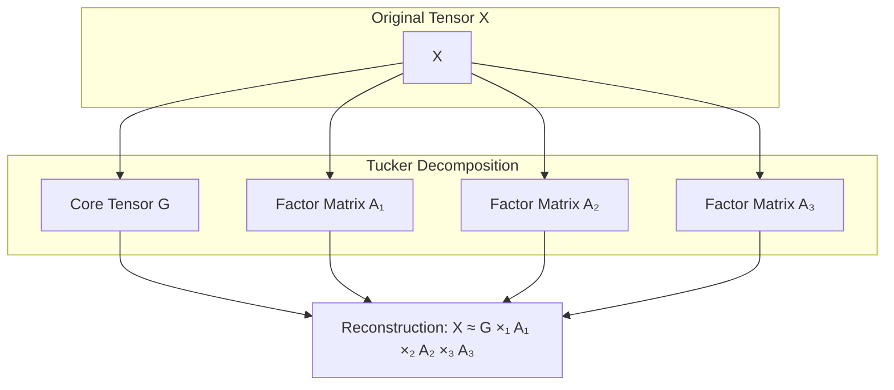
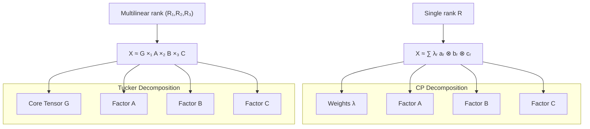
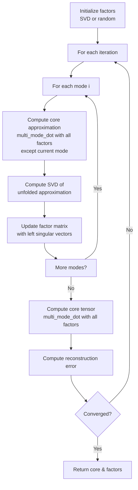
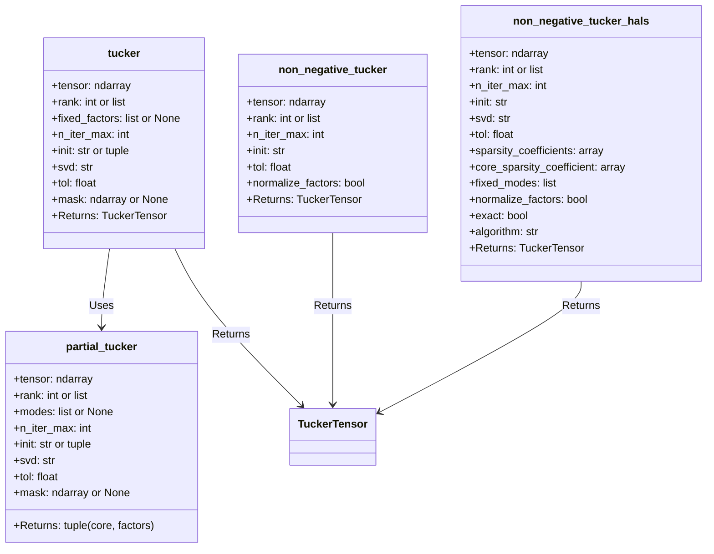
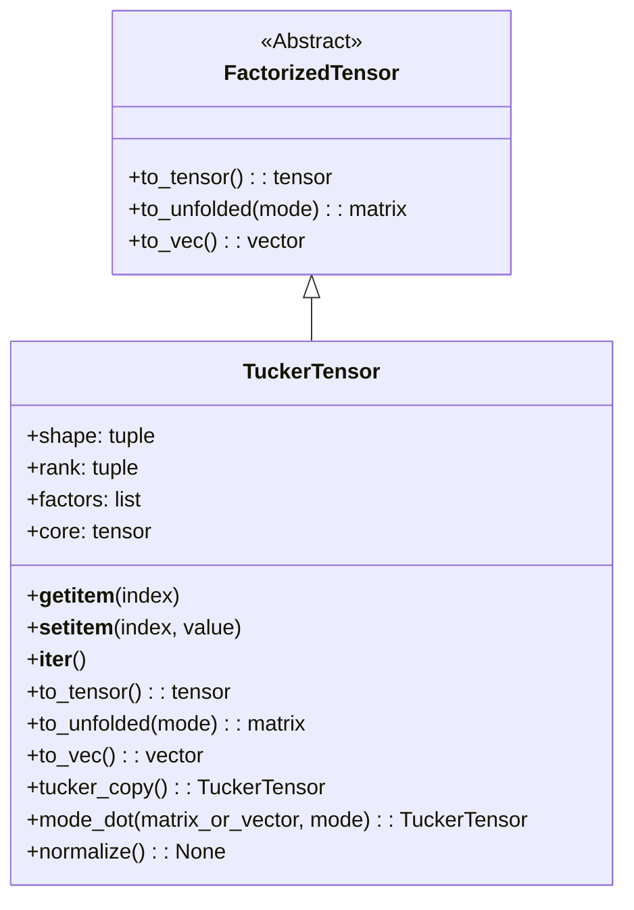
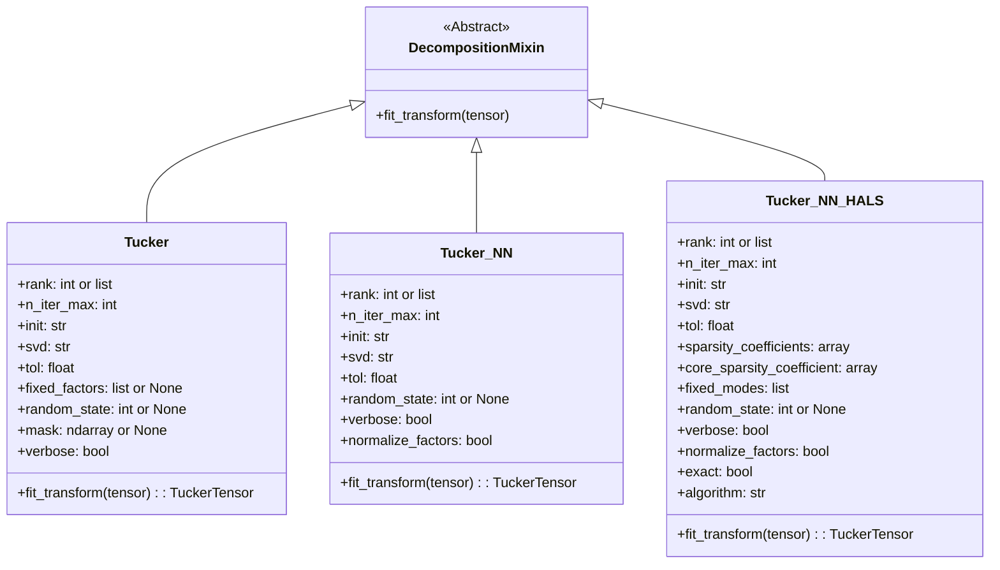

<!-- source: DeepWiki mcp.deepwiki.com · repo tensorly/tensorly · page 3.2 Tucker Decomposition · fetched 2026-10-21 -->

# Tucker Decomposition

<details>
<summary>Relevant source files</summary>

The following files were used as context for generating this wiki page:

- [tensorly/decomposition/_tucker.py](tensorly/decomposition/_tucker.py)
- [tensorly/decomposition/tests/test_tucker.py](tensorly/decomposition/tests/test_tucker.py)

</details>


This document explains the Tucker decomposition in TensorLy, a method that decomposes a tensor into a core tensor multiplied by a matrix along each mode. For other decomposition methods like CP decomposition or Tensor Train, see [CP Decomposition](#3.1) and [Tensor Train Decomposition](#3.3) respectively.

## Overview

Tucker decomposition, also known as Higher-Order SVD (HOSVD) or multilinear SVD, generalizes SVD to higher-order tensors. Given an N-dimensional tensor, Tucker decomposition expresses it as a product of a smaller core tensor and N factor matrices. Unlike CP decomposition which uses the same rank for all modes, Tucker allows specifying different ranks for different modes.



Sources: [tensorly/decomposition/_tucker.py:224-245]()/[tensorly/tucker_tensor.py:50-75]()

## Mathematical Formulation

For a tensor X ∈ ℝ^(I₁×I₂×...×Iₙ), the Tucker decomposition is:

X ≈ G ×₁ A₁ ×₂ A₂ ... ×ₙ Aₙ

where:
- G ∈ ℝ^(R₁×R₂×...×Rₙ) is the core tensor
- Aₖ ∈ ℝ^(Iₖ×Rₖ) are the factor matrices
- ×ₖ represents the mode-k product
- Rₖ ≤ Iₖ is the rank along mode k

The rank of the decomposition is described by the tuple (R₁, R₂, ..., Rₙ).

Sources: [tensorly/decomposition/_tucker.py:226-241]()/[tensorly/tucker_tensor.py:19-47]()

## Tucker vs CP Decomposition

Tucker decomposition differs from CP decomposition in several important ways:



Sources: [tensorly/decomposition/_tucker.py:224-245]()/[tensorly/cp_tensor.py:433-454]()

## Core Implementation

TensorLy implements Tucker decomposition through Higher-Order Orthogonal Iteration (HOI), a generalization of the power iteration method for tensors.

### HOI Algorithm



Sources: [tensorly/decomposition/_tucker.py:105-221]()

### Key Functions



Sources: [tensorly/decomposition/_tucker.py:25-694]()

## TuckerTensor Class

The `TuckerTensor` class provides an object-oriented representation of a Tucker decomposition:



Sources: [tensorly/tucker_tensor.py:227-320]()

## Tucker Variants

### Standard Tucker Decomposition

The standard Tucker decomposition, implemented in `tucker()` function, uses the Higher Order Orthogonal Iteration (HOI) algorithm. It starts with an initial guess for the factor matrices (either from SVD or random), and then iteratively updates each factor matrix by fixing all others.

```python
tucker_tensor = tucker(tensor, rank=3, n_iter_max=100, init='svd')
```

Sources: [tensorly/decomposition/_tucker.py:224-345]()

### Partial Tucker Decomposition

Partial Tucker decomposition, implemented in `partial_tucker()`, allows decomposing a tensor along specific modes only:

```python
(core, factors), rec_errors = partial_tucker(tensor, rank=[3, 4], modes=[0, 2])
```

Sources: [tensorly/decomposition/_tucker.py:105-221]()

### Non-negative Tucker

TensorLy provides two implementations of non-negative Tucker decomposition:

1. `non_negative_tucker()`: Uses iterative multiplicative updates to enforce non-negativity
2. `non_negative_tucker_hals()`: Uses Hierarchical Alternating Least Squares (HALS) with non-negativity constraints

```python
# Non-negative Tucker with multiplicative updates
nn_tucker = non_negative_tucker(tensor, rank=[3, 4, 5], init='svd', n_iter_max=100)

# Non-negative Tucker with HALS
nn_tucker_hals = non_negative_tucker_hals(
    tensor, 
    rank=[3, 4, 5], 
    sparsity_coefficients=[0.1, 0.1, 0.1],
    algorithm='fista'
)
```

Sources: [tensorly/decomposition/_tucker.py:348-1015]()

## Class-based Interface

TensorLy also provides a scikit-learn-style interface through classes:



Usage example:

```python
# Standard Tucker
tucker_model = Tucker(rank=[3, 4, 5])
tucker_result = tucker_model.fit_transform(tensor)

# Non-negative Tucker
nn_tucker_model = Tucker_NN(rank=[3, 4, 5], normalize_factors=True)
nn_tucker_result = nn_tucker_model.fit_transform(tensor)
```

Sources: [tensorly/decomposition/_tucker.py:697-1015]()

## Tucker Tensor Operations

TensorLy provides several operations for working with Tucker tensors:

| Operation | Function | Description |
|-----------|----------|-------------|
| To tensor | `tucker_to_tensor()` | Converts Tucker tensor to full tensor |
| To unfolded | `tucker_to_unfolded()` | Converts to unfolded tensor (matrix) |
| To vector | `tucker_to_vec()` | Converts to vectorized form |
| Mode-n product | `tucker_mode_dot()` | n-mode product with matrix/vector |
| Normalize | `tucker_normalize()` | Normalizes factors to unit length |

Sources: [tensorly/tucker_tensor.py:50-102]()/[tensorly/tucker_tensor.py:167-225]()

## Rank Selection

TensorLy provides utilities to select the rank of Tucker decomposition:

```python
# Automatic rank selection to maintain same parameter count
rank = validate_tucker_rank(tensor_shape, rank='same')

# Fractional rank (e.g., use 50% of parameters)
rank = validate_tucker_rank(tensor_shape, rank=0.5)

# Fixed rank for specific modes
rank = validate_tucker_rank(tensor_shape, rank=0.5, fixed_modes=[0, 2])
```

The `validate_tucker_rank` function computes appropriate ranks for each mode to maintain the specified parameter ratio while allowing fixed ranks for specific modes.

Sources: [tensorly/tucker_tensor.py:344-447]()

## Advanced Features

### Fixed Factors

The `tucker` function allows keeping some factor matrices fixed during optimization:

```python
# Keep the factor for mode 1 fixed
tucker_tensor = tucker(tensor, rank=[3, 4, 5], fixed_factors=[1], init=(core, factors))
```

Sources: [tensorly/decomposition/_tucker.py:286-322]()

### Masking

Tucker decomposition supports masking for handling missing values:

```python
# Create a mask (1 for observed, 0 for missing)
mask = tensor != 0

# Decompose with mask
tucker_tensor = tucker(tensor, rank=[3, 4, 5], mask=mask)
```

Sources: [tensorly/decomposition/_tucker.py:188-191]()

### Sparsity Constraints

The HALS implementation of non-negative Tucker decomposition supports sparsity constraints:

```python
# Apply sparsity constraints to factors and core
tucker_tensor = non_negative_tucker_hals(
    tensor, 
    rank=[3, 4, 5], 
    sparsity_coefficients=[0.1, 0.1, 0.1],
    core_sparsity_coefficient=0.01
)
```

Sources: [tensorly/decomposition/_tucker.py:473-519]()

## Integration with TensorLy Backend

Tucker decomposition works with any backend supported by TensorLy (NumPy, PyTorch, TensorFlow, JAX), allowing for GPU acceleration and automatic differentiation when needed.

---

