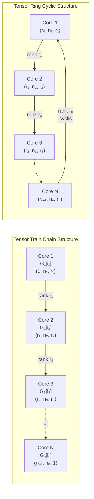
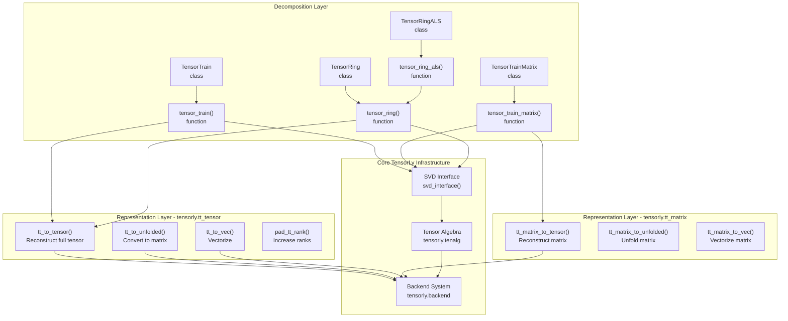
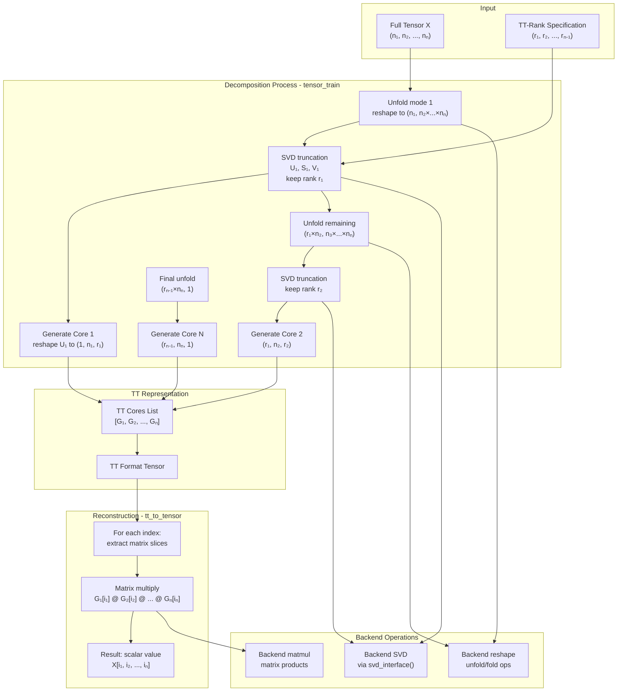
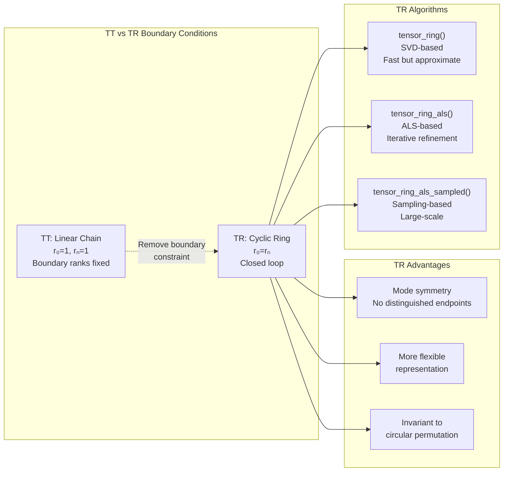
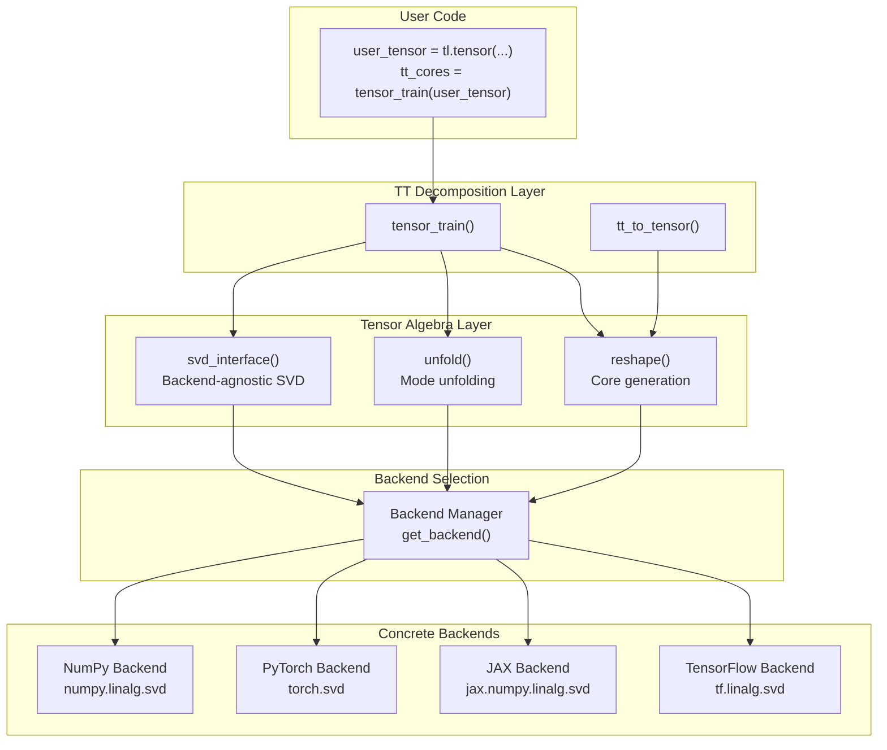
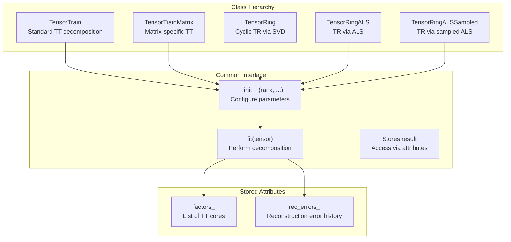

<!-- source: DeepWiki mcp.deepwiki.com · repo tensorly/tensorly · page 3.3 Tensor Train Decomposition · fetched 2026-10-21 -->

# Tensor Train Decomposition

<details>
<summary>Relevant source files</summary>

The following files were used as context for generating this wiki page:

- [doc/modules/api.rst](doc/modules/api.rst)
- [tensorly/decomposition/__init__.py](tensorly/decomposition/__init__.py)
- [tensorly/decomposition/tests/test_robust_decomposition.py](tensorly/decomposition/tests/test_robust_decomposition.py)

</details>


## Purpose and Scope

This page documents Tensor Train (TT) decomposition and its variants in TensorLy. Tensor Train decomposition, also known as Matrix Product State (MPS) in quantum physics, represents a tensor as a sequence of 3-dimensional cores with constrained rank structure. This page covers:

- Standard Tensor Train (TT/MPS) decomposition for tensors
- TT-Matrix decomposition for representing matrices in TT format
- Tensor Ring (TR) decomposition with cyclic boundary conditions

For general tensor decomposition overview, see [Tensor Decompositions](#3). For other decomposition methods like CP and Tucker, see [CP Decomposition](#3.1) and [Tucker Decomposition](#3.2).

## Overview of Tensor Train Format

Tensor Train decomposition factorizes a high-dimensional tensor into a sequence of low-rank 3-dimensional cores. Unlike CP decomposition which uses rank-1 outer products, or Tucker decomposition which uses a single core tensor, TT decomposition creates a chain structure where each mode is represented by a separate core tensor.

The key advantage of TT format is its ability to represent high-dimensional tensors with computational and storage complexity that grows linearly with the number of modes, rather than exponentially. This makes TT particularly valuable for very high-dimensional problems where other decompositions become intractable.



**Sources:** [doc/modules/api.rst:203-238](), [tensorly/decomposition/__init__.py:16-24]()

## Mathematical Representation

### Standard Tensor Train (TT/MPS)

A tensor `X` of size `(n₁, n₂, ..., nₙ)` is represented in TT format as:

```
X[i₁, i₂, ..., iₙ] = G₁[i₁] × G₂[i₂] × ... × Gₙ[iₙ]
```

where:
- `G₁[i₁]` has shape `(1, n₁, r₁)` (first core with boundary rank 1)
- `Gₖ[iₖ]` has shape `(rₖ₋₁, nₖ, rₖ)` for `k = 2, ..., n-1` (middle cores)
- `Gₙ[iₙ]` has shape `(rₙ₋₁, nₙ, 1)` (last core with boundary rank 1)

The multiplication represents matrix products along the rank dimensions, resulting in a scalar for each index combination. The sequence of ranks `(r₁, r₂, ..., rₙ₋₁)` is called the **TT-rank** and controls the approximation quality and storage requirements.

### TT-Matrix Format

TT-Matrix format represents a matrix (or equivalently, a 2N-dimensional tensor) where each core has two mode indices:

```
M[i₁, j₁, i₂, j₂, ..., iₙ, jₙ] = G₁[i₁,j₁] × G₂[i₂,j₂] × ... × Gₙ[iₙ,jₙ]
```

where:
- `Gₖ[iₖ,jₖ]` has shape `(rₖ₋₁, nₖ, mₖ, rₖ)`
- This is useful for representing large matrices in compressed format

The TT-Matrix format is particularly effective for representing structured matrices arising from discretized partial differential equations or kernel matrices.

### Tensor Ring Format

Tensor Ring (TR) extends TT by imposing cyclic boundary conditions, removing the asymmetry in TT format:

```
X[i₁, i₂, ..., iₙ] = Trace(G₁[i₁] × G₂[i₂] × ... × Gₙ[iₙ])
```

where:
- All cores `Gₖ[iₖ]` have shape `(rₖ₋₁, nₖ, rₖ)`
- The last rank `rₙ` equals the first rank `r₀` (cyclic boundary)
- The trace operation closes the ring

The cyclic structure makes TR more flexible than TT, as the representation is invariant to circular permutations of the modes.

**Sources:** [doc/modules/api.rst:203-238]()

## Implementation Architecture



**Sources:** [tensorly/decomposition/__init__.py:16-24](), [doc/modules/api.rst:203-238](), [doc/modules/api.rst:319-377]()

## Decomposition Functions and Classes

### Tensor Train Decomposition

| Function/Class | Purpose | Key Parameters | Module |
|---------------|---------|----------------|---------|
| `tensor_train()` | Decompose tensor into TT format | tensor, rank, SVD method | `tensorly.decomposition` |
| `TensorTrain` | Class interface for TT decomposition | rank, n_iter_max, init | `tensorly.decomposition` |

The `tensor_train()` function performs Sequential SVD-based decomposition:
1. Iteratively unfolds the tensor along each mode
2. Applies SVD to separate the current mode from remaining modes
3. Truncates SVD to the specified TT-rank
4. Continues until all modes are processed

### TT-Matrix Decomposition

| Function/Class | Purpose | Module |
|---------------|---------|---------|
| `tensor_train_matrix()` | Decompose matrix into TT-Matrix format | `tensorly.decomposition` |
| `TensorTrainMatrix` | Class interface for TT-Matrix decomposition | `tensorly.decomposition` |

TT-Matrix format treats a matrix as having paired indices (row-column pairs for each mode), making it suitable for representing large structured matrices.

### Tensor Ring Decomposition

| Function/Class | Purpose | Algorithm | Module |
|---------------|---------|-----------|---------|
| `tensor_ring()` | TR decomposition via SVD | Sequential SVD | `tensorly.decomposition` |
| `TensorRing` | Class interface for TR SVD | Sequential SVD | `tensorly.decomposition` |
| `tensor_ring_als()` | TR decomposition via ALS | Alternating Least Squares | `tensorly.decomposition` |
| `TensorRingALS` | Class interface for TR ALS | ALS optimization | `tensorly.decomposition` |
| `tensor_ring_als_sampled()` | Sampled TR-ALS | Sampling-based ALS | `tensorly.decomposition` |
| `TensorRingALSSampled` | Class interface for sampled TR-ALS | Sampling-based ALS | `tensorly.decomposition` |

Tensor Ring provides multiple algorithms:
- **SVD-based**: Similar to TT but with cyclic closure
- **ALS-based**: Iteratively optimizes each core while fixing others
- **Sampled ALS**: Uses sampling for large-scale problems

**Sources:** [tensorly/decomposition/__init__.py:16-24](), [doc/modules/api.rst:342-348](), [doc/modules/api.rst:372-374]()

## Tensor Representation Functions

### TT Tensor Operations

The `tensorly.tt_tensor` module provides functions for manipulating tensors in TT format:

| Function | Purpose | Input | Output |
|----------|---------|-------|--------|
| `tt_to_tensor()` | Reconstruct full tensor | TT cores (list) | Dense tensor |
| `tt_to_unfolded()` | Convert to unfolded matrix | TT cores, mode | Matrix |
| `tt_to_vec()` | Vectorize TT | TT cores | Vector |
| `pad_tt_rank()` | Increase TT-ranks | TT cores, new ranks | Padded TT cores |

The reconstruction process multiplies the cores sequentially:
- For index `[i₁, i₂, ..., iₙ]`, extract the matrix slice from each core
- Perform matrix multiplications: `G₁[i₁] @ G₂[i₂] @ ... @ Gₙ[iₙ]`
- The result is a scalar (due to boundary ranks of 1)

### TT-Matrix Operations

The `tensorly.tt_matrix` module provides operations specific to TT-Matrix format:

| Function | Purpose | Description |
|----------|---------|-------------|
| `tt_matrix_to_tensor()` | Reconstruct matrix | Converts TT-Matrix to dense matrix |
| `tt_matrix_to_unfolded()` | Unfold TT-Matrix | Matrix unfolding along modes |
| `tt_matrix_to_vec()` | Vectorize TT-Matrix | Flatten to vector |

**Sources:** [doc/modules/api.rst:203-238]()

## Data Flow Through TT Decomposition



**Sources:** [doc/modules/api.rst:203-238](), [doc/modules/api.rst:274-280]()

## Random Tensor Generation

TensorLy provides utilities for generating random tensors in TT format for testing and initialization:

| Function | Purpose | Module |
|----------|---------|---------|
| `random_tt()` | Generate random TT tensor | `tensorly.random` |
| `random_tt_matrix()` | Generate random TT-Matrix | `tensorly.random` |

These functions create TT tensors with random entries, useful for:
- Testing decomposition algorithms
- Initializing optimization procedures
- Benchmarking reconstruction accuracy

**Sources:** [doc/modules/api.rst:453-471]()

## Rank Constraints and Storage Complexity

### Storage Requirements

The storage complexity of TT format for a tensor of size `(n₁, n₂, ..., nₙ)` with TT-ranks `(r₁, r₂, ..., rₙ₋₁)` is:

```
Storage = n₁×r₁ + r₁×n₂×r₂ + r₂×n₃×r₃ + ... + rₙ₋₁×nₙ
        = O(n × d × r²)
```

where `n` is the maximum mode size, `d` is the number of modes, and `r` is the maximum TT-rank.

This is **linear** in the number of modes `d`, compared to:
- Full tensor: `O(nᵈ)` (exponential)
- CP format: `O(d × n × R)` (linear, but different structure)
- Tucker format: `O(Rᵈ + d × n × R)` (exponential in core)

### Rank Selection

| Strategy | Description | Trade-off |
|----------|-------------|-----------|
| Fixed rank | Specify `rank=(r₁, r₂, ..., rₙ₋₁)` | User controls compression |
| Uniform rank | Single value `rank=r` for all | Simplest specification |
| SVD truncation | Truncate based on singular values | Automatic quality control |

The `pad_tt_rank()` function allows increasing TT-ranks after decomposition, which can be useful for:
- Adding flexibility for optimization
- Ensuring compatibility between TT tensors

**Sources:** [doc/modules/api.rst:203-220]()

## Tensor Ring Specifics



**Sources:** [tensorly/decomposition/__init__.py:18-24](), [doc/modules/api.rst:346-348]()

## Integration with Backend System

All TT operations are backend-agnostic and work seamlessly with different numerical backends:



Users can switch backends without changing TT decomposition code:

```python
import tensorly as tl

# NumPy backend (default)
tl.set_backend('numpy')
tt_cores_np = tl.decomposition.tensor_train(tensor)

# PyTorch backend with GPU
tl.set_backend('pytorch')
tt_cores_torch = tl.decomposition.tensor_train(tensor)
```

**Sources:** [doc/modules/api.rst:5-34](), [doc/modules/api.rst:319-377]()

## Class-Based Interface

TensorLy provides class-based interfaces for all TT variants, following scikit-learn style:



All classes follow the pattern:
1. Initialize with decomposition parameters (rank, SVD method, etc.)
2. Call `fit(tensor)` to perform decomposition
3. Access results via `factors_` attribute
4. Monitor convergence via `rec_errors_` if applicable

**Sources:** [tensorly/decomposition/__init__.py:16-24](), [doc/modules/api.rst:328-348]()

## Usage Considerations

### When to Use TT vs Other Decompositions

| Scenario | Recommended Format | Reason |
|----------|-------------------|---------|
| Very high-dimensional tensors (d > 10) | Tensor Train | Linear scaling with modes |
| Low-rank structure across all modes | Tensor Train | Efficient sequential compression |
| Structured matrices (PDE, kernels) | TT-Matrix | Specialized matrix format |
| Mode symmetry important | Tensor Ring | Circular symmetry |
| Sum of rank-1 structure | CP Decomposition | See [CP Decomposition](#3.1) |
| Single core tensor structure | Tucker Decomposition | See [Tucker Decomposition](#3.2) |

### Computational Complexity

| Operation | TT Complexity | Full Tensor |
|-----------|---------------|-------------|
| Storage | `O(d × n × r²)` | `O(nᵈ)` |
| Decomposition | `O(d × n³ × r³)` | Intractable for large d |
| Element access | `O(d × r²)` | `O(1)` |
| Reconstruction | `O(nᵈ × d × r²)` | N/A |

### Rank Determination

The TT-rank directly controls the approximation quality. Common strategies:
- **Trial ranks**: Start small, increase until error acceptable
- **SVD truncation**: Set threshold on singular values
- **Cross-validation**: Use held-out data to select ranks
- **Information criteria**: Balance fit quality and model complexity

**Sources:** [doc/modules/api.rst:319-377]()

---

