<!-- source: DeepWiki mcp.deepwiki.com · repo tensorly/tensorly · page 3.4 PARAFAC2 Decomposition · fetched 2026-10-21 -->

# PARAFAC2 Decomposition

<details>
<summary>Relevant source files</summary>

The following files were used as context for generating this wiki page:

- [tensorly/decomposition/_parafac2.py](tensorly/decomposition/_parafac2.py)
- [tensorly/decomposition/tests/test_parafac2.py](tensorly/decomposition/tests/test_parafac2.py)
- [tensorly/parafac2_tensor.py](tensorly/parafac2_tensor.py)
- [tensorly/testing.py](tensorly/testing.py)
- [tensorly/tests/test_parafac2_tensor.py](tensorly/tests/test_parafac2_tensor.py)
- [tensorly/tests/test_testing.py](tensorly/tests/test_testing.py)

</details>


## Purpose and Scope

This document describes TensorLy's PARAFAC2 decomposition implementation, a tensor factorization method designed specifically for tensors with **varying dimensions along one mode**. Unlike standard CP decomposition (see [CP Decomposition](#3.1)) which requires fixed dimensions across all modes, PARAFAC2 handles data where slices have different sizes, making it suitable for time series data with irregular sampling or datasets with unequal observation counts.

The implementation provides alternating least squares (ALS) optimization with optional line search acceleration, support for non-negative constraints, and missing value handling. For the tensor representation format, see [Parafac2Tensor and Other Formats](#4.3).

Sources: [tensorly/decomposition/_parafac2.py:415-536]()

---

## Mathematical Formulation

PARAFAC2 decomposes a third-order tensor into factors $(A, [B_i], C)$ where the second mode factor $B_i$ varies across the first mode while maintaining a constant cross-product structure:

$$X_i = B_i \text{diag}(a_i) C^T$$

where:
- $a_i$ is the $i$-th row of factor matrix $A$ (size $I \times R$)
- $B_i$ is a varying factor matrix (size $J_i \times R$) for the $i$-th slice
- $C$ is a constant factor matrix (size $K \times R$)
- The constraint: $B_i^T B_i$ is constant for all $i$

This is reformulated as $B_i = P_i B$ where:
- $P_i$ is a $J_i \times R$ orthogonal projection matrix ($P_i^T P_i = I$)
- $B$ is a $R \times R$ matrix

Element-wise notation: $X_{ijk} = \sum_{r=1}^R A_{ir} B_{ijr} C_{kr}$

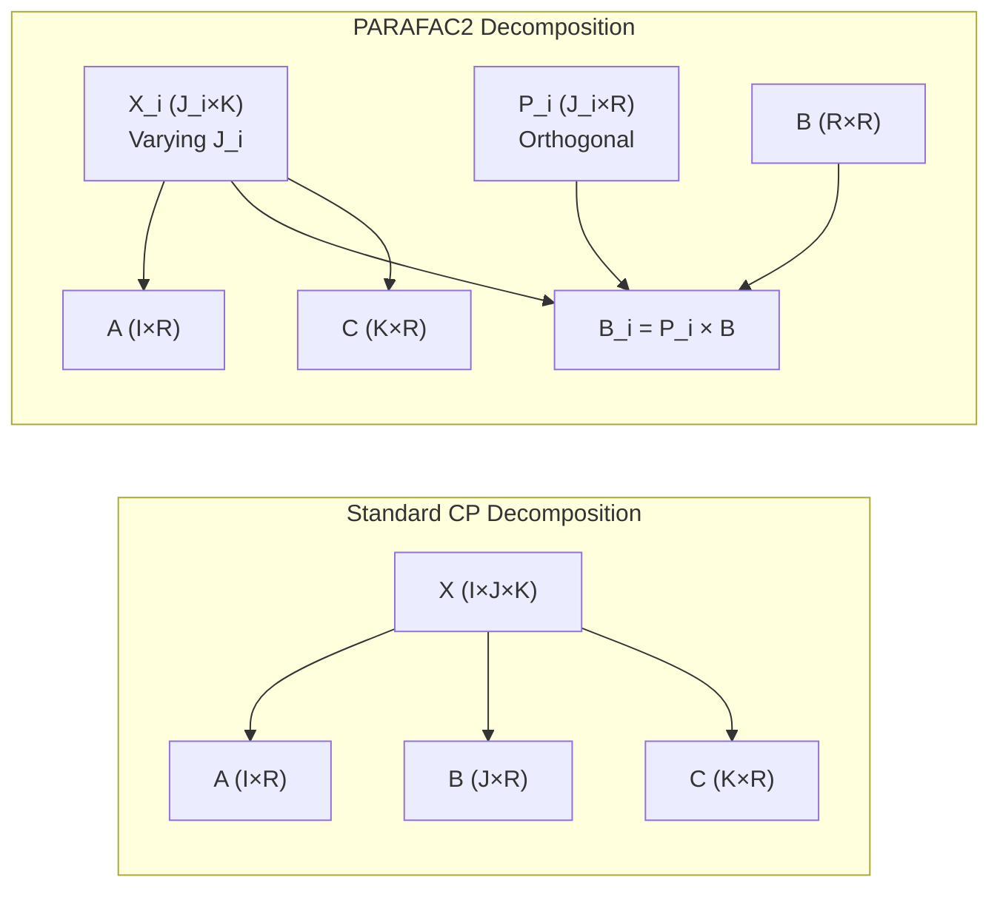

**Key Differences from CP**:
| Feature | CP Decomposition | PARAFAC2 |
|---------|-----------------|----------|
| Mode dimensions | Fixed $J$ | Varying $J_i$ |
| Factor structure | $B$ is $J \times R$ | $B_i = P_i B$, varies per slice |
| Constraint | None | $B_i^T B_i$ constant |
| Input format | 3D tensor | List of 2D matrices or 3D tensor |

Sources: [tensorly/decomposition/_parafac2.py:415-447](), [tensorly/parafac2_tensor.py:248-278]()

---

## Core Components Architecture

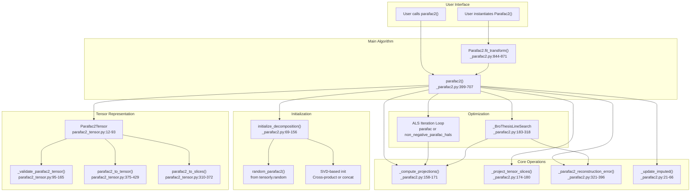

Sources: [tensorly/decomposition/_parafac2.py:1-872](), [tensorly/parafac2_tensor.py:1-530]()

---

## The parafac2() Function

The main entry point for PARAFAC2 decomposition is the `parafac2()` function located at [tensorly/decomposition/_parafac2.py:399-707]().

### Function Signature

```python
parafac2(
    tensor_slices,
    rank: int,
    n_iter_max: int = 2000,
    init="random",
    svd: SVD_TYPES = "truncated_svd",
    normalize_factors: bool = False,
    tol: float = 1.0e-8,
    nn_modes: Optional[Union[Sequence[int], Literal["all"]]] = None,
    random_state=None,
    verbose: Union[bool, int] = False,
    return_errors: bool = False,
    n_iter_parafac: int = 5,
    linesearch: bool = True,
    mask=None,
)
```

### Key Parameters

| Parameter | Type | Description |
|-----------|------|-------------|
| `tensor_slices` | ndarray or list | Third-order tensor or list of 2D tensors with varying rows |
| `rank` | int | Number of components (must be ≤ number of columns) |
| `n_iter_max` | int | Maximum iterations (default: 2000, changed from 100 in v0.6.1) |
| `init` | str/CPTensor/Parafac2Tensor | Initialization: 'random', 'svd', or existing decomposition |
| `nn_modes` | None/'all'/list | Modes to constrain as non-negative (modes 0, 2 only) |
| `linesearch` | bool | Enable Bro's line search acceleration |
| `mask` | ndarray | Missing value mask (0=missing, 1=observed) |
| `n_iter_parafac` | int | CP iterations per PARAFAC2 iteration |

### Algorithm Flow

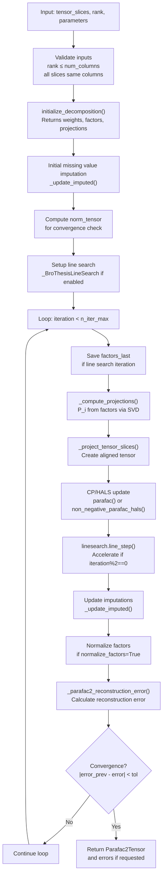

Sources: [tensorly/decomposition/_parafac2.py:399-707]()

---

## Initialization Methods

The `initialize_decomposition()` function at [tensorly/decomposition/_parafac2.py:69-156]() provides three initialization strategies:

### 1. Random Initialization

Uses `random_parafac2()` from the random module to generate random orthogonal projection matrices and factor matrices.

```python
# Code at tensorly/decomposition/_parafac2.py:114-118
if init == "random":
    return random_parafac2(
        shapes, rank, full=False, random_state=random_state, **context
    )
```

### 2. SVD Initialization

Computes the factor matrix $C$ using SVD on either:
- **Concatenated slices**: When $\sum_i J_i \leq K$ (total rows ≤ columns)
- **Cross-product matrix**: When $\sum_i J_i > K$ (more efficient)

The cross-product approach computes $K = X_1^T X_1 + X_2^T X_2 + \ldots$ to avoid creating a large concatenated matrix.

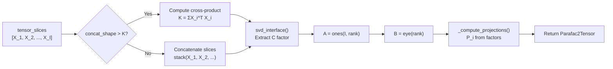

Sources: [tensorly/decomposition/_parafac2.py:119-141]()

### 3. Existing Decomposition

Accepts a `CPTensor` or `Parafac2Tensor` for warm-start initialization. The rank must match the specified rank.

```python
# Code at tensorly/decomposition/_parafac2.py:143-154
elif isinstance(init, (tuple, list, Parafac2Tensor, CPTensor)):
    decomposition = Parafac2Tensor.from_CPTensor(init, parafac2_tensor_ok=True)
    if decomposition.rank != rank:
        raise ValueError("Cannot init with a decomposition of different rank")
    return decomposition
```

Sources: [tensorly/decomposition/_parafac2.py:69-156]()

---

## Projection Matrix Computation

The `_compute_projections()` function at [tensorly/decomposition/_parafac2.py:158-171]() is critical to PARAFAC2. It computes orthogonal projection matrices $P_i$ that align the varying $B_i$ factors.

### Algorithm

For each slice $i$:
1. Compute $\text{lhs} = B \cdot (a_i \odot C)^T$
2. Compute $\text{rhs} = X_i^T$
3. Perform SVD: $\text{lhs} \cdot \text{rhs} = U \Sigma V^T$
4. Set $P_i = (U V^T)^T$ (orthogonal matrix)

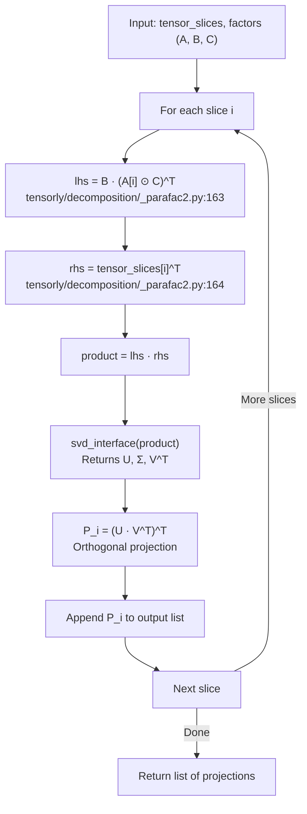

**Key Property**: The resulting $P_i$ matrices are orthogonal: $P_i^T P_i = I_R$

Sources: [tensorly/decomposition/_parafac2.py:158-171]()

---

## Line Search Optimization

The `_BroThesisLineSearch` class at [tensorly/decomposition/_parafac2.py:183-318]() implements the line search acceleration from Rasmus Bro's PhD thesis.

### Mechanism

After computing new factors at iteration $n$, the line search extrapolates ahead by:

$$\text{factors}_{\text{ls}} = \text{factors}_{n-1} + (\text{factors}_n - \text{factors}_{n-1}) \cdot \text{jump}$$

where $\text{jump} = \text{iteration}^{1/\text{acc\_pow}}$

The extrapolated factors are **accepted** only if they reduce reconstruction error, otherwise the standard update is used.

### Key Parameters

| Parameter | Default | Description |
|-----------|---------|-------------|
| `acc_pow` | 2.0 | Controls jump size: iteration^(1/acc_pow) |
| `max_fail` | 4 | Failures before increasing acc_pow |
| `acc_fail` | 0 | Current failure count |

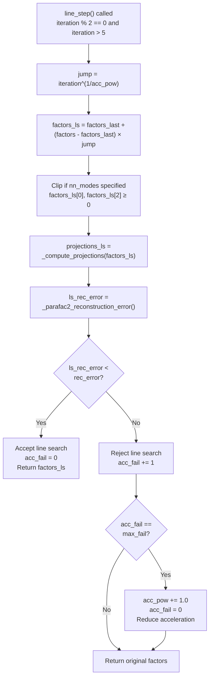

**Performance Impact**: Tests show line search typically achieves better reconstruction error in fewer iterations (see test at [tensorly/decomposition/tests/test_parafac2.py:110-142]()).

Sources: [tensorly/decomposition/_parafac2.py:183-318](), [tensorly/decomposition/tests/test_parafac2.py:110-142]()

---

## Missing Value Handling

PARAFAC2 supports missing values via the `mask` parameter. The `_update_imputed()` function at [tensorly/decomposition/_parafac2.py:21-66]() provides two imputation strategies:

### Imputation Methods

| Method | When Used | Strategy |
|--------|-----------|----------|
| `"mode-2"` | Initialization | Fill with mean of each slice |
| `"factors"` | During optimization | Fill with reconstructed values from decomposition |

### Implementation Flow

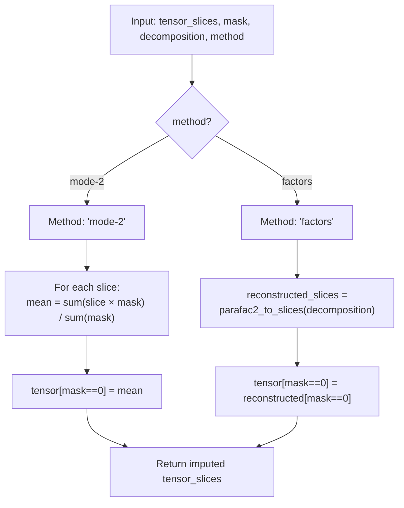

### Usage Pattern

1. **Initial imputation** (iteration 0): Use `"mode-2"` or `"factors"` (if init decomposition provided)
2. **During optimization**: Use `"factors"` after each iteration to refine missing value estimates

```python
# Code at tensorly/decomposition/_parafac2.py:664-671
if mask is not None:
    tensor_slices = _update_imputed(
        tensor_slices=tensor_slices,
        decomposition=(weights, factors, projections),
        mask=mask,
        method="factors",
    )
```

**Test coverage**: See [tensorly/decomposition/tests/test_parafac2.py:508-570]() for EM-style missing value tests.

Sources: [tensorly/decomposition/_parafac2.py:21-66](), [tensorly/decomposition/_parafac2.py:553-671]()

---

## Non-Negative PARAFAC2

When `nn_modes` parameter is specified, PARAFAC2 enforces non-negativity constraints on selected modes.

### Important Constraint

**Mode 1 (B matrix) cannot be truly non-negative** with the ALS algorithm because $B_i = P_i B$. While $B$ can be constrained non-negative, the orthogonal projection matrices $P_i$ may have negative entries, so $B_i$ is unlikely to be non-negative.

A warning is issued if mode 1 is included in `nn_modes`:

```python
# Code at tensorly/decomposition/_parafac2.py:615-618
if nn_modes == "all" or 1 in nn_modes:
    warn("Mode `1` of PARAFAC2 fitted with ALS cannot be constrained "
         "to be truly non-negative. See the documentation for more info.")
```

### Implementation

| nn_modes value | CP solver used | Constrained modes |
|----------------|----------------|-------------------|
| `None` | `parafac()` | None |
| `[0, 2]` or `"all"` | `non_negative_parafac_hals()` | A and C factors only |

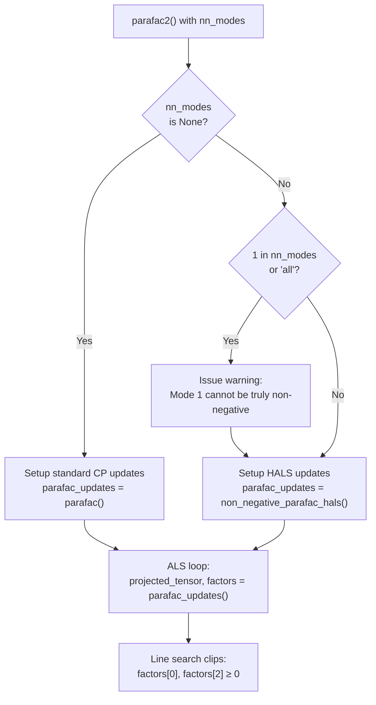

**Test validation**: Tests verify that modes 0 and 2 are non-negative after decomposition at [tensorly/decomposition/tests/test_parafac2.py:291-292]().

Sources: [tensorly/decomposition/_parafac2.py:595-631](), [tensorly/decomposition/tests/test_parafac2.py:206-318]()

---

## Parafac2Tensor Class

The `Parafac2Tensor` class at [tensorly/parafac2_tensor.py:12-93]() wraps the decomposition result.

### Structure

```python
Parafac2Tensor
├── weights: 1D array (rank,)
├── factors: List[ndarray]
│   ├── factors[0]: A matrix (I×R)
│   ├── factors[1]: B matrix (R×R)
│   └── factors[2]: C matrix (K×R)
└── projections: List[ndarray]
    └── projections[i]: P_i matrix (J_i×R) - orthogonal
```

### Key Methods

| Method | Returns | Description |
|--------|---------|-------------|
| `to_tensor()` | ndarray | Full reconstructed tensor (padded with zeros) |
| `to_vec()` | ndarray | Vectorized tensor |
| `to_unfolded(mode)` | ndarray | Unfolded tensor along specified mode |
| `from_CPTensor(cp_tensor)` | Parafac2Tensor | Convert CPTensor to Parafac2Tensor via QR |

### Validation

The `_validate_parafac2_tensor()` function at [tensorly/parafac2_tensor.py:95-165]() checks:

1. **Three factors**: Must have exactly 3 factor matrices
2. **Consistent rank**: All factors and projections have same number of columns
3. **Correct projections**: One projection per slice (length = factors[0].shape[0])
4. **Orthogonality**: $P_i^T P_i = I$ for all projections (tolerance 1e-5)
5. **Weights length**: If provided, length must equal rank

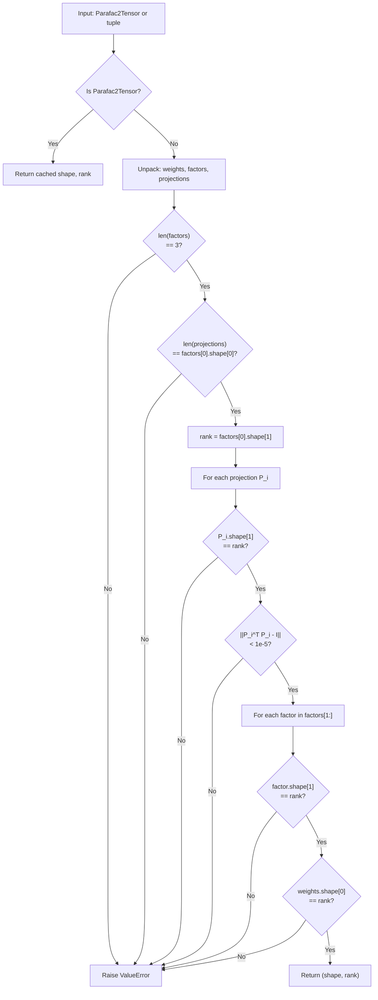

Sources: [tensorly/parafac2_tensor.py:12-165]()

---

## Reconstruction Operations

### parafac2_to_slices()

Reconstructs individual slices without padding. Returns a list since slices may have different dimensions.

```python
# Code at tensorly/parafac2_tensor.py:310-372
def parafac2_to_slices(parafac2_tensor, validate=True):
    # For each slice i:
    # 1. B_i = P_i @ B
    # 2. X_i = B_i * diag(a_i) @ C^T
    pass
```

### parafac2_to_tensor()

Creates a full 3D tensor by padding shorter slices with zeros to match the maximum slice length.

```python
# Code at tensorly/parafac2_tensor.py:375-429
def parafac2_to_tensor(parafac2_tensor):
    slices = parafac2_to_slices(parafac2_tensor)
    max_length = max(P_i.shape[0] for P_i in projections)
    # Create tensor with shape (I, max_length, K)
    # Fill with slices, pad remaining entries with zeros
```

### Reconstruction Flow

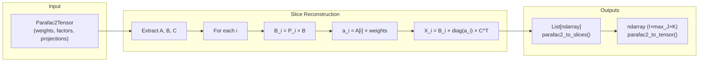

### Other Operations

- `parafac2_to_slice(parafac2_tensor, slice_idx)`: Reconstruct single slice [tensorly/parafac2_tensor.py:248-307]()
- `parafac2_to_unfolded(parafac2_tensor, mode)`: Unfold reconstructed tensor [tensorly/parafac2_tensor.py:432-479]()
- `parafac2_to_vec(parafac2_tensor)`: Vectorize reconstructed tensor [tensorly/parafac2_tensor.py:482-529]()
- `parafac2_normalise(parafac2_tensor)`: Normalize factors to unit length [tensorly/parafac2_tensor.py:168-218]()

Sources: [tensorly/parafac2_tensor.py:248-529]()

---

## Reconstruction Error Calculation

The `_parafac2_reconstruction_error()` function at [tensorly/decomposition/_parafac2.py:321-396]() efficiently computes the reconstruction error without materializing the full reconstructed tensor.

### Efficient Computation

Uses the identity: $\|X - \hat{X}\|^2 = \|X\|^2 + \|\hat{X}\|^2 - 2\langle X, \hat{X} \rangle$

For **fully observed data** (no mask):

1. Precompute $C^T C$ (shared across slices)
2. For each slice $i$:
   - Compute $B_i = P_i B \odot A[i]$
   - Inner product: $\text{trace}(B_i^T X_i C)$
   - Norm component: $\sum (B_i^T B_i) \odot (C^T C)$

For **missing values** (with mask):
- Directly compute: $\sum_i \|M_i \odot X_i - M_i \odot \hat{X}_i\|^2$ where $M_i$ is the mask

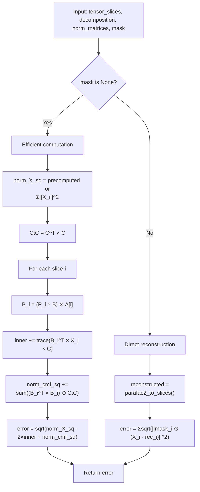

Sources: [tensorly/decomposition/_parafac2.py:321-396]()

---

## Parafac2 Class (OOP Interface)

The `Parafac2` class at [tensorly/decomposition/_parafac2.py:710-872]() provides a scikit-learn-style interface.

### Usage Pattern

```python
# Initialize
decomposer = Parafac2(
    rank=5,
    n_iter_max=1000,
    init='svd',
    linesearch=True
)

# Fit and transform
decomposition = decomposer.fit_transform(tensor_slices)

# Access results
decomposer.decomposition_  # Parafac2Tensor
decomposer.errors_         # List of errors per iteration
```

### Key Differences from Function

| Feature | `parafac2()` function | `Parafac2` class |
|---------|----------------------|------------------|
| Interface | Functional | Object-oriented |
| Return | Parafac2Tensor (or tuple with errors) | Self (stores results in attributes) |
| Errors | Optional via `return_errors` | Always stored in `self.errors_` |
| Use case | Single decomposition | Reusable, sklearn-compatible |

### Implementation

```python
# Code at tensorly/decomposition/_parafac2.py:844-871
def fit_transform(self, tensor):
    self.decomposition_, self.errors_ = parafac2(
        tensor,
        rank=self.rank,
        n_iter_max=self.n_iter_max,
        init=self.init,
        svd=self.svd,
        normalize_factors=self.normalize_factors,
        tol=self.tol,
        nn_modes=self.nn_modes,
        random_state=self.random_state,
        verbose=self.verbose,
        return_errors=self.return_errors,
        n_iter_parafac=self.n_iter_parafac,
        linesearch=self.linesearch,
        mask=self.mask,
    )
    return self.decomposition_
```

Sources: [tensorly/decomposition/_parafac2.py:710-872]()

---

## Implementation Notes

### Note on Mode Ordering

TensorLy's PARAFAC2 differs from the original paper [Kiers et al., 1999]:

- **TensorLy**: Second mode changes over **first mode**
- **Original paper**: Second mode changes over **third mode**

This modification allows accepting both lists of matrices and single 3D tensors without mode reordering.

### Input Flexibility

The `parafac2()` function accepts:

1. **List of 2D matrices**: `[X_1, X_2, ..., X_I]` where each `X_i` is shape `(J_i, K)`
2. **3D tensor**: Shape `(I, J, K)` where all slices have same `J` (degenerates to standard case)

```python
# Test at tensorly/decomposition/tests/test_parafac2.py:321-341
slice_rec = parafac2(slices, rank)  # List input
tensor_rec = parafac2(tensor, rank)  # Tensor input
# Results are equivalent
```

### Convergence Criterion

Changed in version 0.6.1:

**Old criterion** (before v0.6.1): $|\|X - \hat{X}_{n-1}\| - \|X - \hat{X}_n\|| < \epsilon$

**New criterion** (v0.6.1+): $|\|X - \hat{X}_{n-1}\|^2 - \|X - \hat{X}_n\|^2| < \epsilon \|X - \hat{X}_{n-1}\|^2$

This makes the tolerance relative to the reconstruction error, improving robustness.

Sources: [tensorly/decomposition/_parafac2.py:460-481](), [tensorly/decomposition/_parafac2.py:527-531](), [tensorly/decomposition/tests/test_parafac2.py:321-341]()

---

## Testing and Validation

The test suite at [tensorly/decomposition/tests/test_parafac2.py]() covers:

| Test | Purpose | Location |
|------|---------|----------|
| `test_parafac2` | Core decomposition with various parameters | Lines 26-107 |
| `test_parafac2_linesearch` | Line search effectiveness | Lines 110-142 |
| `test_linesearch_accepts_only_improved_fit` | Line search logic | Lines 145-202 |
| `test_parafac2_nn` | Non-negative constraints | Lines 206-318 |
| `test_parafac2_slice_and_tensor_input` | Input format equivalence | Lines 321-341 |
| `test_parafac2_normalize_factors` | Factor normalization | Lines 344-371 |
| `test_parafac2_init_*` | Initialization methods | Lines 374-435 |
| `test_update_imputed` | Missing value imputation | Lines 458-505 |
| `test_parafac2_em` | EM-style missing value handling | Lines 508-570 |

**Validation metrics**: Tests use `congruence_coefficient` from [tensorly/metrics/factors.py]() to measure factor recovery quality (typically > 0.98 threshold).

Sources: [tensorly/decomposition/tests/test_parafac2.py:1-570]()

---

