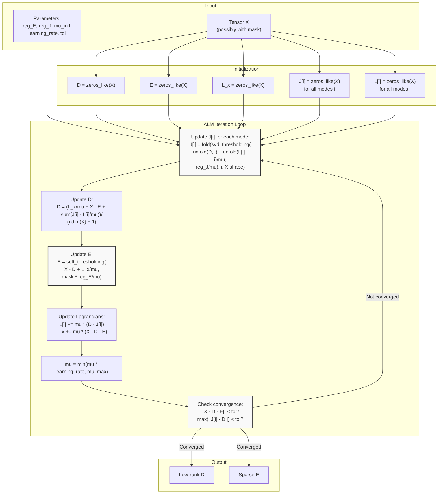
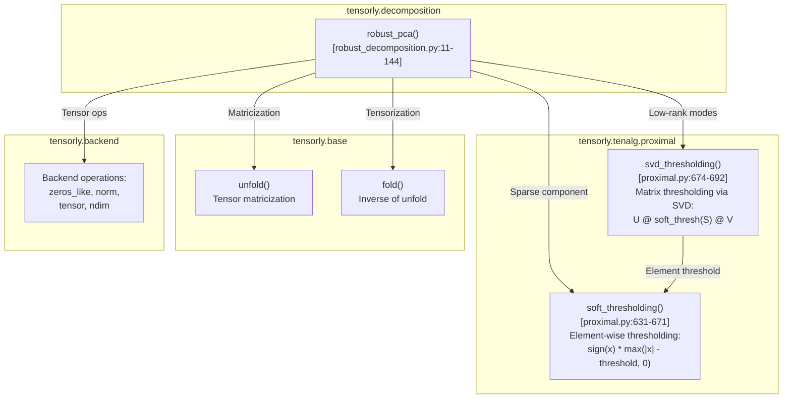
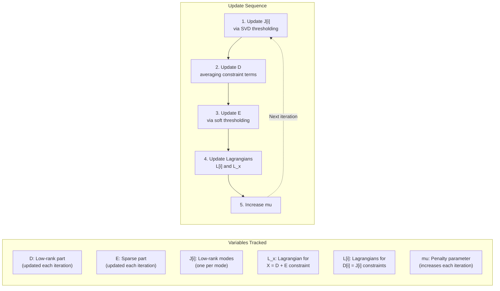
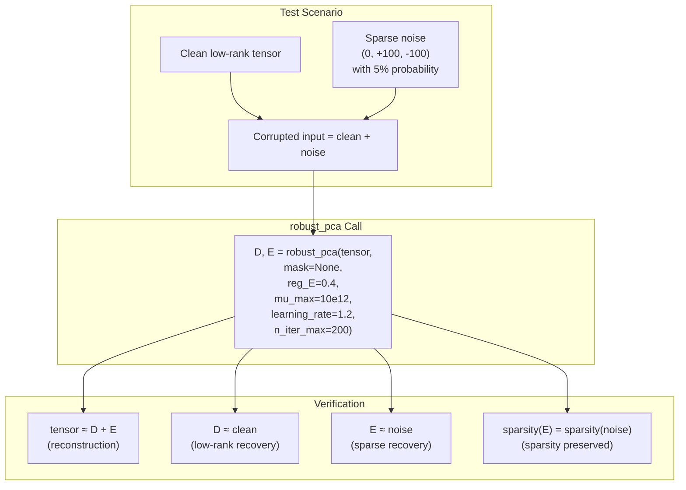
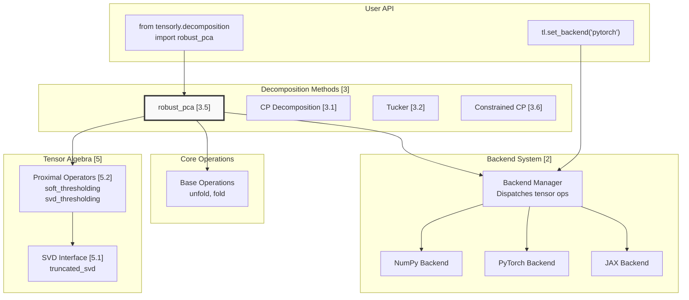

<!-- source: DeepWiki mcp.deepwiki.com · repo tensorly/tensorly · page 3.5 Robust Decomposition · fetched 2026-10-21 -->

# Robust Decomposition

<details>
<summary>Relevant source files</summary>

The following files were used as context for generating this wiki page:

- [doc/modules/api.rst](doc/modules/api.rst)
- [tensorly/decomposition/__init__.py](tensorly/decomposition/__init__.py)
- [tensorly/decomposition/_constrained_cp.py](tensorly/decomposition/_constrained_cp.py)
- [tensorly/decomposition/robust_decomposition.py](tensorly/decomposition/robust_decomposition.py)
- [tensorly/decomposition/tests/test_robust_decomposition.py](tensorly/decomposition/tests/test_robust_decomposition.py)
- [tensorly/tenalg/proximal.py](tensorly/tenalg/proximal.py)
- [tensorly/tenalg/svd.py](tensorly/tenalg/svd.py)
- [tensorly/tenalg/tests/test_proximal.py](tensorly/tenalg/tests/test_proximal.py)
- [tensorly/tenalg/tests/test_svd.py](tensorly/tenalg/tests/test_svd.py)

</details>


## Purpose and Scope

This document covers TensorLy's robust tensor decomposition capabilities, specifically the **Robust PCA** method for decomposing tensors into the sum of a low-rank component and a sparse component. This decomposition is useful for separating structured signal from outliers or corrupted entries in tensor data.

For standard low-rank decompositions without sparsity handling, see CP Decomposition ([3.1](#3.1)) and Tucker Decomposition ([3.2](#3.2)). For constrained decompositions with various constraints on factors, see Constrained Decompositions ([3.6](#3.6)).

**Sources**: [tensorly/decomposition/robust_decomposition.py:1-145](), [doc/modules/api.rst:371]()

## Problem Formulation

Robust PCA decomposes an input tensor $\tilde{X}$ into two components:
- **D**: Low-rank component (the clean signal)
- **E**: Sparse component (outliers/errors)

The optimization problem solved is:

$$
\begin{aligned}
& \min_{\{J_i\}, \tilde{D}, \tilde{E}} & & \sum_{i=1}^N \text{reg}_J \|J_i\|_* + \text{reg}_E \|E\|_1 \\
& \text{subject to} & & \tilde{X} = \tilde{D} + \tilde{E} \\
& & & D_{[i]} = J_i, \text{ for each } i \in \{1, 2, \cdots, N\}
\end{aligned}
$$

where:
- $\|\cdot\|_*$ denotes the nuclear norm (sum of singular values), enforcing low-rank structure
- $\|\cdot\|_1$ denotes the L1 norm, enforcing sparsity
- $J_i$ are the unfolded low-rank components along each mode
- $D_{[i]}$ is the mode-i unfolding of tensor $D$

**Sources**: [tensorly/decomposition/robust_decomposition.py:68-83]()

## Algorithm: Augmented Lagrangian Method (ALM)



**Diagram: Robust PCA ALM Algorithm Flow**

The algorithm alternates between updating the low-rank components $J_i$, the decomposed components $D$ and $E$, and the Lagrangian multipliers, with an adaptive penalty parameter $\mu$.

**Sources**: [tensorly/decomposition/robust_decomposition.py:105-144]()

## Key Components and Dependencies



**Diagram: Component Dependencies for Robust PCA**

**Sources**: [tensorly/decomposition/robust_decomposition.py:1-3](), [tensorly/tenalg/proximal.py:631-692]()

## Function API: robust_pca

The primary function is `robust_pca` located in [tensorly/decomposition/robust_decomposition.py:11-144]().

### Parameters

| Parameter | Type | Default | Description |
|-----------|------|---------|-------------|
| `X` | ndarray | required | Input tensor of shape `(n_samples, N1, ..., NS)` |
| `mask` | ndarray | `None` | Boolean array with same shape as `X`. Zero where values are missing, one elsewhere |
| `tol` | float | `10e-7` | Convergence tolerance for reconstruction error |
| `reg_E` | float | `1.0` | Regularization parameter for sparse component (L1 norm) |
| `reg_J` | float | `1.0` | Regularization parameter for low-rank component (nuclear norm) |
| `mu_init` | float | `10e-5` | Initial value for penalty parameter |
| `mu_max` | float | `10e-9` | Maximum value for penalty parameter |
| `learning_rate` | float | `1.1` | Multiplicative increase rate for `mu` per iteration |
| `n_iter_max` | int | `100` | Maximum number of iterations |
| `return_errors` | bool | `False` | Whether to return reconstruction error history |
| `verbose` | int | `1` | Verbosity level (0=silent, 1=convergence info) |

**Sources**: [tensorly/decomposition/robust_decomposition.py:11-53]()

### Returns

| Return Value | Type | Description |
|--------------|------|-------------|
| `D` | ndarray | Low-rank component, same shape as input `X` |
| `E` | ndarray | Sparse error component, same shape as input `X` |
| `rec_errors` | list | (Optional) Reconstruction errors per iteration if `return_errors=True` |

The decomposition satisfies: `X ≈ D + E`

**Sources**: [tensorly/decomposition/robust_decomposition.py:56-84]()

## Proximal Operators

### soft_thresholding

Performs element-wise soft thresholding: $\text{sign}(x) \cdot \max(|x| - \text{threshold}, 0)$

This is the proximal operator for the L1 norm, used to enforce sparsity on the error component `E`.

```python
# From tensorly/tenalg/proximal.py
E = soft_thresholding(X - D + L_x / mu, mask * reg_E / mu)
```

Supports element-wise thresholding with masks for missing values.

**Sources**: [tensorly/tenalg/proximal.py:631-671](), [tensorly/decomposition/robust_decomposition.py:120]()

### svd_thresholding

Performs singular value thresholding:
1. Compute SVD: $M = U S V^T$
2. Threshold singular values: $S' = \text{soft\_threshold}(S, \text{threshold})$
3. Reconstruct: $M' = U S' V^T$

This is the proximal operator for the nuclear norm, used to enforce low-rank structure on unfolded modes of `D`.

```python
# From tensorly/decomposition/robust_decomposition.py
J[i] = fold(
    svd_thresholding(unfold(D, i) + unfold(L[i], i) / mu, reg_J / mu),
    i,
    X.shape,
)
```

**Sources**: [tensorly/tenalg/proximal.py:674-692](), [tensorly/decomposition/robust_decomposition.py:109-113]()

## Implementation Details



**Diagram: Variable Update Sequence in ALM**

### Convergence Monitoring

Two error metrics are tracked per iteration:

1. **Reconstruction Error**: `||X - D - E||₂` measures how well the decomposition reconstructs the input
2. **Consistency Error**: `max(||J[i] - D||₂)` measures consistency across mode unfoldings

Convergence is achieved when both errors fall below `tol`.

**Sources**: [tensorly/decomposition/robust_decomposition.py:131-140]()

### Missing Value Handling

When a `mask` is provided:
- Zeros in the mask indicate missing values
- During the sparse update: `E = soft_thresholding(X - D + L_x / mu, mask * reg_E / mu)`
- The mask multiplies the threshold, effectively setting threshold to zero for missing entries
- This allows the algorithm to impute missing values while still detecting sparse errors in observed entries

**Sources**: [tensorly/decomposition/robust_decomposition.py:85-88](), [tensorly/decomposition/robust_decomposition.py:120]()

## Usage Pattern from Tests



**Diagram: Test Pattern for Robust PCA**

### Example Test Case

From [tensorly/decomposition/tests/test_robust_decomposition.py:8-46]():

```python
# Create clean low-rank data
sample = np.array([[1.0, 2, 3, 4], [2, 4, 6, 8]])
clean = np.vstack([sample[None, ...]] * 100)

# Add sparse noise
noise = rng.choice([0.0, 100.0, -100.0], size=clean.shape, 
                   p=[0.95, 0.025, 0.025])
tensor = tl.tensor(clean + noise)

# Decompose
clean_pred, noise_pred = robust_pca(
    tensor, mask=None, reg_E=0.4, mu_max=10e12,
    learning_rate=1.2, n_iter_max=200, tol=1e-5
)

# Verify: tensor ≈ clean_pred + noise_pred
# Verify: clean_pred ≈ clean (low-rank)
# Verify: noise_pred ≈ noise (sparse)
```

**Sources**: [tensorly/decomposition/tests/test_robust_decomposition.py:8-46]()

## Integration with TensorLy Ecosystem



**Diagram: Robust PCA Integration in TensorLy Architecture**

Robust PCA integrates into TensorLy as:
- A decomposition method alongside CP, Tucker, etc. (exported from `tensorly.decomposition`)
- Backend-agnostic through TensorLy's backend abstraction
- Built on tensor algebra operations (unfold/fold) and proximal operators
- Usable with any supported backend (NumPy, PyTorch, JAX, TensorFlow, CuPy, Paddle)

**Sources**: [tensorly/decomposition/__init__.py:15](), [tensorly/decomposition/robust_decomposition.py:1-3]()

## Comparison with Related Methods

| Method | Purpose | Output | Constraints | Related Page |
|--------|---------|--------|-------------|--------------|
| **Robust PCA** | Separate low-rank + sparse | D (low-rank) + E (sparse) | Nuclear norm + L1 | This page (3.5) |
| **CP Decomposition** | Factor tensor into rank-1 components | Weights + factors | None (standard) | [3.1](#3.1) |
| **Constrained CP** | CP with constraints on factors | Weights + factors | 12+ constraint types | [3.6](#3.6) |
| **Tucker** | Core tensor + factor matrices | Core + factors | None (standard) | [3.2](#3.2) |

Robust PCA is unique in that it decomposes into additive components (low-rank + sparse) rather than multiplicative factors.

**Sources**: [doc/modules/api.rst:319-377]()

## Performance Considerations

### Computational Complexity

Per iteration:
- **SVD thresholding**: $O(N \cdot \text{cost of SVD})$ where $N$ is number of modes
  - For mode-$i$ unfolding of shape $(n_i, \prod_{j \neq i} n_j)$, SVD cost is $O(n_i^2 \prod_{j \neq i} n_j)$
- **Soft thresholding**: $O(\prod_i n_i)$ (linear in tensor size)
- **Lagrangian updates**: $O(\prod_i n_i)$ per update

Total iterations depends on convergence (typically 50-200 iterations in practice).

### Memory Requirements

The algorithm maintains:
- Input tensor `X`
- Decomposed components `D`, `E` (same size as `X`)
- Low-rank modes `J[i]` (N tensors, each same size as `X`)
- Lagrangian variables `L[i]`, `L_x` (N+1 tensors, each same size as `X`)

Total memory: approximately $(2N + 3) \times \text{size}(X)$

**Sources**: [tensorly/decomposition/robust_decomposition.py:90-100]()

## Parameter Tuning Guidelines

| Parameter | Impact | Tuning Strategy |
|-----------|--------|-----------------|
| `reg_E` | Controls sparsity of `E` | Increase to enforce more sparsity; decrease if sparse component is under-detected |
| `reg_J` | Controls rank of `D` | Increase to enforce lower rank; decrease if low-rank component is over-smoothed |
| `mu_init` | Initial penalty strength | Start small (1e-5 to 1e-3) to allow gradual convergence |
| `learning_rate` | Growth rate of penalty | Typical values 1.05-1.5; higher = faster convergence but less stable |
| `mu_max` | Maximum penalty | Set high enough (1e9-1e12) to ensure convergence; prevents numerical issues |
| `tol` | Convergence tolerance | Tighter tolerance (1e-7 to 1e-5) for more accurate decomposition |

**Sources**: [tensorly/decomposition/robust_decomposition.py:14-22](), [tensorly/decomposition/tests/test_robust_decomposition.py:30-35]()

---

