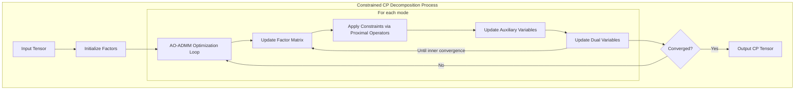
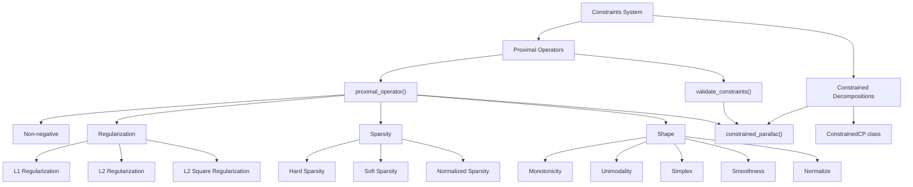
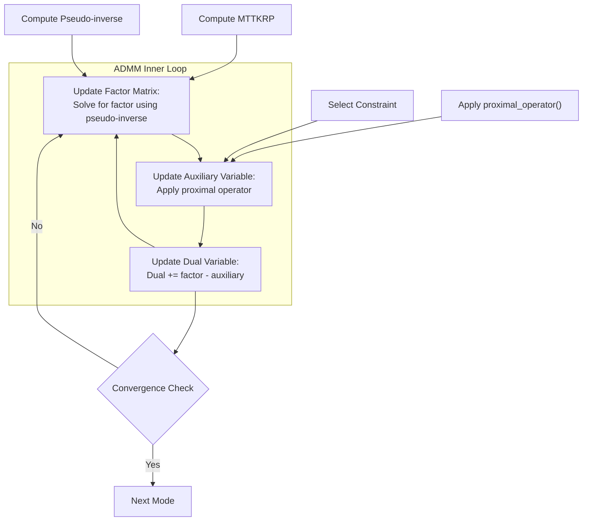

<!-- source: DeepWiki mcp.deepwiki.com · repo tensorly/tensorly · page 3.6 Constrained Decompositions · fetched 2026-10-21 -->

# Constrained Decompositions

<details>
<summary>Relevant source files</summary>

The following files were used as context for generating this wiki page:

- [tensorly/decomposition/_constrained_cp.py](tensorly/decomposition/_constrained_cp.py)
- [tensorly/decomposition/robust_decomposition.py](tensorly/decomposition/robust_decomposition.py)
- [tensorly/tenalg/proximal.py](tensorly/tenalg/proximal.py)
- [tensorly/tenalg/svd.py](tensorly/tenalg/svd.py)
- [tensorly/tenalg/tests/test_proximal.py](tensorly/tenalg/tests/test_proximal.py)
- [tensorly/tenalg/tests/test_svd.py](tensorly/tenalg/tests/test_svd.py)

</details>


This page documents the constrained tensor decomposition capabilities in TensorLy, focusing on how to apply various constraints to tensor decompositions. Constrained decompositions allow you to incorporate domain knowledge or desired properties into your tensor factorization results, leading to more interpretable or physically meaningful solutions. Currently, TensorLy primarily implements constrained CP (CANDECOMP/PARAFAC) decomposition using the Alternating Direction Method of Multipliers (ADMM) optimization algorithm.

For general information about tensor decompositions without constraints, see [Tensor Decompositions](#3).

## System Overview

TensorLy's constrained decomposition system applies constraints to factor matrices during the optimization process. The main approach uses AO-ADMM (Alternating Optimization with Alternating Direction Method of Multipliers), which efficiently handles various constraints through proximal operators.

### Constrained Decomposition Flow



Sources: [tensorly/decomposition/_constrained_cp.py:166-423]()

### Available Constraints Architecture



Sources: [tensorly/tenalg/proximal.py:4-145](), [tensorly/decomposition/_constrained_cp.py:166-423]()

## Available Constraints

TensorLy supports a comprehensive set of constraints that can be applied to tensor decompositions. These constraints are implemented through proximal operators in the `tensorly.tenalg.proximal` module.

### Constraint Types

| Constraint Type | Parameter | Description | Mathematical Form |
|-----------------|-----------|-------------|-------------------|
| Non-negative | `non_negative` | Forces factor elements to be non-negative | max(x, 0) |
| L1 Regularization | `l1_reg` | Encourages sparsity through L1 penalty | sign(x) * max(|x| - λ, 0) |
| L2 Regularization | `l2_reg` | Penalizes with L2 norm | x - λx/max(‖x‖₂, λ) |
| L2 Square Regularization | `l2_square_reg` | Penalizes with squared L2 norm | x/(1 + 2λ) |
| Unimodality | `unimodality` | Enforces single-peak structure | Projection to unimodal set |
| Normalize | `normalize` | Scales by maximum value | x/max(|x|) |
| Simplex | `simplex` | Projects onto simplex | Projection to {x: x≥0, Σxᵢ=λ} |
| Normalized Sparsity | `normalized_sparsity` | K-sparse vectors with unit norm | Hard thresholding + normalization |
| Soft Sparsity | `soft_sparsity` | Bounded L1 norm | Projection to {x: ‖x‖₁≤λ} |
| Smoothness | `smoothness` | Enforces smoothness | Solution to banded system |
| Monotonicity | `monotonicity` | Forces monotonic pattern | Projection to monotonic set |
| Hard Sparsity | `hard_sparsity` | Forces exact sparsity level | Keep top-k values |

Sources: [tensorly/tenalg/proximal.py:148-672]()

### Constraint Specification

Constraints can be specified in three ways:

1. **Boolean flag** (applies to all modes):
   ```python
   non_negative=True  # Apply non-negativity to all factor matrices
   ```

2. **Dictionary** (mode-specific application):
   ```python
   non_negative={0: True, 2: True}  # Apply only to modes 0 and 2
   ```

3. **List** (mode-specific parameters):
   ```python
   l1_reg=[0.1, 0.2, 0.1]  # Different L1 regularization for each mode
   ```

Sources: [tensorly/tenalg/proximal.py:4-145]()

## Implementation Details

### ADMM Optimization

The constrained CP decomposition uses the ADMM algorithm, which introduces auxiliary variables to efficiently handle constraints. The algorithm alternates between:

1. Solving for the factor matrices
2. Applying constraints via proximal operators
3. Updating dual variables

This approach allows handling complex constraints that would be difficult to incorporate directly into the optimization objective.



Sources: [tensorly/decomposition/_constrained_cp.py:166-423]()

### Proximal Operators

Each constraint is implemented as a proximal operator, which projects a point onto the constraint set. The general form of a proximal operator for a function f is:

prox_f(x) = argmin_z { f(z) + (1/2)‖z - x‖² }

For example:
- For non-negativity: prox(x) = max(x, 0)
- For L1 regularization: prox(x) = sign(x) * max(|x| - λ, 0)

The `proximal_operator` function in TensorLy takes a tensor and constraint parameters, identifies the appropriate constraint, and applies the corresponding proximal operator.

Sources: [tensorly/tenalg/proximal.py:148-267]()

## Usage Examples

### Basic Usage

```python
from tensorly.decomposition import constrained_parafac

# Non-negative CP decomposition
cp_tensor = constrained_parafac(tensor, rank=3, non_negative=True)

# Using the class-based API
from tensorly.decomposition import ConstrainedCP
model = ConstrainedCP(rank=3, non_negative=True)
cp_tensor = model.fit_transform(tensor)
```

### Constraint Combinations

```python
# Combine multiple constraints
cp_tensor = constrained_parafac(
    tensor, 
    rank=3,
    non_negative=True,  # All factors non-negative
    l1_reg={1: 0.1},    # L1 regularization on second mode only
    smoothness={0: 0.01}  # Smoothness constraint on first mode
)
```

### Specifying Mode-Specific Constraints

```python
# Different constraints for different modes
cp_tensor = constrained_parafac(
    tensor,
    rank=5,
    # Mode 0: Non-negative
    # Mode 1: Simplex with sum=1
    # Mode 2: Soft sparsity with L1 bound of 2
    non_negative={0: True},
    simplex={1: 1.0},
    soft_sparsity={2: 2.0}
)
```

Sources: [tensorly/decomposition/tests/test_constrained_parafac.py:17-399]()

## Example Results

Below are examples of how different constraints affect decomposition results:

### Non-negative CP Decomposition

Non-negativity constraints ensure all factor values are positive, which is useful for applications where negative values have no physical interpretation (e.g., chemical concentrations, image processing).

```python
# Example from tests
cp_tensor, errors = constrained_parafac(
    tensor,
    non_negative=True,
    rank=3,
    return_errors=True
)
# All elements of factors are >= 0
```

Sources: [tensorly/decomposition/tests/test_constrained_parafac.py:17-65]()

### Monotonic Factors

Monotonicity constraints enforce that values in each column of a factor are either strictly increasing or decreasing, useful for time-series or physical processes.

```python
# Example from tests
cp_tensor = constrained_parafac(
    tensor, 
    monotonicity=True, 
    rank=3
)
# Factors have monotonically increasing values along columns
```

Sources: [tensorly/decomposition/tests/test_constrained_parafac.py:189-204](), [tensorly/tenalg/proximal.py:270-356]()

### Unimodal Factors

Unimodality enforces a single-peak pattern in factors, which can represent phenomena that rise and then fall.

```python
# Example from tests
cp_tensor = constrained_parafac(
    tensor,
    unimodality=True,
    rank=3
)
# Factors have a single peak in each column
```

Sources: [tensorly/decomposition/tests/test_constrained_parafac.py:279-303](), [tensorly/tenalg/proximal.py:359-441]()

## Performance Considerations

When using constrained decompositions, consider the following best practices:

1. **Initialization**: Good initialization can significantly improve convergence. Options include:
   - `init='svd'`: Uses SVD of unfoldings (default, often best)
   - `init='random'`: Random initialization
   - Or provide a pre-computed CPTensor

2. **Convergence Parameters**:
   - `n_iter_max`: Maximum outer iterations (default: 100)
   - `n_iter_max_inner`: Maximum ADMM iterations (default: 10)
   - `tol_outer`: Outer convergence tolerance (default: 1e-8)
   - `tol_inner`: Inner convergence tolerance (default: 1e-6)

3. **Constraint Strength**: For regularization parameters, start with small values (0.01-0.1) and adjust as needed.

4. **Fixed Modes**: Use `fixed_modes` parameter to keep certain modes unchanged during optimization.

5. **Computational Complexity**: Constraints increase computational cost. The most expensive constraints are unimodality and monotonicity, which require complex projections.

Sources: [tensorly/decomposition/_constrained_cp.py:22-163](), [tensorly/decomposition/_constrained_cp.py:166-423]()

## Limitations

1. Constraint combinations on the same mode are not supported - you can only apply one constraint type per mode.

2. The last mode cannot be fixed due to how error computation is implemented.

3. Some constraints may slow convergence or lead to lower-quality decompositions if parameters are not properly tuned.

Sources: [tensorly/tenalg/proximal.py:100-126](), [tensorly/decomposition/_constrained_cp.py:326-332]()

## Advanced Usage: Customizing the Optimization Process

For advanced users, it's possible to customize the optimization process by adjusting parameters like:

```python
cp_tensor = constrained_parafac(
    tensor,
    rank=3,
    non_negative=True,
    n_iter_max=200,           # More outer iterations
    n_iter_max_inner=20,      # More ADMM iterations per factor update
    tol_outer=1e-10,          # Stricter outer convergence
    tol_inner=1e-8,           # Stricter inner convergence
    cvg_criterion="abs_rec_error"  # Convergence criterion
)
```

The `cvg_criterion` parameter can be either:
- `"abs_rec_error"`: Uses absolute change in reconstruction error
- `"rec_error"`: Uses the raw change in reconstruction error

Sources: [tensorly/decomposition/_constrained_cp.py:166-423]()

---

