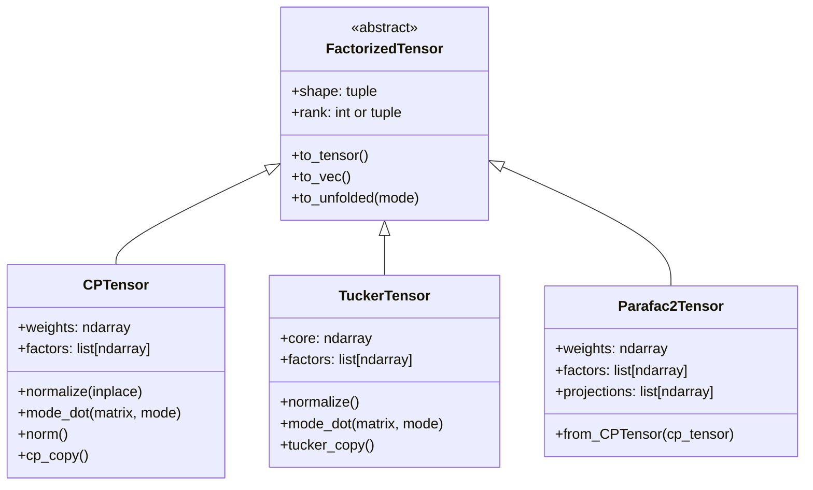
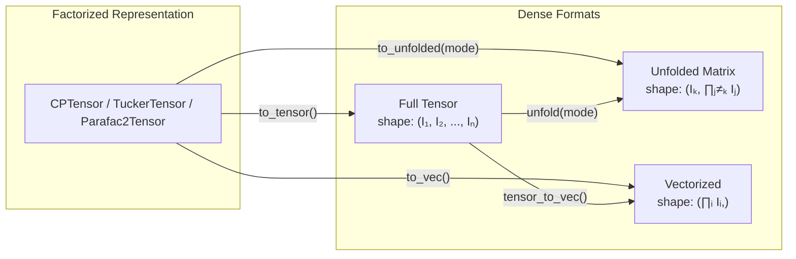
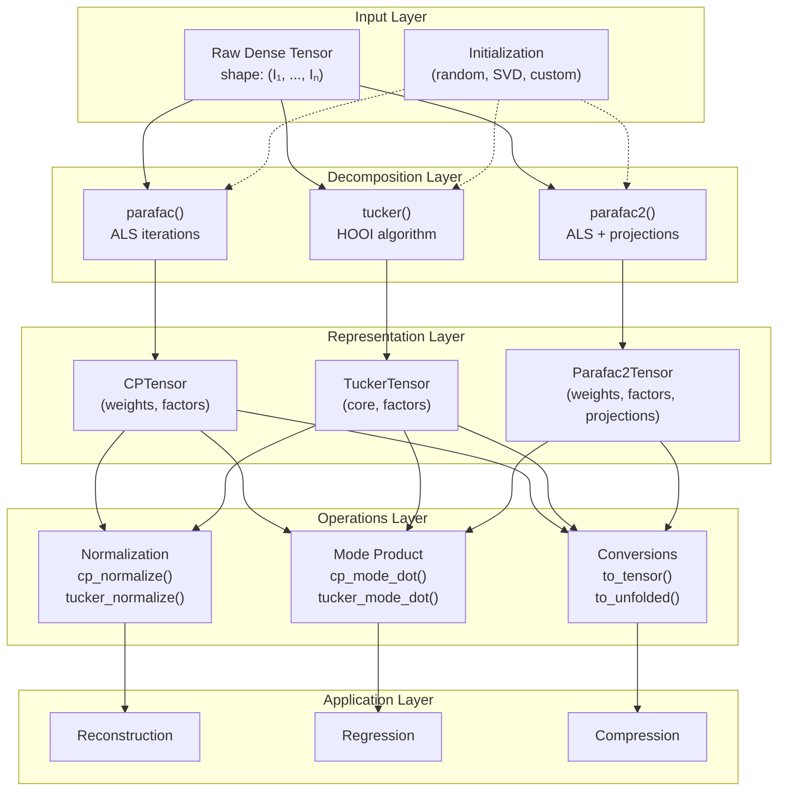
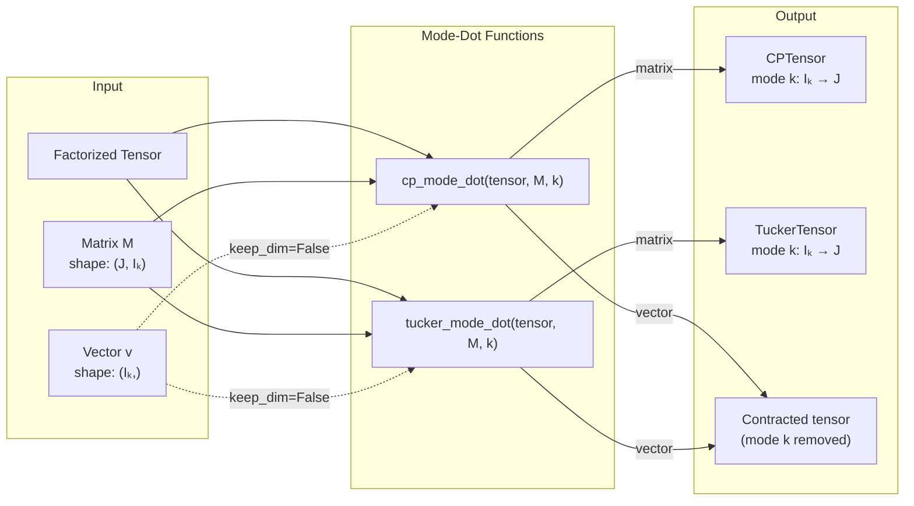

<!-- source: DeepWiki mcp.deepwiki.com · repo tensorly/tensorly · page 4 Tensor Representations · fetched 2026-10-21 -->

# Tensor Representations

<details>
<summary>Relevant source files</summary>

The following files were used as context for generating this wiki page:

- [tensorly/cp_tensor.py](tensorly/cp_tensor.py)
- [tensorly/decomposition/_parafac2.py](tensorly/decomposition/_parafac2.py)
- [tensorly/decomposition/tests/test_parafac2.py](tensorly/decomposition/tests/test_parafac2.py)
- [tensorly/parafac2_tensor.py](tensorly/parafac2_tensor.py)
- [tensorly/testing.py](tensorly/testing.py)
- [tensorly/tests/test_cp_tensor.py](tensorly/tests/test_cp_tensor.py)
- [tensorly/tests/test_parafac2_tensor.py](tensorly/tests/test_parafac2_tensor.py)
- [tensorly/tests/test_testing.py](tensorly/tests/test_testing.py)
- [tensorly/tests/test_tucker_tensor.py](tensorly/tests/test_tucker_tensor.py)
- [tensorly/tucker_tensor.py](tensorly/tucker_tensor.py)

</details>


This page documents TensorLy's factorized tensor data structures, which store tensors in decomposed form for computational and memory efficiency. These representations are the core output of decomposition algorithms and support various tensor operations without requiring full reconstruction.

For details on specific decomposition algorithms that produce these representations, see [Tensor Decompositions](#3). For backend-agnostic tensor operations, see [Tensor Algebra Operations](#5).

## Purpose and Scope

Tensor representations in TensorLy encapsulate factorized forms of multi-dimensional arrays. Instead of storing a full dense tensor of size $I_1 \times I_2 \times \cdots \times I_N$, these representations store factor matrices and optionally weights or core tensors, enabling:

- **Memory efficiency**: Storage scales linearly with tensor dimensions rather than exponentially
- **Computational efficiency**: Operations can be performed directly on factors without reconstruction
- **Algorithmic flexibility**: Different decomposition types capture different structural properties

The three primary factorized formats are:
- **CPTensor** (Canonical Polyadic): Rank-$R$ sum of outer products
- **TuckerTensor**: Core tensor with factor matrices per mode
- **Parafac2Tensor**: CP-like format with evolving second-mode factors

## Factorized Tensor Base Class

All tensor representations inherit from `FactorizedTensor`, an abstract base class that defines the common interface.



**Sources**: [tensorly/_factorized_tensor.py](), [tensorly/cp_tensor.py:17-161](), [tensorly/tucker_tensor.py:227-321](), [tensorly/parafac2_tensor.py:12-93]()

## Common Representation Structure

### Validation Functions

Each representation type implements a validation function that checks structural consistency and returns shape and rank information:

| Function | Input | Returns | Validates |
|----------|-------|---------|-----------|
| `_validate_cp_tensor` | `(weights, factors)` | `(shape, rank)` | Factor dimensions match, rank consistency |
| `_validate_tucker_tensor` | `(core, factors)` | `(shape, rank)` | Core/factor compatibility, mode count |
| `_validate_parafac2_tensor` | `(weights, factors, projections)` | `(shape, rank)` | Projection orthogonality, 3 factors exactly |

These functions are called automatically during object construction and raise `ValueError` if the structure is invalid.

**Sources**: [tensorly/cp_tensor.py:163-214](), [tensorly/tucker_tensor.py:19-47](), [tensorly/parafac2_tensor.py:95-165]()

### Conversion Operations

All representations support three primary conversion operations:



**Implementation details:**
- **`to_tensor()`**: Reconstructs the full dense tensor
  - CP: [tensorly/cp_tensor.py:433-485]()
  - Tucker: [tensorly/tucker_tensor.py:50-75]()
  - Parafac2: [tensorly/parafac2_tensor.py:375-429]()
  
- **`to_unfolded(mode)`**: Produces mode-$k$ matricization without full reconstruction
  - CP: [tensorly/cp_tensor.py:488-521]()
  - Tucker: [tensorly/tucker_tensor.py:105-131]()
  - Parafac2: [tensorly/parafac2_tensor.py:432-479]()
  
- **`to_vec()`**: Flattens to 1D vector
  - CP: [tensorly/cp_tensor.py:524-546]()
  - Tucker: [tensorly/tucker_tensor.py:134-164]()
  - Parafac2: [tensorly/parafac2_tensor.py:482-529]()

**Sources**: [tensorly/cp_tensor.py:433-546](), [tensorly/tucker_tensor.py:50-164](), [tensorly/parafac2_tensor.py:375-529]()

## Data Flow Through Representations



**Sources**: [tensorly/decomposition/_cp.py](), [tensorly/decomposition/_tucker.py](), [tensorly/decomposition/_parafac2.py](), [tensorly/cp_tensor.py](), [tensorly/tucker_tensor.py](), [tensorly/parafac2_tensor.py]()

## Representation Types Overview

### CPTensor: Canonical Polyadic Format

The CP decomposition represents a tensor as a sum of rank-1 tensors:

$$\mathcal{X} \approx \sum_{r=1}^R \lambda_r \mathbf{a}_r \circ \mathbf{b}_r \circ \mathbf{c}_r$$

**Structure:**
- `weights`: 1D array of shape `(rank,)` - component weights $\lambda_r$
- `factors`: List of $N$ matrices - factor matrices for each mode

**Key operations:**
- `cp_normalize()`: Normalizes factor columns to unit length, absorbs norms into weights
- `cp_flip_sign()`: Adjusts signs for interpretability
- `cp_mode_dot()`: Efficient n-mode product with matrices/vectors
- `cp_norm()`: Computes Frobenius norm without reconstruction using $\|\mathcal{X}\|^2 = \sum_{r,s} \lambda_r \lambda_s \prod_n (\mathbf{u}_r^{(n)})^T \mathbf{u}_s^{(n)}$
- `cp_permute_factors()`: Reorders components to match a reference decomposition

For detailed documentation, see [CPTensor Class](#4.1).

**Sources**: [tensorly/cp_tensor.py:17-689]()

### TuckerTensor: Core + Factor Format

The Tucker decomposition represents a tensor via a core tensor and factor matrices:

$$\mathcal{X} \approx \mathcal{G} \times_1 \mathbf{A}^{(1)} \times_2 \mathbf{A}^{(2)} \cdots \times_N \mathbf{A}^{(N)}$$

**Structure:**
- `core`: $N$-dimensional core tensor of shape `(R₁, R₂, ..., Rₙ)`
- `factors`: List of $N$ matrices - factor matrices of shape `(Iₖ, Rₖ)` for mode $k$

**Key operations:**
- `tucker_normalize()`: Normalizes factors, absorbs scaling into core
- `tucker_mode_dot()`: n-mode product implementation
- `validate_tucker_rank()`: Determines rank to maintain parameter count
- `_tucker_n_param()`: Computes parameter count for given rank

For detailed documentation, see [TuckerTensor Class](#4.2).

**Sources**: [tensorly/tucker_tensor.py:1-448]()

### Parafac2Tensor: Evolving Mode Format

PARAFAC2 extends CP to handle varying dimensions along one mode via projection matrices:

$$\mathcal{X}_i \approx \mathbf{B}_i \text{diag}(\mathbf{a}_i) \mathbf{C}^T \text{ where } \mathbf{B}_i = \mathbf{P}_i \mathbf{B}$$

**Structure:**
- `weights`: 1D array of shape `(rank,)` - component weights
- `factors`: List of 3 matrices - $\mathbf{A}$, $\mathbf{B}$, $\mathbf{C}$
- `projections`: List of orthogonal projection matrices $\mathbf{P}_i$

**Key operations:**
- `parafac2_to_slice()`: Extracts single slice along first mode
- `parafac2_to_slices()`: Generates all slices (returns list, not tensor)
- `parafac2_normalise()`: Normalizes all factors including projections
- `apply_parafac2_projections()`: Computes evolved factors $\mathbf{B}_i = \mathbf{P}_i \mathbf{B}$
- `from_CPTensor()`: Creates Parafac2Tensor from CPTensor by QR decomposition

**Constraint**: Projection matrices must be orthonormal ($\mathbf{P}_i^T \mathbf{P}_i = \mathbf{I}$), enforced in validation.

For detailed documentation, see [Parafac2Tensor and Other Formats](#4.3).

**Sources**: [tensorly/parafac2_tensor.py:1-530]()

## Representation Comparison

| Aspect | CPTensor | TuckerTensor | Parafac2Tensor |
|--------|----------|--------------|----------------|
| **Parameters** | $(N \cdot R + R)$ weights + factors | $\prod_k R_k$ core + $\sum_k I_k R_k$ factors | $(N \cdot R + R)$ + $\sum_i J_i \cdot R$ projections |
| **Uniqueness** | Often unique (under conditions) | Not unique (rotation invariant) | Partially unique |
| **Flexibility** | Fixed structure all slices | Fixed structure all slices | Varying second-mode dimension |
| **Tuple Length** | 2: `(weights, factors)` | 2: `(core, factors)` | 3: `(weights, factors, projections)` |
| **Indexing** | `[0]` weights, `[1]` factors | `[0]` core, `[1]` factors | `[0]` weights, `[1]` factors, `[2]` projections |
| **Reconstruction** | Sum of outer products | Multi-mode product | Slice-wise with projections |
| **Primary Use** | Low-rank approximation | Compression, dimensionality reduction | Time-varying/ragged tensors |

**Sources**: [tensorly/cp_tensor.py](), [tensorly/tucker_tensor.py](), [tensorly/parafac2_tensor.py]()

## Accessing Representation Components

All representation classes support both attribute and indexing access:

```python
# CPTensor
cp_tensor = CPTensor((weights, factors))
cp_tensor.weights  # or cp_tensor[0]
cp_tensor.factors  # or cp_tensor[1]

# TuckerTensor
tucker_tensor = TuckerTensor((core, factors))
tucker_tensor.core     # or tucker_tensor[0]
tucker_tensor.factors  # or tucker_tensor[1]

# Parafac2Tensor
pf2_tensor = Parafac2Tensor((weights, factors, projections))
pf2_tensor.weights      # or pf2_tensor[0]
pf2_tensor.factors      # or pf2_tensor[1]
pf2_tensor.projections  # or pf2_tensor[2]
```

All classes implement `__iter__` and `__len__` for tuple-like unpacking:

```python
weights, factors = cp_tensor  # unpacking
len(tucker_tensor)  # returns 2
```

**Sources**: [tensorly/cp_tensor.py:33-62](), [tensorly/tucker_tensor.py:238-267](), [tensorly/parafac2_tensor.py:59-79]()

## Mode-Dot Operations

All representations support efficient n-mode products without full reconstruction:



**CP mode-dot**: Modifies factor matrix at specified mode: `factors[mode] = matrix @ factors[mode]`

**Tucker mode-dot**: Updates both factor and adjusts core if needed

**Sources**: [tensorly/cp_tensor.py:549-611](), [tensorly/tucker_tensor.py:167-224]()

## Parameter Count Functions

Each representation provides functions to compute the number of parameters:

- **`_cp_n_param(tensor_shape, rank)`**: Returns $R \cdot \sum_n I_n$ (optionally $+ R$ for weights)
- **`_tucker_n_param(tensor_shape, rank)`**: Returns $\prod_n R_n + \sum_n I_n R_n$
- **`validate_cp_rank(tensor_shape, rank, rounding)`**: Finds CP rank for target parameter fraction
- **`validate_tucker_rank(tensor_shape, rank, rounding, fixed_modes)`**: Finds Tucker rank for target parameters

These utilities help choose appropriate ranks to balance compression and accuracy.

**Sources**: [tensorly/cp_tensor.py:217-275](), [tensorly/tucker_tensor.py:323-447]()

## Tensor Reconstruction Formulas

The mathematical reconstruction differs by type:

**CP reconstruction** (mode-0 unfolding then refolding):
$$\mathbf{X}_{(0)} = (\mathbf{A}^{(0)} \odot \lambda) (\mathbf{A}^{(N)} \odot \cdots \odot \mathbf{A}^{(1)})^T$$

**Tucker reconstruction** (sequential mode products):
$$\mathcal{X} = \mathcal{G} \times_1 \mathbf{A}^{(1)} \times_2 \mathbf{A}^{(2)} \cdots \times_N \mathbf{A}^{(N)}$$

**PARAFAC2 reconstruction** (slice-wise):
$$\mathcal{X}_i = \mathbf{B}_i \text{diag}(\mathbf{a}_i \odot \lambda) \mathbf{C}^T = (\mathbf{P}_i \mathbf{B}) \text{diag}(\mathbf{a}_i \odot \lambda) \mathbf{C}^T$$

Where $\odot$ denotes Khatri-Rao product and $\times_n$ denotes n-mode product.

**Sources**: [tensorly/cp_tensor.py:433-485](), [tensorly/tucker_tensor.py:50-75](), [tensorly/parafac2_tensor.py:248-307]()

## Testing Infrastructure

All representations have comprehensive test suites verifying:

1. **Validation**: Structural constraints and error handling
2. **Conversions**: Correctness of `to_tensor()`, `to_unfolded()`, `to_vec()`
3. **Normalization**: Factor norms and reconstruction preservation
4. **Operations**: Mode-dot, copying, permutations
5. **Special cases**: Rank-1 tensors, zero-order tensors, edge cases

Test files follow the pattern `test_<representation>_tensor.py` in `tensorly/tests/`.

**Sources**: [tensorly/tests/test_cp_tensor.py](), [tensorly/tests/test_tucker_tensor.py](), [tensorly/tests/test_parafac2_tensor.py]()

## Integration with Decomposition Algorithms

Decomposition functions return factorized representations directly:

```python
from tensorly.decomposition import parafac, tucker, parafac2

# Returns CPTensor
cp_tensor = parafac(X, rank=5)

# Returns TuckerTensor  
tucker_tensor = tucker(X, rank=[5, 4, 3])

# Returns Parafac2Tensor
pf2_tensor = parafac2(tensor_slices, rank=5)
```

These representations can be used directly in downstream tasks without reconstruction, passed to regression models, or converted to full tensors when needed.

**Sources**: [tensorly/decomposition/_cp.py](), [tensorly/decomposition/_tucker.py](), [tensorly/decomposition/_parafac2.py]()

---

