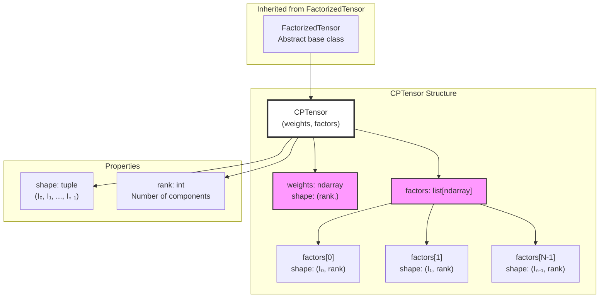
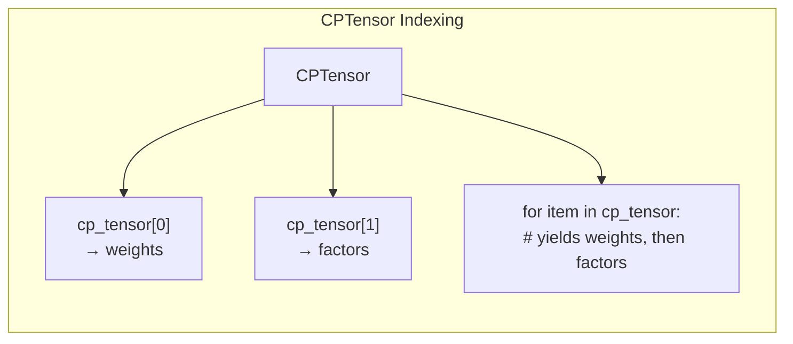
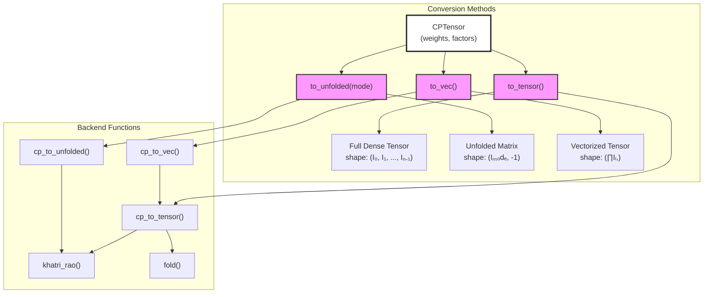
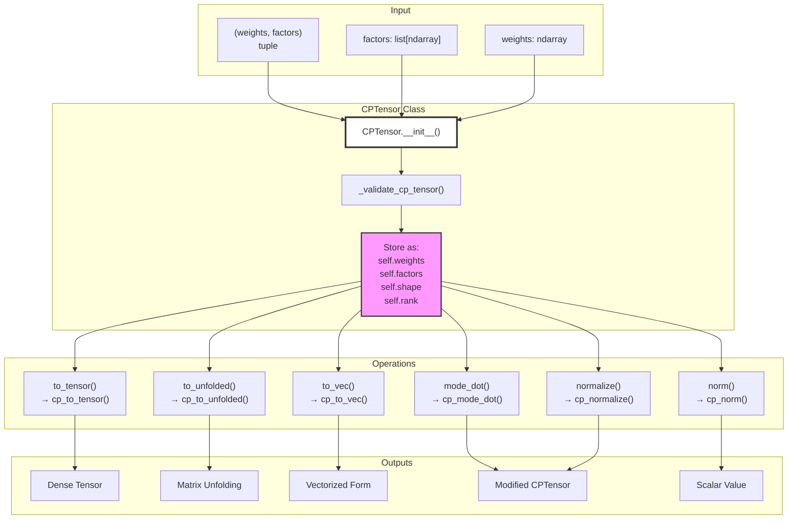

<!-- source: DeepWiki mcp.deepwiki.com · repo tensorly/tensorly · page 4.1 CPTensor Class · fetched 2026-10-21 -->

# CPTensor Class

<details>
<summary>Relevant source files</summary>

The following files were used as context for generating this wiki page:

- [tensorly/cp_tensor.py](tensorly/cp_tensor.py)
- [tensorly/tests/test_cp_tensor.py](tensorly/tests/test_cp_tensor.py)
- [tensorly/tests/test_tucker_tensor.py](tensorly/tests/test_tucker_tensor.py)
- [tensorly/tucker_tensor.py](tensorly/tucker_tensor.py)

</details>


## Purpose and Scope

This document details the `CPTensor` class and associated functions in TensorLy, which provide the core data structure and operations for Canonical Polyadic (CP) tensor decompositions. The CPTensor class stores a tensor in its factorized CP form as weights and factor matrices, enabling memory-efficient representation and computation.

For information about computing CP decompositions, see [CP Decomposition](#3.1). For other tensor representation formats, see [TuckerTensor Class](#4.2) and [Parafac2Tensor and Other Formats](#4.3).

**Sources:** [tensorly/cp_tensor.py:1-690]()

## CPTensor Data Structure

The `CPTensor` class represents a tensor in CP factorized form as a tuple `(weights, factors)`:

- **weights**: 1D array of shape `(rank,)` containing the weights for each rank-1 component
- **factors**: List of `N` matrices, where `factors[i]` has shape `(tensor_shape[i], rank)`

The full tensor is reconstructed as:

$$\mathcal{X} = \sum_{r=1}^{R} w_r \cdot \mathbf{u}_r^{(1)} \circ \mathbf{u}_r^{(2)} \circ \cdots \circ \mathbf{u}_r^{(N)}$$

where $w_r$ are the weights, $\mathbf{u}_r^{(i)}$ are the columns of `factors[i]`, and $\circ$ denotes the outer product.



**Sources:** [tensorly/cp_tensor.py:17-68](), [tensorly/cp_tensor.py:163-214]()

## Class Initialization and Validation

### CPTensor Constructor

The `CPTensor` class constructor accepts a tuple `(weights, factors)` and validates the structure:

| Validation Check | Requirement |
|-----------------|-------------|
| **Factor dimensions** | All factors must have the same number of columns (rank) |
| **Weights length** | `len(weights)` must equal `rank` |
| **Factor rank consistency** | `factors[i].shape[1] == rank` for all `i` |
| **Weights shape** | If provided, `weights.shape == (rank,)` |

If `weights` is `None`, it is automatically set to `ones(rank)`.

```python
# Example usage
weights = tl.tensor([1.0, 2.0, 3.0])  # rank=3
factors = [
    tl.tensor([[1, 2, 3], [4, 5, 6]]),        # shape (2, 3)
    tl.tensor([[7, 8, 9], [10, 11, 12]]),     # shape (2, 3)
    tl.tensor([[13, 14, 15], [16, 17, 18]])   # shape (2, 3)
]
cp_tensor = CPTensor((weights, factors))
# Represents a 2x2x2 tensor with rank 3
```

**Sources:** [tensorly/cp_tensor.py:17-68](), [tensorly/cp_tensor.py:163-214]()

### Validation Function

The `_validate_cp_tensor()` function validates a CP tensor and returns its shape and rank:

```python
shape, rank = _validate_cp_tensor(cp_tensor)
```

This function handles both `CPTensor` instances and raw `(weights, factors)` tuples. It also handles special cases:
- 0-order tensors (scalars)
- Rank-1 tensors (vectors with single-column factors)

**Sources:** [tensorly/cp_tensor.py:163-214]()

## Indexing and Iteration

The `CPTensor` class supports tuple-like indexing and iteration:

| Operation | Behavior | Example |
|-----------|----------|---------|
| `cp_tensor[0]` | Returns weights | `weights = cp_tensor[0]` |
| `cp_tensor[1]` | Returns factors list | `factors = cp_tensor[1]` |
| `weights, factors = cp_tensor` | Unpacking | Iterates over weights, then factors |
| `len(cp_tensor)` | Always returns 2 | `len(cp_tensor) == 2` |



**Sources:** [tensorly/cp_tensor.py:33-62]()

## Conversion Methods

The `CPTensor` class provides several methods to convert the factorized representation to other forms:

### to_tensor(): Full Tensor Reconstruction

Converts the CP tensor to a full dense tensor using the Khatri-Rao product:

```python
full_tensor = cp_tensor.to_tensor()
```

Implementation computes: `factors[0] * weights @ khatri_rao(factors[1:]).T`, then folds to original shape.

**Sources:** [tensorly/cp_tensor.py:70-72](), [tensorly/cp_tensor.py:433-486]()

### to_unfolded(mode): Matrix Unfolding

Converts to a mode-n unfolding (matricization) without forming the full tensor:

```python
unfolded_matrix = cp_tensor.to_unfolded(mode=0)
```

Computes: `factors[mode] * weights @ khatri_rao(factors, skip_matrix=mode).T`

**Sources:** [tensorly/cp_tensor.py:76-77](), [tensorly/cp_tensor.py:488-522]()

### to_vec(): Vectorization

Converts to a flattened vector representation:

```python
vector = cp_tensor.to_vec()
```

Equivalent to vectorizing the full tensor but computed efficiently via the Khatri-Rao product.

**Sources:** [tensorly/cp_tensor.py:73-74](), [tensorly/cp_tensor.py:524-546]()



**Sources:** [tensorly/cp_tensor.py:70-77](), [tensorly/cp_tensor.py:433-546]()

## Operations on CP Tensors

### mode_dot(): N-Mode Product

Performs n-mode product with a matrix or vector at a specified mode:

```python
result = cp_tensor.mode_dot(matrix_or_vector, mode, keep_dim=False, copy=True)
```

| Parameter | Description |
|-----------|-------------|
| `matrix_or_vector` | 2D matrix of shape `(J, tensor_shape[mode])` or 1D vector of shape `(tensor_shape[mode],)` |
| `mode` | Mode along which to perform the product |
| `keep_dim` | If False and input is vector, contracts over that mode |
| `copy` | If True, returns new CPTensor; if False, modifies in-place |

**Behavior:**
- **Matrix multiplication**: Replaces `factors[mode]` with `matrix @ factors[mode]`, resulting in shape change at that mode
- **Vector multiplication with `keep_dim=False`**: Contracts the mode, removing it from the tensor and merging the result into an adjacent factor
- **Vector multiplication with `keep_dim=True`**: Keeps dimensionality but updates the factor

**Sources:** [tensorly/cp_tensor.py:87-110](), [tensorly/cp_tensor.py:549-612]()

### norm(): L2 Norm

Computes the L2 norm of the full tensor without reconstructing it:

```python
norm_value = cp_tensor.norm()
```

Uses the property that for Khatri-Rao products:
$$\text{khatri-rao}(A, B)^T \times \text{khatri-rao}(A, B) = (A^T A) \odot (B^T B)$$

where $\odot$ is the Hadamard (elementwise) product.

**Sources:** [tensorly/cp_tensor.py:112-130](), [tensorly/cp_tensor.py:614-644]()

### normalize(): Factor Normalization

Normalizes factor matrices to unit column norm, absorbing the norms into the weights:

```python
cp_tensor.normalize(inplace=True)
```

| Parameter | Description |
|-----------|-------------|
| `inplace` | If True, modifies tensor in-place; if False, returns normalized copy |

After normalization, each column of each factor matrix has unit Euclidean norm, and the magnitude information is stored in the weights.

**Sources:** [tensorly/cp_tensor.py:132-161](), [tensorly/cp_tensor.py:278-321]()

### cp_copy(): Deep Copy

Creates a deep copy of the CP tensor:

```python
cp_tensor_copy = cp_tensor.cp_copy()
```

Copies both weights and all factor matrices.

**Sources:** [tensorly/cp_tensor.py:79-85]()

## Utility Functions

### cp_normalize(): Standalone Normalization

```python
normalized_cp_tensor = cp_normalize(cp_tensor)
```

Returns a new normalized CPTensor without modifying the input. Absorbs the first factor's norms into weights, then normalizes all factors.

**Sources:** [tensorly/cp_tensor.py:278-321]()

### cp_flip_sign(): Sign Flipping

```python
flipped_cp_tensor = cp_flip_sign(cp_tensor, mode=0, func=None)
```

Flips factor signs to ensure positivity (by default, positive mean). Negative signs are assigned to the specified mode.

| Parameter | Description |
|-----------|-------------|
| `mode` | Mode that receives negative signs (default: 0) |
| `func` | Function to summarize column sign (default: `T.mean`) |

**Sources:** [tensorly/cp_tensor.py:324-374]()

### cp_lstsq_grad(): Gradient Computation

```python
cp_gradient = cp_lstsq_grad(cp_tensor, target_tensor, return_loss=False, mask=None)
```

Computes the gradient of the least-squares loss $\frac{1}{2}\|\mathcal{X} - \text{CP}\|^2$ with respect to the factor matrices.

| Parameter | Description |
|-----------|-------------|
| `target_tensor` | Target dense tensor to compare against |
| `return_loss` | If True, also returns scalar loss value |
| `mask` | Optional mask to apply to the difference |

Returns a `CPTensor` with `weights=None` and gradient matrices as factors.

**Sources:** [tensorly/cp_tensor.py:377-430]()

### cp_permute_factors(): Factor Permutation

```python
permuted_tensors, permutation = cp_permute_factors(ref_cp_tensor, tensors_to_permute)
```

Permutes columns of factor matrices to match a reference CP tensor's component order. Uses congruence coefficients and Linear Sum Assignment to find optimal permutation.

| Parameter | Description |
|-----------|-------------|
| `ref_cp_tensor` | Reference CP tensor |
| `tensors_to_permute` | Single CPTensor or list of CPTensors to permute |

Returns permuted tensors and the permutation indices used.

**Sources:** [tensorly/cp_tensor.py:647-689]()

## Rank Validation and Parameter Counting

### validate_cp_rank(): Rank Determination

```python
rank = validate_cp_rank(tensor_shape, rank='same', rounding='round')
```

Determines appropriate CP rank based on desired parameter count:

| `rank` value | Behavior |
|--------------|----------|
| `'same'` | Rank chosen to match original tensor parameter count |
| `float` (e.g., 0.5) | Rank chosen to use specified fraction of original parameters |
| `int` | Returns the integer as-is |

| `rounding` value | Effect |
|------------------|--------|
| `'round'` | Standard rounding |
| `'floor'` | Round down |
| `'ceil'` | Round up |

**Sources:** [tensorly/cp_tensor.py:240-275]()

### _cp_n_param(): Parameter Count

```python
n_params = _cp_n_param(tensor_shape, rank, weights=False)
```

Computes the number of parameters in a CP decomposition:

$$n_{\text{params}} = r \times \sum_{i=1}^{N} I_i$$

where $r$ is the rank and $I_i$ are the mode sizes. Add $r$ if `weights=True`.

**Sources:** [tensorly/cp_tensor.py:217-237]()

## Data Flow Summary



**Sources:** [tensorly/cp_tensor.py:1-690]()

## Practical Usage Examples

### Creating a CP Tensor

```python
import tensorly as tl

# Create factor matrices for a 4x5x6 tensor with rank 3
factors = [
    tl.tensor(np.random.randn(4, 3)),  # mode 0: shape (4, 3)
    tl.tensor(np.random.randn(5, 3)),  # mode 1: shape (5, 3)
    tl.tensor(np.random.randn(6, 3))   # mode 2: shape (6, 3)
]
weights = tl.tensor([1.0, 2.0, 3.0])

# Create CPTensor instance
cp_tensor = CPTensor((weights, factors))

print(cp_tensor.shape)  # (4, 5, 6)
print(cp_tensor.rank)   # 3
```

### Converting and Computing

```python
# Reconstruct full tensor
full_tensor = cp_tensor.to_tensor()

# Get mode-0 unfolding
unfolded = cp_tensor.to_unfolded(mode=0)

# Compute norm without reconstruction
norm_value = cp_tensor.norm()

# Normalize factors
cp_tensor.normalize()
```

### N-Mode Product

```python
# Matrix multiplication along mode 1
matrix = tl.tensor(np.random.randn(7, 5))  # maps mode 1 from size 5 to 7
result = cp_tensor.mode_dot(matrix, mode=1, copy=True)
# result has shape (4, 7, 6) with rank 3

# Vector contraction along mode 2
vector = tl.tensor(np.random.randn(6))
result = cp_tensor.mode_dot(vector, mode=2, keep_dim=False, copy=True)
# result has shape (4, 5) with rank 3 (mode 2 contracted out)
```

**Sources:** [tensorly/cp_tensor.py:17-690](), [tensorly/tests/test_cp_tensor.py:1-332]()

## Integration with Decomposition Algorithms

The `CPTensor` class is the primary output format for CP decomposition algorithms:

- `parafac()` returns a `CPTensor` instance
- `non_negative_parafac()` returns a `CPTensor` instance
- `constrained_parafac()` returns a `CPTensor` instance

These decomposition methods are detailed in [CP Decomposition](#3.1).

**Sources:** [tensorly/cp_tensor.py:1-15]()

---

