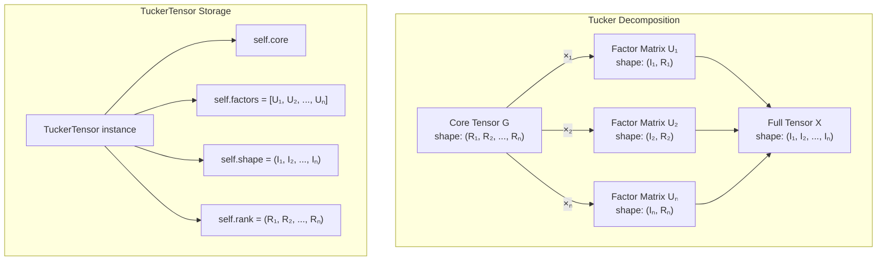
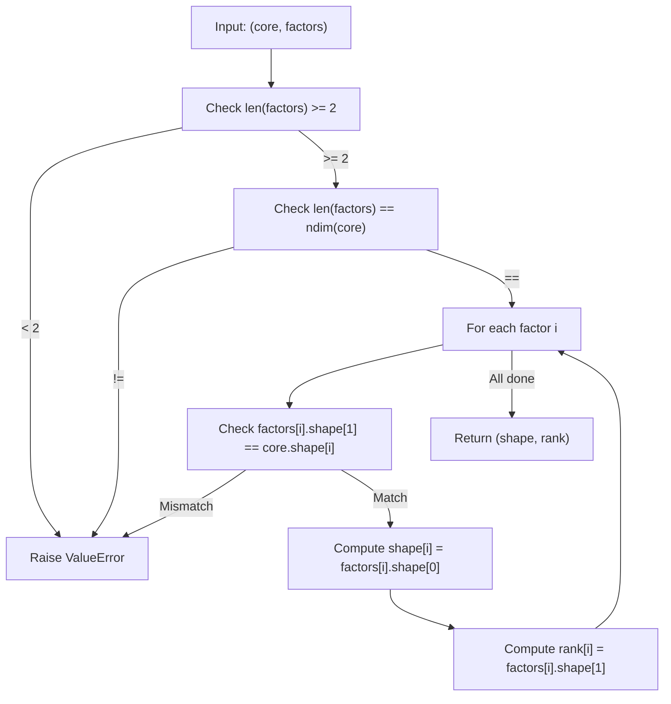
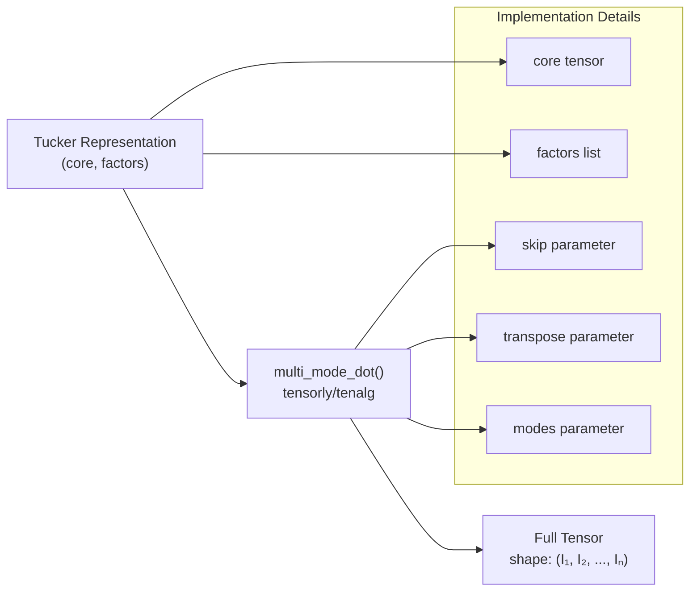
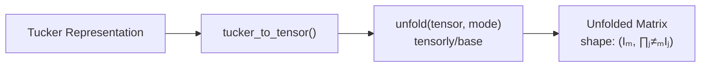
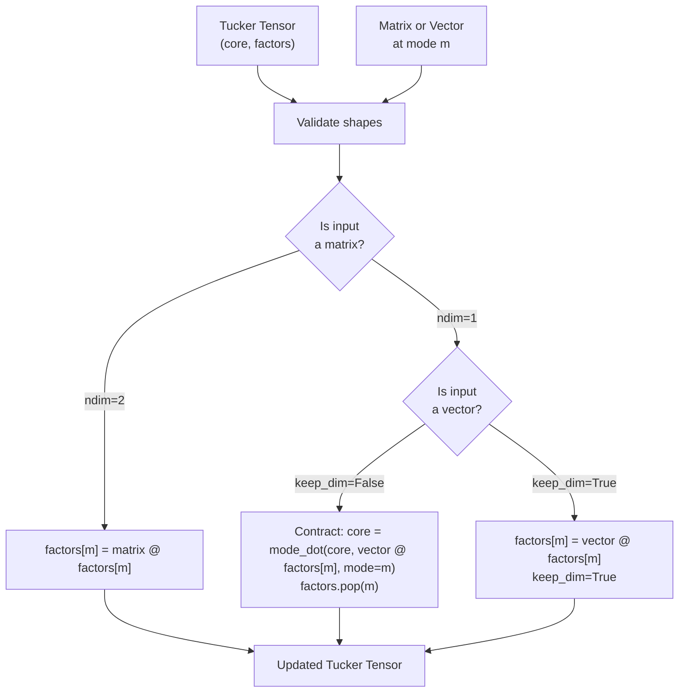
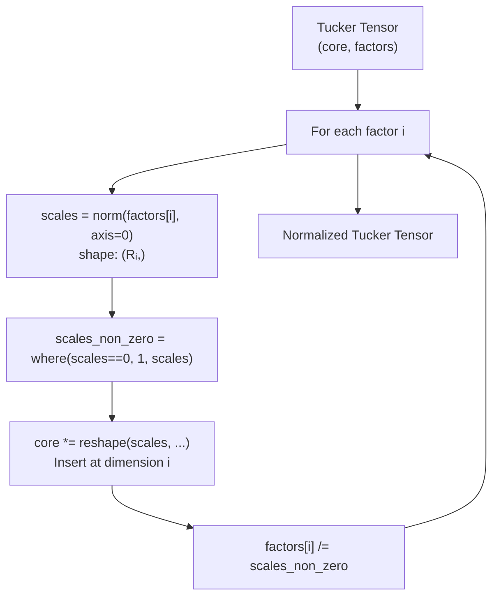
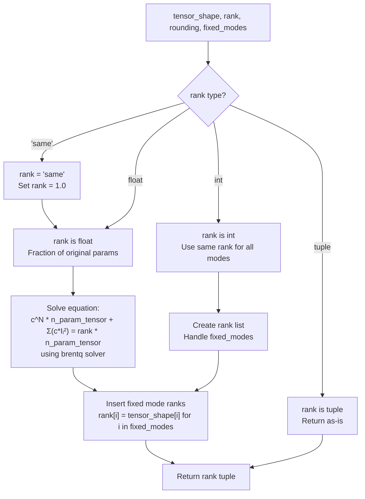

<!-- source: DeepWiki mcp.deepwiki.com · repo tensorly/tensorly · page 4.2 TuckerTensor Class · fetched 2026-10-21 -->

# TuckerTensor Class

<details>
<summary>Relevant source files</summary>

The following files were used as context for generating this wiki page:

- [tensorly/cp_tensor.py](tensorly/cp_tensor.py)
- [tensorly/tests/test_cp_tensor.py](tensorly/tests/test_cp_tensor.py)
- [tensorly/tests/test_tucker_tensor.py](tensorly/tests/test_tucker_tensor.py)
- [tensorly/tucker_tensor.py](tensorly/tucker_tensor.py)

</details>


## Purpose and Scope

This document describes the `TuckerTensor` class and associated operations in TensorLy. The TuckerTensor class provides a factorized representation of tensors using Tucker decomposition, which decomposes a tensor into a core tensor multiplied by factor matrices along each mode. This representation enables efficient storage and computation for high-dimensional tensors.

For information about Tucker decomposition algorithms (HOOI, partial Tucker, non-negative variants), see [Tucker Decomposition](#3.2). For information about CP decomposition representation, see [CPTensor Class](#4.1). For other tensor formats, see [Parafac2Tensor and Other Formats](#4.3).

---

## Tucker Decomposition Structure

A Tucker decomposition represents a tensor **X** of shape `(I₁, I₂, ..., Iₙ)` as:

**X** ≈ **G** ×₁ **U₁** ×₂ **U₂** ... ×ₙ **Uₙ**

Where:
- **G** is the **core tensor** of shape `(R₁, R₂, ..., Rₙ)`
- **U₁**, **U₂**, ..., **Uₙ** are **factor matrices** where **Uₖ** has shape `(Iₖ, Rₖ)`
- `(R₁, R₂, ..., Rₙ)` is the **rank** (also called multi-linear rank)



**Sources:** [tensorly/tucker_tensor.py:19-47](), [tensorly/tucker_tensor.py:227-236]()

---

## TuckerTensor Class Definition

The `TuckerTensor` class is defined in [tensorly/tucker_tensor.py:227-321]() and inherits from `FactorizedTensor`.

```mermaid
graph TB
    FactorizedTensor["FactorizedTensor<br/>(base class)"]
    TuckerTensor["TuckerTensor<br/>tensorly/tucker_tensor.py:227"]
    
    FactorizedTensor --> TuckerTensor
    
    subgraph "TuckerTensor Attributes"
        core["self.core<br/>Core tensor"]
        factors["self.factors<br/>List of factor matrices"]
        shape["self.shape<br/>Tuple of mode sizes"]
        rank["self.rank<br/>Tuple of ranks per mode"]
    end
    
    subgraph "TuckerTensor Methods"
        getitem["__getitem__(index)<br/>Access core (0) or factors (1)"]
        setitem["__setitem__(index, value)<br/>Set core or factors"]
        iter["__iter__()<br/>Iterate over core, factors"]
        to_tensor["to_tensor()<br/>Convert to full tensor"]
        to_unfolded["to_unfolded(mode)<br/>Convert to unfolded matrix"]
        to_vec["to_vec()<br/>Convert to vector"]
        mode_dot["mode_dot(matrix, mode)<br/>n-mode product"]
        normalize["normalize()<br/>Normalize factors"]
        tucker_copy["tucker_copy()<br/>Create deep copy"]
    end
    
    TuckerTensor --> core
    TuckerTensor --> factors
    TuckerTensor --> shape
    TuckerTensor --> rank
    
    TuckerTensor --> getitem
    TuckerTensor --> to_tensor
    TuckerTensor --> mode_dot
```



**Sources:** [tensorly/tucker_tensor.py:227-321]()

---

## Initialization and Validation

### TuckerTensor Constructor

The `TuckerTensor` class is initialized with a tuple `(core, factors)`:

```python
tucker_tensor = TuckerTensor((core, factors))
```

Where:
- `core`: Core tensor of shape `(R₁, R₂, ..., Rₙ)`
- `factors`: List of `n` factor matrices, where `factors[i]` has shape `(Iᵢ, Rᵢ)`

**Sources:** [tensorly/tucker_tensor.py:228-236]()

### Validation Process

The `_validate_tucker_tensor` function [tensorly/tucker_tensor.py:19-47]() performs the following checks:

| Validation Check | Error Condition | Error Message |
|-----------------|-----------------|---------------|
| Minimum factors | `len(factors) < 2` | "A Tucker tensor should be composed of at least two factors and a core" |
| Factor count matches core modes | `len(factors) != ndim(core)` | "Tucker decompositions should have one factor per mode of the core tensor" |
| Factor dimensions match core | `factors[i].shape[1] != core.shape[i]` | "factors[n].shape[1] = core.shape[n]" must hold |



**Sources:** [tensorly/tucker_tensor.py:19-47](), [tensorly/tests/test_tucker_tensor.py:26-58]()

---

## Indexing and Iteration

The `TuckerTensor` class supports tuple-like indexing:

| Index | Returns | Line Reference |
|-------|---------|----------------|
| `tucker_tensor[0]` | Core tensor | [tensorly/tucker_tensor.py:238-242]() |
| `tucker_tensor[1]` | List of factors | [tensorly/tucker_tensor.py:238-242]() |
| Other indices | Raises `IndexError` | [tensorly/tucker_tensor.py:243-248]() |

Assignment works similarly via `__setitem__` [tensorly/tucker_tensor.py:250-260](). The class also supports iteration via `__iter__` [tensorly/tucker_tensor.py:262-264](), yielding the core followed by the factors.

**Sources:** [tensorly/tucker_tensor.py:238-267]()

---

## Conversion Methods

### tucker_to_tensor / to_tensor()

Converts the Tucker decomposition to a full dense tensor by computing the multi-mode product:

**X** = **G** ×₁ **U₁** ×₂ **U₂** ... ×ₙ **Uₙ**



**Function signatures:**
- `tucker_to_tensor(tucker_tensor, skip_factor=None, transpose_factors=False, modes=None)` [tensorly/tucker_tensor.py:50-75]()
- `TuckerTensor.to_tensor()` [tensorly/tucker_tensor.py:273-274]()

**Parameters:**
- `skip_factor`: Index of a factor to skip in the computation
- `transpose_factors`: Whether to transpose factor matrices
- `modes`: List of modes on which to perform the decomposition

**Sources:** [tensorly/tucker_tensor.py:50-75](), [tensorly/tucker_tensor.py:273-274](), [tensorly/tests/test_tucker_tensor.py:60-92]()

### tucker_to_unfolded / to_unfolded()

Converts the Tucker tensor to an unfolded (matricized) representation at a specified mode.



**Function signatures:**
- `tucker_to_unfolded(tucker_tensor, mode=0, skip_factor=None, transpose_factors=False)` [tensorly/tucker_tensor.py:105-131]()
- `TuckerTensor.to_unfolded(mode)` [tensorly/tucker_tensor.py:276-277]()

**Sources:** [tensorly/tucker_tensor.py:105-131](), [tensorly/tucker_tensor.py:276-277](), [tensorly/tests/test_tucker_tensor.py:133-156]()

### tucker_to_vec / to_vec()

Converts the Tucker tensor to a vectorized (flattened) representation.

**Function signatures:**
- `tucker_to_vec(tucker_tensor, skip_factor=None, transpose_factors=False)` [tensorly/tucker_tensor.py:134-164]()
- `TuckerTensor.to_vec()` [tensorly/tucker_tensor.py:287-288]()

**Note:** The implementation first converts to full tensor, then vectorizes. An alternative (slower) mathematical formulation exists: `kronecker(factors).dot(tensor_to_vec(core))`

**Sources:** [tensorly/tucker_tensor.py:134-164](), [tensorly/tucker_tensor.py:287-288](), [tensorly/tests/test_tucker_tensor.py:158-173]()

---

## Operations

### tucker_mode_dot / mode_dot()

Performs n-mode product between a Tucker tensor and a matrix or vector at a specified mode.



**Function signatures:**
- `tucker_mode_dot(tucker_tensor, matrix_or_vector, mode, keep_dim=False, copy=False)` [tensorly/tucker_tensor.py:167-224]()
- `TuckerTensor.mode_dot(matrix_or_vector, mode, keep_dim=False, copy=False)` [tensorly/tucker_tensor.py:290-313]()

**Parameters:**
- `matrix_or_vector`: 1D or 2D array
  - If 2D: shape `(J, Iₘ)` - tensor times matrix
  - If 1D: shape `(Iₘ,)` - tensor times vector
- `mode`: Integer specifying which mode to multiply
- `keep_dim`: If False and input is vector, contracts over that mode
- `copy`: If True, creates copies of core and factors

**Behavior:**
- **Matrix multiplication**: `factors[mode] = matrix @ factors[mode]` (new shape: `(J, Rₘ)`)
- **Vector multiplication (keep_dim=False)**: Contracts the mode by computing `core = mode_dot(core, vector @ factors[mode], mode)` and removing `factors[mode]`
- **Vector multiplication (keep_dim=True)**: `factors[mode] = vector @ factors[mode]` (new shape: `(1, Rₘ)`)

**Sources:** [tensorly/tucker_tensor.py:167-224](), [tensorly/tucker_tensor.py:290-313](), [tensorly/tests/test_tucker_tensor.py:175-211]()

### tucker_normalize / normalize()

Normalizes the factor matrices to unit length, absorbing the normalizing constants into the core tensor.



**Function signatures:**
- `tucker_normalize(tucker_tensor)` [tensorly/tucker_tensor.py:78-102]()
- `TuckerTensor.normalize()` [tensorly/tucker_tensor.py:315-320]()

The normalization process:
1. For each factor matrix, compute column-wise norms
2. Handle zero norms by replacing with ones
3. Multiply core tensor by the norms (properly shaped)
4. Divide factor columns by their norms

**Result:** All factor columns have unit Euclidean length, and `tucker_to_tensor` produces the same result.

**Sources:** [tensorly/tucker_tensor.py:78-102](), [tensorly/tucker_tensor.py:315-320](), [tensorly/tests/test_tucker_tensor.py:273-283]()

### tucker_copy()

Creates a deep copy of the TuckerTensor by copying both the core and all factor matrices.

**Function signature:**
- `TuckerTensor.tucker_copy()` [tensorly/tucker_tensor.py:279-285]()

**Sources:** [tensorly/tucker_tensor.py:279-285](), [tensorly/tests/test_tucker_tensor.py:285-295]()

---

## Rank Validation and Parameter Counting

### validate_tucker_rank()

Determines the appropriate rank for a Tucker decomposition based on various criteria.



**Function signature:**
- `validate_tucker_rank(tensor_shape, rank='same', rounding='round', fixed_modes=None)` [tensorly/tucker_tensor.py:344-447]()

**Parameters:**

| Parameter | Type | Description |
|-----------|------|-------------|
| `tensor_shape` | tuple | Shape of the full tensor `(I₁, I₂, ..., Iₙ)` |
| `rank` | str/float/int/tuple | Determines rank selection |
| `rounding` | str | Rounding method: 'round', 'floor', or 'ceil' |
| `fixed_modes` | list or None | Modes where rank equals original dimension |

**Rank specification options:**

| rank value | Behavior |
|------------|----------|
| `'same'` | Computes rank to preserve the same number of parameters as the full tensor |
| `float` (0 < rank ≤ 1) | Computes rank to keep `rank` fraction of original parameters |
| `int` | Uses the same rank for all modes (unless `fixed_modes` specified) |
| `tuple` | Directly specifies rank for each mode |

**Algorithm for fractional rank:**

The function solves for a scaling factor `c` such that the Tucker decomposition with rank `(c*I₁, c*I₂, ..., c*Iₙ)` has the desired fraction of parameters:

- Full tensor parameters: `∏ᵢIᵢ`
- Tucker parameters: `∏ᵢ(c*Iᵢ)` (core) + `Σᵢ(c*Iᵢ²)` (factors)
- Equation: `c^N * ∏ᵢIᵢ + Σᵢ(c*Iᵢ²) = rank * ∏ᵢIᵢ`

The equation is solved using scipy's `brentq` root finder [tensorly/tucker_tensor.py:428]().

**Sources:** [tensorly/tucker_tensor.py:344-447](), [tensorly/tests/test_tucker_tensor.py:225-271]()

### _tucker_n_param()

Computes the number of parameters in a Tucker decomposition.

**Function signature:**
- `_tucker_n_param(tensor_shape, rank)` [tensorly/tucker_tensor.py:323-341]()

**Formula:**
```
n_params = ∏ᵢRᵢ + Σᵢ(Rᵢ * Iᵢ)
```

Where:
- `∏ᵢRᵢ` = parameters in core tensor
- `Σᵢ(Rᵢ * Iᵢ)` = total parameters in all factor matrices

**Sources:** [tensorly/tucker_tensor.py:323-341](), [tensorly/tests/test_tucker_tensor.py:213-222]()

---

## Complete Function Reference

### Standalone Functions

| Function | Location | Purpose |
|----------|----------|---------|
| `_validate_tucker_tensor()` | [tensorly/tucker_tensor.py:19-47]() | Validates Tucker tensor structure and returns shape/rank |
| `tucker_to_tensor()` | [tensorly/tucker_tensor.py:50-75]() | Converts to full tensor using multi-mode product |
| `tucker_normalize()` | [tensorly/tucker_tensor.py:78-102]() | Normalizes factor matrices to unit length |
| `tucker_to_unfolded()` | [tensorly/tucker_tensor.py:105-131]() | Converts to mode-n unfolded matrix |
| `tucker_to_vec()` | [tensorly/tucker_tensor.py:134-164]() | Converts to vectorized form |
| `tucker_mode_dot()` | [tensorly/tucker_tensor.py:167-224]() | Performs n-mode product with matrix/vector |
| `_tucker_n_param()` | [tensorly/tucker_tensor.py:323-341]() | Counts parameters in decomposition |
| `validate_tucker_rank()` | [tensorly/tucker_tensor.py:344-447]() | Validates and computes appropriate rank |

### TuckerTensor Class Methods

| Method | Location | Purpose |
|--------|----------|---------|
| `__init__()` | [tensorly/tucker_tensor.py:228-236]() | Initializes Tucker tensor from (core, factors) |
| `__getitem__()` | [tensorly/tucker_tensor.py:238-248]() | Accesses core (index 0) or factors (index 1) |
| `__setitem__()` | [tensorly/tucker_tensor.py:250-260]() | Sets core or factors |
| `__iter__()` | [tensorly/tucker_tensor.py:262-264]() | Iterates over core and factors |
| `__len__()` | [tensorly/tucker_tensor.py:266-267]() | Returns 2 (core and factors) |
| `__repr__()` | [tensorly/tucker_tensor.py:269-271]() | String representation |
| `to_tensor()` | [tensorly/tucker_tensor.py:273-274]() | Converts to full tensor |
| `to_unfolded()` | [tensorly/tucker_tensor.py:276-277]() | Converts to unfolded matrix |
| `tucker_copy()` | [tensorly/tucker_tensor.py:279-285]() | Creates deep copy |
| `to_vec()` | [tensorly/tucker_tensor.py:287-288]() | Converts to vector |
| `mode_dot()` | [tensorly/tucker_tensor.py:290-313]() | n-mode product operation |
| `normalize()` | [tensorly/tucker_tensor.py:315-320]() | Normalizes factors |

**Sources:** [tensorly/tucker_tensor.py:227-321]()

---

## Usage Examples

### Creating and Converting a Tucker Tensor

```python
from tensorly import backend as tl
from tensorly.tucker_tensor import TuckerTensor
from tensorly.random import random_tucker

# Generate random Tucker tensor
shape = (3, 4, 5)
rank = (2, 3, 4)
tucker_tensor = random_tucker(shape, rank)

# Access components
core, factors = tucker_tensor  # Unpacking
core = tucker_tensor[0]        # Core tensor
factors = tucker_tensor[1]     # List of factor matrices

# Convert to full tensor
full_tensor = tucker_tensor.to_tensor()

# Convert to unfolded matrix at mode 1
unfolded = tucker_tensor.to_unfolded(mode=1)

# Convert to vector
vec = tucker_tensor.to_vec()
```

**Sources:** [tensorly/tests/test_tucker_tensor.py:60-92](), [tensorly/tests/test_tucker_tensor.py:133-156]()

### Performing Mode Products

```python
import numpy as np
from tensorly import backend as tl
from tensorly.tucker_tensor import TuckerTensor

# Create Tucker tensor
shape = (5, 4, 6)
rank = (3, 2, 4)
tucker_ten = random_tucker(shape, rank)

# Matrix for mode 1 (shape: 7 x 4)
matrix = tl.tensor(np.random.random((7, shape[1])))

# Multiply at mode 1
result = tucker_ten.mode_dot(matrix, mode=1, copy=True)
# Result has new shape: (5, 7, 6) with rank (3, 2, 4)

# Vector for mode 2 (shape: 6)
vec = tl.tensor(np.random.random(shape[2]))

# Contract over mode 2
result = tucker_ten.mode_dot(vec, mode=2, keep_dim=False)
# Result has new shape: (5, 4) with 2 modes
```

**Sources:** [tensorly/tests/test_tucker_tensor.py:175-211]()

### Normalizing Factors

```python
from tensorly.tucker_tensor import TuckerTensor
from tensorly.random import random_tucker

shape = (3, 4, 5)
rank = (3, 2, 4)
tucker_ten = random_tucker(shape, rank)

# Normalize in-place
tucker_ten.normalize()

# All factor columns now have unit length
for i, factor in enumerate(tucker_ten.factors):
    norms = tl.norm(factor, axis=0)
    # norms ≈ [1, 1, ..., 1]

# Reconstruction is unchanged
```

**Sources:** [tensorly/tests/test_tucker_tensor.py:273-283]()

### Validating Tucker Rank

```python
from tensorly.tucker_tensor import validate_tucker_rank, _tucker_n_param

tensor_shape = (10, 15, 20)

# Keep same number of parameters
rank = validate_tucker_rank(tensor_shape, rank='same')
# rank ≈ (5, 7, 9)

# Use 50% of parameters
rank = validate_tucker_rank(tensor_shape, rank=0.5)
n_params = _tucker_n_param(tensor_shape, rank)
# n_params ≈ 0.5 * (10 * 15 * 20)

# Fixed modes: mode 0 keeps original size
rank = validate_tucker_rank(
    tensor_shape, 
    rank=0.3, 
    fixed_modes=[0]
)
# rank[0] == tensor_shape[0] == 10
```

**Sources:** [tensorly/tests/test_tucker_tensor.py:225-271]()

---

## Key Implementation Details

### Validation Enforcement

The `_validate_tucker_tensor` function is called during `TuckerTensor.__init__` [tensorly/tucker_tensor.py:231]() to ensure:
1. At least 2 factors exist
2. Number of factors equals core dimensions
3. Factor dimensions align with core dimensions

### Multi-Mode Product Implementation

The `tucker_to_tensor` function delegates to `multi_mode_dot(core, factors, ...)` from [tensorly/tenalg](), which efficiently computes the sequence of mode products.

### Memory Efficiency

The Tucker representation stores:
- Core: `∏ᵢRᵢ` parameters
- Factors: `Σᵢ(Rᵢ * Iᵢ)` parameters
- Total: `∏ᵢRᵢ + Σᵢ(Rᵢ * Iᵢ)` parameters

This is significantly more compact than the full tensor (`∏ᵢIᵢ` parameters) when ranks are chosen appropriately.

### Copy Behavior

The `copy` parameter in `mode_dot()` is important:
- `copy=False`: Modifies the Tucker tensor in-place, updating `self.core` and `self.factors`
- `copy=True`: Creates copies before modification, returning a new TuckerTensor instance

**Sources:** [tensorly/tucker_tensor.py:213-224]()

---

## Related Components

- **Base operations**: Importing from [tensorly/base.py]() for `unfold()` and `tensor_to_vec()`
- **Tensor algebra**: Using `multi_mode_dot()` and `mode_dot()` from [tensorly/tenalg]()
- **Backend**: All operations use `tl` (backend as tl) for backend-agnostic computation
- **Factorized tensor interface**: Inherits from `FactorizedTensor` defined in [tensorly/_factorized_tensor.py]()
- **Random generation**: `random_tucker()` from [tensorly/random]() generates random Tucker tensors for testing

**Sources:** [tensorly/tucker_tensor.py:5-11]()

---

