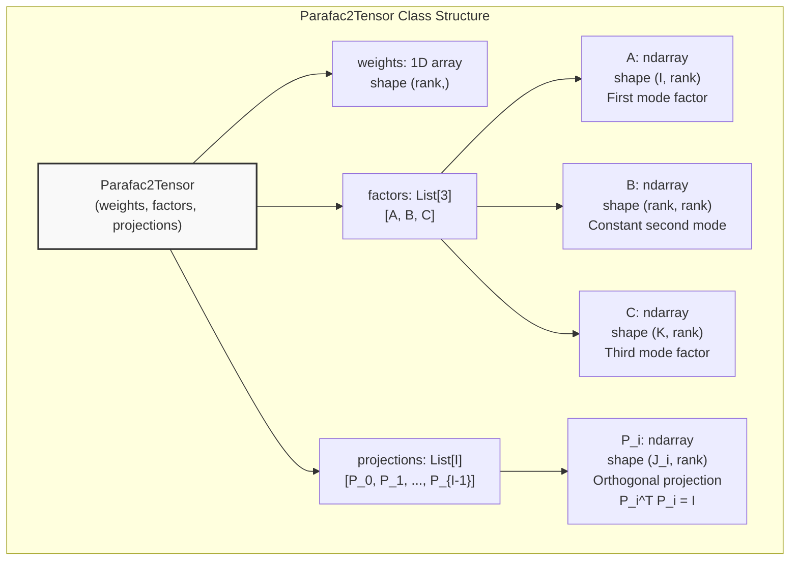
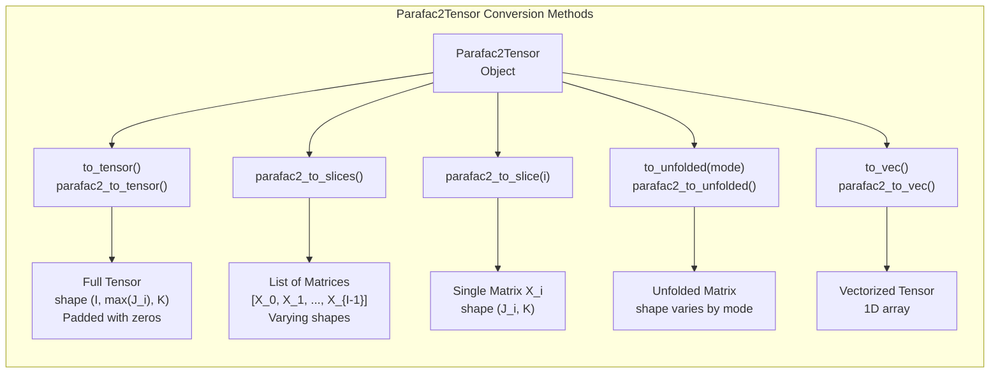
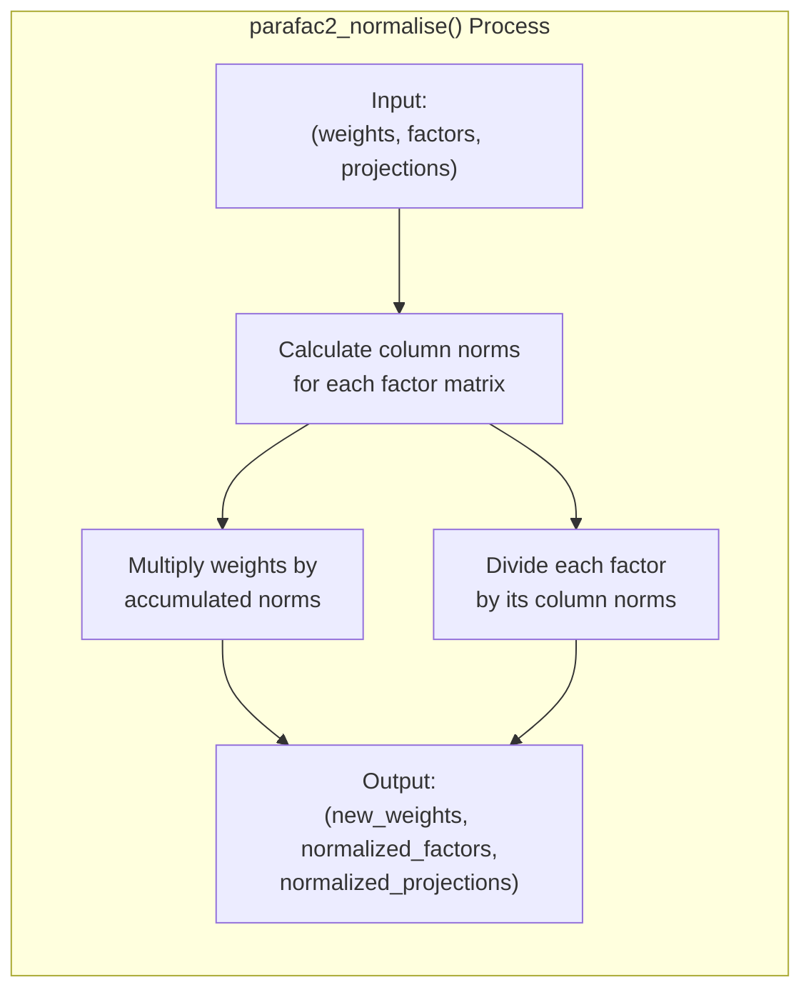
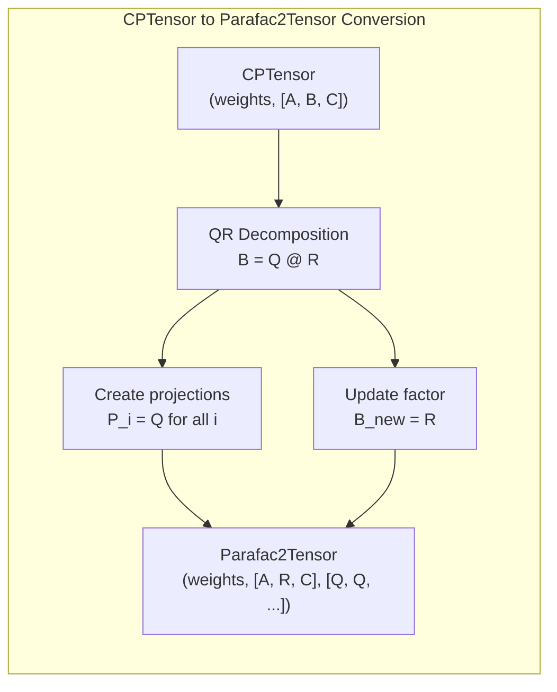
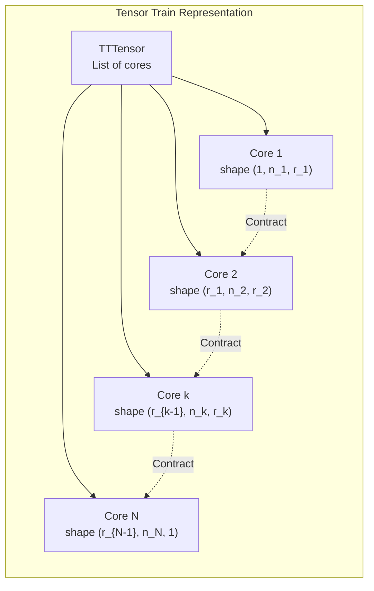
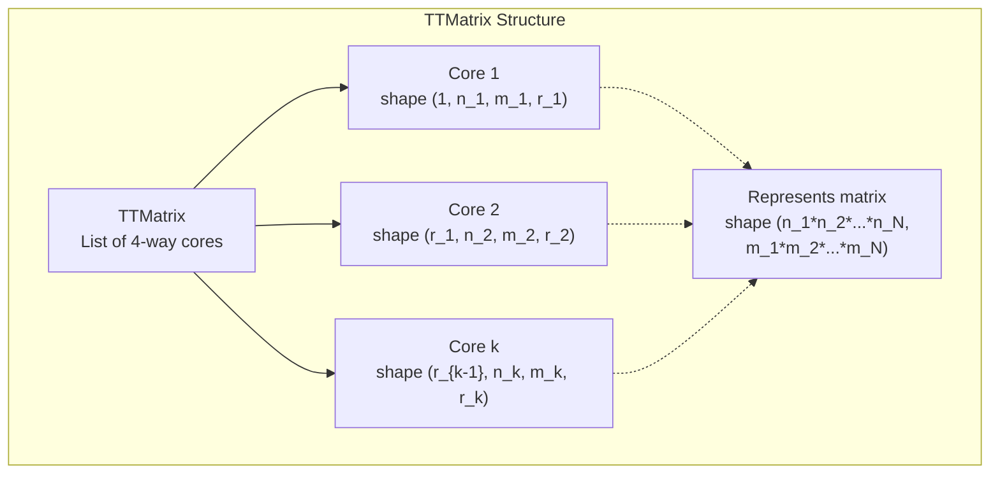
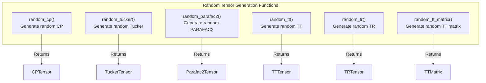

<!-- source: DeepWiki mcp.deepwiki.com · repo tensorly/tensorly · page 4.3 Parafac2Tensor and Other Formats · fetched 2026-10-21 -->

# Parafac2Tensor and Other Formats

<details>
<summary>Relevant source files</summary>

The following files were used as context for generating this wiki page:

- [doc/modules/api.rst](doc/modules/api.rst)
- [tensorly/decomposition/__init__.py](tensorly/decomposition/__init__.py)
- [tensorly/decomposition/_parafac2.py](tensorly/decomposition/_parafac2.py)
- [tensorly/decomposition/tests/test_parafac2.py](tensorly/decomposition/tests/test_parafac2.py)
- [tensorly/decomposition/tests/test_robust_decomposition.py](tensorly/decomposition/tests/test_robust_decomposition.py)
- [tensorly/parafac2_tensor.py](tensorly/parafac2_tensor.py)
- [tensorly/testing.py](tensorly/testing.py)
- [tensorly/tests/test_parafac2_tensor.py](tensorly/tests/test_parafac2_tensor.py)
- [tensorly/tests/test_testing.py](tensorly/tests/test_testing.py)

</details>


This page documents the specialized tensor representation classes for PARAFAC2, Tensor Train (TT), and Tensor Ring (TR) decompositions. These formats extend TensorLy's factorized tensor capabilities beyond the standard CP and Tucker representations covered in [4.1](#4.1) and [4.2](#4.2).

For information about the decomposition algorithms that produce these formats, see [3.3](#3.3) for Tensor Train and [3.4](#3.4) for PARAFAC2 decomposition.

---

## Parafac2Tensor: Handling Variable Mode Dimensions

### Mathematical Formulation

The `Parafac2Tensor` class represents a specialized tensor decomposition that allows the second mode to vary in size across the first mode. This is particularly useful for datasets where observations have different lengths or dimensions.

The decomposition has the form $(A, [B_i], C)$ where the $i$-th frontal slice $X_i$ is given by:

$$X_i = B_i \text{diag}(a_i) C^T$$

where:
- $a_i$ is the $i$-th row of factor matrix $A$ (shape $I \times R$)
- $B_i$ is a varying factor matrix (shape $J_i \times R$) satisfying $B_i = P_i B$
- $P_i$ are orthogonal projection matrices (shape $J_i \times R$)
- $B$ is a constant factor matrix (shape $R \times R$)
- $C$ is a constant factor matrix (shape $K \times R$)

The key constraint is that $B_i^T B_i$ must be constant for all $i$, achieved through the orthogonal projections.

**Sources:** [tensorly/parafac2_tensor.py:1-10](), [tensorly/decomposition/_parafac2.py:415-447]()

### Class Structure and Components



**Parafac2Tensor Structure Mapping**

**Sources:** [tensorly/parafac2_tensor.py:12-29](), [tensorly/parafac2_tensor.py:95-166]()

### Initialization and Validation

The `Parafac2Tensor` class performs strict validation during initialization:

| Validation Check | Requirement | Error Type |
|-----------------|-------------|------------|
| Number of factors | Must be exactly 3 | `ValueError` |
| Number of projections | Must equal `factors[0].shape[0]` | `ValueError` |
| Factor rank consistency | All factors must have same rank | `ValueError` |
| Projection orthogonality | $P_i^T P_i = I$ for all $i$ | `ValueError` |
| Weights dimension | Must match rank | `ValueError` |

**Sources:** [tensorly/parafac2_tensor.py:95-166]()

### Key Methods and Conversions



**Parafac2Tensor Conversion Operations**

The main conversion functions are:

- **`parafac2_to_tensor()`** [tensorly/parafac2_tensor.py:375-429](): Reconstructs the full tensor, padding uneven slices with zeros
- **`parafac2_to_slices()`** [tensorly/parafac2_tensor.py:310-373](): Returns a list of all slices without padding
- **`parafac2_to_slice()`** [tensorly/parafac2_tensor.py:248-308](): Reconstructs a single slice by index
- **`parafac2_to_unfolded()`** [tensorly/parafac2_tensor.py:432-479](): Unfolds the padded tensor along a specified mode
- **`parafac2_to_vec()`** [tensorly/parafac2_tensor.py:482-530](): Vectorizes the padded tensor

**Sources:** [tensorly/parafac2_tensor.py:248-530]()

### Normalization and Projection Application

#### Factor Normalization

The `parafac2_normalise()` function normalizes all factor matrices to unit column norms and absorbs the scaling into weights:



**Factor Normalization Process**

**Sources:** [tensorly/parafac2_tensor.py:168-219]()

#### Applying Projections

The `apply_parafac2_projections()` function computes the evolving factor matrices $B_i = P_i B$ for all slices:

```
Input:  (weights, [A, B, C], [P_0, P_1, ..., P_{I-1}])
Output: (weights, [A, [B_0, B_1, ..., B_{I-1}], C])
```

This converts from the compact representation with constant $B$ to an explicit representation with varying $B_i$ matrices.

**Sources:** [tensorly/parafac2_tensor.py:221-246]()

### Special Properties and Constraints

| Property | Description | Implementation |
|----------|-------------|----------------|
| **Variable dimensions** | Second mode can vary in size across first mode | Projections list can have varying first dimensions |
| **Orthogonality** | All projections satisfy $P_i^T P_i = I$ | Validated in `_validate_parafac2_tensor()` [tensorly/parafac2_tensor.py:139-145]() |
| **Constant cross-product** | $B_i^T B_i$ is constant for all $i$ | Ensured by $B_i = P_i B$ formulation |
| **Indexing** | Supports `[0]`, `[1]`, `[2]` indexing | Returns weights, factors, projections [tensorly/parafac2_tensor.py:59-71]() |
| **Iteration** | Iterable over components | Yields weights, factors, projections [tensorly/parafac2_tensor.py:73-76]() |

**Sources:** [tensorly/parafac2_tensor.py:12-93]()

### Conversion from CPTensor

The `from_CPTensor()` class method converts a standard CP decomposition to PARAFAC2 format by applying QR decomposition to the second factor:



**CPTensor to Parafac2Tensor Conversion**

**Sources:** [tensorly/parafac2_tensor.py:30-57]()

---

## TTTensor: Tensor Train Format

The Tensor Train (also known as Matrix Product State) format represents a tensor as a sequence of 3-way cores:

$$X_{i_1 i_2 ... i_N} = G_1[i_1] G_2[i_2] ... G_N[i_N]$$

where each $G_k[i_k]$ is a matrix of shape $(r_{k-1}, r_k)$ and $r_0 = r_N = 1$.

### TTTensor Structure



**Tensor Train Core Structure**

### Key Operations

The `tensorly.tt_tensor` module provides the following conversion functions:

- **`tt_to_tensor()`**: Reconstructs the full tensor from TT cores
- **`tt_to_unfolded(mode)`**: Unfolds the TT representation along a specified mode
- **`tt_to_vec()`**: Vectorizes the tensor
- **`pad_tt_rank()`**: Pads TT cores to increase rank

**Sources:** [doc/modules/api.rst:203-220]()

---

## TRTensor: Tensor Ring Format

The Tensor Ring format is similar to Tensor Train but with cyclic boundary conditions, where the last core connects back to the first:

$$X_{i_1 i_2 ... i_N} = \text{Trace}(G_1[i_1] G_2[i_2] ... G_N[i_N])$$

### TRTensor vs TTTensor

| Feature | Tensor Train (TT) | Tensor Ring (TR) |
|---------|------------------|------------------|
| **Boundary** | Open: $r_0 = r_N = 1$ | Closed: $r_0 = r_N \geq 1$ |
| **Operation** | Matrix products | Trace of matrix products |
| **Symmetry** | First/last modes special | All modes equivalent |
| **Rank flexibility** | Edge ranks fixed at 1 | All ranks can be larger |

**Sources:** [tensorly/decomposition/__init__.py:18-24]()

---

## TTMatrix: Tensor Train Matrix Format

The `tt_matrix` module provides a specialized format for representing matrices in Tensor Train form, useful for large-scale linear operators:



**Tensor Train Matrix Structure**

### Key Operations

- **`tt_matrix_to_tensor()`**: Reconstructs the full matrix
- **`tt_matrix_to_unfolded(mode)`**: Unfolds the matrix representation
- **`tt_matrix_to_vec()`**: Vectorizes the matrix

**Sources:** [doc/modules/api.rst:222-238]()

---

## Comparison of Factorized Formats

| Format | Components | Varying Dimensions | Orthogonality Constraint | Use Case |
|--------|-----------|-------------------|-------------------------|----------|
| **CPTensor** | weights, 3 factors | No | No | Standard decomposition |
| **TuckerTensor** | core tensor, 3 factors | No | No | Higher-order SVD |
| **Parafac2Tensor** | weights, 3 factors, projections | Yes (mode 2) | Yes (projections) | Variable-length sequences |
| **TTTensor** | N cores | No | No | High-dimensional tensors |
| **TRTensor** | N cores (cyclic) | No | No | Translation-invariant data |
| **TTMatrix** | N 4-way cores | No | No | Large-scale linear operators |

**Sources:** [tensorly/parafac2_tensor.py:1-530](), [doc/modules/api.rst:162-259]()

---

## Random Tensor Generation

TensorLy provides random generation functions for testing and initialization:



**Random Generation Functions for Tensor Formats**

These functions are particularly useful for:
- Testing decomposition algorithms
- Initializing iterative algorithms
- Generating synthetic datasets

**Sources:** [doc/modules/api.rst:453-471](), [tensorly/decomposition/tests/test_parafac2.py:31-35]()

---

