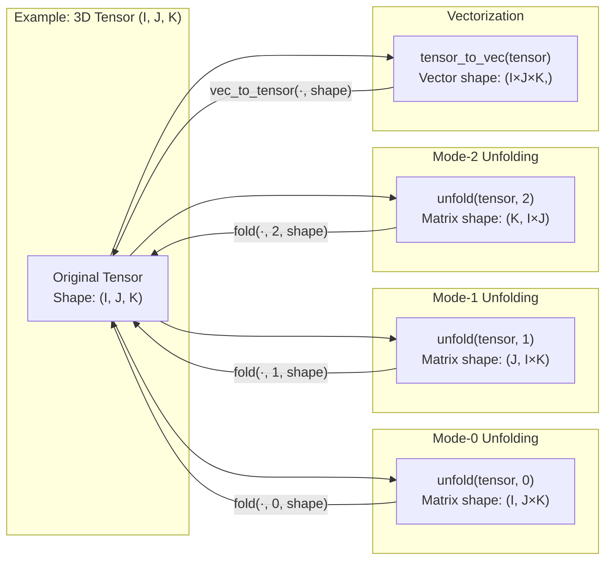
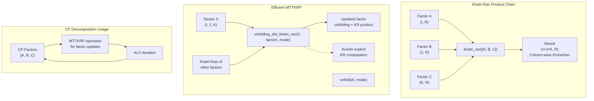
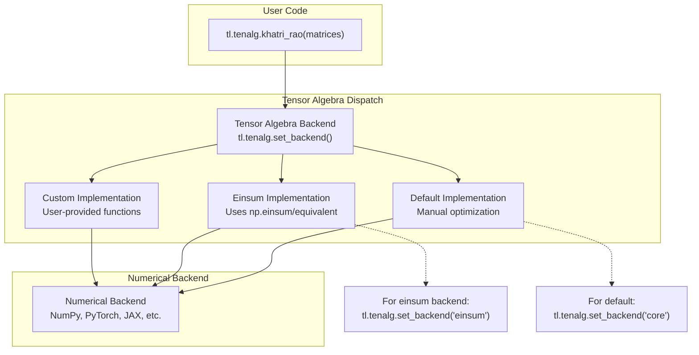

<!-- source: DeepWiki mcp.deepwiki.com · repo tensorly/tensorly · page 5 Tensor Algebra Operations · fetched 2026-10-21 -->

# Tensor Algebra Operations

<details>
<summary>Relevant source files</summary>

The following files were used as context for generating this wiki page:

- [doc/modules/api.rst](doc/modules/api.rst)
- [tensorly/decomposition/__init__.py](tensorly/decomposition/__init__.py)
- [tensorly/decomposition/_constrained_cp.py](tensorly/decomposition/_constrained_cp.py)
- [tensorly/decomposition/robust_decomposition.py](tensorly/decomposition/robust_decomposition.py)
- [tensorly/decomposition/tests/test_robust_decomposition.py](tensorly/decomposition/tests/test_robust_decomposition.py)
- [tensorly/tenalg/proximal.py](tensorly/tenalg/proximal.py)
- [tensorly/tenalg/svd.py](tensorly/tenalg/svd.py)
- [tensorly/tenalg/tests/test_proximal.py](tensorly/tenalg/tests/test_proximal.py)
- [tensorly/tenalg/tests/test_svd.py](tensorly/tenalg/tests/test_svd.py)

</details>


## Purpose and Scope

This page provides a comprehensive guide to TensorLy's tensor algebra operations, which form the mathematical foundation for tensor decompositions and manipulations. These operations include tensor unfolding/folding, mode-wise operations, specialized tensor products, and tensor reshaping utilities.

For specialized linear algebra operations including SVD variants, see [SVD Interface and Linear Algebra](#5.1). For constraint projection and proximal operators used in optimization, see [Proximal Operators](#5.2).

**Sources:** [doc/modules/api.rst:260-317](), [tensorly/tenalg/proximal.py:1-715](), [tensorly/tenalg/svd.py:1-448]()

## Tensor Algebra System Architecture

The tensor algebra layer sits between the backend abstraction and the decomposition algorithms, providing mathematical primitives for tensor manipulation.

```mermaid
graph TB
    subgraph "Backend Layer"
        Backend["Backend Manager<br/>tl.tensor, tl.dot, tl.norm"]
    end
    
    subgraph "Core Module: tensorly.base"
        Unfold["unfold()<br/>Matricization of tensors"]
        Fold["fold()<br/>Inverse of unfolding"]
        TensorToVec["tensor_to_vec()<br/>Vectorization"]
        VecToTensor["vec_to_tensor()<br/>Inverse vectorization"]
        PartialUnfold["partial_unfold()<br/>Partial matricization"]
        PartialFold["partial_fold()<br/>Inverse partial unfold"]
    end
    
    subgraph "Tensor Algebra Module: tensorly.tenalg"
        ModeDot["mode_dot()<br/>Tensor-matrix product along mode"]
        MultiModeDot["multi_mode_dot()<br/>Multiple mode products"]
        KhatriRao["khatri_rao()<br/>Column-wise Kronecker product"]
        UnfoldingDotKR["unfolding_dot_khatri_rao()<br/>Efficient MTTKRP"]
        Kronecker["kronecker()<br/>Standard Kronecker product"]
        Inner["inner()<br/>Tensor inner product"]
        Outer["outer()<br/>Tensor outer product"]
        BatchedOuter["batched_outer()<br/>Batch outer products"]
        TensorDot["tensordot()<br/>Generalized tensor contraction"]
        HigherMoment["higher_order_moment()<br/>Statistical moments"]
    end
    
    subgraph "Linear Algebra: tensorly.tenalg.svd"
        SVDInterface["svd_interface()<br/>Unified SVD dispatcher"]
        TruncatedSVD["truncated_svd()"]
        RandomizedSVD["randomized_svd()"]
        SymeigSVD["symeig_svd()"]
    end
    
    subgraph "Optimization: tensorly.tenalg.proximal"
        ProximalOp["proximal_operator()<br/>Main dispatcher"]
        SoftThreshold["soft_thresholding()"]
        SVDThreshold["svd_thresholding()"]
        Procrustes["procrustes()"]
        Constraints["12+ constraint types"]
    end
    
    subgraph "Applications"
        CPDecomp["CP Decomposition"]
        TuckerDecomp["Tucker Decomposition"]
        ConstrainedDecomp["Constrained Decomposition"]
        RobustPCA["Robust PCA"]
    end
    
    Backend --> Unfold
    Backend --> TensorToVec
    
    Unfold --> ModeDot
    Unfold --> UnfoldingDotKR
    Fold --> ModeDot
    
    Backend --> KhatriRao
    Backend --> Kronecker
    
    KhatriRao --> UnfoldingDotKR
    ModeDot --> MultiModeDot
    
    Backend --> SVDInterface
    SVDInterface --> TruncatedSVD
    SVDInterface --> RandomizedSVD
    SVDInterface --> SymeigSVD
    
    Backend --> ProximalOp
    ProximalOp --> SoftThreshold
    ProximalOp --> SVDThreshold
    SoftThreshold --> SVDThreshold
    SVDInterface --> SVDThreshold
    
    ModeDot --> CPDecomp
    UnfoldingDotKR --> CPDecomp
    KhatriRao --> CPDecomp
    
    ModeDot --> TuckerDecomp
    SVDInterface --> TuckerDecomp
    
    ProximalOp --> ConstrainedDecomp
    UnfoldingDotKR --> ConstrainedDecomp
    
    SVDThreshold --> RobustPCA
    SoftThreshold --> RobustPCA
    Unfold --> RobustPCA
    Fold --> RobustPCA
```



**Sources:** [doc/modules/api.rst:139-160](), [doc/modules/api.rst:260-301](), [tensorly/decomposition/_constrained_cp.py:1-613](), [tensorly/decomposition/robust_decomposition.py:1-145]()

## Unfolding and Reshaping Operations

Unfolding (also called matricization) converts a tensor into a matrix by rearranging its elements along specific modes. These operations are fundamental to tensor decomposition algorithms.

### Core Unfolding Functions

| Function | Location | Purpose |
|----------|----------|---------|
| `unfold(tensor, mode)` | `tensorly.base` | Unfolds tensor along specified mode |
| `fold(unfolded, mode, shape)` | `tensorly.base` | Inverse operation: reconstructs tensor |
| `partial_unfold(tensor, mode, ...)` | `tensorly.base` | Unfolds subset of modes |
| `partial_fold(unfolded, mode, ...)` | `tensorly.base` | Inverse of partial_unfold |
| `tensor_to_vec(tensor)` | `tensorly.base` | Flattens tensor to 1D vector |
| `vec_to_tensor(vec, shape)` | `tensorly.base` | Reshapes vector back to tensor |

**Unfolding Operation:**
For a tensor of shape `(I₁, I₂, ..., Iₙ)`, unfolding along mode `k` produces a matrix of shape `(Iₖ, I₁×...×Iₖ₋₁×Iₖ₊₁×...×Iₙ)`.



**Sources:** [doc/modules/api.rst:139-160]()

## Mode Operations

Mode operations perform tensor-matrix or tensor-tensor products along specific modes of a tensor, fundamental to Tucker decomposition and CP decomposition algorithms.

### Mode-n Product

The mode-n product multiplies a tensor by a matrix along its n-th mode:

**Function:** `mode_dot(tensor, matrix, mode, transpose=False)`

For a tensor `X` of shape `(I₁, ..., Iₙ, ..., Iₘ)` and matrix `U` of shape `(J, Iₙ)`, the mode-n product produces a tensor of shape `(I₁, ..., J, ..., Iₘ)`.

```mermaid
graph TB
    subgraph "Single Mode Operation"
        InputTensor["Tensor X<br/>shape: (I₁, I₂, ..., Iₙ, ..., Iₘ)"]
        Matrix["Matrix U<br/>shape: (J, Iₙ)"]
        ModeDotFunc["mode_dot(X, U, mode=n)"]
        OutputTensor["Result<br/>shape: (I₁, I₂, ..., J, ..., Iₘ)"]
        
        InputTensor --> ModeDotFunc
        Matrix --> ModeDotFunc
        ModeDotFunc --> OutputTensor
    end
    
    subgraph "Multi-Mode Operation"
        InputTensor2["Tensor X<br/>shape: (I₁, I₂, I₃)"]
        Matrices["List of matrices<br/>[U₁, U₂, U₃]"]
        MultiModeDotFunc["multi_mode_dot(X, [U₁, U₂, U₃])"]
        Core["Core tensor<br/>Transformed along all modes"]
        
        InputTensor2 --> MultiModeDotFunc
        Matrices --> MultiModeDotFunc
        MultiModeDotFunc --> Core
    end
    
    subgraph "Implementation Detail"
        UnfoldOp["unfold(tensor, mode)"]
        MatMul["matrix @ unfolded.T"]
        FoldOp["fold(result, mode, new_shape)"]
        
        UnfoldOp --> MatMul
        MatMul --> FoldOp
    end
```



**Multi-mode product:** `multi_mode_dot(tensor, matrix_or_matrices, modes=None, skip=None, transpose=False)`

This applies mode products sequentially along multiple modes, useful in Tucker decomposition where the core tensor is computed as `G = X ×₁ U₁ᵀ ×₂ U₂ᵀ ×₃ U₃ᵀ`.

**Sources:** [doc/modules/api.rst:284-296]()

## Tensor Products

TensorLy provides several specialized tensor product operations used throughout decomposition algorithms.

### Khatri-Rao Product

The Khatri-Rao product is the column-wise Kronecker product, fundamental to CP decomposition.

**Function:** `khatri_rao(matrices, skip_matrix=None, mask=None)`

For matrices `A` of shape `(I, R)` and `B` of shape `(J, R)`, the Khatri-Rao product is:
```
(A ⊙ B)[:,r] = A[:,r] ⊗ B[:,r]  for r = 1,...,R
```
Result shape: `(I×J, R)`



**Efficient MTTKRP:** `unfolding_dot_khatri_rao(tensor, cp_tensor, mode)`

The matricized tensor times Khatri-Rao product (MTTKRP) is the most computationally expensive operation in CP decomposition. This function computes `unfold(X, mode) @ khatri_rao(factors, skip_matrix=mode)` efficiently without explicitly forming the full Khatri-Rao product.

**Sources:** [doc/modules/api.rst:288-289](), [tensorly/decomposition/_constrained_cp.py:355-356]()

### Kronecker Product

**Function:** `kronecker(matrices, skip_matrix=None, reverse=False)`

Standard Kronecker product for a list of matrices. For matrices `A` of shape `(I, J)` and `B` of shape `(K, L)`, the Kronecker product `A ⊗ B` has shape `(I×K, J×L)`.

### Other Products

| Function | Description | Output Shape |
|----------|-------------|--------------|
| `inner(tensor1, tensor2)` | Tensor inner product (element-wise multiply then sum) | Scalar |
| `outer(tensor1, tensor2)` | Tensor outer product | `shape1 + shape2` |
| `batched_outer(tensor1, tensor2)` | Outer product for batched tensors | Depends on batch dims |
| `tensordot(tensor1, tensor2, axes)` | Generalized tensor contraction | Depends on axes |

**Sources:** [doc/modules/api.rst:290-296]()

## Tensor Algebra Backend

TensorLy's tensor algebra operations can be dispatched to different computational backends for performance optimization.



**Functions:**
- `tl.tenalg.set_backend(backend_name)` - Set the tensor algebra backend
- `tl.tenalg.get_backend()` - Get current tensor algebra backend name
- `tl.tenalg.backend_context(backend_name)` - Temporary context manager

The einsum backend can provide performance benefits when einsum is optimized (e.g., with `opt_einsum` or `cuQuantum` plugins).

**Sources:** [doc/modules/api.rst:302-317]()

## Higher-Order Operations

### Higher-Order Moments

**Function:** `higher_order_moment(tensor, order)`

Computes the `order`-th moment of a tensor, used in tensor decomposition initialization and analysis.

**Sources:** [doc/modules/api.rst:297]()

## Integration with Decomposition Algorithms

Tensor algebra operations are the building blocks for all decomposition algorithms:

```mermaid
graph TB
    subgraph "CP Decomposition Flow"
        CPInput["Input Tensor X"]
        CPInit["Initialize factors<br/>using SVD"]
        CPLoop["ALS Iteration Loop"]
        MTTKRP["unfolding_dot_khatri_rao()<br/>Compute gradient"]
        KRProd["khatri_rao()<br/>For reconstruction"]
        CPOutput["CP factors [A, B, C]"]
        
        CPInput --> CPInit
        CPInit --> CPLoop
        CPLoop --> MTTKRP
        MTTKRP --> CPLoop
        KRProd -.-> CPLoop
        CPLoop --> CPOutput
    end
    
    subgraph "Tucker Decomposition Flow"
        TuckerInput["Input Tensor X"]
        TuckerInit["Initialize using<br/>truncated_svd()"]
        TuckerLoop["HOOI Iteration"]
        ModeDotOp["multi_mode_dot()<br/>Compute core"]
        UnfoldSVD["unfold() + svd_interface()<br/>Update factors"]
        TuckerOutput["Tucker (core, factors)"]
        
        TuckerInput --> TuckerInit
        TuckerInit --> TuckerLoop
        TuckerLoop --> ModeDotOp
        TuckerLoop --> UnfoldSVD
        ModeDotOp --> TuckerLoop
        UnfoldSVD --> TuckerLoop
        TuckerLoop --> TuckerOutput
    end
    
    subgraph "Constrained Decomposition Flow"
        ConstInput["Input Tensor X"]
        ConstInit["Initialize with<br/>proximal_operator()"]
        ADMMLoop["ADMM Iteration"]
        MTTKRPConst["MTTKRP computation"]
        ProxUpdate["proximal_operator()<br/>Enforce constraints"]
        ConstOutput["Constrained CP factors"]
        
        ConstInput --> ConstInit
        ConstInit --> ADMMLoop
        ADMMLoop --> MTTKRPConst
        MTTKRPConst --> ProxUpdate
        ProxUpdate --> ADMMLoop
        ADMMLoop --> ConstOutput
    end
    
    subgraph "Robust PCA Flow"
        RPCAInput["Input Tensor X"]
        RPCALoop["ALM Iteration"]
        UnfoldOp["unfold() each mode"]
        SVDThresh["svd_thresholding()<br/>Low-rank part"]
        SoftThresh["soft_thresholding()<br/>Sparse part"]
        FoldOp["fold() back to tensor"]
        RPCAOutput["D (low-rank) + E (sparse)"]
        
        RPCAInput --> RPCALoop
        RPCALoop --> UnfoldOp
        UnfoldOp --> SVDThresh
        RPCALoop --> SoftThresh
        SVDThresh --> FoldOp
        FoldOp --> RPCALoop
        SoftThresh --> RPCALoop
        RPCALoop --> RPCAOutput
    end
```



**Sources:** [tensorly/decomposition/_constrained_cp.py:355-378](), [tensorly/decomposition/robust_decomposition.py:108-120]()

## Usage Patterns

### Pattern 1: Factor Update in CP Decomposition

```python
# Compute MTTKRP for mode update
# From: tensorly/decomposition/_constrained_cp.py:355-356
mttkrp = unfolding_dot_khatri_rao(tensor, (None, factors), mode)

# Solve least squares problem
# pseudo_inverse = (A.T @ A) * (B.T @ B) * (C.T @ C) for other modes
factor_new = solve(pseudo_inverse, mttkrp.T).T
```

### Pattern 2: Tucker Core Computation

```python
# Compute Tucker core via multi-mode product
# G = X ×₁ U₁ᵀ ×₂ U₂ᵀ ×₃ U₃ᵀ
core = multi_mode_dot(tensor, factors, transpose=True)
```

### Pattern 3: Mode-wise SVD in Tucker

```python
# Update factor for mode via unfolding + SVD
unfolded = unfold(tensor, mode)
U, S, V = svd_interface(unfolded, n_eigenvecs=rank)
factor[mode] = U[:, :rank]
```

### Pattern 4: Robust PCA Low-Rank Update

```python
# From: tensorly/decomposition/robust_decomposition.py:109-113
for i in range(ndim(X)):
    J[i] = fold(
        svd_thresholding(unfold(D, i) + unfold(L[i], i) / mu, reg_J / mu),
        i,
        X.shape,
    )
```

**Sources:** [tensorly/decomposition/_constrained_cp.py:355-378](), [tensorly/decomposition/robust_decomposition.py:108-120]()

## Advanced Features

### SVD Interface and Linear Algebra

For unified SVD operations supporting multiple algorithms (truncated, randomized, symeig), missing value imputation, non-negative factorization, and sign resolution, see [SVD Interface and Linear Algebra](#5.1).

Key functions:
- `svd_interface()` - Main dispatcher with advanced features
- `truncated_svd()` - Standard truncated SVD
- `randomized_svd()` - Randomized SVD for large matrices  
- `symeig_svd()` - SVD via eigendecomposition

**Sources:** [tensorly/tenalg/svd.py:366-448]()

### Proximal Operators

For constraint enforcement and proximal optimization operators supporting 12+ constraint types (non-negativity, sparsity, smoothness, monotonicity, unimodality, simplex projection, etc.), see [Proximal Operators](#5.2).

Key functions:
- `proximal_operator()` - Main dispatcher for constraints
- `soft_thresholding()` - L1 regularization
- `svd_thresholding()` - Nuclear norm regularization
- `simplex_prox()` - Simplex projection
- `monotonicity_prox()` - Monotonicity constraints
- `unimodality_prox()` - Unimodal distributions

**Sources:** [tensorly/tenalg/proximal.py:148-268](), [tensorly/tenalg/proximal.py:270-715]()

## Performance Considerations

1. **MTTKRP Efficiency:** The `unfolding_dot_khatri_rao()` function avoids explicit formation of the Khatri-Rao product, which is the primary computational bottleneck in CP decomposition.

2. **Tensor Algebra Backend:** For operations like Khatri-Rao products, switching to the einsum backend with `opt_einsum` or `cuQuantum` can provide significant speedups.

3. **Memory Layout:** Unfolding operations do not copy data when possible, but the memory layout depends on the backend and may affect performance.

4. **Backend Selection:** Different numerical backends (NumPy, PyTorch, JAX) have different performance characteristics for tensor operations. GPU backends can provide substantial speedups for large tensors.

**Sources:** [doc/modules/api.rst:302-317]()

---

