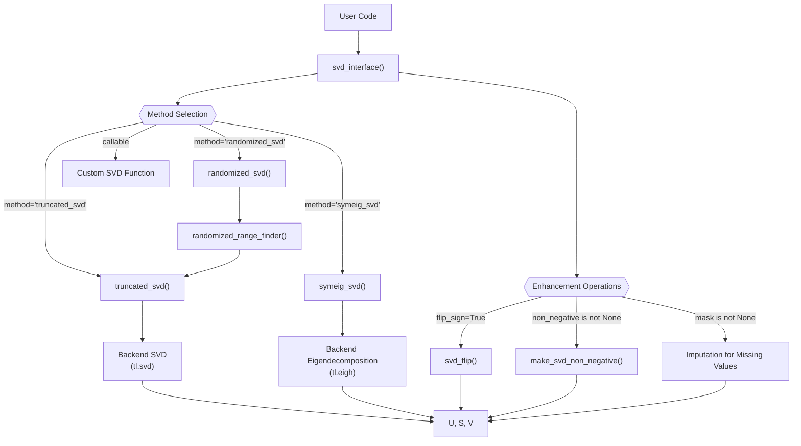
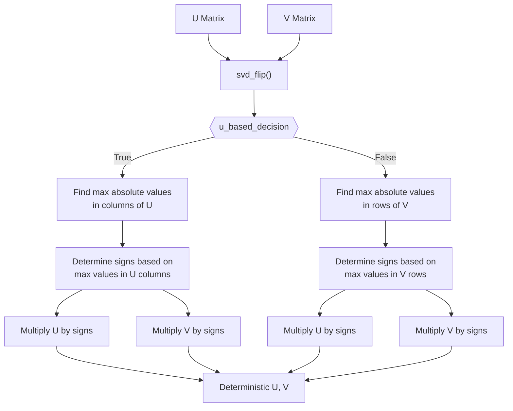
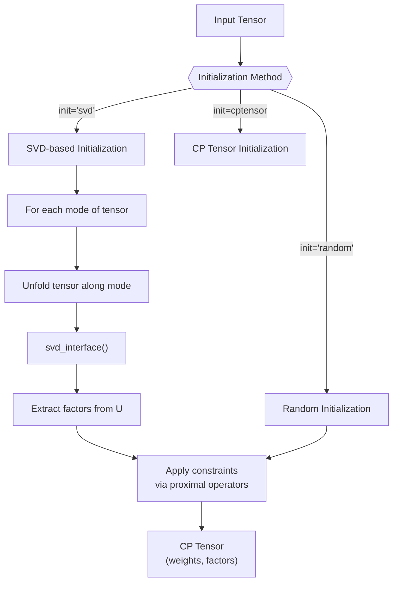

<!-- source: DeepWiki mcp.deepwiki.com · repo tensorly/tensorly · page 5.1 SVD Interface and Linear Algebra · fetched 2026-10-21 -->

# SVD and Matrix Operations

<details>
<summary>Relevant source files</summary>

The following files were used as context for generating this wiki page:

- [tensorly/decomposition/_constrained_cp.py](tensorly/decomposition/_constrained_cp.py)
- [tensorly/decomposition/robust_decomposition.py](tensorly/decomposition/robust_decomposition.py)
- [tensorly/tenalg/proximal.py](tensorly/tenalg/proximal.py)
- [tensorly/tenalg/svd.py](tensorly/tenalg/svd.py)
- [tensorly/tenalg/tests/test_proximal.py](tensorly/tenalg/tests/test_proximal.py)
- [tensorly/tenalg/tests/test_svd.py](tensorly/tenalg/tests/test_svd.py)

</details>


This page documents the Singular Value Decomposition (SVD) implementations and matrix operations in TensorLy, which serve as fundamental building blocks for many tensor decomposition algorithms. For information about tensor operations more generally, see [Tensor Operations](#5).

## Purpose and Scope

TensorLy provides multiple SVD implementations optimized for different use cases, along with utility functions for enhancing SVD results (e.g., sign correction, non-negative transformations). These operations are critical for initializing tensor decompositions and are designed to work with TensorLy's backend system, enabling computation across various numerical libraries (NumPy, PyTorch, TensorFlow, etc.).

## SVD Interface System

TensorLy implements a unified SVD interface that dispatches to different SVD algorithms based on user requirements. This provides flexibility to choose the most appropriate algorithm for a given task.



Sources: [tensorly/tenalg/svd.py:364-445]()

### Available SVD Methods

TensorLy provides three main SVD implementations:

| Method | Description | Best for | Implementation |
|--------|-------------|----------|----------------|
| `truncated_svd` | Standard SVD truncated to desired rank | General purpose | Uses backend's native SVD implementation |
| `symeig_svd` | SVD via eigendecomposition of A<sup>T</sup>A or AA<sup>T</sup> | Symmetric matrices or when backend eigendecomposition is optimized | Computes eigendecomposition of Gram matrix |
| `randomized_svd` | Randomized algorithm for approximate SVD | Large matrices where approximate result is sufficient | Uses random projections to reduce computation |

Sources: [tensorly/tenalg/svd.py:209-357]()

### SVD Interface Function

The `svd_interface` function serves as the main entry point for performing SVD operations in TensorLy:

```mermaid
flowchart LR
    Input["Input Matrix"] --> SVDInterface["svd_interface()"]
    SVDInterface --> SVDMethod["Selected SVD Method"]
    SVDMethod --> RawDecomp["Raw U, S, V"]
    
    RawDecomp --> |"mask is not None"| Imputation["Missing Value Imputation Loop"]
    Imputation --> Reconstructed["SVD with Imputed Values"]
    
    RawDecomp --> |"No imputation needed"| SignFlip["Sign Correction\n(optional)"]
    Reconstructed --> SignFlip
    
    SignFlip --> |"non_negative is not None"| NonNeg["Non-negative Transformation"]
    SignFlip --> |"non_negative is None"| Output["Final U, S, V"]
    NonNeg --> Output
```



Sources: [tensorly/tenalg/svd.py:364-445]()

## SVD Implementation Types

### Truncated SVD

The `truncated_svd` function computes a standard SVD truncated to the desired number of components:

```python
U, S, V = truncated_svd(matrix, n_eigenvecs=None)
```

This implementation leverages the backend's native SVD implementation (`tl.svd`), making it efficient across different backend libraries. It performs basic input validation through `svd_checks` to ensure proper dimensions and handling of edge cases.

Sources: [tensorly/tenalg/svd.py:209-233]()

### Symmetric Eigendecomposition SVD

The `symeig_svd` function computes SVD through eigendecomposition of either matrix.T.dot(matrix) or matrix.dot(matrix.T), depending on which dimension is smaller:

```python
U, S, V = symeig_svd(matrix, n_eigenvecs=None)
```

This approach can be more efficient for certain matrix shapes and backend implementations, especially when the matrix has significantly different dimensions.

Sources: [tensorly/tenalg/svd.py:236-283]()

### Randomized SVD

The `randomized_svd` function implements a probabilistic algorithm for SVD that can be significantly faster for large matrices where an approximate result is sufficient:

```python
U, S, V = randomized_svd(matrix, n_eigenvecs=None, n_oversamples=5, n_iter=2)
```

It works by finding a low-dimensional subspace that captures most of the matrix's action, then performing SVD in this smaller subspace. The implementation follows Algorithm 5.1 from Halko et al. (2009).

Sources: [tensorly/tenalg/svd.py:286-357]()

## SVD Enhancements

### Sign Correction with svd_flip

The `svd_flip` function ensures deterministic output from SVD by adjusting the sign of the columns in U and rows in V:



This function is particularly important for ensuring reproducible results across runs, especially when SVD results are used for initialization in iterative algorithms.

Sources: [tensorly/tenalg/svd.py:13-63]()

### Non-negative SVD

The `make_svd_non_negative` function transforms SVD results into non-negative form using the NNDSVD method (Non-Negative Double Singular Value Decomposition):

```python
W, H = make_svd_non_negative(tensor, U, S, V, nntype='nndsvda')
```

This transformation is useful for applications requiring non-negative factors, such as non-negative matrix factorization (NMF) initialization. Two variants are available:
- `nndsvd`: Small values are set to zero
- `nndsvda`: Small values are set to the tensor mean

Sources: [tensorly/tenalg/svd.py:66-133]()

## SVD in Tensor Decomposition Initialization

SVD plays a crucial role in initializing tensor decomposition algorithms, particularly for CP and Tucker decompositions.



Sources: [tensorly/decomposition/_constrained_cp.py:22-163]()

### SVD in Constrained PARAFAC

The `initialize_constrained_parafac` function uses SVD to initialize the factors for constrained CP decomposition:

1. For each mode of the tensor, the tensor is unfolded along that mode
2. SVD is performed on the unfolded tensor using `svd_interface`
3. The left singular vectors (U) are used to initialize the factors
4. Constraints are applied to the factors using proximal operators

This SVD-based initialization typically provides a better starting point than random initialization, leading to faster convergence and better solutions.

Sources: [tensorly/decomposition/_constrained_cp.py:22-163]()

## Randomized Range Finding

The `randomized_range_finder` function computes an orthonormal matrix whose range approximates the range of a given matrix:

```python
Q = randomized_range_finder(A, n_dims, n_iter=2, random_state=None)
```

This is a building block for the randomized SVD algorithm and works by:

1. Generating a random matrix and projecting it through A
2. Orthogonalizing the result
3. Performing power iterations to improve accuracy when the spectrum decays slowly

Sources: [tensorly/tenalg/svd.py:136-168]()

## Common SVD Checks

The `svd_checks` function performs common validation for all SVD methods:

```python
n_eigenvecs, min_dim, max_dim = svd_checks(matrix, n_eigenvecs=None)
```

It ensures that:
1. The input is a 2D matrix
2. The requested number of eigenvectors is valid (not exceeding matrix dimensions)
3. Returns the minimum and maximum dimensions for further processing

Sources: [tensorly/tenalg/svd.py:171-206]()

---

