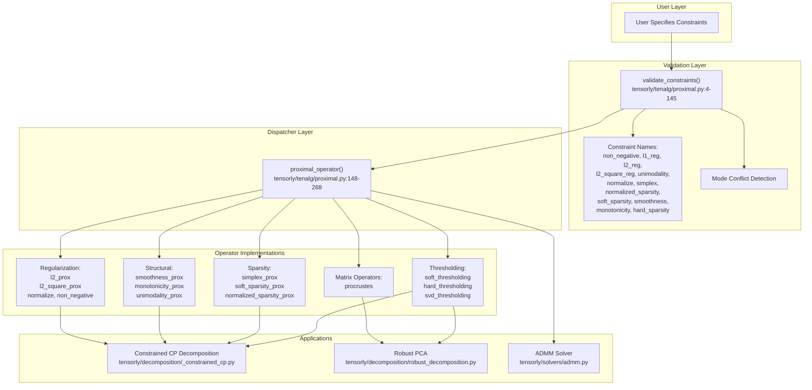
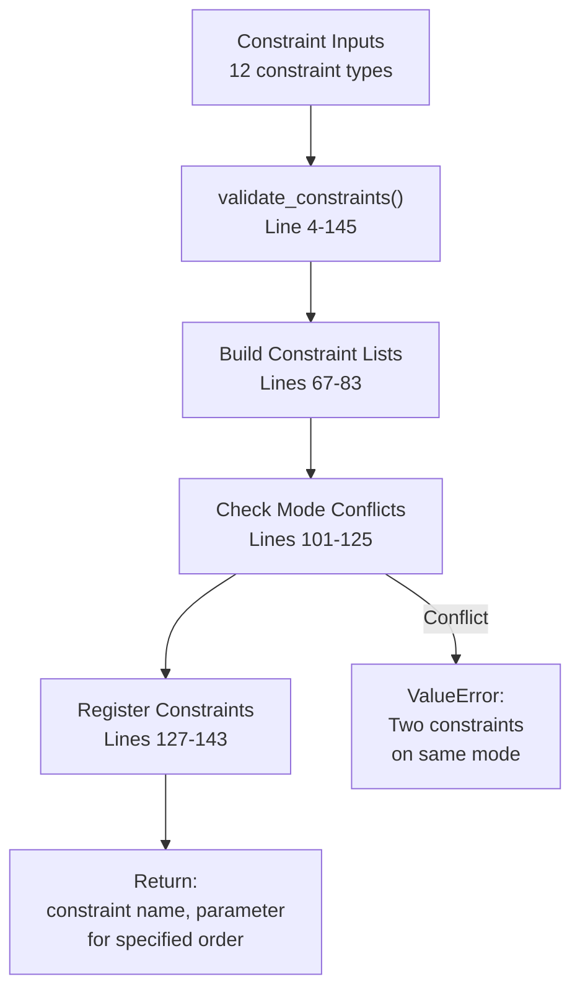
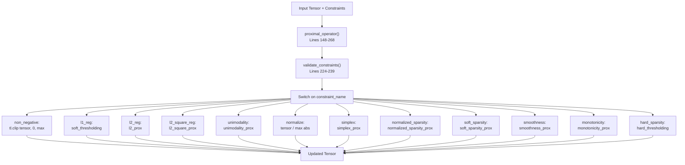
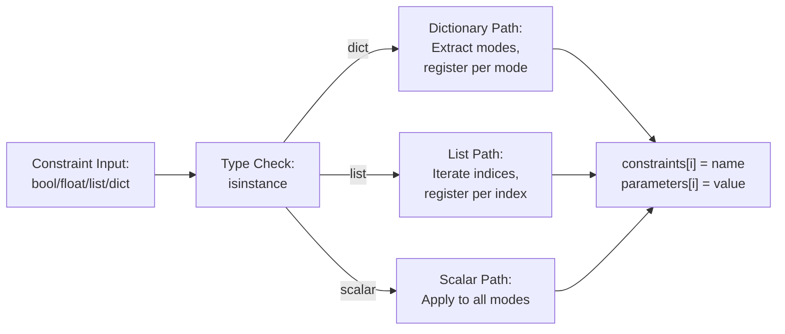
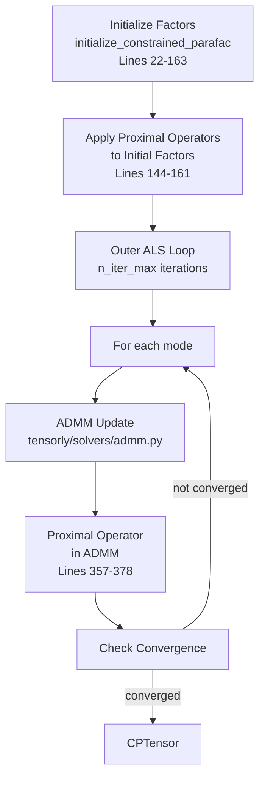
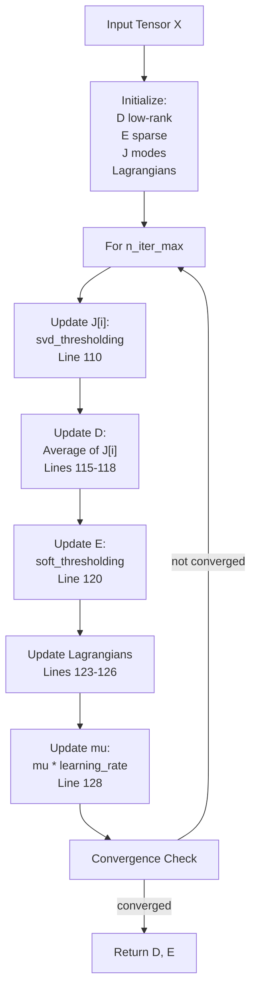

<!-- source: DeepWiki mcp.deepwiki.com · repo tensorly/tensorly · page 5.2 Proximal Operators · fetched 2026-10-21 -->

# Proximal Operators

<details>
<summary>Relevant source files</summary>

The following files were used as context for generating this wiki page:

- [tensorly/decomposition/_constrained_cp.py](tensorly/decomposition/_constrained_cp.py)
- [tensorly/decomposition/robust_decomposition.py](tensorly/decomposition/robust_decomposition.py)
- [tensorly/tenalg/proximal.py](tensorly/tenalg/proximal.py)
- [tensorly/tenalg/svd.py](tensorly/tenalg/svd.py)
- [tensorly/tenalg/tests/test_proximal.py](tensorly/tenalg/tests/test_proximal.py)
- [tensorly/tenalg/tests/test_svd.py](tensorly/tenalg/tests/test_svd.py)

</details>


## Purpose and Scope

This page documents TensorLy's proximal operator system located in [tensorly/tenalg/proximal.py](). Proximal operators solve convex optimization problems of the form `argmin_x(f(x) + 1/2||x - v||_2^2)`, enabling constrained tensor decompositions. The system provides 12+ constraint types including thresholding, sparsity, smoothness, monotonicity, unimodality, and projection operators.

For usage within decompositions, see [Constrained Decompositions](#3.6) and [Robust Decomposition](#3.5). For the SVD interface that uses proximal operators, see [SVD Interface and Linear Algebra](#5.1).

## System Architecture

The proximal operator system consists of three layers:

1. **Constraint Validation Layer** - Validates and routes constraint specifications
2. **Dispatcher Layer** - Routes to appropriate proximal operator implementations
3. **Operator Implementation Layer** - Individual mathematical proximal operators

### High-Level Architecture



**Sources:** [tensorly/tenalg/proximal.py:1-715](), [tensorly/decomposition/_constrained_cp.py:1-613]()

## Constraint Validation System

The `validate_constraints` function provides unified constraint validation and routing. It accepts constraints specified in three formats:

| Format | Example | Description |
|--------|---------|-------------|
| Boolean | `non_negative=True` | Apply to all modes |
| List | `l1_reg=[0.1, 0.2, 0.3]` | Per-mode specification |
| Dictionary | `smoothness={0: 0.5, 2: 0.3}` | Sparse per-mode specification |

### Validation Flow



**Sources:** [tensorly/tenalg/proximal.py:4-145]()

### Key Parameters

- `n_const` (int): Number of constraints (modes) in the problem
- `order` (int): Which constraint to return (for multi-mode problems)
- Returns: `(constraint_name, parameter)` tuple

The validation ensures no mode is constrained twice by tracking `modes_constrained` set [tensorly/tenalg/proximal.py:101-125]().

## Main Dispatcher

The `proximal_operator` function serves as the central dispatcher, routing to specific operator implementations based on validated constraints.

### Dispatcher Logic



**Sources:** [tensorly/tenalg/proximal.py:148-268]()

## Thresholding Operators

### Soft Thresholding

**Function:** `soft_thresholding(tensor, threshold)` [tensorly/tenalg/proximal.py:631-672]()

Implements the proximal operator of the L1 norm: `sign(tensor) * max[abs(tensor) - threshold, 0]`.

**Mathematical Form:**
```
prox_λ(x) = sign(x) * max(|x| - λ, 0)
```

**Key Features:**
- Supports scalar threshold (applied uniformly)
- Supports array threshold (element-wise, 0 values ignored for masking)
- Used in L1 regularization and sparse decompositions

**Usage Example Context:**
- Robust PCA [tensorly/decomposition/robust_decomposition.py:120]()
- SVD initialization [tensorly/tenalg/svd.py:124-125]()

### Hard Thresholding

**Function:** `hard_thresholding(tensor, number_of_non_zero)` [tensorly/tenalg/proximal.py:602-628]()

Proximal operator of the L0 "norm". Keeps the largest `number_of_non_zero` elements by absolute value, sets others to zero.

**Algorithm:**
1. Vectorize tensor
2. Argsort by absolute value (descending)
3. Keep top-k elements, zero others
4. Reshape to original shape

**Sources:** [tensorly/tenalg/proximal.py:602-628](), [tensorly/tenalg/tests/test_proximal.py:43-52]()

### SVD Thresholding

**Function:** `svd_thresholding(matrix, threshold)` [tensorly/tenalg/proximal.py:674-693]()

Singular value soft thresholding operator for low-rank matrix approximation.

**Algorithm:**
1. Compute SVD: `U, s, V = truncated_svd(matrix)`
2. Apply soft thresholding to singular values
3. Reconstruct: `U @ diag(soft_threshold(s, λ)) @ V`

**Used In:**
- Robust PCA for low-rank component recovery [tensorly/decomposition/robust_decomposition.py:110]()

**Sources:** [tensorly/tenalg/proximal.py:674-693]()

### Procrustes Operator

**Function:** `procrustes(matrix)` [tensorly/tenalg/proximal.py:695-714]()

Projects matrix onto the set of orthogonal matrices by computing `U @ V^T` from SVD.

**Mathematical Form:**
```
argmin_X ||X - M||_F  subject to X^T X = I
Solution: X = U V^T where M = U Σ V^T
```

**Sources:** [tensorly/tenalg/proximal.py:695-714](), [tensorly/tenalg/tests/test_proximal.py:192-198]()

## Sparsity Operators

### Simplex Projection

**Function:** `simplex_prox(tensor, parameter)` [tensorly/tenalg/proximal.py:558-600]()

Projects input tensor onto the simplex of radius `parameter`, ensuring sum of elements equals the parameter while maintaining non-negativity.

**Algorithm** (per column):
1. Sort elements in descending order
2. Compute cumulative sum minus parameter, divided by position
3. Find threshold index
4. Subtract threshold and clip to [0, ∞)

**Mathematical Form:**
```
argmin_x ||x - v||² subject to Σx_i = parameter, x ≥ 0
```

**Sources:** [tensorly/tenalg/proximal.py:558-600](), [tensorly/tenalg/tests/test_proximal.py:64-76]()

### Soft Sparsity

**Function:** `soft_sparsity_prox(tensor, threshold)` [tensorly/tenalg/proximal.py:529-556]()

Projects columns to have L1 norm ≤ threshold using simplex projection on absolute values.

**Implementation:**
```python
simplex_prox(abs(tensor), threshold) * sign(tensor)
```

Imposes L1 norm bounds while preserving sign structure.

**Sources:** [tensorly/tenalg/proximal.py:529-556](), [tensorly/tenalg/tests/test_proximal.py:55-61]()

### Normalized Sparsity

**Function:** `normalized_sparsity_prox(tensor, threshold)` [tensorly/tenalg/proximal.py:496-527]()

Projects onto intersection of unit L2 ball with k-sparse vectors: `{||x||_2 = 1, ||x||_0 ≤ k}`.

**Algorithm:**
1. Apply hard thresholding to achieve target sparsity
2. Normalize result to unit L2 norm

**Mathematical Form:**
```
hard_threshold(x, k) / ||hard_threshold(x, k)||_2
```

**Sources:** [tensorly/tenalg/proximal.py:496-527](), [tensorly/tenalg/tests/test_proximal.py:79-84]()

## Structural Constraint Operators

### Smoothness

**Function:** `smoothness_prox(tensor, regularizer)` [tensorly/tenalg/proximal.py:270-290]()

Enforces smoothness by penalizing differences between adjacent elements. Solves a banded linear system.

**Mathematical Form:**
```
argmin_x (||x - v||² + λΣ(x_i - x_{i+1})²)
```

**Implementation:**
Constructs tridiagonal matrix with:
- Diagonal: `2λ + 1`
- Off-diagonals: `-λ`

Solves: `(2λI + D)x = v` where D is the difference operator.

**Sources:** [tensorly/tenalg/proximal.py:270-290](), [tensorly/tenalg/tests/test_proximal.py:29-40]()

### Monotonicity

**Function:** `monotonicity_prox(tensor, decreasing=False)` [tensorly/tenalg/proximal.py:292-357]()

Projects each column onto monotonically increasing (or decreasing) distributions using isotonic regression.

**Algorithm** (per column):
1. Compute cumulative sums
2. Build assisted tensor of candidate values
3. Find optimal monotone approximation via dynamic programming
4. Enforce monotonicity via backward pass

**Guarantees:**
- `decreasing=False`: x[1] ≤ x[2] ≤ ... ≤ x[n]
- `decreasing=True`: x[1] ≥ x[2] ≥ ... ≥ x[n]

**Sources:** [tensorly/tenalg/proximal.py:292-357](), [tensorly/tenalg/tests/test_proximal.py:87-95]()

### Unimodality

**Function:** `unimodality_prox(tensor)` [tensorly/tenalg/proximal.py:359-442]()

Projects each column onto unimodal distributions: `x[1] ≤ ... ≤ x[j] ≥ ... ≥ x[n]` for some peak j.

**Algorithm:**
1. Compute monotonically increasing projection
2. Compute monotonically decreasing projection
3. Find mutual peak points (where both constraints satisfied)
4. Select peak minimizing total deviation
5. Combine increasing part before peak, decreasing part after

**Sources:** [tensorly/tenalg/proximal.py:359-442](), [tensorly/tenalg/tests/test_proximal.py:98-114]()

## Regularization Operators

### L2 Proximal Operator

**Function:** `l2_prox(tensor, regularizer)` [tensorly/tenalg/proximal.py:466-494]()

Proximal operator for L2 norm regularization (block soft thresholding).

**Mathematical Form:**
```
prox_λ(x) = (1 - λ/max(||x||_2, λ)) * x
```

Shrinks the tensor toward zero while preserving direction.

**Sources:** [tensorly/tenalg/proximal.py:466-494](), [tensorly/tenalg/tests/test_proximal.py:117-122]()

### L2 Squared Proximal Operator

**Function:** `l2_square_prox(tensor, regularizer)` [tensorly/tenalg/proximal.py:444-464]()

Proximal operator for squared L2 norm: `λ||x||²_2`.

**Closed Form Solution:**
```
prox_λ(x) = x / (1 + 2λ)
```

Simple element-wise scaling operation.

**Sources:** [tensorly/tenalg/proximal.py:444-464](), [tensorly/tenalg/tests/test_proximal.py:125-130]()

### Non-Negativity

**Implementation:** [tensorly/tenalg/proximal.py:242-243]()

Simple clipping to `[0, max(tensor)]`:
```python
tl.clip(tensor, 0, tl.max(tensor))
```

### Normalization

**Implementation:** [tensorly/tenalg/proximal.py:252-253]()

Divides by maximum absolute value:
```python
tensor / tl.max(tl.abs(tensor))
```

**Sources:** [tensorly/tenalg/proximal.py:242-253]()

## Constraint Specification Format

Constraints support three specification formats for flexibility:

### Format Comparison Table

| Constraint Type | Boolean Format | List Format | Dictionary Format |
|----------------|----------------|-------------|-------------------|
| `non_negative` | `True` (all modes) | N/A | `{0: True, 2: True}` (modes 0,2) |
| `l1_reg` | `0.1` (all modes) | `[0.1, 0.2, 0.3]` (per mode) | `{1: 0.2, 2: 0.3}` (sparse) |
| `smoothness` | N/A | `[0.5, 0.3, 0.1]` | `{0: 0.5, 2: 0.1}` |
| `unimodality` | `True` | N/A | `{0: True, 1: True}` |

### Constraint Registration Process



**Sources:** [tensorly/tenalg/proximal.py:127-143]()

## Integration with Decompositions

### Constrained CP Decomposition

The constrained PARAFAC algorithm uses proximal operators within an ADMM framework:



**Key Integration Points:**

1. **Initialization** [tensorly/decomposition/_constrained_cp.py:144-161]():
   - SVD initialization
   - Apply proximal operator to each factor
   - Ensures factors satisfy constraints from start

2. **ADMM Inner Loop** [tensorly/decomposition/_constrained_cp.py:357-378]():
   - Factor update via least squares
   - Proximal operator applied to auxiliary variables
   - Dual variable update

**Sources:** [tensorly/decomposition/_constrained_cp.py:1-613]()

### Robust PCA

Robust PCA uses two specific operators:



**Operators Used:**
- `svd_thresholding` [tensorly/decomposition/robust_decomposition.py:110](): Nuclear norm penalty on low-rank modes
- `soft_thresholding` [tensorly/decomposition/robust_decomposition.py:120](): L1 penalty on sparse component

**Sources:** [tensorly/decomposition/robust_decomposition.py:1-145]()

## Complete Operator Reference

### Operator Summary Table

| Operator | Function Name | Parameters | Mathematical Operation | Use Case |
|----------|--------------|------------|----------------------|----------|
| Soft Threshold | `soft_thresholding` | threshold | `sign(x)*max(abs(x)-λ, 0)` | L1 regularization |
| Hard Threshold | `hard_thresholding` | number_of_non_zero | Keep top-k by magnitude | L0 sparsity |
| SVD Threshold | `svd_thresholding` | threshold | Soft threshold singular values | Nuclear norm |
| Procrustes | `procrustes` | - | `U V^T` from SVD | Orthogonality |
| Simplex | `simplex_prox` | parameter | Project to simplex radius | Sum constraint |
| Soft Sparsity | `soft_sparsity_prox` | threshold | L1 norm ≤ threshold | Bounded L1 |
| Normalized Sparsity | `normalized_sparsity_prox` | threshold | k-sparse + unit norm | Sparse + normalized |
| Smoothness | `smoothness_prox` | regularizer | Minimize differences | Smooth factors |
| Monotonicity | `monotonicity_prox` | decreasing | Isotonic projection | Ordered factors |
| Unimodality | `unimodality_prox` | - | Single peak | Peak distributions |
| L2 | `l2_prox` | regularizer | Block soft threshold | L2 regularization |
| L2 Squared | `l2_square_prox` | regularizer | `x/(1+2λ)` | Quadratic penalty |

**Sources:** [tensorly/tenalg/proximal.py:1-715]()

## Backend Compatibility

All proximal operators are backend-agnostic, using TensorLy's unified API:

**Key Backend Operations Used:**
- `tl.clip`: Clipping operations
- `tl.norm`: Norm computations
- `tl.sort`, `tl.argsort`: Sorting for thresholding
- `tl.solve`: Linear system solving for smoothness
- `tl.index_update`: In-place updates (JAX compatibility)
- `tl.cumsum`: Cumulative sums for monotonicity
- `tl.truncated_svd`: SVD for matrix operators

**Special Considerations:**
- JAX requires `tl.index_update` instead of direct assignment
- TensorFlow has indexing limitations [tensorly/tenalg/tests/test_proximal.py:23-26]()
- All operators preserve tensor context (dtype, device)

**Sources:** [tensorly/tenalg/proximal.py:1-715](), [tensorly/backend/core.py]()

---

