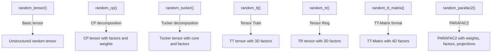
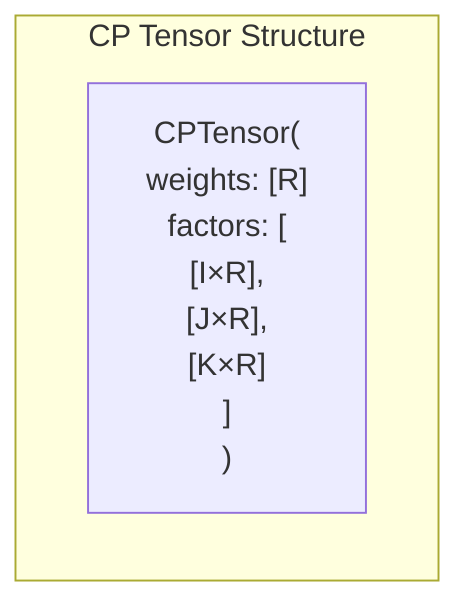
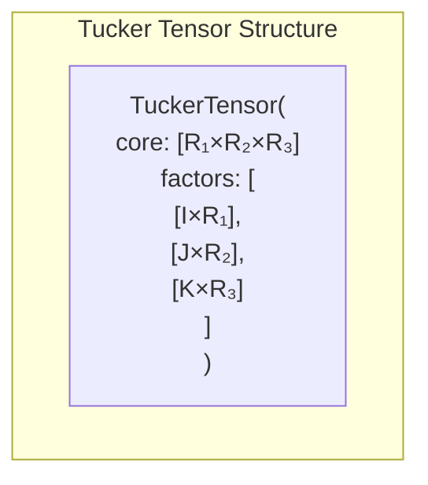
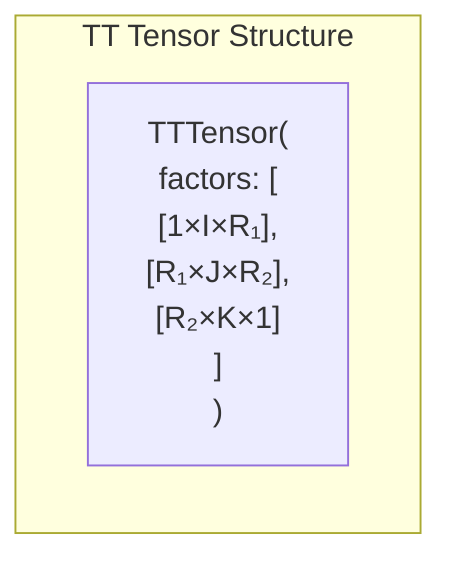
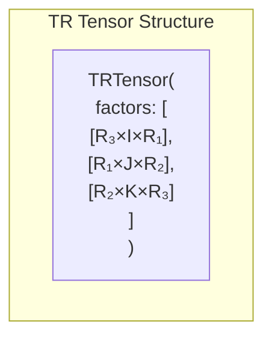
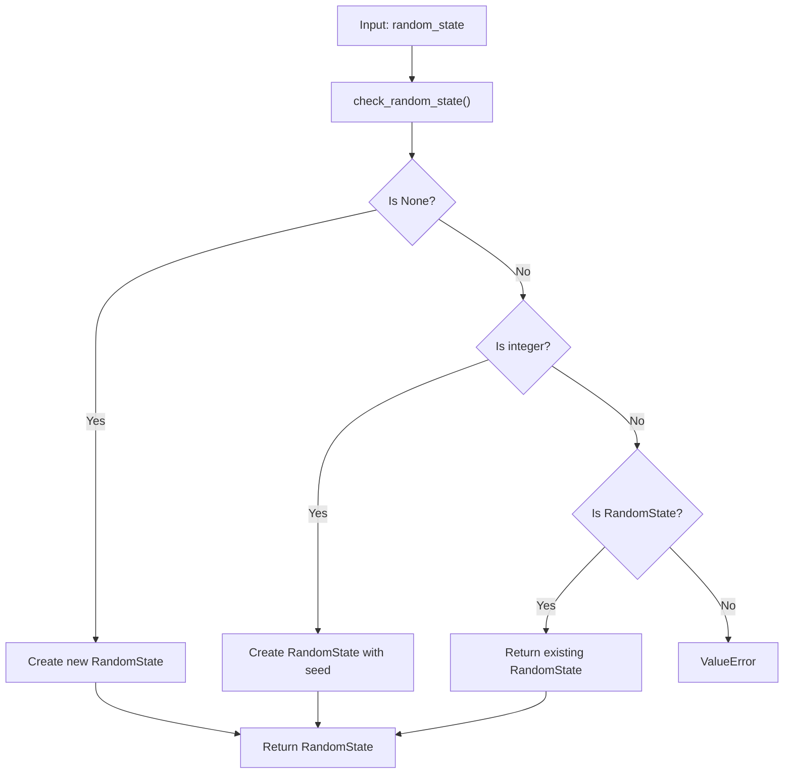

<!-- source: DeepWiki mcp.deepwiki.com · repo tensorly/tensorly · page 6 Random Tensor Generation · fetched 2026-10-21 -->

# Random Tensor Generation

<details>
<summary>Relevant source files</summary>

The following files were used as context for generating this wiki page:

- [tensorly/random/__init__.py](tensorly/random/__init__.py)
- [tensorly/random/base.py](tensorly/random/base.py)
- [tensorly/random/tests/test_base.py](tensorly/random/tests/test_base.py)

</details>


Random tensor generation in TensorLy provides utilities for creating random tensors with specific structures and decompositions. These functions are essential for testing decomposition algorithms, creating synthetic datasets with known properties, initializing tensor factors, and benchmarking performance.

For information about using these tensors in tensor operations, see [Tensor Operations](#5).

## Overview

TensorLy's random module includes functions for generating random tensors with various tensor decomposition formats, including CP (CANDECOMP/PARAFAC), Tucker, Tensor Train (TT), Tensor Ring (TR), TT-Matrix, and PARAFAC2. Each function allows you to specify the shape and rank of the tensor, with options to return either the full tensor or its decomposed representation.



Sources: [tensorly/random/base.py:11-323](), [tensorly/random/__init__.py:1-9]()

## General Random Tensor Generation

The most basic function is `random_tensor()` which creates an unstructured random tensor with a uniform distribution.

```python
random_tensor(shape, random_state=None, **context)
```

**Parameters:**
- `shape`: tuple defining the dimensions of the tensor
- `random_state`: controls random number generation for reproducibility
- `**context`: backend-specific tensor creation parameters

```python
# Example: Generate a random 3D tensor of shape (10, 20, 30)
tensor = random_tensor((10, 20, 30))
```

Sources: [tensorly/random/base.py:12-15]()

## Random CP Tensor Generation

The `random_cp()` function generates random CP decomposed tensors, allowing you to create either the full tensor or just the CP components.

```python
random_cp(shape, rank, full=False, orthogonal=False, random_state=None, normalise_factors=True, **context)
```

**Parameters:**
- `shape`: tuple defining the dimensions of the tensor
- `rank`: rank of the CP decomposition
- `full`: if True, returns the full tensor; if False, returns the CP factors
- `orthogonal`: if True, generates orthogonal components
- `normalise_factors`: if True, normalizes the factors
- `random_state`: controls random number generation



**Notes:**
- Orthogonal tensors can only be created when `rank <= min(shape)`
- The function validates the CP rank before proceeding
- When `normalise_factors=True`, the function normalizes the factors via `cp_normalize`

Sources: [tensorly/random/base.py:64-114](), [tensorly/random/tests/test_base.py:31-67]()

## Random Tucker Tensor Generation

The `random_tucker()` function generates random Tucker decomposed tensors.

```python
random_tucker(shape, rank, full=False, orthogonal=False, random_state=None, non_negative=False, **context)
```

**Parameters:**
- `shape`: tuple defining the dimensions of the tensor
- `rank`: rank of the Tucker decomposition (int or list of ints)
- `full`: if True, returns the full tensor; if False, returns the Tucker components
- `orthogonal`: if True, generates orthogonal factor matrices
- `non_negative`: if True, generates non-negative factors and core
- `random_state`: controls random number generation



**Notes:**
- If `rank` is an integer, the same rank is used for all modes
- When `orthogonal=True`, the function performs QR decomposition on the factors
- When `non_negative=True`, absolute values are used for factors and core

Sources: [tensorly/random/base.py:117-179](), [tensorly/random/tests/test_base.py:69-108]()

## Random TT (Tensor Train) Tensor Generation

The `random_tt()` function generates random Tensor Train (TT) decomposed tensors.

```python
random_tt(shape, rank, full=False, random_state=None, **context)
```

**Parameters:**
- `shape`: tuple defining the dimensions of the tensor
- `rank`: rank of the TT decomposition (list of ints)
- `full`: if True, returns the full tensor; if False, returns the TT factors
- `random_state`: controls random number generation



**Boundary Conditions:**
- `rank[0] = rank[-1] = 1` (boundary ranks must be 1)
- Length of rank must be `len(shape) + 1`

Sources: [tensorly/random/base.py:182-230](), [tensorly/random/tests/test_base.py:111-136]()

## Random TR (Tensor Ring) Tensor Generation

The `random_tr()` function generates random Tensor Ring (TR) decomposed tensors.

```python
random_tr(shape, rank, full=False, random_state=None, **context)
```

**Parameters:**
- `shape`: tuple defining the dimensions of the tensor
- `rank`: rank of the TR decomposition (list of ints)
- `full`: if True, returns the full tensor; if False, returns the TR factors
- `random_state`: controls random number generation



**Boundary Conditions:**
- `rank[0] = rank[-1]` (circular boundary condition)
- Length of rank must be `len(shape) + 1`

Sources: [tensorly/random/base.py:279-322](), [tensorly/random/tests/test_base.py:138-162]()

## Random TT-Matrix Generation

The `random_tt_matrix()` function generates random tensors in TT-Matrix format.

```python
random_tt_matrix(shape, rank, full=False, random_state=None, **context)
```

**Parameters:**
- `shape`: tuple defining the dimensions of the tensor (must have an even length)
- `rank`: rank of the TT-Matrix decomposition (list of ints)
- `full`: if True, returns the full tensor; if False, returns the TT-Matrix factors
- `random_state`: controls random number generation

**Notes:**
- The shape is interpreted as left and right shapes concatenated
- The first half of `shape` represents the left dimensions
- The second half represents the right dimensions
- Similar boundary conditions apply as in TT decomposition

Sources: [tensorly/random/base.py:233-276]()

## Random Parafac2 Tensor Generation

The `random_parafac2()` function generates random PARAFAC2 decomposed tensors.

```python
random_parafac2(shapes, rank, full=False, random_state=None, normalise_factors=False, **context)
```

**Parameters:**
- `shapes`: list of tuples, where each tuple represents the shape of a matrix
- `rank`: rank of the PARAFAC2 decomposition
- `full`: if True, returns the full tensor; if False, returns the PARAFAC2 components
- `normalise_factors`: if True, normalizes the factors
- `random_state`: controls random number generation

**Notes:**
- All matrices must have the same number of columns (second dimension)
- Internally uses `random_cp` to generate the weights and factors

Sources: [tensorly/random/base.py:18-61]()

## Random State Handling

All random tensor generation functions use TensorLy's `check_random_state` function to handle random number generation consistently across different backends.



This standardized handling ensures reproducibility of random tensor generation across different runs and backends.

Sources: [tensorly/random/tests/test_base.py:12-28]()

## Usage Examples

### Basic Random Tensor Generation
```python
from tensorly.random import random_tensor
# Create a random 3D tensor with shape (10, 20, 30)
tensor = random_tensor((10, 20, 30))
```

### Random CP Tensor with Orthogonal Factors
```python
from tensorly.random import random_cp
# Generate a random CP tensor with orthogonal factors
weights, factors = random_cp((10, 20, 30), rank=5, orthogonal=True)
```

### Random Tucker Tensor with Non-negative Values
```python
from tensorly.random import random_tucker
# Generate a non-negative Tucker tensor
core, factors = random_tucker((10, 20, 30), rank=(5, 6, 7), non_negative=True)
```

### Random Tensor Train with Specific Ranks
```python
from tensorly.random import random_tt
# Generate a TT tensor with specific ranks
factors = random_tt((10, 20, 30), rank=(1, 4, 5, 1))
```

### Reproducible Random Tensor Generation
```python
import numpy as np
from tensorly.random import random_tensor
# Generate the same random tensor twice
tensor1 = random_tensor((10, 20), random_state=42)
tensor2 = random_tensor((10, 20), random_state=42)
# tensor1 and tensor2 will be identical
```

Sources: [tensorly/random/base.py:11-323]()

## Rank Validation

Each tensor decomposition type has specific requirements for its rank structure, which are validated by corresponding validation functions:

| Decomposition | Validation Function | Requirements |
|--------------|---------------------|-------------|
| CP | `validate_cp_rank` | Rank must be a positive integer |
| Tucker | `validate_tucker_rank` | Rank can be int or tuple matching tensor order |
| TT | `validate_tt_rank` | Rank list with `len(shape)+1` elements and rank[0]=rank[-1]=1 |
| TR | `validate_tr_rank` | Rank list with `len(shape)+1` elements and rank[0]=rank[-1] |
| TT-Matrix | `validate_tt_matrix_rank` | Similar to TT rank validation |

These validation functions ensure that the provided ranks are compatible with the respective tensor decomposition formats.

Sources: [tensorly/random/base.py:64-322]()

---

