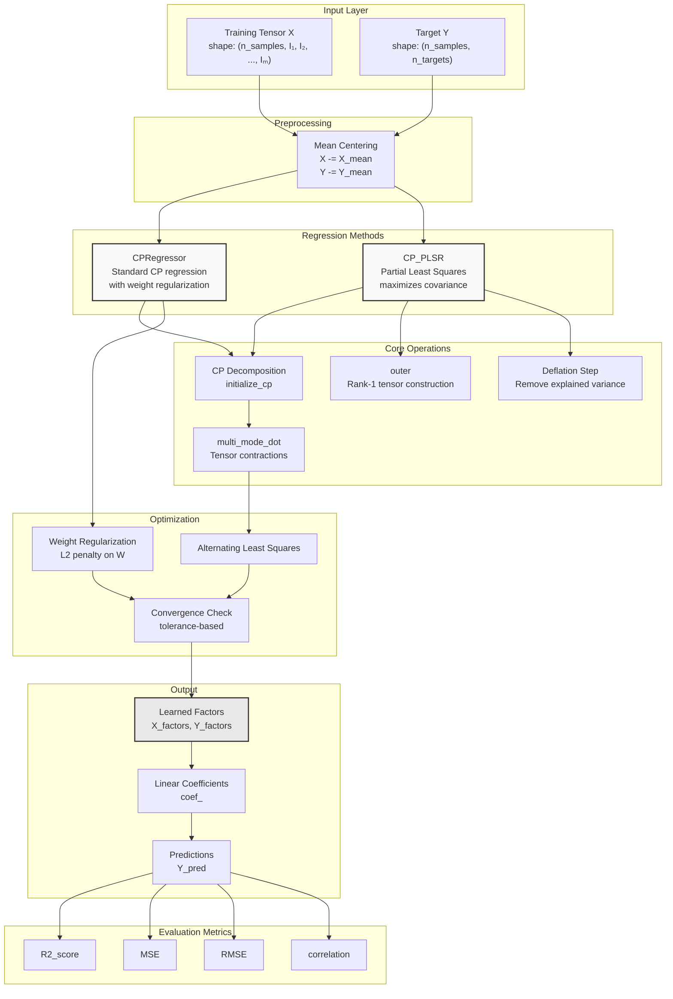
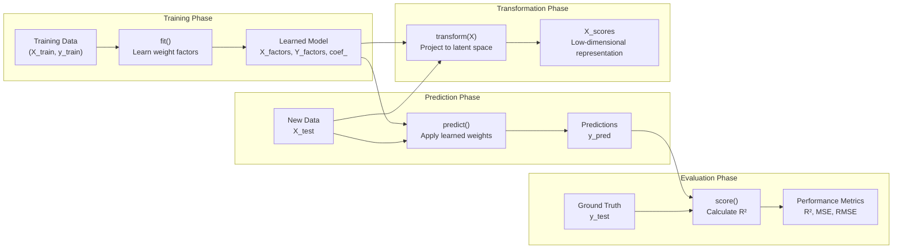

<!-- source: DeepWiki mcp.deepwiki.com · repo tensorly/tensorly · page 7 Regression and Applications · fetched 2026-10-21 -->

# Regression and Applications

<details>
<summary>Relevant source files</summary>

The following files were used as context for generating this wiki page:

- [doc/conf.py](doc/conf.py)
- [doc/index.rst](doc/index.rst)
- [tensorly/backend/paddle_backend.py](tensorly/backend/paddle_backend.py)
- [tensorly/metrics/regression.py](tensorly/metrics/regression.py)
- [tensorly/metrics/tests/__init__.py](tensorly/metrics/tests/__init__.py)
- [tensorly/metrics/tests/test_regression.py](tensorly/metrics/tests/test_regression.py)
- [tensorly/regression/cp_plsr.py](tensorly/regression/cp_plsr.py)
- [tensorly/regression/tests/test_cp_plsr.py](tensorly/regression/tests/test_cp_plsr.py)
- [tensorly/regression/tests/test_cp_regression.py](tensorly/regression/tests/test_cp_regression.py)

</details>


## Purpose and Scope

This section documents TensorLy's tensor regression capabilities, which enable predictive modeling with high-dimensional tensor data. Tensor regression methods decompose weight tensors using factorization techniques to reduce parameters and improve generalization.

This page provides an overview of tensor regression concepts and available methods. For detailed documentation of specific regression methods, see:
- [CP Regression](#7.1) - Standard CP-based tensor regression with weight regularization
- [CP-PLSR](#7.2) - CP Partial Least Squares Regression for maximizing covariance

For metrics used to evaluate regression performance, see [Metrics and Validation](#8).

---

## Tensor Regression Overview

### What is Tensor Regression?

Tensor regression extends traditional linear regression to handle multi-dimensional array inputs. Instead of mapping vectors to scalars/vectors, tensor regression maps tensors to scalars or lower-dimensional outputs:

**Standard Regression**: `y = X·w` where `X ∈ ℝ^(n×p)`, `w ∈ ℝ^p`

**Tensor Regression**: `y = X ⊙ W` where `X ∈ ℝ^(n×I₁×I₂×...×Iₘ)`, `W ∈ ℝ^(I₁×I₂×...×Iₘ)`

The key challenge is that the weight tensor `W` can have millions of parameters. TensorLy addresses this by representing `W` in factorized form using tensor decompositions.

### Why Use Tensor Decomposition for Regression?

| Benefit | Description |
|---------|-------------|
| **Parameter Reduction** | A rank-R CP decomposition of a 3-mode tensor reduces parameters from `I₁·I₂·I₃` to `R·(I₁+I₂+I₃)` |
| **Regularization** | Low-rank constraint acts as implicit regularization, preventing overfitting |
| **Interpretability** | Factorized weights reveal mode-specific patterns |
| **Computational Efficiency** | Operations on factorized tensors are faster than on full tensors |

Sources: [tensorly/regression/cp_plsr.py:11-33](), High-level architecture diagrams

---

## Regression Methods Architecture



**Diagram: Tensor Regression System Architecture**

Sources: [tensorly/regression/cp_plsr.py:11-328](), [tensorly/regression/tests/test_cp_regression.py:11-88]()

---

## Available Regression Methods

### Method Comparison

| Method | Class | Use Case | Key Feature | Child Page |
|--------|-------|----------|-------------|------------|
| **CP Regression** | `CPRegressor` | Standard tensor-to-scalar/vector regression | Weight regularization with L2 penalty | [7.1](#7.1) |
| **CP-PLSR** | `CP_PLSR` | Maximize covariance between tensor and matrix | Deflation-based component extraction | [7.2](#7.2) |

### CP_PLSR: Partial Least Squares Regression

Located in [tensorly/regression/cp_plsr.py:11-328]()

**Key Characteristics:**
- Performs partial least squares regression from tensor X (≥2 modes) to matrix Y
- First modes of X and Y are coupled (same length)
- Decomposition maximizes covariance between coupled modes
- Sequential component extraction with deflation
- Orthogonal factors across components

**Main Methods:**
- `fit(X, Y)` - Learn factors maximizing covariance [tensorly/regression/cp_plsr.py:55-188]()
- `predict(X)` - Predict labels for new tensor data [tensorly/regression/cp_plsr.py:190-223]()
- `transform(X, Y)` - Project data to component space [tensorly/regression/cp_plsr.py:225-293]()
- `fit_transform(X, Y)` - Fit and transform in one step [tensorly/regression/cp_plsr.py:295-312]()
- `score(X, Y)` - Calculate R² of predictions [tensorly/regression/cp_plsr.py:314-327]()

### CPRegressor: Standard CP Regression

Referenced in [tensorly/regression/tests/test_cp_regression.py:11-88]()

**Key Characteristics:**
- Uses CP decomposition to represent weight tensor W
- Regularization parameter `reg_W` for L2 penalty
- Supports multi-dimensional output tensors
- Rank controlled by `weight_rank` parameter

**Main Methods:**
- `fit(X, y)` - Learn weight tensor factors
- `predict(X)` - Make predictions on new data
- `get_params()` / `set_params()` - Parameter management

Sources: [tensorly/regression/tests/test_cp_regression.py:11-88]()

---

## Regression Workflow



**Diagram: Regression Method Workflow**

Sources: [tensorly/regression/cp_plsr.py:55-327]()

---

## Code Integration Points

### Backend Integration

Tensor regression methods are backend-agnostic through TensorLy's unified API:

```python
# Methods use backend operations via T (tensorly.backend)
T.tensor()          # Tensor creation
T.dot()             # Matrix multiplication
T.tensordot()       # Tensor contraction
T.lstsq()           # Least squares solver
T.norm()            # Norms
T.index_update()    # In-place updates
```

Sources: [tensorly/regression/cp_plsr.py:1-4]()

### Tensor Algebra Operations

Regression methods rely on tensor algebra primitives:

| Operation | Function | Purpose |
|-----------|----------|---------|
| Mode-n multiplication | `multi_mode_dot` | Contract tensor with factors [tensorly/regression/cp_plsr.py:1]() |
| Outer product | `outer` | Construct rank-1 tensors [tensorly/regression/cp_plsr.py:1]() |
| Vectorization | `tensor_to_vec` | Flatten tensors [tensorly/regression/cp_plsr.py:3]() |
| Initialization | `initialize_cp` | Factor initialization [tensorly/regression/cp_plsr.py:4]() |

### Decomposition Dependencies

```mermaid
graph TD
    subgraph "Regression Module"
        CPRegressor["CPRegressor"]
        CPPLSR["CP_PLSR"]
    end
    
    subgraph "Tensor Operations"
        MultiModeDot["multi_mode_dot"]
        Outer["outer"]
        TensorToVec["tensor_to_vec"]
    end
    
    subgraph "Decomposition"
        InitializeCP["initialize_cp"]
        CPNormalize["cp_normalize"]
        CPToTensor["cp_to_tensor"]
    end
    
    subgraph "Tensor Representations"
        CPTensor["CPTensor"]
    end
    
    subgraph "Metrics"
        R2Score["R2_score"]
        MSE["MSE"]
        RMSE["RMSE"]
        Correlation["correlation"]
    end
    
    subgraph "Backend"
        Backend["Backend API<br/>T.dot, T.lstsq, etc."]
    end
    
    CPPLSR --> MultiModeDot
    CPPLSR --> Outer
    CPPLSR --> TensorToVec
    CPPLSR --> InitializeCP
    
    CPRegressor --> CPToTensor
    CPRegressor --> CPNormalize
    
    InitializeCP --> CPTensor
    CPNormalize --> CPTensor
    
    CPPLSR --> R2Score
    CPRegressor --> RMSE
    
    MultiModeDot --> Backend
    Outer --> Backend
    InitializeCP --> Backend
    R2Score --> Backend
    
    style CPPLSR fill:#f9f9f9,stroke:#333,stroke-width:2px
    style CPRegressor fill:#f9f9f9,stroke:#333,stroke-width:2px
```

**Diagram: Regression Module Dependencies**

Sources: [tensorly/regression/cp_plsr.py:1-10](), [tensorly/regression/tests/test_cp_regression.py:3-8]()

---

## Performance Metrics

TensorLy provides several metrics for evaluating regression performance, located in [tensorly/metrics/regression.py:1-109]():

### Available Metrics

| Metric | Function | Formula | Range | Use Case |
|--------|----------|---------|-------|----------|
| **MSE** | `MSE(y_true, y_pred)` | mean((y_true - y_pred)²) | [0, ∞) | Average squared error |
| **RMSE** | `RMSE(y_true, y_pred)` | sqrt(MSE) | [0, ∞) | Error in original units |
| **R² Score** | `R2_score(X_original, X_predicted)` | 1 - ‖X_pred - X_orig‖² / ‖X_orig‖² | (-∞, 1] | Proportion of variance explained |
| **Correlation** | `correlation(y_true, y_pred)` | Pearson's r | [-1, 1] | Linear relationship strength |
| **Covariance** | `covariance(y_true, y_pred)` | cov(y_true, y_pred) | (-∞, ∞) | Joint variability |

### Metric Implementation Details

**R² Score** [tensorly/metrics/regression.py:41-57]():
- Best possible score: 1.0 (perfect prediction)
- Score of 0.0: prediction equals baseline (mean)
- Negative scores: prediction worse than baseline
- Used by `CP_PLSR.score()` method

**Correlation** [tensorly/metrics/regression.py:104-108]():
- Pearson's product-moment correlation coefficient
- Measures linear relationship between predictions and ground truth
- Normalized covariance divided by standard deviations

**MSE/RMSE** [tensorly/metrics/regression.py:6-38]():
- Standard error metrics
- Support axis parameter for multi-dimensional arrays
- RMSE preferred when error should be in same units as target

Sources: [tensorly/metrics/regression.py:1-109](), [tensorly/regression/cp_plsr.py:325-327]()

---

## Testing Infrastructure

### CP_PLSR Tests

Located in [tensorly/regression/tests/test_cp_plsr.py:1-250]()

**Key Test Categories:**

1. **Structure Tests** - Verify mathematical properties:
   - `test_factor_normality` - Components have unit norm [tensorly/regression/tests/test_cp_plsr.py:72-82]()
   - `test_factor_orthogonality` - Components are orthogonal [tensorly/regression/tests/test_cp_plsr.py:85-98]()
   - `test_consistent_components` - Factor dimensions match n_components [tensorly/regression/tests/test_cp_plsr.py:101-111]()

2. **Dimension Compatibility** [tensorly/regression/tests/test_cp_plsr.py:117-129]():
   - Tests with 2-5 mode tensors
   - Tests with 1-4 response variables
   - Ensures flexibility across tensor shapes

3. **Decomposition Accuracy** [tensorly/regression/tests/test_cp_plsr.py:135-162]():
   - Recovery of known synthetic factors
   - Congruence coefficient > 0.85 threshold
   - Reconstruction accuracy tests

4. **Covariance Optimization** [tensorly/regression/tests/test_cp_plsr.py:177-208]():
   - Verifies components capture maximum covariance
   - Tests with synthetic and random data

5. **Increasing Variance** [tensorly/regression/tests/test_cp_plsr.py:211-235]():
   - R² increases with more components
   - Validates sequential component extraction

### CPRegressor Tests

Located in [tensorly/regression/tests/test_cp_regression.py:11-88]()

Tests verify:
- Regression accuracy on synthetic data (RMSE < 0.05)
- Multi-dimensional output support
- Parameter management (get_params/set_params)
- Convergence to known weights

Sources: [tensorly/regression/tests/test_cp_plsr.py:1-250](), [tensorly/regression/tests/test_cp_regression.py:11-88]()

---

## Usage Patterns

### Typical CP_PLSR Workflow

```
1. Import and instantiate
   CP_PLSR(n_components, tol, n_iter_max, random_state, verbose)

2. Fit to training data
   model.fit(X_train, Y_train)
   # Learns X_factors, Y_factors, coef_

3. Make predictions
   Y_pred = model.predict(X_test)

4. Evaluate performance
   r2_score = model.score(X_test, Y_test)

5. Transform to latent space (optional)
   X_scores = model.transform(X_test)
   X_scores, Y_scores = model.transform(X_test, Y_test)
```

### Typical CPRegressor Workflow

```
1. Import and instantiate
   CPRegressor(weight_rank, tol, reg_W, n_iter_max, verbose)

2. Fit to training data
   model.fit(X_train, y_train)
   # Learns weight_tensor_ in factorized form

3. Make predictions
   y_pred = model.predict(X_test)

4. Evaluate performance
   from tensorly.metrics.regression import RMSE
   error = RMSE(y_test, y_pred)
```

Sources: [tensorly/regression/cp_plsr.py:35-327](), [tensorly/regression/tests/test_cp_regression.py:37-42]()

---

## Key Design Decisions

### Mean Centering

Both regression methods center data before decomposition [tensorly/regression/cp_plsr.py:97-104]():
- Stores `X_mean_` and `Y_mean_` during fit
- Subtracts means from input during training
- Adds means back during prediction
- Ensures zero-mean components for proper interpretation

### Sequential Component Extraction (CP_PLSR)

CP_PLSR uses deflation to extract components sequentially [tensorly/regression/cp_plsr.py:118-187]():
1. Find component maximizing covariance
2. Deflate X and Y by removing explained variance
3. Repeat for next component
4. Results in orthogonal components

### Convergence Criteria

Iterative optimization stops when [tensorly/regression/cp_plsr.py:151-156]():
- `norm(old_factors - new_factors) < tol`
- Or `n_iter_max` iterations reached
- Convergence tracked per component

### Index Update Pattern

Uses `T.index_update()` for backend-agnostic in-place updates [tensorly/regression/cp_plsr.py:161-176]():
- Compatible with JAX (which doesn't support in-place ops)
- Maintains gradient flow for autograd backends
- Consistent interface across NumPy, PyTorch, TensorFlow, JAX

Sources: [tensorly/regression/cp_plsr.py:81-187]()

---

