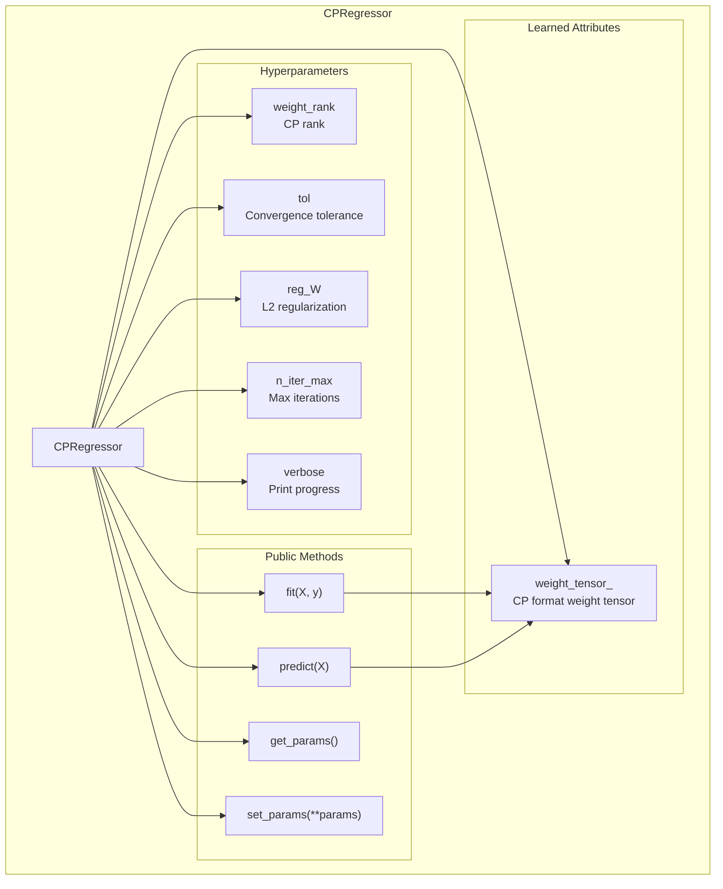
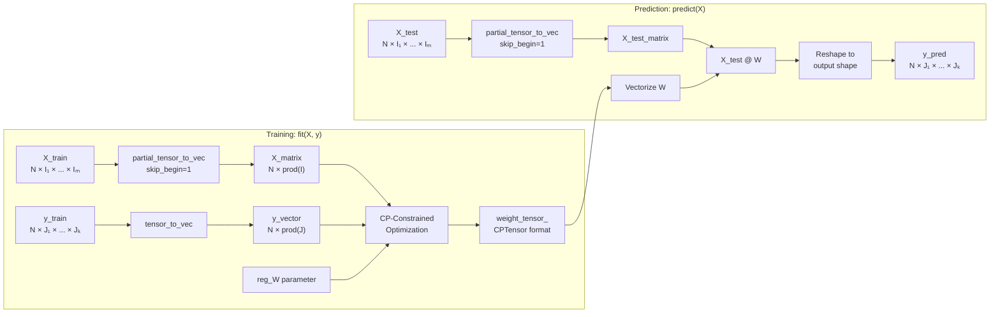
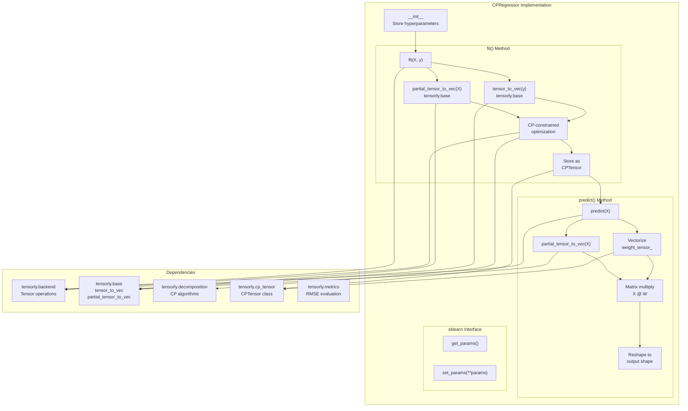
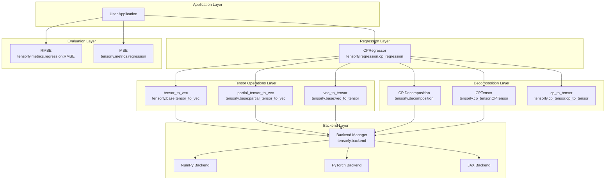
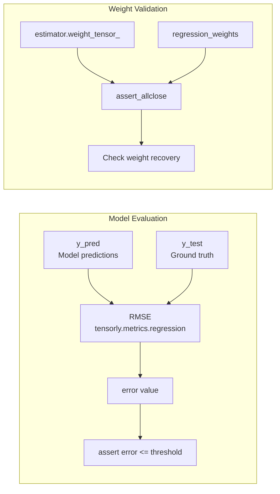

<!-- source: DeepWiki mcp.deepwiki.com · repo tensorly/tensorly · page 7.1 CP Regression · fetched 2026-10-21 -->

# CP Regression

<details>
<summary>Relevant source files</summary>

The following files were used as context for generating this wiki page:

- [doc/conf.py](doc/conf.py)
- [doc/index.rst](doc/index.rst)
- [tensorly/regression/tests/test_cp_regression.py](tensorly/regression/tests/test_cp_regression.py)

</details>


## Purpose and Scope

This document covers the `CPRegressor` class, which performs tensor regression using CP (Canonical Polyadic) decomposition. The method learns a low-rank weight tensor to predict outputs from multi-dimensional input tensors. For CP Partial Least Squares Regression (CP-PLSR), which maximizes covariance rather than minimizing prediction error, see [CP-PLSR](#7.2). For details on the underlying CP decomposition algorithm, see [CP Decomposition](#3.1). For the CPTensor representation used internally, see [CPTensor Class](#4.1).

---

## Overview

`CPRegressor` learns a weight tensor in CP format to map tensor-valued inputs to tensor-valued outputs. The key innovation is representing regression weights as a low-rank CP tensor, which provides:

- **Dimensionality reduction** through low-rank approximation
- **Implicit regularization** via the rank constraint
- **Interpretability** through separable factor structure
- **Computational efficiency** for high-dimensional problems

The method is particularly useful when dealing with structured data such as images, videos, or multi-way feature arrays.

Sources: [tensorly/regression/tests/test_cp_regression.py:11-88]()

---

## Mathematical Formulation

Given:
- Input tensors: $\mathbf{X} \in \mathbb{R}^{N \times I_1 \times I_2 \times \ldots \times I_M}$ (N samples)
- Output: $\mathbf{y} \in \mathbb{R}^{N \times J_1 \times \ldots \times J_K}$ (can be vector or tensor)
- Weight tensor: $\mathbf{W} \in \mathbb{R}^{I_1 \times I_2 \times \ldots \times I_M \times J_1 \times \ldots \times J_K}$

The model predicts:
$$\hat{\mathbf{y}}_n = \text{vec}(\mathbf{X}_n)^\top \cdot \text{vec}(\mathbf{W})$$

`CPRegressor` represents $\mathbf{W}$ as a CP decomposition:
$$\mathbf{W} = \sum_{r=1}^{R} \lambda_r \cdot \mathbf{w}_r^{(1)} \circ \mathbf{w}_r^{(2)} \circ \ldots \circ \mathbf{w}_r^{(M+K)}$$

The optimization problem:
$$\min_{\mathbf{W}} \|\mathbf{y} - \hat{\mathbf{y}}\|_F^2 + \text{reg}_W \|\mathbf{W}\|_F^2$$

subject to $\mathbf{W}$ having CP rank $R$.

Sources: [tensorly/regression/tests/test_cp_regression.py:22-41](), [tensorly/regression/tests/test_cp_regression.py:62-73]()

---

## CPRegressor Class Structure

### Class Overview



Sources: [tensorly/regression/tests/test_cp_regression.py:37-55]()

---

## Data Flow Through CPRegressor

### Training and Prediction Pipeline



Sources: [tensorly/regression/tests/test_cp_regression.py:31-41](), [tensorly/regression/tests/test_cp_regression.py:66-80]()

---

## Usage Examples

### Basic Tensor Regression (Scalar Output)

```python
import tensorly as tl
from tensorly.regression import CPRegressor

# Generate image-like data: 1000 samples of 8×8×3 tensors
rng = tl.check_random_state(1234)
X_train = tl.tensor(rng.normal(size=(1000, 8, 8, 3)))
y_train = ...  # Scalar targets, shape (1000,)

# Create regressor with CP rank 4
estimator = CPRegressor(
    weight_rank=4,      # CP rank for weight tensor
    tol=1e-8,          # Convergence tolerance
    reg_W=1.0,         # L2 regularization strength
    n_iter_max=200,    # Maximum iterations
    verbose=True       # Print training progress
)

# Train model
estimator.fit(X_train, y_train)

# Predict on new data
X_test = ...
y_pred = estimator.predict(X_test)
```

Sources: [tensorly/regression/tests/test_cp_regression.py:11-43]()

### Multi-Dimensional Output Regression

`CPRegressor` supports tensor-valued outputs:

```python
# Input: 1000 samples of 12×5×4 tensors
X_train = tl.randn((1000, 12, 5, 4), seed=rng)

# Output: 1000 samples of 4×3 matrices
y_train = ...  # shape (1000, 4, 3)

# Weight tensor will have shape (12, 5, 4, 4, 3)
# Represented in CP format with rank 3
estimator = CPRegressor(
    weight_rank=3,
    tol=1e-8,
    reg_W=0.0,        # No regularization
    n_iter_max=200,
    verbose=True
)

estimator.fit(X_train, y_train)

# Predictions have same shape as training outputs
y_pred = estimator.predict(X_test)  # shape (N_test, 4, 3)
```

Sources: [tensorly/regression/tests/test_cp_regression.py:58-82]()

---

## Constructor Parameters

| Parameter | Type | Default | Description |
|-----------|------|---------|-------------|
| `weight_rank` | int | Required | Rank of the CP decomposition for the weight tensor. Higher ranks capture more complex relationships but increase risk of overfitting. |
| `tol` | float | 1e-4 | Convergence tolerance for the optimization algorithm. Training stops when the relative improvement falls below this threshold. |
| `reg_W` | float | 0.0 | L2 regularization coefficient for the weight tensor. Set to 0.0 to disable explicit regularization (rank constraint still applies). |
| `n_iter_max` | int | 100 | Maximum number of iterations for the optimization algorithm. |
| `verbose` | bool | False | If True, print progress information during training. |

Sources: [tensorly/regression/tests/test_cp_regression.py:37-39](), [tensorly/regression/tests/test_cp_regression.py:75-77]()

---

## Methods

### fit(X, y)

Trains the CP regression model on the provided data.

**Parameters:**
- `X` : tensor, shape `(n_samples, i_1, i_2, ..., i_m)`
  - Input tensor where the first dimension is the sample dimension
  - Remaining dimensions represent the feature tensor modes
  
- `y` : tensor, shape `(n_samples,)` or `(n_samples, j_1, ..., j_k)`
  - Target tensor where the first dimension matches `n_samples` from X
  - Can be a vector (scalar output) or multi-dimensional tensor

**Returns:**
- `self` : CPRegressor
  - The fitted estimator

**Side Effects:**
- Sets `weight_tensor_` attribute containing the learned CP weight tensor
- Optimizes the model parameters using the specified hyperparameters

Sources: [tensorly/regression/tests/test_cp_regression.py:40](), [tensorly/regression/tests/test_cp_regression.py:78]()

### predict(X)

Makes predictions using the trained model.

**Parameters:**
- `X` : tensor, shape `(n_samples, i_1, i_2, ..., i_m)`
  - Input tensor with same feature dimensions as training data
  - Number of samples can differ from training

**Returns:**
- `y_pred` : tensor, shape `(n_samples,)` or `(n_samples, j_1, ..., j_k)`
  - Predicted values with same output shape as training targets

**Raises:**
- Error if called before `fit()`
- Error if input feature dimensions don't match training data

Sources: [tensorly/regression/tests/test_cp_regression.py:41](), [tensorly/regression/tests/test_cp_regression.py:79]()

### get_params()

Retrieves the current hyperparameters of the model (sklearn compatibility).

**Returns:**
- `params` : dict
  - Dictionary containing all constructor parameters
  - Keys: `'weight_rank'`, `'tol'`, `'reg_W'`, `'n_iter_max'`, `'verbose'`

Sources: [tensorly/regression/tests/test_cp_regression.py:45-49]()

### set_params(\*\*params)

Updates the hyperparameters of the model (sklearn compatibility).

**Parameters:**
- `**params` : dict
  - Keyword arguments for parameters to update
  - Must be valid constructor parameter names

**Returns:**
- `self` : CPRegressor
  - The estimator with updated parameters

**Note:** Calling `set_params()` does not retrain the model. Call `fit()` again to train with new parameters.

Sources: [tensorly/regression/tests/test_cp_regression.py:50-55]()

---

## Implementation Architecture

### Internal Component Relationships



Sources: [tensorly/regression/tests/test_cp_regression.py:1-9]()

---

## Tensor Shape Requirements

### Input Tensor X

**Required shape:** `(n_samples, i_1, i_2, ..., i_m)`

- **First dimension**: Number of samples (batch dimension)
- **Remaining dimensions**: Feature tensor modes
- All samples must have identical feature shape

**Examples:**
- Images: `(1000, height, width, channels)` → `(1000, 8, 8, 3)`
- 3D volumes: `(500, depth, height, width)` → `(500, 12, 5, 4)`
- Time series: `(2000, timesteps, features)` → `(2000, 100, 10)`

### Output Tensor y

**Required shape:** `(n_samples,)` or `(n_samples, j_1, ..., j_k)`

- **First dimension**: Must match `n_samples` from X
- **Remaining dimensions**: Output tensor modes (can be empty for scalar output)

**Examples:**
- Scalar output: `(1000,)`
- Vector output: `(1000, 10)`
- Matrix output: `(1000, 4, 3)`
- 3D output: `(1000, 2, 3, 4)`

### Weight Tensor W (Internal)

**Shape:** `(i_1, i_2, ..., i_m, j_1, ..., j_k)`

The weight tensor connects input feature modes to output modes. It is stored internally in `weight_tensor_` as a `CPTensor` with rank equal to `weight_rank`.

**Parameter count:**
- **Full format**: $\prod_{d} (\text{dimension}_d)$ parameters
- **CP format**: $R \times \sum_{d} (\text{dimension}_d)$ parameters
- **Reduction factor**: Can be several orders of magnitude for high-dimensional tensors

Sources: [tensorly/regression/tests/test_cp_regression.py:22-35](), [tensorly/regression/tests/test_cp_regression.py:62-73]()

---

## Key Features and Benefits

### Low-Rank Weight Representation

The weight tensor uses CP format with rank `weight_rank`, providing:

**1. Parameter Reduction**

For a weight tensor of shape $(I_1, I_2, ..., I_M, J_1, ..., J_K)$:
- Full format requires: $I_1 \times I_2 \times ... \times I_M \times J_1 \times ... \times J_K$ parameters
- CP format requires: $R \times (I_1 + I_2 + ... + I_M + J_1 + ... + J_K)$ parameters

Example: For shape `(12, 5, 4, 4, 3)`:
- Full: 2,880 parameters
- CP rank 3: 3 × (12+5+4+4+3) = 84 parameters
- Reduction: 97% fewer parameters

**2. Implicit Regularization**

The rank constraint prevents overfitting by limiting model capacity:
- Low rank: Strong regularization, may underfit
- High rank: Weak regularization, may overfit
- Optimal rank: Balance between bias and variance

**3. Interpretable Structure**

Each rank-1 component represents a separable pattern:
$$\mathbf{w}_r^{(1)} \circ \mathbf{w}_r^{(2)} \circ ... \circ \mathbf{w}_r^{(M+K)}$$

Individual factors can be analyzed to understand feature interactions.

Sources: [tensorly/regression/tests/test_cp_regression.py:37-39](), [tensorly/regression/tests/test_cp_regression.py:75-77]()

### Explicit Regularization

The `reg_W` parameter controls L2 regularization:

$$\text{Loss} = \|\mathbf{y} - \hat{\mathbf{y}}\|_F^2 + \text{reg}_W \|\mathbf{W}\|_F^2$$

**Usage guidelines:**
- `reg_W = 0.0`: No explicit regularization (only rank constraint)
- `reg_W > 0.0`: Additional L2 penalty on weight magnitude
- Higher values: Stronger regularization, simpler models

**Test examples:**
- Basic test uses `reg_W=1.0` for additional regularization
- Multi-dimensional test uses `reg_W=0.0` (rank constraint sufficient)

Sources: [tensorly/regression/tests/test_cp_regression.py:38](), [tensorly/regression/tests/test_cp_regression.py:76]()

### Scikit-learn Compatibility

`CPRegressor` implements the standard scikit-learn estimator interface, enabling:

**Cross-validation:**
```python
from sklearn.model_selection import cross_val_score

scores = cross_val_score(estimator, X, y, cv=5)
```

**Grid search:**
```python
from sklearn.model_selection import GridSearchCV

param_grid = {'weight_rank': [2, 3, 4, 5], 'reg_W': [0.1, 1.0, 10.0]}
grid_search = GridSearchCV(CPRegressor(), param_grid)
grid_search.fit(X_train, y_train)
```

**Pipelines:**
```python
from sklearn.pipeline import Pipeline
from sklearn.preprocessing import StandardScaler

pipeline = Pipeline([
    ('scaler', StandardScaler()),
    ('regressor', CPRegressor(weight_rank=4))
])
```

Sources: [tensorly/regression/tests/test_cp_regression.py:45-55]()

---

## Integration with TensorLy Components

### Dependency Graph



Sources: [tensorly/regression/tests/test_cp_regression.py:1-9]()

---

## Performance Considerations

### Computational Complexity

**Training (fit method):**
- Input vectorization: $O(N \times \prod I_m)$
- CP optimization: $O(R \times T \times N \times \sum_{d} I_d)$ where T is number of iterations
- Overall: Linear in number of samples and CP rank

**Prediction (predict method):**
- Input vectorization: $O(N \times \prod I_m)$
- Matrix multiplication: $O(N \times \prod I_m \times \prod J_k)$
- Output reshaping: $O(N \times \prod J_k)$

The CP format significantly reduces complexity compared to full weight tensor operations.

### Memory Requirements

**Storage:**
- Input data: $O(N \times \prod I_m)$
- Weight tensor (CP format): $O(R \times \sum (I_m + J_k))$
- Weight tensor (full format would be): $O(\prod I_m \times \prod J_k)$

**Working memory:**
- Vectorized inputs: $O(N \times \prod I_m)$
- Intermediate matrices: Depends on backend and decomposition algorithm

The CP representation provides massive memory savings for high-dimensional problems.

### Convergence Settings

**Tolerance (`tol`):**
- Typical values: `1e-6` to `1e-8`
- Lower values: More precise convergence, longer training
- Higher values: Faster training, may sacrifice accuracy

**Maximum iterations (`n_iter_max`):**
- Typical values: 100 to 200
- Should be set high enough to allow convergence
- Acts as safeguard against non-convergent cases

**Test suite settings:**
- High precision: `tol=1e-8`, `n_iter_max=200`
- These ensure reliable convergence in validation tests

Sources: [tensorly/regression/tests/test_cp_regression.py:38-39](), [tensorly/regression/tests/test_cp_regression.py:76-77]()

---

## Testing and Validation

### Test Coverage

The test suite provides comprehensive validation:

**1. test_CPRegressor** (Single-output regression):
- Input: 1200 samples of 8×8×3 image tensors
- Output: Scalar targets
- Weight tensor shape: (8, 8, 3)
- Validation: RMSE < 0.05
- Tests: Basic functionality, parameter get/set

**2. test_multidim_CPRegressor** (Multi-dimensional output):
- Input: 1200 samples of 12×5×4 tensors  
- Output: 4×3 matrix targets
- Weight tensor shape: (12, 5, 4, 4, 3)
- Validation: RMSE < 1e-3 AND weight recovery accuracy
- Tests: Complex output structure, convergence quality

Sources: [tensorly/regression/tests/test_cp_regression.py:11-88]()

### Evaluation Metrics



**RMSE (Root Mean Squared Error):**
```python
from tensorly.metrics.regression import RMSE

error = RMSE(y_test, y_pred)
```

Used to evaluate prediction accuracy in both test cases.

Sources: [tensorly/regression/tests/test_cp_regression.py:5](), [tensorly/regression/tests/test_cp_regression.py:42-43](), [tensorly/regression/tests/test_cp_regression.py:80-81]()

---

## Comparison with Related Methods

| Method | Location | Key Differences |
|--------|----------|-----------------|
| **CP-PLSR** | [7.2](#7.2) | Maximizes covariance between X and y modes; supervised dimensionality reduction; different objective function |
| **Standard CP** | [3.1](#3.1) | General unsupervised decomposition; CPRegressor is supervised regression with specific loss function |
| **Non-negative CP** | [3.1](#3.1) | Adds non-negativity constraints; CPRegressor allows negative weights |
| **Tucker Regression** | N/A | Uses Tucker format instead of CP; allows different ranks per mode; more parameters but more flexible |
| **Standard Linear Regression** | External | CPRegressor: Low-rank tensor weights; Linear: Full-rank vector/matrix weights |

**When to use CPRegressor:**
- Multi-dimensional input features with structure
- High-dimensional weight tensors where full representation is intractable
- When interpretability of weight factors is important
- When implicit regularization from rank constraint is desired

---

## Related Components

The following TensorLy components are directly used by or related to CPRegressor:

**Core Dependencies:**
- **[Backend System](#2)**: Provides multi-framework support (NumPy, PyTorch, JAX, etc.)
- **[Tensor Operations](#5)**: `tensor_to_vec` and `partial_tensor_to_vec` for reshaping
- **[CP Decomposition](#3.1)**: Underlying decomposition algorithm for optimization
- **[CPTensor Class](#4.1)**: Representation format for learned weight tensors

**Related Applications:**
- **[CP-PLSR](#7.2)**: Alternative tensor regression method based on covariance maximization
- **[Metrics and Validation](#8)**: Performance evaluation tools (RMSE, MSE, R²)

**Supporting Infrastructure:**
- **[Random Tensor Generation](#6)**: Generate synthetic CP tensors for testing
- **[Testing Framework](#9.2)**: Pytest-based validation infrastructure

Sources: [tensorly/regression/tests/test_cp_regression.py:1-88]()

---

