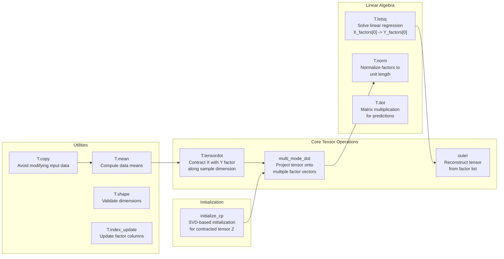
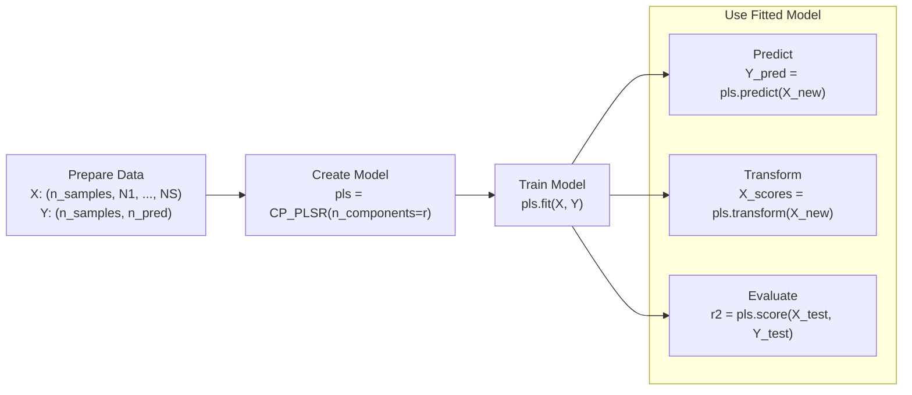

<!-- source: DeepWiki mcp.deepwiki.com · repo tensorly/tensorly · page 7.2 CP-PLSR · fetched 2026-10-21 -->

# CP-PLSR

<details>
<summary>Relevant source files</summary>

The following files were used as context for generating this wiki page:

- [tensorly/backend/paddle_backend.py](tensorly/backend/paddle_backend.py)
- [tensorly/metrics/regression.py](tensorly/metrics/regression.py)
- [tensorly/metrics/tests/__init__.py](tensorly/metrics/tests/__init__.py)
- [tensorly/metrics/tests/test_regression.py](tensorly/metrics/tests/test_regression.py)
- [tensorly/regression/cp_plsr.py](tensorly/regression/cp_plsr.py)
- [tensorly/regression/tests/test_cp_plsr.py](tensorly/regression/tests/test_cp_plsr.py)

</details>


## Purpose and Scope

CP-PLSR (Canonical Polyadic Partial Least Squares Regression) is a tensor regression method that learns a low-rank CP tensor weight to predict a matrix Y from a tensor X. This method performs partial least squares regression where the first modes of X and Y are coupled, and the decomposition maximizes the covariance between them. This is particularly useful for high-dimensional tensor data where traditional regression methods would be inefficient or suffer from overfitting.

For standard CP-based regression without the PLS covariance maximization, see [CP Regression](#7.1). For information about the underlying CP decomposition algorithm, see [CP Decomposition](#3.1).

Sources: [tensorly/regression/cp_plsr.py:11-33]()

## Overview

CP-PLSR extends the concept of Partial Least Squares (PLS) regression to tensor data by finding CP decompositions of both the input tensor X and the output matrix Y such that their first mode factors (the sample dimension) have maximum covariance. Unlike standard CP decomposition which minimizes reconstruction error, CP-PLSR optimizes for predictive covariance while maintaining the interpretability of the CP factor structure.

### Key Characteristics

| Property | Description |
|----------|-------------|
| **Input** | Tensor X of shape `(n_samples, N1, ..., NS)` where S ≥ 1 |
| **Output** | Matrix Y of shape `(n_samples, n_predictions)` |
| **Coupling** | First mode (samples) must match between X and Y |
| **Objective** | Maximize covariance between `X_factors[0]` and `Y_factors[0]` |
| **Decomposition** | Sequential component extraction with deflation |
| **Normalization** | Factors are normalized to unit norm |

Sources: [tensorly/regression/cp_plsr.py:11-33](), [tensorly/regression/tests/test_cp_plsr.py:26-47]()

## Class Structure and API

```mermaid
graph TB
    subgraph "CP_PLSR Class"
        Init["__init__<br/>(n_components, tol, n_iter_max,<br/>random_state, verbose)"]
        Fit["fit(X, Y)<br/>Main training method"]
        Predict["predict(X)<br/>Generate predictions"]
        Transform["transform(X, Y=None)<br/>Dimension reduction"]
        FitTransform["fit_transform(X, Y)<br/>Train and transform"]
        Score["score(X, Y)<br/>R² evaluation"]
        GetParams["get_params()"]
        SetParams["set_params(**parameters)"]
    end
    
    subgraph "Fitted Attributes"
        XFactors["X_factors<br/>List[ndarray]<br/>Factors for each mode of X"]
        YFactors["Y_factors<br/>List[ndarray]<br/>Factors for Y (2 modes)"]
        Coef["coef_<br/>ndarray(n_components, n_components)<br/>Linear regression coefficients"]
        XMean["X_mean_<br/>Mean of X for centering"]
        YMean["Y_mean_<br/>Mean of Y for centering"]
        XShape["X_shape_, Y_shape_<br/>Original data shapes"]
        XR2["X_r2, Y_r2<br/>R² per component"]
    end
    
    subgraph "Dependencies"
        MultiModeDot["multi_mode_dot<br/>tensorly.tenalg"]
        Outer["outer<br/>tensorly.tenalg"]
        InitCP["initialize_cp<br/>tensorly.decomposition._cp"]
        Backend["Backend T<br/>tensorly.backend"]
        TensorToVec["tensor_to_vec<br/>tensorly"]
        R2Score["R2_score<br/>tensorly.metrics.regression"]
    end
    
    Init --> Fit
    Fit --> Predict
    Fit --> Transform
    Fit --> FitTransform
    Fit --> Score
    
    Fit --> XFactors
    Fit --> YFactors
    Fit --> Coef
    Fit --> XMean
    Fit --> YMean
    Fit --> XShape
    
    Predict --> XFactors
    Predict --> YFactors
    Predict --> Coef
    Predict --> XMean
    Predict --> YMean
    
    Transform --> XFactors
    Transform --> YFactors
    
    Fit --> MultiModeDot
    Fit --> Outer
    Fit --> InitCP
    Fit --> Backend
    Fit --> TensorToVec
    
    Predict --> MultiModeDot
    Predict --> Outer
    Predict --> Backend
    
    Score --> R2Score
```



Sources: [tensorly/regression/cp_plsr.py:11-328]()

## Initialization Parameters

The `CP_PLSR` class is initialized with hyperparameters that control the decomposition:

| Parameter | Type | Default | Description |
|-----------|------|---------|-------------|
| `n_components` | int | required | Rank of the CP decomposition (number of components to extract) |
| `tol` | float | 1.0e-9 | Convergence tolerance for each component |
| `n_iter_max` | int | 100 | Maximum iterations per component |
| `random_state` | None, int, RandomState | None | Random seed for reproducibility |
| `verbose` | bool | False | Whether to print convergence messages |

Sources: [tensorly/regression/cp_plsr.py:35-42]()

## Algorithm Workflow

```mermaid
graph TB
    InputData["Input: X (n_samples, N1, ..., NS)<br/>Y (n_samples, n_predictions)"]
    
    Validate["Validate Inputs<br/>- Check first mode coupling<br/>- Convert Y to matrix if vector<br/>Line 83-95"]
    
    Center["Mean Center Data<br/>X -= X_mean_<br/>Y -= Y_mean_<br/>Line 97-104"]
    
    InitFactors["Initialize Factor Matrices<br/>X_factors[i] = zeros(shape[i], n_components)<br/>Y_factors[i] = zeros(shape[i], n_components)<br/>Line 106-116"]
    
    ComponentLoop["For component in range(n_components)<br/>Line 119"]
    
    InitYFactor["Initialize comp_Y_factors_0 = Y[:, 0]<br/>Line 121"]
    
    IterLoop["Alternating Iteration Loop<br/>Line 124"]
    
    TensorDot["Z = tensordot(X, comp_Y_factors_0, axes=((0,), (0,)))<br/>Contract X along sample mode<br/>Line 125"]
    
    InitZ["Initialize Z_comp from Z<br/>using initialize_cp<br/>Line 127-129"]
    
    UpdateZComp["Update Z_comp factors<br/>via multi_mode_dot<br/>Normalize to unit norm<br/>Line 131-137"]
    
    UpdateXFactors["Update X_factors from Z_comp<br/>X_factors[mode>0] = Z_comp<br/>X_factors[0] = multi_mode_dot(X, X_factors[1:])<br/>Line 139-146"]
    
    UpdateYFactors["Update Y_factors<br/>Y_factors[1] = Y.T @ X_factors[0]<br/>Y_factors[0] = Y @ Y_factors[1]<br/>Line 147-149"]
    
    CheckConverge["Check Convergence<br/>norm(old - new) < tol<br/>Line 151-157"]
    
    SaveFactors["Save Component Factors<br/>Update X_factors, Y_factors<br/>using index_update<br/>Line 160-169"]
    
    ComputeCoef["Compute Coefficients<br/>coef = lstsq(X_factors[0], Y_factors[0])<br/>Line 171-176"]
    
    Deflation["Deflation<br/>X -= outer(comp_X_factors)<br/>Y -= X_factors[0] @ coef @ Y_factors[1].T<br/>Line 178-186"]
    
    NextComponent["Next Component"]
    
    Return["Return self with fitted attributes"]
    
    InputData --> Validate
    Validate --> Center
    Center --> InitFactors
    InitFactors --> ComponentLoop
    ComponentLoop --> InitYFactor
    InitYFactor --> IterLoop
    IterLoop --> TensorDot
    TensorDot --> InitZ
    InitZ --> UpdateZComp
    UpdateZComp --> UpdateXFactors
    UpdateXFactors --> UpdateYFactors
    UpdateYFactors --> CheckConverge
    CheckConverge -->|"Not Converged"| IterLoop
    CheckConverge -->|"Converged"| SaveFactors
    SaveFactors --> ComputeCoef
    ComputeCoef --> Deflation
    Deflation --> NextComponent
    NextComponent -->|"More Components"| ComponentLoop
    NextComponent -->|"Done"| Return
```



Sources: [tensorly/regression/cp_plsr.py:55-188]()

## Core Methods

### fit(X, Y)

The `fit` method trains the CP-PLSR model by iteratively extracting components that maximize covariance between X and Y.

**Process:**

1. **Preprocessing** [tensorly/regression/cp_plsr.py:81-104]()
   - Validates that first modes of X and Y match
   - Converts vector Y to matrix if needed
   - Mean-centers both X and Y
   - Stores shapes and means

2. **Component Extraction** [tensorly/regression/cp_plsr.py:119-187]()
   - For each component (sequential extraction):
     - Initialize Y factor from first column
     - Alternate between updating X and Y factors
     - Contract X with Y factor via `tensordot`
     - Decompose contracted tensor using `initialize_cp` and `multi_mode_dot`
     - Normalize all factors to unit norm
     - Check convergence based on change in Y factor
     - Compute linear regression coefficients via `lstsq`
     - Deflate X and Y to remove the extracted component

**Returns:** self (with fitted attributes)

**Key Fitted Attributes:**

| Attribute | Shape | Description |
|-----------|-------|-------------|
| `X_factors` | List of `(shape[i], n_components)` | CP factors for each mode of X |
| `Y_factors` | List of `(shape[i], n_components)` | CP factors for Y (2 factors) |
| `coef_` | `(n_components, n_components)` | Linear model coefficients |

Sources: [tensorly/regression/cp_plsr.py:55-188]()

### predict(X)

Generates predictions for new tensor data using the fitted model.

**Algorithm:**

1. Validate that X shape matches training data (except first dimension)
2. Mean-center X using stored `X_mean_`
3. Project X onto the learned factors sequentially:
   - For each component:
     - Compute projection: `multi_mode_dot(X, X_factors[1:], range(1, ndim(X)))`
     - Deflate X by subtracting the outer product
4. Compute final prediction: `X_projection @ coef_ @ Y_factors[1].T + Y_mean_`

**Returns:** ndarray of shape `(n_samples, n_predictions)`

Sources: [tensorly/regression/cp_plsr.py:190-223]()

### transform(X, Y=None)

Applies dimensionality reduction by projecting data onto learned factors.

**Behavior:**

- If only X provided: Returns `X_scores` of shape `(n_samples, n_components)`
- If both X and Y provided: Returns `(X_scores, Y_scores)` tuple

**X Transformation:**
- Projects X onto `X_factors[1:]` for all modes except samples
- Uses sequential deflation like in `predict`

**Y Transformation:**
- Projects Y onto `Y_factors[1]`: `Y_scores[:, c] = Y @ Y_factors[1][:, c]`
- Deflates Y using `X_scores @ coef_[:, c] @ Y_factors[1][:, c].T`

Sources: [tensorly/regression/cp_plsr.py:225-293]()

### score(X, Y)

Evaluates prediction quality using R² (coefficient of determination).

**Calculation:**
```
R² = R2_score(Y - Y_mean_, predict(X) - Y_mean_)
   = 1 - ||predicted - true||² / ||true||²
```

Best possible score is 1.0; can be negative if predictions are arbitrarily bad.

Sources: [tensorly/regression/cp_plsr.py:314-327](), [tensorly/metrics/regression.py:41-57]()

## Key Dependencies and Operations



Sources: [tensorly/regression/cp_plsr.py:1-4]()

## Implementation Details

### Convergence and Normalization

The algorithm ensures that factors are orthonormal and converges when the Y factor stabilizes:

1. **Factor Normalization** [tensorly/regression/cp_plsr.py:134-137]()
   - Each Z component factor is normalized: `factor = factor / T.norm(factor, 2)`
   - Ensures numerical stability and interpretability

2. **Convergence Check** [tensorly/regression/cp_plsr.py:151-157]()
   - Monitors change in `comp_Y_factors_0`: `T.norm(old - new) < tol`
   - Default tolerance: 1e-9
   - Maximum iterations: 100 (configurable)

Sources: [tensorly/regression/cp_plsr.py:119-157]()

### Deflation Strategy

After extracting each component, both X and Y are deflated to ensure subsequent components capture orthogonal variance:

**X Deflation:**
```python
X -= outer(comp_X_factors)
```
Removes the rank-1 tensor approximation for the current component.

**Y Deflation:**
```python
Y -= X_factors[0] @ coef_ @ Y_factors[1].T
```
Removes the predicted Y contribution from the current component.

This ensures components are extracted in decreasing order of covariance.

Sources: [tensorly/regression/cp_plsr.py:178-186]()

### Backend Compatibility

CP-PLSR uses backend-agnostic operations throughout:

| Operation | Backend Method | Purpose |
|-----------|---------------|---------|
| Tensor contraction | `T.tensordot` | Contract X with Y factor |
| Matrix operations | `T.dot`, `T.lstsq` | Linear regression |
| Indexing | `T.index_update` | Update factor columns |
| Reshaping | `T.reshape` | Handle vector Y |
| Copying | `T.copy` | Avoid input mutation |

This allows CP-PLSR to work seamlessly with NumPy, PyTorch, TensorFlow, JAX, CuPy, and Paddle backends.

Sources: [tensorly/regression/cp_plsr.py:1-4]()

## Usage Example Pattern



Sources: [tensorly/regression/tests/test_cp_plsr.py:60-70](), [tensorly/regression/tests/test_cp_plsr.py:119-129]()

## Testing and Validation

The CP-PLSR implementation is validated through comprehensive tests:

### Test Categories

| Test Type | Description | Location |
|-----------|-------------|----------|
| **Dimension Compatibility** | Tests various tensor dimensions and response sizes | [test_cp_plsr.py:117-129]() |
| **Factor Properties** | Validates normality and orthogonality of factors | [test_cp_plsr.py:72-99]() |
| **Decomposition Accuracy** | Verifies factor recovery on synthetic data | [test_cp_plsr.py:149-162]() |
| **Covariance Optimization** | Confirms maximum covariance is achieved | [test_cp_plsr.py:190-208]() |
| **Variance Explained** | Checks R² increases with more components | [test_cp_plsr.py:211-235]() |
| **Reconstruction** | Tests X reconstruction from factors | [test_cp_plsr.py:165-174]() |
| **Transform Consistency** | Validates transform equals first factor | [test_cp_plsr.py:238-249]() |

### Key Test Insights

**Factor Normality Test** [tensorly/regression/tests/test_cp_plsr.py:72-82]()
- Verifies all factors (except first mode) have unit norm
- `assert_allclose(tl.norm(x_factor, axis=0), 1, rtol=1e-6)`

**Orthogonality Test** [tensorly/regression/tests/test_cp_plsr.py:85-98]()
- Confirms components are orthogonal by checking factor products
- Essential for ensuring components capture independent variance

**Covariance Maximization Test** [tensorly/regression/tests/test_cp_plsr.py:191-208]()
- Compares PLS covariance with true maximum covariance
- Validates the core objective function is optimized

Sources: [tensorly/regression/tests/test_cp_plsr.py:1-250]()

## Comparison with Standard PLS

| Aspect | Matrix PLS (2D) | CP-PLSR (Tensor) |
|--------|-----------------|------------------|
| **Input Structure** | Matrix (2D) | Tensor (≥2D) |
| **Factor Structure** | Single loadings vector per mode | CP factors for each tensor mode |
| **Decomposition** | SVD-based | Alternating least squares with deflation |
| **Interpretability** | One set of loadings | Multi-mode interpretable factors |
| **Compression** | Linear projection | Low-rank tensor approximation |
| **Applications** | Spectroscopy, chemometrics | Multi-way data (images, videos, time-series) |

Sources: [tensorly/regression/cp_plsr.py:11-33]()

## Mathematical Foundation

CP-PLSR solves the following optimization problem sequentially for each component:

**Objective:** Maximize covariance between projected X and projected Y

**Constraints:**
- X factors normalized: `||X_factors[i][:, r]||₂ = 1` for i > 0
- Y factors normalized: `||Y_factors[1][:, r]||₂ = 1`
- Components orthogonal (via deflation)

**Solution Method:**
1. Alternating updates of X and Y factors
2. Each update maximizes covariance given other factors fixed
3. Deflation removes extracted variance before next component

This is based on the multiway PLS calibration framework by Rasmus Bro (1996).

Sources: [tensorly/regression/cp_plsr.py:30-33]()

---

