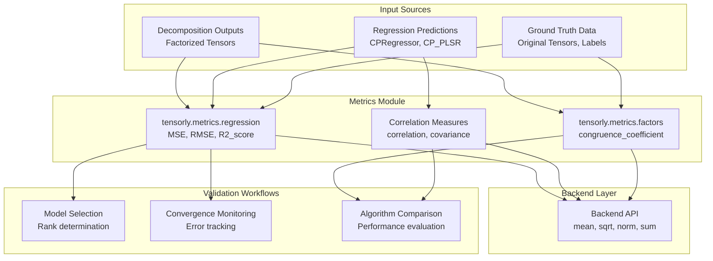
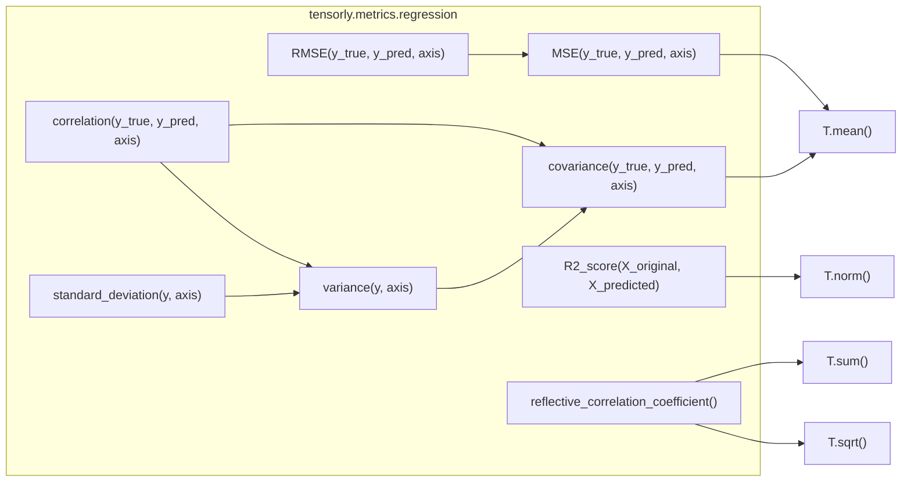
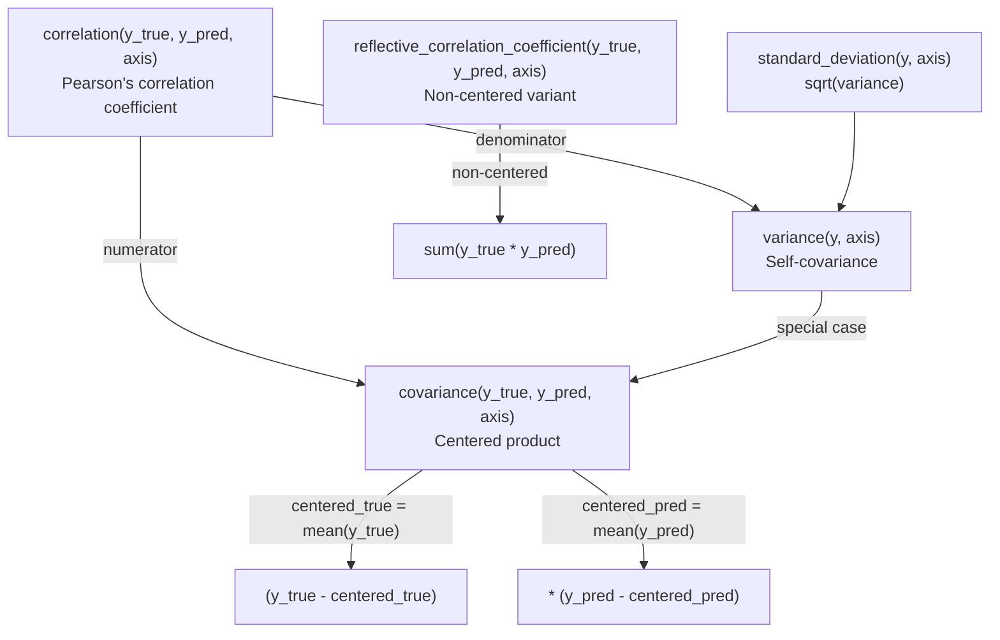
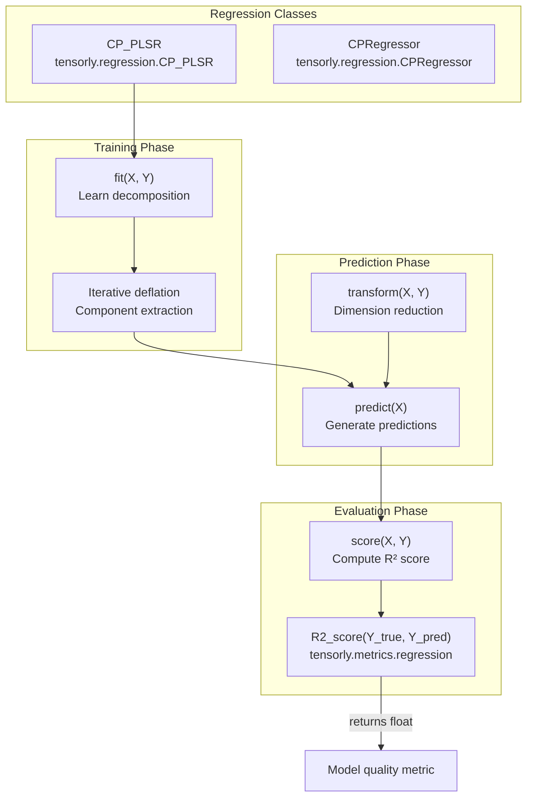
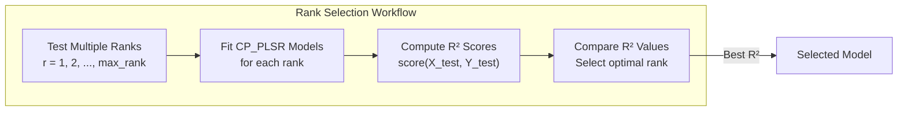
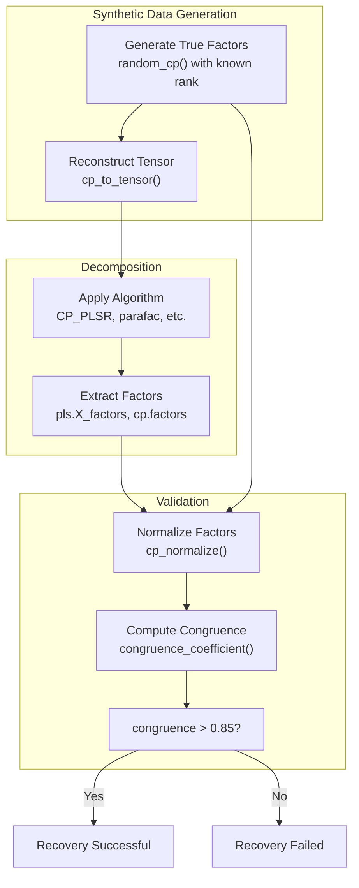
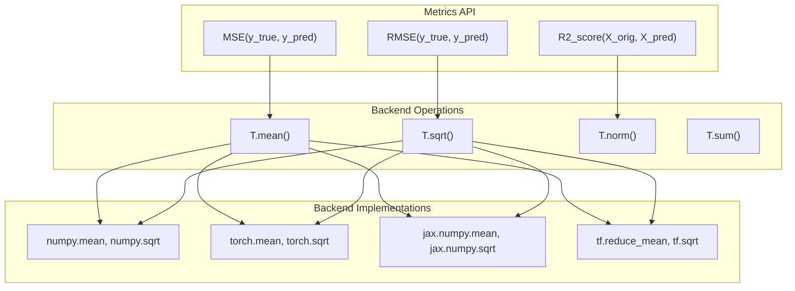

<!-- source: DeepWiki mcp.deepwiki.com · repo tensorly/tensorly · page 8 Metrics and Validation · fetched 2026-10-21 -->

# Metrics and Validation

<details>
<summary>Relevant source files</summary>

The following files were used as context for generating this wiki page:

- [doc/modules/api.rst](doc/modules/api.rst)
- [tensorly/backend/paddle_backend.py](tensorly/backend/paddle_backend.py)
- [tensorly/decomposition/__init__.py](tensorly/decomposition/__init__.py)
- [tensorly/decomposition/tests/test_robust_decomposition.py](tensorly/decomposition/tests/test_robust_decomposition.py)
- [tensorly/metrics/regression.py](tensorly/metrics/regression.py)
- [tensorly/metrics/tests/__init__.py](tensorly/metrics/tests/__init__.py)
- [tensorly/metrics/tests/test_regression.py](tensorly/metrics/tests/test_regression.py)
- [tensorly/regression/cp_plsr.py](tensorly/regression/cp_plsr.py)
- [tensorly/regression/tests/test_cp_plsr.py](tensorly/regression/tests/test_cp_plsr.py)

</details>


## Purpose and Scope

This page documents TensorLy's metrics and validation system, which provides performance measures for evaluating tensor decompositions and regression models. The metrics module includes regression metrics (MSE, RMSE, R²), correlation measures, and factor comparison metrics (congruence coefficients). 

For tensor regression methods that use these metrics, see [CP Regression](#7.1) and [CP-PLSR](#7.2). For decomposition algorithms that may be evaluated using these metrics, see [Tensor Decompositions](#3).

## Metrics System Overview

The metrics system sits at the application layer, consuming outputs from decomposition and regression systems to provide quantitative evaluation measures. It operates entirely through the backend abstraction layer, making all metrics backend-agnostic.



**Sources:** [doc/modules/api.rst:434-451](), [tensorly/metrics/regression.py:1-109]()

## Regression Metrics Module

The regression metrics module provides standard error and accuracy measures for comparing predicted values against ground truth. All metrics are backend-agnostic and support axis-wise computation.

### Module Structure



**Sources:** [tensorly/metrics/regression.py:1-109]()

## Mean Squared Error (MSE)

Computes the mean squared error between predictions and ground truth.

**Function:** `MSE(y_true, y_pred, axis=None)`

**Formula:**
```
MSE = mean((y_true - y_pred)²)
```

**Parameters:**
| Parameter | Type | Description |
|-----------|------|-------------|
| `y_true` | array | Ground truth target values (n_samples,) |
| `y_pred` | array | Estimated target values (n_samples,) |
| `axis` | int or None | Axis along which to compute mean |

**Returns:** float or array

**Implementation:** [tensorly/metrics/regression.py:6-20]()

```python
def MSE(y_true, y_pred, axis=None):
    return T.mean((y_true - y_pred) ** 2, axis=axis)
```

The implementation uses backend-agnostic operations, computing element-wise squared differences followed by a mean reduction.

**Sources:** [tensorly/metrics/regression.py:6-20]()

## Root Mean Squared Error (RMSE)

Computes the square root of the mean squared error, providing error in the same units as the original values.

**Function:** `RMSE(y_true, y_pred, axis=None)`

**Formula:**
```
RMSE = sqrt(mean((y_true - y_pred)²))
```

**Parameters:** Same as `MSE`

**Returns:** float or array

**Implementation:** [tensorly/metrics/regression.py:23-38]()

```python
def RMSE(y_true, y_pred, axis=None):
    return T.sqrt(MSE(y_true, y_pred, axis=axis))
```

**Sources:** [tensorly/metrics/regression.py:23-38]()

## R² Score (Coefficient of Determination)

Computes the R² regression score, measuring the proportion of variance explained by predictions. Best possible score is 1.0; scores can be negative if predictions are worse than a constant model.

**Function:** `R2_score(X_original, X_predicted)`

**Formula:**
```
R² = 1 - ||X_predicted - X_original||² / ||X_original||²
```

**Parameters:**
| Parameter | Type | Description |
|-----------|------|-------------|
| `X_original` | array | Original tensor/array |
| `X_predicted` | array | Predicted tensor/array |

**Returns:** float

**Special Cases:**
- R² = 1.0: Perfect prediction
- R² = 0.0: Prediction equivalent to constant model (mean of targets)
- R² < 0.0: Prediction worse than constant model

**Implementation:** [tensorly/metrics/regression.py:41-57]()

```python
def R2_score(X_original, X_predicted):
    return 1 - T.norm(X_predicted - X_original) ** 2.0 / T.norm(X_original) ** 2.0
```

**Sources:** [tensorly/metrics/regression.py:41-57]()

## Correlation and Covariance Functions

The regression module provides a family of functions for measuring linear relationships between variables.

### Correlation Metric Hierarchy



**Sources:** [tensorly/metrics/regression.py:60-109]()

### Pearson Correlation Coefficient

**Function:** `correlation(y_true, y_pred, axis=None)`

**Formula:**
```
correlation = cov(y_true, y_pred) / sqrt(var(y_true) * var(y_pred))
```

Measures linear relationship between variables, ranging from -1 (perfect negative correlation) to +1 (perfect positive correlation).

**Implementation:** [tensorly/metrics/regression.py:104-108]()

### Reflective Correlation Coefficient

**Function:** `reflective_correlation_coefficient(y_true, y_pred, axis=None)`

**Formula:**
```
reflective_corr = sum(y_true * y_pred) / sqrt(sum(y_true²) * sum(y_pred²))
```

Non-centered variant where predictions are not centered around their mean values. Useful when comparing factor matrices or when zero has special meaning.

**Implementation:** [tensorly/metrics/regression.py:60-77]()

**Sources:** [tensorly/metrics/regression.py:60-109]()

## Factor Metrics Module

Factor metrics compare the quality of recovered factors in tensor decompositions against ground truth or between different decompositions.

**Module:** `tensorly.metrics.factors`

### Congruence Coefficient

**Function:** `congruence_coefficient(factors_1, factors_2)`

Measures the similarity between two sets of factors from tensor decompositions. Used extensively in decomposition validation to assess recovery quality.

**Usage Example from Tests:** [tensorly/regression/tests/test_cp_plsr.py:157-162]()

```python
for pls_factor, true_factor in zip(pls.X_factors, x_cp.factors):
    assert congruence_coefficient(pls_factor, true_factor)[0] > 0.85
```

The function returns a tuple where the first element is the congruence score. Values close to 1.0 indicate high similarity between factor matrices.

**Sources:** [doc/modules/api.rst:447-449](), [tensorly/regression/tests/test_cp_plsr.py:157-162]()

## Integration with Regression Systems

Metrics are tightly integrated with TensorLy's regression classes through their `score()` methods, which provide a consistent interface for model evaluation.



**Sources:** [tensorly/regression/cp_plsr.py:314-327]()

### CP_PLSR Score Method

The `CP_PLSR.score()` method demonstrates standard metric integration:

**Implementation:** [tensorly/regression/cp_plsr.py:314-327]()

```python
def score(self, X, Y):
    """Calculate the R^2 of prediction on X compared to the ground truth Y provided."""
    from ..metrics.regression import R2_score
    return R2_score(Y - self.Y_mean_, self.predict(X) - self.Y_mean_)
```

**Key Design Patterns:**
1. **Mean Centering:** Predictions and ground truth are centered before computing R²
2. **Import Location:** Metrics imported locally to avoid circular dependencies
3. **Consistent Interface:** `score(X, Y)` signature matches scikit-learn convention

**Sources:** [tensorly/regression/cp_plsr.py:314-327]()

## Validation Workflows

Metrics enable several validation workflows throughout the library.

### Component Number Selection



**Test Example:** [tensorly/regression/tests/test_cp_plsr.py:211-235]()

```python
def test_increasing_variance_synthetic():
    """Tests that for synthetic X and Y, the R^2s are increasing"""
    X, Y, _, _ = _get_pls_dataset((20, 18, 14, 13), 8, 17)
    R2s = []
    for r in range(1, 12):
        tpls = CP_PLSR(r)
        tpls.fit(X, Y)
        R2s.append(tpls.score(X, Y))
    
    assert np.all(np.array(R2s) >= 0.0)
    assert np.all(np.diff(R2s) >= 0.0)
```

This test validates that R² scores are non-decreasing as the number of components increases, which is an important property for model selection.

**Sources:** [tensorly/regression/tests/test_cp_plsr.py:211-235]()

### Factor Recovery Validation



**Test Example:** [tensorly/regression/tests/test_cp_plsr.py:149-162]()

```python
def test_decomposition_accuracy(n_modes, n_response):
    """Tests CP_PLSR recovers factors in original synthetic data."""
    x, y, x_cp, y_cp = _get_pls_dataset(tuple([10] * n_modes), N_LATENT, n_response)
    pls = CP_PLSR(N_LATENT)
    pls.fit(x, y)
    
    cp_normalize(x_cp)
    
    for pls_factor, true_factor in zip(pls.X_factors, x_cp.factors):
        assert congruence_coefficient(pls_factor, true_factor)[0] > 0.85
```

**Sources:** [tensorly/regression/tests/test_cp_plsr.py:149-162]()

## Testing and Validation

The metrics module includes comprehensive tests ensuring correct behavior across backends.

### Test Coverage

| Metric | Test File | Key Tests |
|--------|-----------|-----------|
| `MSE` | [tensorly/metrics/tests/test_regression.py]() | Known value verification |
| `RMSE` | [tensorly/metrics/tests/test_regression.py]() | Known value verification |
| `R2_score` | [tensorly/metrics/tests/test_regression.py]() | Perfect/zero/scaled predictions |
| `correlation` | [tensorly/metrics/tests/test_regression.py]() | Linear relationships, orthogonality |

### Test Cases

**MSE Test:** [tensorly/metrics/tests/test_regression.py:8-13]()

```python
def test_MSE():
    y_true = tl.tensor([1, 0, 2, -2], dtype=tl.float32)
    y_pred = tl.tensor([1, -1, 1, -1], dtype=tl.float32)
    true_mse = 0.75
    assert_array_almost_equal(MSE(y_true, y_pred), true_mse)
```

**R² Score Special Cases:** [tensorly/metrics/tests/test_regression.py:24-29]()

```python
def test_R2_score():
    X_original = tl.randn((5, 4, 3))
    assert R2_score(X_original, X_original) == 1.0        # Perfect fit
    assert R2_score(X_original, X_original * 2) == 0.0    # Scaled (worse than mean)
    assert R2_score(X_original, tl.zeros_like(X_original)) == 0.0  # Zero prediction
```

**Correlation Properties:** [tensorly/metrics/tests/test_regression.py:32-46]()

Tests verify:
- Perfect positive correlation: `correlation(a, a*2 + 1) == 1`
- Perfect negative correlation: `correlation(a, -a*2 + 1) == -1`
- Zero correlation for orthogonal data
- Axis-wise computation

**Sources:** [tensorly/metrics/tests/test_regression.py:1-47]()

## Backend Compatibility

All metrics operate through the backend abstraction layer, ensuring compatibility across NumPy, PyTorch, TensorFlow, JAX, CuPy, and Paddle backends.



**Key Design Decisions:**

1. **No Direct Backend Imports:** Metrics never import `numpy`, `torch`, etc. directly
2. **Backend Prefix:** All operations use `T.` prefix (backend alias)
3. **Generic Array Types:** Functions accept any backend-compatible array type
4. **Automatic Dispatch:** Backend manager handles operation routing

**Sources:** [tensorly/metrics/regression.py:1-109]()

## Summary of Available Metrics

| Metric | Module | Function | Use Case |
|--------|--------|----------|----------|
| Mean Squared Error | `tensorly.metrics.regression` | `MSE()` | Prediction error magnitude |
| Root Mean Squared Error | `tensorly.metrics.regression` | `RMSE()` | Error in original units |
| R² Score | `tensorly.metrics.regression` | `R2_score()` | Proportion of variance explained |
| Correlation | `tensorly.metrics.regression` | `correlation()` | Linear relationship strength |
| Reflective Correlation | `tensorly.metrics.regression` | `reflective_correlation_coefficient()` | Non-centered similarity |
| Covariance | `tensorly.metrics.regression` | `covariance()` | Joint variability |
| Variance | `tensorly.metrics.regression` | `variance()` | Dispersion measure |
| Standard Deviation | `tensorly.metrics.regression` | `standard_deviation()` | Dispersion in original units |
| Congruence Coefficient | `tensorly.metrics.factors` | `congruence_coefficient()` | Factor similarity |

**Sources:** [doc/modules/api.rst:434-451](), [tensorly/metrics/regression.py:1-109]()

---

