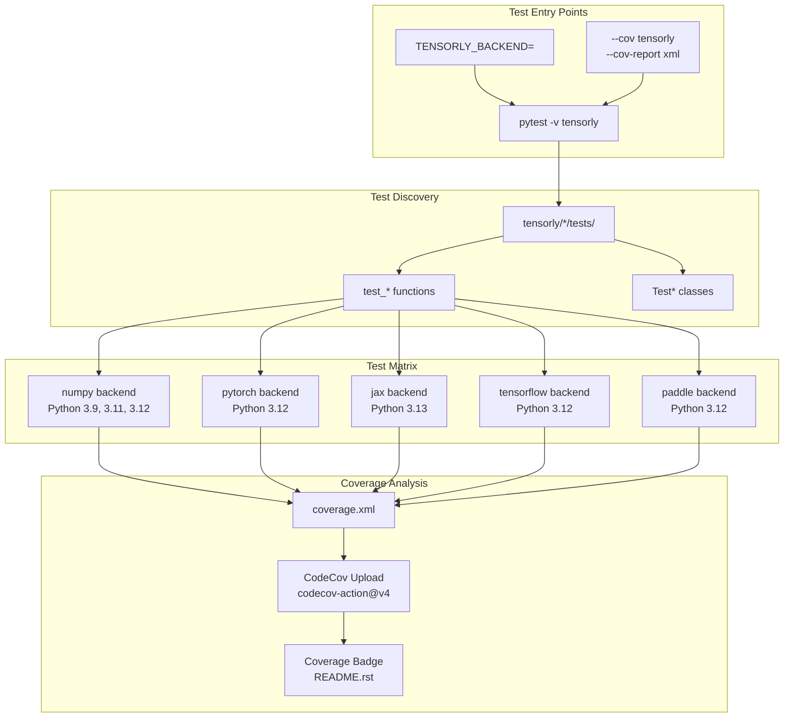
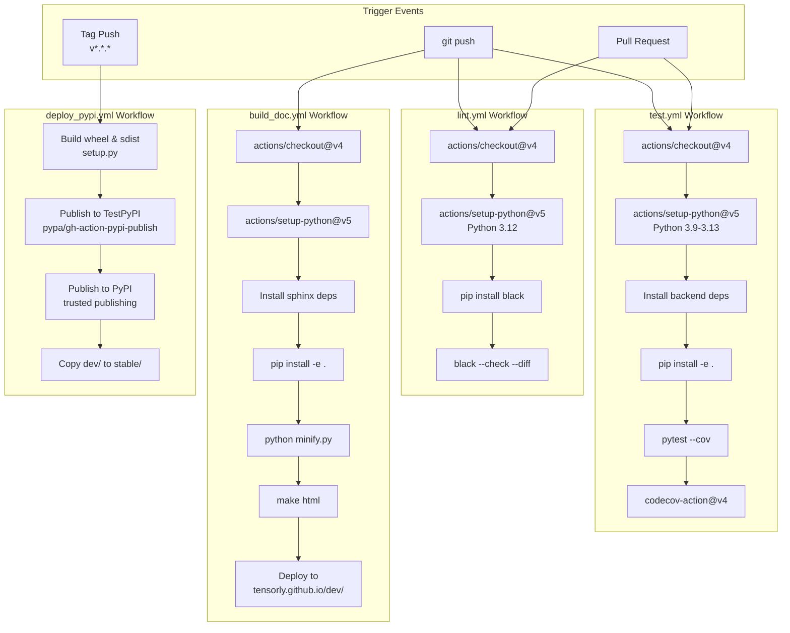

<!-- source: DeepWiki mcp.deepwiki.com · repo tensorly/tensorly · page 9 Developer Guide · fetched 2026-10-21 -->

# Developer Guide

<details>
<summary>Relevant source files</summary>

The following files were used as context for generating this wiki page:

- [.github/workflows/build_doc.yml](.github/workflows/build_doc.yml)
- [.github/workflows/deploy_pypi.yml](.github/workflows/deploy_pypi.yml)
- [.github/workflows/lint.yml](.github/workflows/lint.yml)
- [.github/workflows/test.yml](.github/workflows/test.yml)
- [README.rst](README.rst)
- [conda/meta.yaml](conda/meta.yaml)
- [setup.cfg](setup.cfg)
- [setup.py](setup.py)

</details>


## Purpose and Scope

This document provides a comprehensive overview of the development infrastructure for TensorLy contributors. It covers the development workflow, testing framework, continuous integration/continuous deployment (CI/CD) pipelines, and documentation system. This guide is intended for developers who want to contribute code, fix bugs, or extend TensorLy's capabilities.

For specific topics:
- **Development environment setup**: See [Development Setup](#9.1)
- **Testing infrastructure details**: See [Testing Framework](#9.2)
- **CI/CD pipeline configuration**: See [CI/CD Pipeline](#9.3)
- **Documentation building and deployment**: See [Documentation System](#9.4)

## Development Infrastructure Architecture

The TensorLy development infrastructure consists of four primary systems that work together to ensure code quality, test coverage, and automated deployment:

```mermaid
graph TB
    subgraph "Development Environment"
        LocalRepo["Local Git Repository"]
        EditableInstall["pip install -e ."]
        DevDeps["Development Dependencies<br/>pytest, black, sphinx"]
    end
    
    subgraph "Code Quality System"
        Black["black Formatter<br/>lint.yml"]
        Flake8Config["setup.cfg<br/>flake8 rules"]
        CodeStyle["Code Style Guidelines"]
    end
    
    subgraph "Testing System"
        PytestRunner["pytest Framework"]
        TestMatrix["Test Matrix<br/>test.yml"]
        BackendTests["Backend-Specific Tests<br/>TENSORLY_BACKEND"]
        Coverage["codecov Coverage<br/>Report"]
    end
    
    subgraph "CI/CD Pipelines"
        TestWorkflow["test.yml<br/>GitHub Actions"]
        LintWorkflow["lint.yml<br/>GitHub Actions"]
        DocWorkflow["build_doc.yml<br/>GitHub Actions"]
        DeployWorkflow["deploy_pypi.yml<br/>GitHub Actions"]
    end
    
    subgraph "Documentation System"
        SphinxBuild["Sphinx Build<br/>doc/Makefile"]
        DocTheme["tensorly-sphinx-theme"]
        DocDeploy["GitHub Pages<br/>tensorly.github.io"]
    end
    
    subgraph "Package Distribution"
        SetupPy["setup.py"]
        CondaMeta["conda/meta.yaml"]
        PyPI["PyPI Distribution"]
        TestPyPI["TestPyPI"]
        CondaForge["Conda Channel"]
    end
    
    LocalRepo --> EditableInstall
    DevDeps --> PytestRunner
    DevDeps --> Black
    DevDeps --> SphinxBuild
    
    LocalRepo --> TestWorkflow
    LocalRepo --> LintWorkflow
    LocalRepo --> DocWorkflow
    
    Black --> LintWorkflow
    Flake8Config --> LintWorkflow
    
    PytestRunner --> TestWorkflow
    TestMatrix --> TestWorkflow
    BackendTests --> TestWorkflow
    TestWorkflow --> Coverage
    
    SphinxBuild --> DocWorkflow
    DocTheme --> DocWorkflow
    DocWorkflow --> DocDeploy
    
    SetupPy --> DeployWorkflow
    DeployWorkflow --> TestPyPI
    DeployWorkflow --> PyPI
    DeployWorkflow --> DocDeploy
    
    CondaMeta --> CondaForge
    
    style TestWorkflow fill:#f9f,stroke:#333,stroke-width:2px
    style LintWorkflow fill:#f9f,stroke:#333,stroke-width:2px
    style DocWorkflow fill:#f9f,stroke:#333,stroke-width:2px
    style DeployWorkflow fill:#f9f,stroke:#333,stroke-width:2px
```



**Sources:** [README.rst:1-189](), [.github/workflows/test.yml:1-74](), [.github/workflows/lint.yml:1-27](), [.github/workflows/build_doc.yml:1-60](), [.github/workflows/deploy_pypi.yml:1-110](), [setup.py:1-71](), [conda/meta.yaml:1-52]()

## Development Workflow

The typical development workflow follows this pattern from local changes through automated testing to deployment:

```mermaid
graph LR
    subgraph "Local Development"
        Clone["git clone<br/>tensorly/tensorly"]
        Branch["git checkout -b<br/>feature-branch"]
        Install["pip install -e ."]
        Edit["Edit Code"]
        Format["black ."]
        LocalTest["pytest -v tensorly"]
    end
    
    subgraph "Version Control"
        Commit["git commit"]
        Push["git push origin<br/>feature-branch"]
        PR["Create Pull Request"]
    end
    
    subgraph "Automated CI"
        LintCheck["Lint Check<br/>black --check"]
        MatrixTest["Test Matrix<br/>numpy/pytorch/paddle<br/>Python 3.9-3.13"]
        CoverageCheck["Coverage Report<br/>codecov"]
        DocBuild["Build Documentation<br/>make html"]
    end
    
    subgraph "Review & Merge"
        CodeReview["Code Review"]
        Merge["Merge to main"]
    end
    
    subgraph "Deployment"
        AutoDocDeploy["Auto-deploy docs<br/>to dev/"]
        TagRelease["Create Tag<br/>v0.x.x"]
        BuildDist["Build Wheel<br/>sdist bdist_wheel"]
        PublishTestPyPI["Publish TestPyPI"]
        PublishPyPI["Publish PyPI"]
        UpdateStable["Update stable/<br/>docs"]
    end
    
    Clone --> Branch
    Branch --> Install
    Install --> Edit
    Edit --> Format
    Format --> LocalTest
    LocalTest --> Commit
    Commit --> Push
    Push --> PR
    
    PR --> LintCheck
    PR --> MatrixTest
    PR --> CoverageCheck
    PR --> DocBuild
    
    LintCheck --> CodeReview
    MatrixTest --> CodeReview
    CoverageCheck --> CodeReview
    DocBuild --> CodeReview
    
    CodeReview --> Merge
    Merge --> AutoDocDeploy
    
    Merge --> TagRelease
    TagRelease --> BuildDist
    BuildDist --> PublishTestPyPI
    PublishTestPyPI --> PublishPyPI
    PublishPyPI --> UpdateStable
```



**Sources:** [README.rst:45-56](), [README.rst:133-144](), [.github/workflows/test.yml:1-74](), [.github/workflows/lint.yml:1-27](), [.github/workflows/deploy_pypi.yml:1-110]()

## Repository Structure

The TensorLy repository follows a standard Python package structure with additional directories for testing, documentation, and CI/CD configuration:

| Directory/File | Purpose | Key Contents |
|----------------|---------|--------------|
| `tensorly/` | Main package source code | Core modules, backend implementations, decomposition algorithms |
| `tensorly/tests/` | Test suite | Unit tests, integration tests, backend-specific tests |
| `doc/` | Documentation source | Sphinx configuration, RST files, examples |
| `.github/workflows/` | CI/CD configuration | `test.yml`, `lint.yml`, `build_doc.yml`, `deploy_pypi.yml` |
| `setup.py` | Package installation configuration | Dependencies, metadata, version info |
| `setup.cfg` | Tool configuration | Flake8 rules, package data |
| `requirements.txt` | Core dependencies | NumPy, SciPy |
| `README.rst` | Project documentation | Installation, quickstart, contribution guidelines |
| `LICENSE.txt` | License information | BSD License |
| `conda/` | Conda packaging | `meta.yaml` for conda-forge |

**Sources:** [setup.py:1-71](), [setup.cfg:1-28](), [conda/meta.yaml:1-52](), [README.rst:1-189]()

## Development Environment Setup

To contribute to TensorLy, you need to:

1. **Clone the repository** and install in editable mode:
   ```bash
   git clone https://github.com/tensorly/tensorly
   cd tensorly
   pip install -e .
   ```
   [README.rst:50-54]()

2. **Install development dependencies**:
   - Core dependencies: `numpy`, `scipy` [setup.py:59]()
   - Testing: `pytest` [README.rst:152-154]()
   - Linting: `black` [README.rst:142]()
   - Documentation: Sphinx and related packages [.github/workflows/build_doc.yml:21-26]()

3. **Install backend-specific dependencies** (optional):
   - PyTorch: `pip install torch torchvision` [.github/workflows/test.yml:47-48]()
   - TensorFlow: `pip install tensorflow` [.github/workflows/test.yml:50-51]()
   - JAX: `pip install jax jaxlib` [.github/workflows/test.yml:53-54]()
   - Paddle: `pip install paddlepaddle` [.github/workflows/test.yml:56-59]()

For detailed setup instructions, see [Development Setup](#9.1).

**Sources:** [README.rst:45-56](), [setup.py:59](), [.github/workflows/test.yml:37-59]()

## Testing Infrastructure

TensorLy uses `pytest` as its testing framework with comprehensive backend-specific test coverage:

### Test Execution



### Test Matrix Configuration

The CI test matrix covers multiple Python versions and backends:

| Backend | Python Versions | Additional Config |
|---------|----------------|-------------------|
| `numpy` | 3.9, 3.11, 3.12 | Default, includes sparse tests |
| `pytorch` | 3.12 | GPU support available |
| `tensorflow` | 3.12 | einsum tenalg backend |
| `jax` | 3.13 | einsum tenalg backend |
| `paddle` | 3.12 | - |

[.github/workflows/test.yml:9-25]()

### Running Tests Locally

```bash
# Run all tests with default (NumPy) backend
pytest -v tensorly

# Run tests with a specific backend
TENSORLY_BACKEND='pytorch' pytest -v tensorly

# Run tests with coverage
pytest -v --cov tensorly --cov-report xml tensorly
```

[README.rst:156-167]()

For detailed testing documentation, see [Testing Framework](#9.2).

**Sources:** [README.rst:146-167](), [.github/workflows/test.yml:1-74](), [conda/meta.yaml:27-32]()

## CI/CD Pipeline

TensorLy uses GitHub Actions for continuous integration and deployment with four primary workflows:

### Workflow Overview



### Workflow Configuration Files

| Workflow | File | Trigger | Purpose |
|----------|------|---------|---------|
| Test | `.github/workflows/test.yml` | Push, PR | Run pytest with multiple backends and Python versions |
| Lint | `.github/workflows/lint.yml` | Push to main, PR | Enforce code style with black |
| Build Docs | `.github/workflows/build_doc.yml` | Push | Build and deploy documentation to dev/ |
| Deploy | `.github/workflows/deploy_pypi.yml` | Tag push | Build wheel, publish to PyPI, update stable docs |

[.github/workflows/test.yml:1-3](), [.github/workflows/lint.yml:3-7](), [.github/workflows/build_doc.yml:3](), [.github/workflows/deploy_pypi.yml:3-6]()

For detailed CI/CD documentation, see [CI/CD Pipeline](#9.3).

**Sources:** [.github/workflows/test.yml:1-74](), [.github/workflows/lint.yml:1-27](), [.github/workflows/build_doc.yml:1-60](), [.github/workflows/deploy_pypi.yml:1-110]()

## Documentation System

TensorLy uses Sphinx to build documentation, which is automatically deployed to GitHub Pages:

### Documentation Build Pipeline

The documentation system consists of:

- **Sphinx Configuration**: Located in `doc/` directory
- **Theme**: `tensorly-sphinx-theme` custom theme [.github/workflows/build_doc.yml:25]()
- **Minification**: `doc/minify.py` script prepares files [.github/workflows/build_doc.yml:32-33]()
- **Build Command**: `make html` in `doc/` directory [.github/workflows/build_doc.yml:34]()
- **Deployment**: 
  - Development version → `tensorly.github.io/dev/` on every push to main [.github/workflows/build_doc.yml:37-59]()
  - Stable version → `tensorly.github.io/stable/` on tagged releases [.github/workflows/deploy_pypi.yml:89-109]()

### Building Documentation Locally

```bash
cd doc
python minify.py
make html
# Output in doc/_build/html/
```

For detailed documentation system information, see [Documentation System](#9.4).

**Sources:** [.github/workflows/build_doc.yml:1-60](), [.github/workflows/deploy_pypi.yml:29-34](), [.github/workflows/deploy_pypi.yml:89-109]()

## Code Quality Standards

TensorLy enforces code quality through automated linting and formatting:

### Black Formatter

The codebase uses `black` for consistent code formatting:

```bash
# Format code
pip install black
black .

# Check formatting (CI mode)
black --check --diff --color ./tensorly
```

[README.rst:138-144](), [.github/workflows/lint.yml:24-26]()

The lint workflow runs on every push to main and on pull requests, ensuring all code follows consistent style.

### Flake8 Configuration

Additional style rules are configured in `setup.cfg`:

```python
[flake8]
exclude = __init__.py
ignore = E20, E231, E241, E26, E4, E741
max-line-length = 90
```

[setup.cfg:9-28]()

These rules allow some flexibility for tensor operation formatting while maintaining readability.

**Sources:** [README.rst:138-144](), [.github/workflows/lint.yml:1-27](), [setup.cfg:9-28]()

## Contribution Process

To contribute to TensorLy:

1. **Open an Issue or Discussion**: Report bugs, request features, or ask questions [README.rst:129]()

2. **Fork and Clone**: Fork the repository and clone your fork locally [README.rst:50-51]()

3. **Create a Branch**: Create a feature or bugfix branch
   ```bash
   git checkout -b feature-name
   ```

4. **Make Changes**: Edit code, add tests, update documentation

5. **Format Code**: Run `black` to format your changes [README.rst:138-144]()

6. **Run Tests**: Verify tests pass locally [README.rst:156-167]()
   ```bash
   pytest -v tensorly
   ```

7. **Commit and Push**: Commit your changes and push to your fork

8. **Open Pull Request**: Create a PR on GitHub [README.rst:129]()

9. **CI Checks**: Wait for automated CI checks to pass:
   - Lint check with black
   - Tests across multiple backends
   - Documentation build
   - Coverage report

10. **Code Review**: Address reviewer feedback

11. **Merge**: Once approved, maintainers will merge your PR

**Sources:** [README.rst:129-144](), [README.rst:146-167]()

## Package Distribution

TensorLy is distributed through multiple channels:

### PyPI Distribution

- **Source**: [setup.py:1-71]()
- **Installation**: `pip install tensorly` [README.rst:41]()
- **Build**: `python setup.py sdist bdist_wheel` [.github/workflows/deploy_pypi.yml:37]()
- **Automated Deployment**: Tag-based releases via `deploy_pypi.yml` [.github/workflows/deploy_pypi.yml:1-110]()

### Conda Distribution

- **Source**: [conda/meta.yaml:1-52]()
- **Installation**: `conda install -c tensorly tensorly` [README.rst:41]()
- **Build**: `noarch: python` package [conda/meta.yaml:13]()
- **Testing**: Conda package includes pytest tests [conda/meta.yaml:27-32]()

### Trusted Publishing

TensorLy uses PyPI's trusted publishing feature for secure, automated releases:
- No API tokens stored in GitHub secrets
- Identity-based authentication via OIDC
- Configured in `deploy_pypi.yml` with `id-token: write` permission [.github/workflows/deploy_pypi.yml:79]()

**Sources:** [setup.py:1-71](), [conda/meta.yaml:1-52](), [.github/workflows/deploy_pypi.yml:68-88](), [README.rst:35-44]()

---

