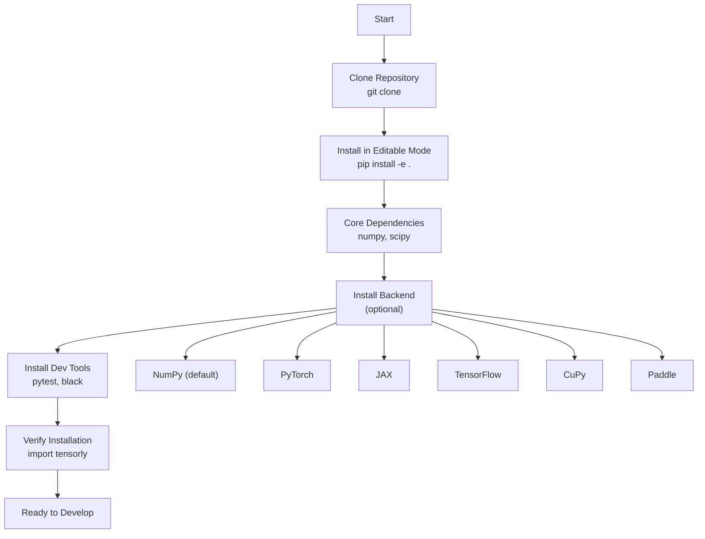
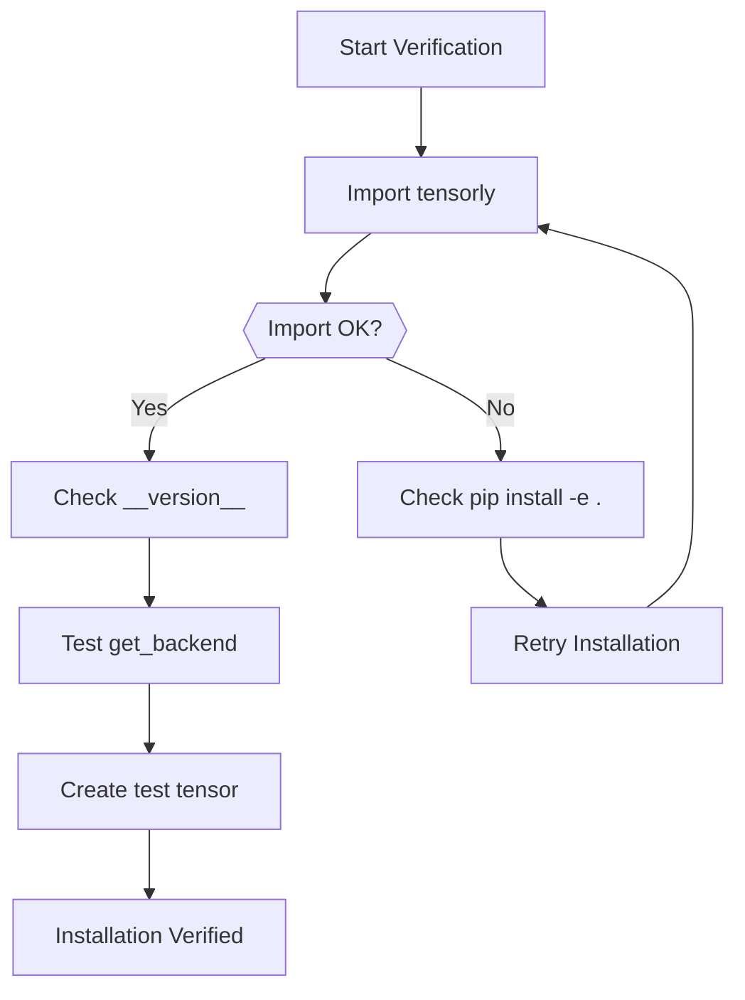
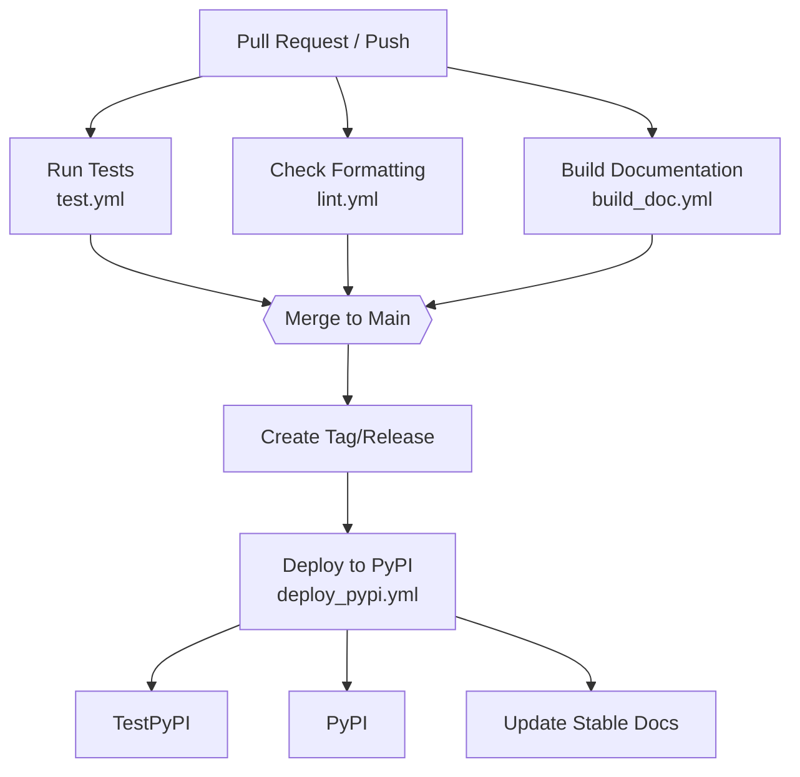

<!-- source: DeepWiki mcp.deepwiki.com · repo tensorly/tensorly · page 9.1 Development Setup · fetched 2026-10-21 -->

# Development Setup

<details>
<summary>Relevant source files</summary>

The following files were used as context for generating this wiki page:

- [README.rst](README.rst)
- [conda/meta.yaml](conda/meta.yaml)
- [setup.cfg](setup.cfg)
- [setup.py](setup.py)

</details>


This document provides instructions for setting up a local development environment for TensorLy. It covers cloning the repository, installing in editable mode, configuring dependencies, and verifying the installation.

For information on testing, see page 9.2. For CI/CD workflows, see page 9.3. For documentation building, see page 9.4.

## Prerequisites

Before setting up TensorLy for development, ensure you have:

- **Python 3.9 or newer** - Required for compatibility with all backends
- **Git** - For version control and cloning the repository
- **pip** - For installing packages (recommended for development)

Alternatively, you can use **conda** for package management, though pip is recommended for development installations.

Sources: [README.rst:32-33](), [setup.py:66]()

## Cloning the Repository

Clone the TensorLy repository from GitHub:

```bash
git clone https://github.com/tensorly/tensorly
cd tensorly
```

The repository structure includes:
- `tensorly/` - Main package source code
- `doc/` - Documentation source files
- `.github/workflows/` - CI/CD configuration
- `setup.py` - Package installation configuration
- `README.rst` - Project readme

Sources: [README.rst:50-52](), [setup.py:48-70]()

## Installing in Editable Mode

Install TensorLy in editable (development) mode using pip:

```bash
pip install -e .
```

**What is editable mode?**

The `-e` flag (or `--editable`) installs the package in a way that allows you to modify the source code and have changes take effect immediately without reinstalling. This is the recommended approach for development.

**What gets installed:**

When you run `pip install -e .`, the following occurs:
- Core dependencies (`numpy`, `scipy`) are installed automatically
- A link is created from your Python environment to the local source directory
- The `tensorly` package becomes available for import
- Any changes to `.py` files in the source tree are immediately reflected

Sources: [README.rst:48-56](), [setup.py:59]()

## Development Setup Workflow

Development Setup Process:



Sources: [README.rst:48-56](), [setup.py:59]()

## Installing Dependencies

### Core Dependencies

The core dependencies are automatically installed when you run `pip install -e .`:

| Package | Purpose |
|---------|---------|
| `numpy` | Default backend for tensor operations |
| `scipy` | Scientific computing utilities |

These dependencies are specified in [setup.py:59]() as `install_requires`.

Sources: [setup.py:59]()

### Backend Dependencies

TensorLy's backend system (see page 2) allows seamless switching between different tensor computation frameworks. The default NumPy backend is installed automatically, but you can install additional backends:

**Backend Installation Commands:**

| Backend | Installation Command | Notes |
|---------|---------------------|-------|
| **NumPy** | *(default)* | Installed with TensorLy |
| **PyTorch** | `pip install torch` | GPU support available |
| **JAX** | `pip install jax jaxlib` | JIT compilation support |
| **TensorFlow** | `pip install tensorflow` | GPU support available |
| **CuPy** | `pip install cupy` | CUDA-based GPU acceleration |
| **Paddle** | `pip install paddlepaddle` | PaddlePaddle framework |

**Example: Installing PyTorch backend**

```bash
pip install torch
```

Then in your code:
```python
import tensorly as tl
tl.set_backend('pytorch')
```

Sources: [README.rst:57-58](), [README.rst:99-105]()

### Development Tools

For development work, you should also install:

**Testing:**
```bash
pip install pytest
```

**Code Formatting:**
```bash
pip install black
```

**Documentation Building:**
```bash
pip install -r doc/requirements_doc.txt
```

See page 9.2 for testing details, and page 9.4 for documentation building.

Sources: [README.rst:138-154]()

## Verifying Your Installation

After installation, verify that TensorLy is correctly installed:

**Basic Import Test:**

```python
import tensorly as tl
print(f"TensorLy version: {tl.__version__}")
print(f"Current backend: {tl.get_backend()}")
```

**Testing Backend Switching:**

```python
import tensorly as tl

# Test NumPy backend (default)
tl.set_backend('numpy')
tensor = tl.tensor([[1, 2], [3, 4]])
print(f"NumPy backend: {type(tensor)}")  # <class 'numpy.ndarray'>

# Test PyTorch backend (if installed)
try:
    tl.set_backend('pytorch')
    tensor = tl.tensor([[1, 2], [3, 4]])
    print(f"PyTorch backend: {type(tensor)}")  # <class 'torch.Tensor'>
except ModuleNotFoundError:
    print("PyTorch not installed")
```

**Verification Checklist:**



If you encounter import errors, ensure:
1. You're in the correct Python environment
2. The installation completed without errors
3. Core dependencies (numpy, scipy) are installed

Sources: [README.rst:74-80](), [README.rst:96-106]()

## Package Structure Overview

Understanding the TensorLy package structure:

```
tensorly/
├── __init__.py              # Package initialization, version
├── backend/                 # Backend system (see page 2)
│   ├── numpy_backend.py
│   ├── pytorch_backend.py
│   ├── tensorflow_backend.py
│   ├── jax_backend.py
│   ├── cupy_backend.py
│   └── paddle_backend.py
├── decomposition/           # Decomposition algorithms (see page 3)
│   ├── parafac.py
│   ├── tucker.py
│   ├── tensor_train.py
│   └── ...
├── tenalg/                  # Tensor algebra operations
│   ├── svd.py
│   ├── proximal.py
│   └── ...
├── regression/              # Tensor regression methods
├── metrics/                 # Performance metrics
├── random/                  # Random tensor generation
└── ...
```

**Key Files:**

| File | Purpose |
|------|---------|
| `setup.py` | Package configuration and dependencies |
| `setup.cfg` | Additional package metadata and linting rules |
| `README.rst` | Project documentation |
| `LICENSE.txt` | License information |

Sources: [setup.py:48-70](), [setup.cfg:1-27]()

## Code Formatting

TensorLy uses **Black** for code formatting. All code contributions must be formatted with Black before submission.

**Installing Black:**

```bash
pip install black
```

**Formatting Your Code:**

```bash
# Format all Python files in the current directory
black .

# Format specific files
black tensorly/decomposition/parafac.py
```

**Checking Formatting (without changing files):**

```bash
black --check --diff --color ./tensorly
```

**Additional Linting Rules:**

The file [setup.cfg:9-27]() defines additional linting rules for `flake8`:
- Maximum line length: 90 characters
- Excluded files: `__init__.py`
- Ignored error codes: E20, E231, E241, E26, E4, E741

See page 9.3 for details on how the CI/CD pipeline enforces these rules.

Sources: [README.rst:138-144](), [setup.cfg:9-27]()

## Building Documentation

If you're working on documentation, install the documentation dependencies:

```bash
pip install -r doc/requirements_doc.txt
pip install git+https://github.com/tensorly/tensorly-sphinx-theme.git@main
```

Then build the documentation:

```bash
cd doc
python minify.py
make html
cd ..
```

The documentation will be generated in `doc/_build/html/`.

Sources: [.github/workflows/build_doc.yml:22-35]()

## CI/CD Workflows

TensorLy uses GitHub Actions for continuous integration and deployment:



The GitHub Actions workflows are defined in `.github/workflows/`:

- `test.yml`: Tests across multiple backends and Python versions
- `lint.yml`: Enforces code formatting with Black
- `build_doc.yml`: Builds and deploys development documentation
- `deploy_pypi.yml`: Deploys releases to TestPyPI and PyPI, updates stable documentation

Sources: [.github/workflows/test.yml](), [.github/workflows/lint.yml](), [.github/workflows/build_doc.yml](), [.github/workflows/deploy_pypi.yml]()

## Contributing Guidelines

- All contributions are welcome
- Report bugs or typos by opening GitHub issues
- Open pull requests for code changes
- Ensure your code adheres to the style guide (using Black)
- Add tests for new features or bug fixes
- Test with multiple backends if possible

For more information on the TensorLy project structure, see the [Overview](#1) page.

Sources: [README.rst:129-136](), [README.rst:146-150]()

---

