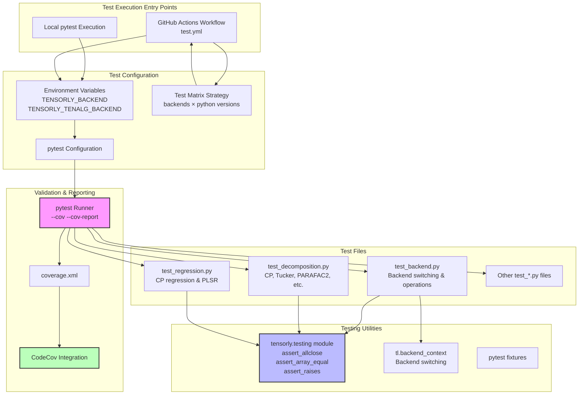
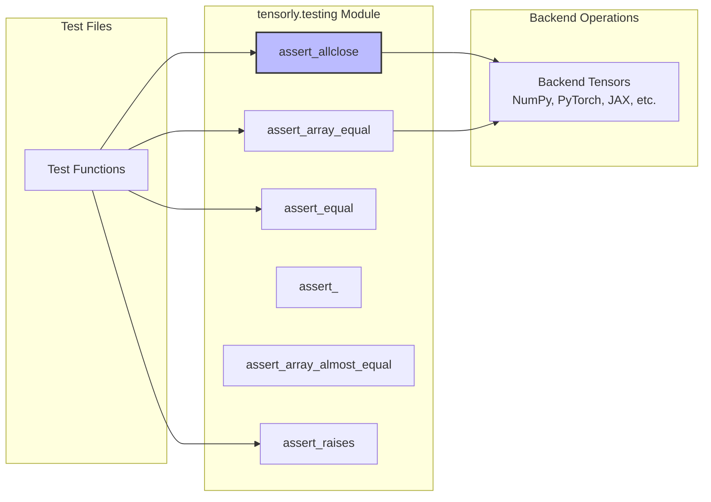
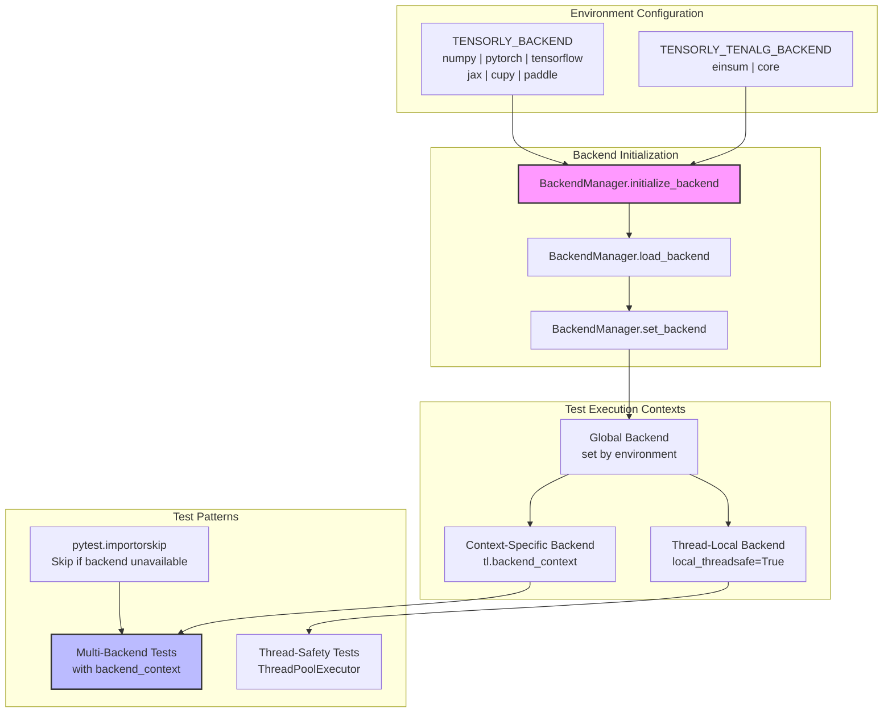
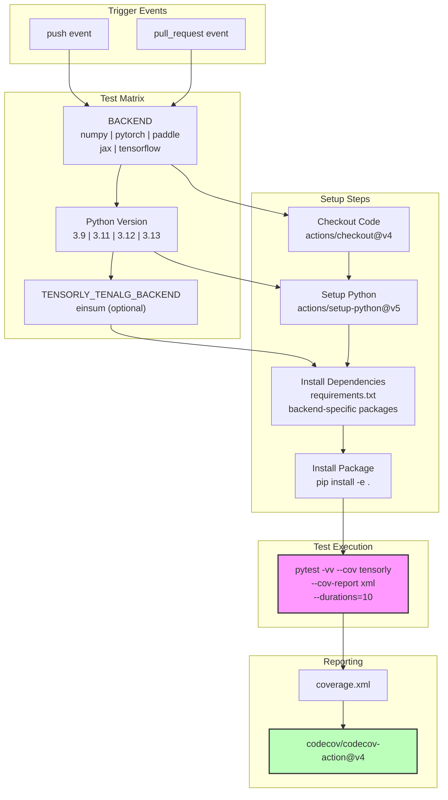

<!-- source: DeepWiki mcp.deepwiki.com · repo tensorly/tensorly · page 9.2 Testing Framework · fetched 2026-10-21 -->

# Testing Framework

<details>
<summary>Relevant source files</summary>

The following files were used as context for generating this wiki page:

- [.github/workflows/build_doc.yml](.github/workflows/build_doc.yml)
- [.github/workflows/deploy_pypi.yml](.github/workflows/deploy_pypi.yml)
- [.github/workflows/lint.yml](.github/workflows/lint.yml)
- [.github/workflows/test.yml](.github/workflows/test.yml)
- [tensorly/__init__.py](tensorly/__init__.py)
- [tensorly/backend/__init__.py](tensorly/backend/__init__.py)
- [tensorly/tests/test_backend.py](tensorly/tests/test_backend.py)

</details>


## Purpose and Scope

This document describes TensorLy's pytest-based testing infrastructure, including backend-agnostic test design, CI/CD integration, coverage reporting, and test execution strategies. The testing framework ensures that all decomposition algorithms, tensor operations, and backend implementations work correctly across multiple numerical computing frameworks.

For information about the CI/CD pipeline that executes these tests, see [CI/CD Pipeline](#9.3). For development environment setup, see [Development Setup](#9.1).

## Overview

TensorLy uses **pytest** as its primary testing framework, with a testing infrastructure specifically designed to validate functionality across multiple backend implementations (NumPy, PyTorch, TensorFlow, JAX, CuPy, Paddle). The testing system includes:

- Backend-agnostic test design with environment-based backend selection
- Custom assertion utilities via `tensorly.testing` module
- Comprehensive CI/CD integration through GitHub Actions
- Code coverage tracking with CodeCov
- Test matrix strategies for multiple Python versions and backends



**Sources:** [.github/workflows/test.yml:1-74](), [tensorly/tests/test_backend.py:1-659]()

## Test Organization

Tests are located in the `tensorly/tests/` directory with a modular structure that mirrors the library's organization:

| Test File | Purpose | Key Coverage |
|-----------|---------|--------------|
| `test_backend.py` | Backend abstraction and operations | Backend switching, tensor operations, SVD, linear algebra |
| `test_decomposition.py` | Tensor decompositions | CP, Tucker, TT, TR, PARAFAC2 algorithms |
| `test_cp_tensor.py` | CP tensor representation | CPTensor class methods and operations |
| `test_tucker_tensor.py` | Tucker tensor representation | TuckerTensor class methods |
| `test_regression.py` | Tensor regression | CPRegressor, CP-PLSR implementations |
| `test_metrics.py` | Metrics and validation | R2 score, RMSE, congruence coefficients |
| `test_tenalg.py` | Tensor algebra operations | Unfolding, Khatri-Rao, mode_dot |
| `test_proximal.py` | Proximal operators | Constraint operators for optimization |

**Sources:** [tensorly/tests/test_backend.py:1-659]()

## Testing Utilities Module

The `tensorly.testing` module provides backend-agnostic assertion functions that work consistently across all backends:



### Assertion Functions

- **`assert_allclose(actual, desired, rtol=1e-7, atol=0)`**: Validates numerical equality within tolerance, handles backend-specific tensor types
- **`assert_array_equal(x1, x2)`**: Validates exact array equality after converting to NumPy
- **`assert_equal(actual, desired)`**: General equality assertion
- **`assert_array_almost_equal(x, y, decimal=6)`**: Validates numerical arrays match to specified decimal precision
- **`assert_(condition, msg=None)`**: Boolean assertion with optional message
- **`assert_raises(exception_class)`**: Context manager for validating exceptions

**Sources:** [tensorly/tests/test_backend.py:11-18]()

## Backend Testing Strategy

TensorLy's tests are designed to execute against any supported backend through environment variable configuration:



### Backend Selection Mechanism

Tests use the `TENSORLY_BACKEND` environment variable to select which backend to test:

```bash
# Run tests with NumPy backend (default)
pytest tensorly/

# Run tests with PyTorch backend
TENSORLY_BACKEND=pytorch pytest tensorly/

# Run tests with JAX backend and einsum tensor algebra
TENSORLY_BACKEND=jax TENSORLY_TENALG_BACKEND=einsum pytest tensorly/
```

**Sources:** [.github/workflows/test.yml:67](), [tensorly/backend/__init__.py:272-289]()

### Backend Context Testing

Tests validate backend switching behavior using `tl.backend_context()` and `pytest.importorskip()`:

**Example from test_backend.py:**
```python
def test_set_backend():
    torch = pytest.importorskip("torch")
    paddle = pytest.importorskip("paddle")
    
    toplevel_backend = tl.get_backend()
    
    # Set in context manager
    with tl.backend_context("numpy"):
        assert tl.get_backend() == "numpy"
        assert isinstance(tl.tensor([1, 2, 3]), np.ndarray)
        
        with tl.backend_context("pytorch"):
            assert tl.get_backend() == "pytorch"
            assert torch.is_tensor(tl.tensor([1, 2, 3]))
        
        # Sets back to numpy
        assert tl.get_backend() == "numpy"
    
    # Reset back to initial backend
    assert tl.get_backend() == toplevel_backend
```

**Sources:** [tensorly/tests/test_backend.py:24-75]()

### Thread-Safety Testing

Tests validate thread-local backend behavior using `ThreadPoolExecutor`:

**Example Pattern:**
```python
def test_set_backend_local_threadsafe():
    pytest.importorskip("torch")
    
    global_default = tl.get_backend()
    
    with ThreadPoolExecutor(max_workers=1) as executor:
        with tl.backend_context("numpy", local_threadsafe=True):
            assert tl.get_backend() == "numpy"
            # Changes only happen locally in this thread
            assert executor.submit(tl.get_backend).result() == global_default
```

**Sources:** [tensorly/tests/test_backend.py:77-111]()

## Test Execution

### Local Test Execution

Run the full test suite:
```bash
# Run all tests with default backend
pytest tensorly/

# Run with verbose output and coverage
pytest -vv --cov tensorly --cov-report term-missing tensorly/

# Run specific test file
pytest tensorly/tests/test_backend.py

# Run specific test function
pytest tensorly/tests/test_backend.py::test_set_backend

# Show test durations
pytest --durations=10 tensorly/
```

**Sources:** [.github/workflows/test.yml:65-67]()

### Backend-Specific Testing

Execute tests against specific backends:

```bash
# Test with PyTorch
TENSORLY_BACKEND=pytorch pytest tensorly/

# Test with TensorFlow
TENSORLY_BACKEND=tensorflow pytest tensorly/

# Test with JAX
TENSORLY_BACKEND=jax pytest tensorly/

# Test with CuPy (requires CUDA)
TENSORLY_BACKEND=cupy pytest tensorly/

# Test with Paddle
TENSORLY_BACKEND=paddle pytest tensorly/
```

**Sources:** [.github/workflows/test.yml:12](), [tensorly/backend/__init__.py:121-128]()

### Coverage Reporting

Generate coverage reports locally:

```bash
# Generate terminal coverage report
pytest --cov tensorly --cov-report term-missing tensorly/

# Generate HTML coverage report
pytest --cov tensorly --cov-report html tensorly/
# Open htmlcov/index.html in browser

# Generate XML coverage report (for CI)
pytest --cov tensorly --cov-report xml tensorly/
```

**Sources:** [.github/workflows/test.yml:67]()

## CI/CD Integration

### GitHub Actions Test Workflow

The test workflow (`test.yml`) implements a comprehensive test matrix strategy:



**Sources:** [.github/workflows/test.yml:1-74]()

### Test Matrix Configuration

The CI test matrix tests multiple combinations:

| Configuration | Details |
|--------------|---------|
| **Primary Backends** | `numpy`, `pytorch`, `paddle` |
| **Python Versions** | 3.9, 3.11, 3.12, 3.13 |
| **Additional Backends** | `jax` (Python 3.13), `tensorflow` (Python 3.12) |
| **Tensor Algebra Backend** | `einsum` (for numpy 3.11, jax, tensorflow) |
| **Fail-Fast** | `false` - all jobs run even if one fails |

**Matrix Definition:**
```yaml
strategy:
  fail-fast: false
  matrix:
    BACKEND: ['numpy', 'pytorch', 'paddle']
    python-version: ['3.12']
    include:
      - BACKEND: 'numpy'
        python-version: '3.9'
      - BACKEND: 'numpy'
        python-version: '3.11'
        TENSORLY_TENALG_BACKEND: ['einsum']
      - BACKEND: 'jax'
        python-version: '3.13'
        TENSORLY_TENALG_BACKEND: ['einsum']
      - BACKEND: 'tensorflow'
        python-version: '3.12'
        TENSORLY_TENALG_BACKEND: ['einsum']
```

**Sources:** [.github/workflows/test.yml:9-25]()

### Dependency Installation

Backend-specific dependencies are installed conditionally:

| Backend | Package Installation |
|---------|---------------------|
| `numpy` | `pip install sparse` |
| `pytorch` | `pip install torch torchvision` |
| `tensorflow` | `pip install tensorflow` |
| `jax` | `pip install jax jaxlib` |
| `paddle` | `pip install setuptools>=65.0`<br/>`pip install paddlepaddle==3.0.0b1` |

**Sources:** [.github/workflows/test.yml:37-59]()

### CodeCov Integration

Coverage reports are automatically uploaded to CodeCov:

```yaml
- name: Check coverage with CodeCov
  uses: codecov/codecov-action@v4
  with:
    file: ./coverage.xml
    verbose: true
```

**Sources:** [.github/workflows/test.yml:69-73]()

## Writing Backend-Agnostic Tests

### Standard Test Pattern

Tests should use TensorLy's API exclusively for backend portability:

```python
def test_tensor_operation():
    """Test pattern that works across all backends"""
    # Create tensors using tl.tensor()
    tensor = tl.tensor([[1, 2], [3, 4]])
    
    # Use TensorLy operations
    result = tl.dot(tensor, tl.transpose(tensor))
    
    # Use tensorly.testing assertions
    expected = tl.tensor([[5, 11], [11, 25]])
    assert_array_equal(result, expected)
```

**Sources:** [tensorly/tests/test_backend.py:159-165]()

### Testing Numerical Accuracy

Use `assert_allclose` for floating-point comparisons with appropriate tolerances:

```python
def test_svd():
    """Test SVD reconstruction accuracy"""
    tol = 0.1
    
    matrix = tl.tensor(np.random.random((100, 5)))
    U, S, V = tl.truncated_svd(matrix, n_eigenvecs=4)
    
    # Reconstruction
    reconstructed = tl.dot(U, tl.reshape(S, (-1, 1)) * V)
    rec_error = tl.sum((matrix - reconstructed) ** 2)
    
    assert_(rec_error <= tol, 
            msg=f'Reconstruction error {rec_error} exceeds tolerance {tol}')
```

**Sources:** [tensorly/tests/test_backend.py:186-263]()

### Testing Shape Consistency

Validate tensor shapes across backends:

```python
def test_shape():
    """Ensure shape returns tuple consistently"""
    A = tl.arange(3 * 4 * 5)
    
    shape = (3, 4, 5)
    A_reshaped = tl.reshape(A, shape)
    
    assert_equal(tl.shape(A_reshaped), shape)
    assert type(tl.shape(A_reshaped)) == tuple
```

**Sources:** [tensorly/tests/test_backend.py:281-293]()

### Testing Backend-Specific Features

Use `pytest.importorskip()` for optional backend testing:

```python
def test_pytorch_specific_feature():
    """Test PyTorch-specific functionality"""
    torch = pytest.importorskip("torch")
    
    # Save current backend
    original_backend = tl.get_backend()
    
    try:
        tl.set_backend("pytorch")
        
        # Test PyTorch-specific feature
        tensor = tl.tensor([1.0, 2.0, 3.0], requires_grad=True)
        assert tensor.requires_grad
        
    finally:
        # Restore original backend
        tl.set_backend(original_backend)
```

**Sources:** [tensorly/tests/test_backend.py:24-26]()

## Performance Testing

### Test Duration Tracking

The CI workflow tracks test durations using `--durations=10` to identify slow tests:

```bash
pytest --durations=10 tensorly/
```

This outputs the 10 slowest tests, helping identify performance regressions.

**Sources:** [.github/workflows/test.yml:67]()

### SVD Performance Tests

Tests include timing assertions for critical operations:

```python
def test_svd_time():
    """Test SVD time - shouldn't be slow for tall/skinny matrices"""
    from time import time
    
    M = tl.tensor(np.random.random_sample((4, 10000)))
    t = time()
    _ = tl.truncated_svd(M, 4)
    t = time() - t
    
    assert_(t <= 0.1, 
            f"Partial_SVD took too long, maybe full_matrices set wrongly")
```

**Sources:** [tensorly/tests/test_backend.py:167-183]()

## Test Coverage Requirements

Coverage is tracked at the function and line level across all backends:

- **Coverage Tool**: pytest-cov
- **Minimum Target**: No explicit minimum enforced, but coverage trends monitored
- **Report Format**: XML for CI (CodeCov), HTML/terminal for local development
- **Scope**: All files in `tensorly/` package

**Coverage Command:**
```bash
pytest -vv --cov tensorly --cov-report xml --durations=10 tensorly
```

**Sources:** [.github/workflows/test.yml:67]()

---

