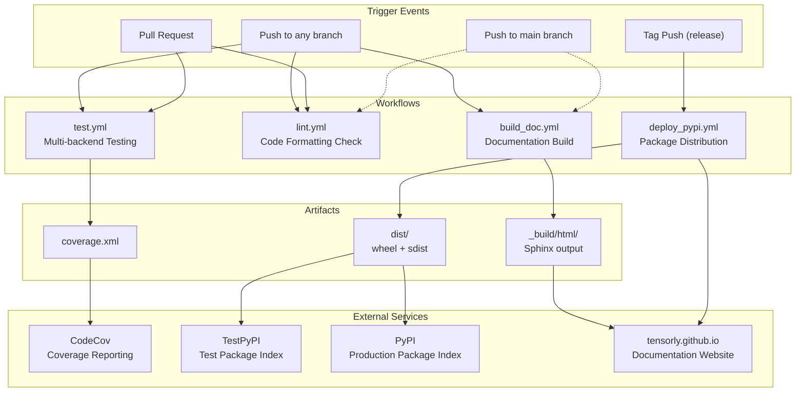
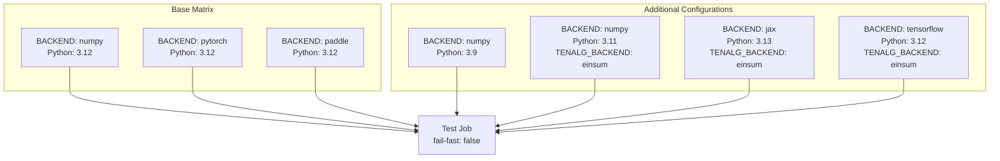
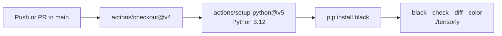
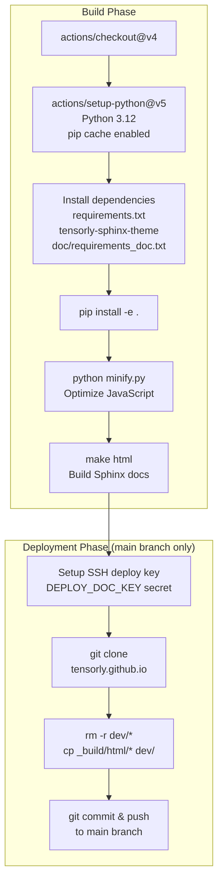
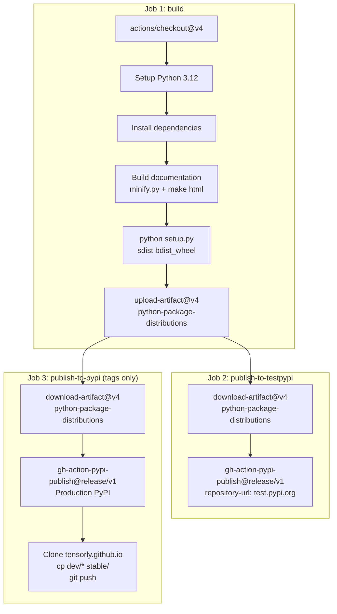
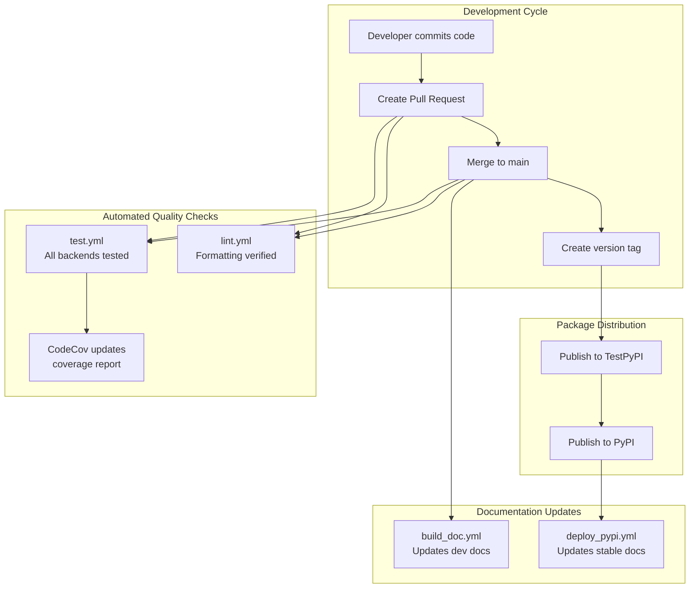

<!-- source: DeepWiki mcp.deepwiki.com · repo tensorly/tensorly · page 9.3 CI/CD Pipeline · fetched 2026-10-21 -->

# CI/CD Pipeline

<details>
<summary>Relevant source files</summary>

The following files were used as context for generating this wiki page:

- [.github/workflows/build_doc.yml](.github/workflows/build_doc.yml)
- [.github/workflows/deploy_pypi.yml](.github/workflows/deploy_pypi.yml)
- [.github/workflows/lint.yml](.github/workflows/lint.yml)
- [.github/workflows/test.yml](.github/workflows/test.yml)

</details>


## Purpose and Scope

This document describes the Continuous Integration and Continuous Deployment (CI/CD) infrastructure for TensorLy, implemented using GitHub Actions. The pipeline consists of four automated workflows that handle testing, code quality, documentation, and package distribution.

For information about the testing framework itself (pytest configuration, test structure, fixtures), see [Testing Framework](#9.2). For documentation generation details (Sphinx configuration, theme customization), see [Documentation System](#9.4). For development environment setup, see [Development Setup](#9.1).

## CI/CD Architecture Overview

The TensorLy CI/CD pipeline consists of four independent GitHub Actions workflows, each responsible for a specific aspect of the development lifecycle.



**Sources:** [.github/workflows/test.yml:1-74](), [.github/workflows/lint.yml:1-27](), [.github/workflows/build_doc.yml:1-60](), [.github/workflows/deploy_pypi.yml:1-110]()

| Workflow | File | Trigger | Purpose | Duration |
|----------|------|---------|---------|----------|
| Test TensorLy | `test.yml` | Push, PR | Run test suite across backends and Python versions | ~5-10 min |
| Lint with Black | `lint.yml` | Push/PR to main | Verify code formatting | ~1 min |
| Build documentation | `build_doc.yml` | Any push | Generate and deploy docs | ~3-5 min |
| Deploy to PyPI | `deploy_pypi.yml` | Tag push | Build and publish release | ~5-8 min |

**Sources:** [.github/workflows/test.yml:1-3](), [.github/workflows/lint.yml:3-7](), [.github/workflows/build_doc.yml:3](), [.github/workflows/deploy_pypi.yml:3-6]()

## Test Workflow

The `test.yml` workflow provides comprehensive multi-backend and multi-Python version testing to ensure compatibility across TensorLy's supported environments.

### Test Matrix Configuration



**Sources:** [.github/workflows/test.yml:9-25]()

The matrix strategy is defined in [.github/workflows/test.yml:9-25]() with `fail-fast: false`, meaning all matrix jobs continue even if one fails. This ensures complete test coverage visibility across all backend combinations.

| Matrix Parameter | Default Values | Additional Values | Purpose |
|------------------|---------------|-------------------|---------|
| `BACKEND` | numpy, pytorch, paddle | jax, tensorflow | Backend to test |
| `python-version` | 3.12 | 3.9, 3.11, 3.13 | Python version compatibility |
| `TENSORLY_TENALG_BACKEND` | (unset) | einsum | Tensor algebra optimization mode |

**Sources:** [.github/workflows/test.yml:12-25]()

### Test Execution Pipeline

```mermaid
graph LR
    Checkout["actions/checkout@v4"]
    SetupPython["actions/setup-python@v5<br/>with pip cache"]
    InstallBase["Install base dependencies<br/>requirements.txt<br/>doc/requirements_doc.txt"]
    InstallBackend["Install backend-specific<br/>torch/tensorflow/jax/paddle"]
    InstallPackage["pip install -e ."]
    RunTests["pytest --cov<br/>TENSORLY_BACKEND=$BACKEND"]
    UploadCoverage["codecov/codecov-action@v4<br/>coverage.xml"]
    
    Checkout --> SetupPython
    SetupPython --> InstallBase
    InstallBase --> InstallBackend
    InstallBackend --> InstallPackage
    InstallPackage --> RunTests
    RunTests --> UploadCoverage
```



**Sources:** [.github/workflows/test.yml:27-74]()

### Backend-Specific Installation

The workflow conditionally installs dependencies based on the `matrix.BACKEND` value:

```bash
# numpy backend
pip install sparse

# pytorch backend  
pip install torch torchvision

# tensorflow backend
pip install tensorflow

# jax backend
pip install jax jaxlib

# paddle backend
pip install 'setuptools>=65.0'
pip install paddlepaddle==3.0.0b1 -i https://www.paddlepaddle.org.cn/packages/stable/cpu/
```

**Sources:** [.github/workflows/test.yml:37-59]()

### Test Execution Command

The core test execution uses pytest with coverage tracking:

```bash
TENSORLY_BACKEND=${{matrix.BACKEND}} pytest -vv --cov tensorly --cov-report xml --durations=10 tensorly
```

Key flags:
- `-vv`: Verbose output
- `--cov tensorly`: Measure coverage for tensorly package
- `--cov-report xml`: Generate XML coverage report
- `--durations=10`: Report 10 slowest tests

**Sources:** [.github/workflows/test.yml:65-67]()

### Coverage Reporting

Coverage data is uploaded to CodeCov using the `codecov/codecov-action@v4` action:

**Sources:** [.github/workflows/test.yml:69-73]()

## Lint Workflow

The `lint.yml` workflow enforces code formatting standards using Black, the Python code formatter.



**Sources:** [.github/workflows/lint.yml:1-27]()

### Black Configuration

The Black command runs in check mode:

```bash
black --check --diff --color ./tensorly
```

- `--check`: Don't write changes, just return exit code
- `--diff`: Show what would be changed
- `--color`: Colorize output for readability

This workflow only triggers on pushes and pull requests to the `main` branch, as defined in [.github/workflows/lint.yml:3-7]().

**Sources:** [.github/workflows/lint.yml:24-26]()

## Documentation Build Workflow

The `build_doc.yml` workflow generates Sphinx documentation and deploys it to the TensorLy documentation website.



**Sources:** [.github/workflows/build_doc.yml:1-60]()

### Build Steps

The documentation build process consists of:

1. **Dependency Installation**: Installs the custom `tensorly-sphinx-theme` from GitHub main branch [.github/workflows/build_doc.yml:21-26]()
2. **JavaScript Minification**: Runs `python minify.py` to optimize documentation assets [.github/workflows/build_doc.yml:32]()
3. **Sphinx Build**: Executes `make html` to generate HTML documentation [.github/workflows/build_doc.yml:33]()

**Sources:** [.github/workflows/build_doc.yml:21-34]()

### Conditional Deployment

Documentation deployment only occurs when:
- The build succeeds (`if: success()`)
- The push is to the `main` branch (`github.ref == 'refs/heads/main'`)

The deployment uses SSH authentication with a deploy key stored as `secrets.DEPLOY_DOC_KEY`. The generated HTML is copied to the `dev/` directory of the `tensorly.github.io` repository.

**Sources:** [.github/workflows/build_doc.yml:36-59]()

### Git Configuration

The workflow configures Git with GitHub Actions bot credentials:

```
user.email: 41898282+github-actions[bot]@users.noreply.github.com
user.name: github-actions
```

**Sources:** [.github/workflows/build_doc.yml:46-48]()

## PyPI Deployment Workflow

The `deploy_pypi.yml` workflow handles package building, testing, and publication to PyPI. It consists of three sequential jobs.



**Sources:** [.github/workflows/deploy_pypi.yml:1-110]()

### Trigger Condition

The workflow triggers only on tag pushes:

```yaml
on:
  push:
    tags:
    - '*'
```

**Sources:** [.github/workflows/deploy_pypi.yml:3-6]()

### Job 1: Build

The build job creates distributable packages:

| Step | Command | Output |
|------|---------|--------|
| Documentation Build | `python minify.py && make html` | `doc/_build/html/` |
| Source Distribution | `python setup.py sdist` | `dist/*.tar.gz` |
| Binary Wheel | `python setup.py bdist_wheel` | `dist/*.whl` |

The distributions are stored as artifacts named `python-package-distributions`.

**Sources:** [.github/workflows/deploy_pypi.yml:9-42]()

### Job 2: TestPyPI Publication

Publishes to TestPyPI for validation before production release:

- **Environment**: `testpypi`
- **URL**: https://test.pypi.org/p/tensorly
- **Authentication**: Trusted publishing via OIDC (`id-token: write`)

**Sources:** [.github/workflows/deploy_pypi.yml:44-66]()

### Job 3: PyPI Publication

Only executes when the Git ref starts with `refs/tags/` (tag pushes):

```yaml
if: startsWith(github.ref, 'refs/tags/')
```

- **Environment**: `pypi`
- **URL**: https://pypi.org/p/tensorly
- **Authentication**: Trusted publishing via OIDC

**Sources:** [.github/workflows/deploy_pypi.yml:68-88]()

### Stable Documentation Update

Upon successful PyPI publication, the workflow updates the stable documentation:

```bash
git clone "git@github.com:tensorly/tensorly.github.io.git" doc_folder
cd doc_folder
cp -r dev/* stable/
git add stable
git commit -m "Github action: new release."
git push --force origin main
```

This copies the development documentation to the `stable/` directory, creating a snapshot of the documentation for the released version.

**Sources:** [.github/workflows/deploy_pypi.yml:89-109]()

## Workflow Integration



**Sources:** [.github/workflows/test.yml:3](), [.github/workflows/lint.yml:3-7](), [.github/workflows/build_doc.yml:3](), [.github/workflows/deploy_pypi.yml:3-6]()

### Shared Dependencies

All workflows share common setup steps:

| Component | Action | Version | Configuration |
|-----------|--------|---------|---------------|
| Checkout | `actions/checkout` | v4 | Default settings |
| Python Setup | `actions/setup-python` | v5 | Python 3.12 (3.9-3.13 in tests) |
| Pip Cache | Built into `setup-python` | v5 | Caches based on requirements files |

**Sources:** [.github/workflows/test.yml:28-35](), [.github/workflows/lint.yml:15-19](), [.github/workflows/build_doc.yml:11-19](), [.github/workflows/deploy_pypi.yml:14-19]()

## Security and Permissions

### Secrets Used

| Secret | Used In | Purpose |
|--------|---------|---------|
| `DEPLOY_DOC_KEY` | `build_doc.yml`, `deploy_pypi.yml` | SSH deploy key for tensorly.github.io repository |

**Sources:** [.github/workflows/build_doc.yml:42](), [.github/workflows/deploy_pypi.yml:95]()

### Trusted Publishing

Both PyPI publication jobs use trusted publishing (OIDC):

```yaml
permissions:
  id-token: write  # IMPORTANT: mandatory for trusted publishing
```

This eliminates the need for manually managed API tokens. GitHub generates short-lived tokens automatically.

**Sources:** [.github/workflows/deploy_pypi.yml:54-55](), [.github/workflows/deploy_pypi.yml:78-79]()

### GitHub Environments

The deployment workflow uses GitHub environments for access control:

- **testpypi**: For TestPyPI publication [.github/workflows/deploy_pypi.yml:50-52]()
- **pypi**: For production PyPI publication [.github/workflows/deploy_pypi.yml:75-77]()

**Sources:** [.github/workflows/deploy_pypi.yml:50-77]()

## Workflow Optimization

### Caching Strategy

The workflows implement pip caching to speed up dependency installation:

```yaml
- uses: actions/setup-python@v5
  with:
    python-version: ${{ matrix.python-version }}
    cache: "pip"
    cache-dependency-path: |
      requirements.txt
      doc/requirements_doc.txt
```

**Sources:** [.github/workflows/test.yml:29-35](), [.github/workflows/build_doc.yml:16-19]()

### Artifact Handling

The deployment workflow uses artifacts to pass distributions between jobs:

1. **Upload** in build job: [.github/workflows/deploy_pypi.yml:38-42]()
2. **Download** in publish jobs: [.github/workflows/deploy_pypi.yml:58-62](), [.github/workflows/deploy_pypi.yml:82-86]()

This approach ensures consistent packages are tested on TestPyPI and published to PyPI.

### Test Duration Reporting

The test workflow reports the 10 slowest tests using `--durations=10`, helping identify performance bottlenecks in the test suite.

**Sources:** [.github/workflows/test.yml:67]()

---

