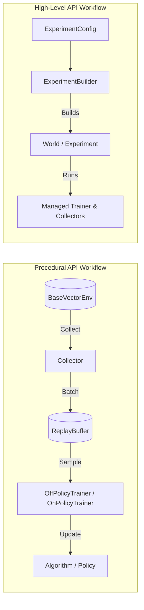

<!-- source: DeepWiki mcp.deepwiki.com · repo thu-ml/tianshou · page 1 Overview · fetched 2026-10-30 -->

# 1. Overview

Relevant source files

The following files were used as context for generating this wiki page:

- [CHANGELOG.md](CHANGELOG.md)
- [README.md](README.md)
- [docs/index.rst](docs/index.rst)
- [tianshou/__init__.py](tianshou/__init__.py)
- [tianshou/data/__init__.py](tianshou/data/__init__.py)
- [tianshou/env/__init__.py](tianshou/env/__init__.py)
- [tianshou/env/gym_wrappers.py](tianshou/env/gym_wrappers.py)
- [tianshou/highlevel/algorithm.py](tianshou/highlevel/algorithm.py)

Tianshou ([天授](https://baike.baidu.com/item/%E5%A4%A9%E6%8E%88)) is a reinforcement learning (RL) library built on pure PyTorch and `Gymnasium` [README.md:23()]. Version 2 introduces a major architectural overhaul focused on a cleaner design, strict separation of concerns, and enhanced type safety [README.md:9-20] [CHANGELOG.md:14-18].

This page provides a high-level introduction to Tianshou v2, outlining its dual API design, overall system architecture, and core components.

Sources: [README.md:9-23](), [CHANGELOG.md:14-18]()

## Purpose and Scope

Tianshou is designed to serve both researchers requiring fine-grained algorithmic control and practitioners seeking rapid application deployment [README.md:25-27]. Key characteristics include:
- **Modular Low-Level Procedural API**: Clean separation between learning algorithms (`Algorithm`) and action-selection policies (`Policy`), supporting online (on-policy/off-policy), offline, multi-agent, and model-based RL [README.md:25-27] [CHANGELOG.md:110-114].
- **Convenient High-Level Declarative API**: Experiment builders and factories (`ExperimentBuilder`, `AlgorithmFactory`) for setting up complex training runs with minimal boilerplate [README.md:26()] [tianshou/highlevel/algorithm.py:110-112].
- **High Performance**: Native support for synchronous and asynchronous vectorized environments (`BaseVectorEnv`) and ultra-fast `EnvPool` integration [README.md:73-80] [tianshou/env/__init__.py:10-16].

Sources: [README.md:23-32](), [CHANGELOG.md:110-114](), [tianshou/highlevel/algorithm.py:110-112]()

## System Architecture and Dual API Design

Tianshou offers two distinct APIs sharing the same underlying data structures and execution primitives: the **Procedural API** and the **High-Level API**. 

```mermaid
graph TD
    subgraph NaturalLanguage["Natural Language Space"]
        CoreLib["Tianshou v2 Library"]
        ProcAPI["Procedural API"]
        HighAPI["High-Level API"]
        DataSys["Data Handling"]
        EnvSys["Environment System"]
        TrainSys["Trainer System"]
    end

    subgraph CodeSpace["Code Entity Space"]
        CoreLib --> ProcAPI
        CoreLib --> HighAPI
        
        ProcAPI --> AlgModule["tianshou.algorithm"]
        ProcAPI --> CollectorClass["tianshou.data.collector.Collector"]
        ProcAPI --> TrainerClass["tianshou.trainer.OffPolicyTrainer"]
        
        HighAPI --> ExpClass["tianshou.highlevel.experiment.Experiment"]
        HighAPI --> AlgFac["tianshou.highlevel.algorithm.AlgorithmFactory"]
        HighAPI --> ExpBuilder["tianshou.highlevel.ExperimentBuilder"]
        
        DataSys --> BatchClass["tianshou.data.batch.Batch"]
        DataSys --> BufferClass["tianshou.data.buffer.buffer_base.ReplayBuffer"]
        
        EnvSys --> VEnvClass["tianshou.env.venvs.BaseVectorEnv"]
        EnvSys --> WrapperClass["tianshou.env.gym_wrappers"]
        
        TrainSys --> OnTrainer["tianshou.trainer.trainer_onpolicy.OnPolicyTrainer"]
        TrainSys --> OffTrainer["tianshou.trainer.trainer_offpolicy.OffPolicyTrainer"]
    end
```

Sources: [README.md:25-35](), [CHANGELOG.md:14-43](), [tianshou/__init__.py:3-5](), [tianshou/highlevel/algorithm.py:110-189]()

### API Execution Flow

Sources: [README.md:73-77](), [tianshou/highlevel/algorithm.py:110-166]()

---

## 1.1. Core Concepts

Tianshou v2 establishes fundamental abstractions to decouple algorithm math from policy execution, data storage, rollout collection, and training loops [README.md:13-18] [CHANGELOG.md:110-114]:
- **Algorithm vs Policy**: The `Algorithm` class handles loss computation and gradient updates, while the `Policy` component manages action selection during environment interactions [README.md:13-15] [CHANGELOG.md:110-114].
- **Batch**: A dictionary-like container (`tianshou.data.Batch`) that supports recursive batching, slicing, and conversion between NumPy arrays and PyTorch tensors [tianshou/data/__init__.py:4()].
- **ReplayBuffer**: Experience storage classes (`tianshou.data.ReplayBuffer`, `VectorReplayBuffer`, `PrioritizedReplayBuffer`) supporting efficient sampling and multi-step returns [tianshou/data/__init__.py:7-19].
- **Collector**: Bridges agents, policies, and environments (`tianshou.data.Collector`, `AsyncCollector`) by executing rollouts and storing transitions into buffers [tianshou/data/__init__.py:27-33].
- **Trainer**: Manages epochs, collection steps, optimization updates, and logging (`OnPolicyTrainer`, `OffPolicyTrainer`, `OfflineTrainer`) [CHANGELOG.md:40-43].
- **Vectorized Environments**: Parallel environment execution wrappers (`BaseVectorEnv`, `DummyVectorEnv`, `SubprocVectorEnv`) and `EnvPool` support [tianshou/env/__init__.py:10-16].

For details, see [Core Concepts](#1.1).

Sources: [README.md:13-18](), [CHANGELOG.md:110-114](), [tianshou/data/__init__.py:4-59](), [tianshou/env/__init__.py:10-16]()

---

## 1.2. Installation and Dependencies

Tianshou requires Python >= 3.11 and is available on PyPI or via source installation [docs/index.rst:41-58]:
- **Standard Installation**: Install the core library via `pip install tianshou` [docs/index.rst:47-51].
- **Dependency Management**: Uses Poetry for dependency groups and environment management.
- **Optional Extras**: Specialized extras support Atari (`atari`), MuJoCo/continuous control (`mujoco`), ultra-fast parallel sampling (`envpool`), and distributed training (`ray`).

For details, see [Installation and Dependencies](#1.2).

Sources: [docs/index.rst:41-65](), [README.md:79-80]()

---

## 1.3. Migration from v1 to v2

Version 2 introduces breaking API changes and cleanups designed to improve long-term maintainability and type safety [README.md:20()] [CHANGELOG.md:14-18]:
- **Removal of God Classes**: `BaseTrainer` was refactored into distinct subclasses (`OnPolicyTrainer`, `OffPolicyTrainer`, `OfflineTrainer`) [CHANGELOG.md:40-44].
- **Algorithm / Policy Separation**: The `tianshou.policy` module was renamed to `tianshou.algorithm`, cleanly separating policy execution interfaces from algorithm learning logic [CHANGELOG.md:110-114].
- **Explicit Trainer Parameters**: Training parameters are now passed through dedicated configuration dataclasses (`OnPolicyTrainerParams`, `OffPolicyTrainerParams`, `OfflineTrainerParams`) rather than positional keyword arguments [CHANGELOG.md:89-91].
- **Optimizer and Component Factories**: Standardization of component creation via `OptimizerFactoryFactory` and modular builders [tianshou/highlevel/algorithm.py:113-116].

For details, see [Migration from v1 to v2](#1.3).

Sources: [README.md:20](), [CHANGELOG.md:14-114](), [tianshou/highlevel/algorithm.py:113-116]()

---

