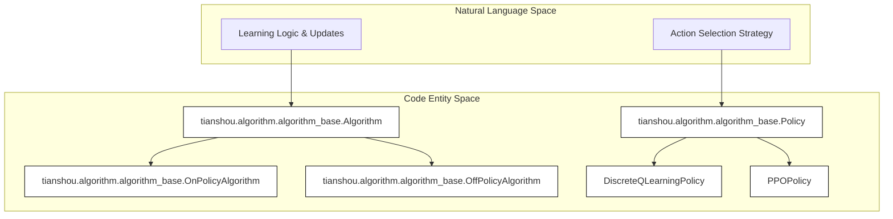
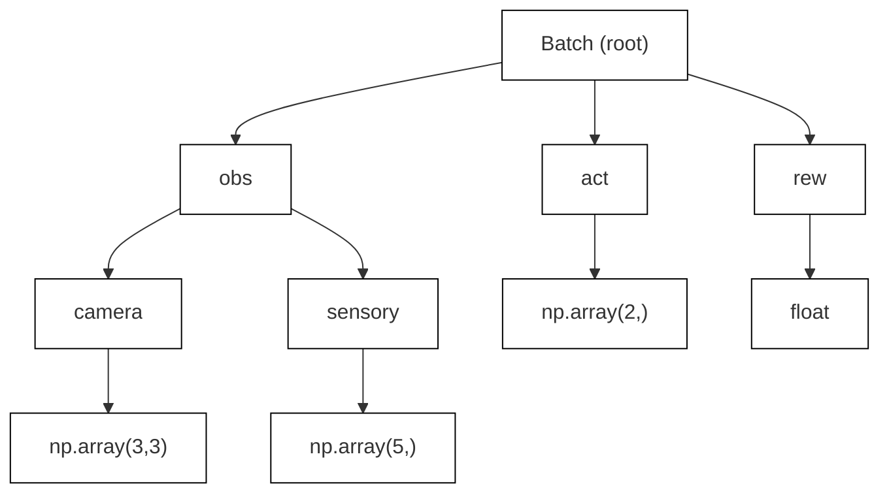
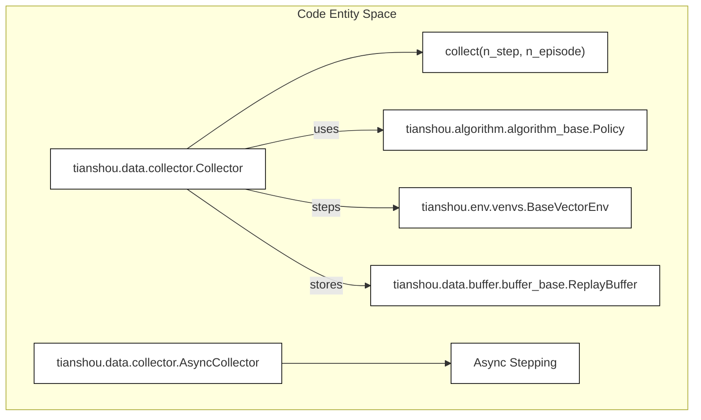

<!-- source: DeepWiki mcp.deepwiki.com · repo thu-ml/tianshou · page 1.1 Core Concepts · fetched 2026-10-30 -->

# Core Concepts

Relevant source files

The following files were used as context for generating this wiki page:

- [README.md](README.md)
- [docs/01_user_guide/00_training_process.md](docs/01_user_guide/00_training_process.md)
- [docs/01_user_guide/01_apis.md](docs/01_user_guide/01_apis.md)
- [docs/01_user_guide/02_core_abstractions.md](docs/01_user_guide/02_core_abstractions.md)
- [docs/01_user_guide/index.rst](docs/01_user_guide/index.rst)
- [docs/02_deep_dives/0_intro.md](docs/02_deep_dives/0_intro.md)
- [docs/02_deep_dives/L1_Batch.ipynb](docs/02_deep_dives/L1_Batch.ipynb)
- [docs/index.rst](docs/index.rst)
- [tianshou/__init__.py](tianshou/__init__.py)
- [tianshou/data/__init__.py](tianshou/data/__init__.py)
- [tianshou/env/__init__.py](tianshou/env/__init__.py)
- [tianshou/env/gym_wrappers.py](tianshou/env/gym_wrappers.py)

## Purpose and Scope

This document explains the fundamental concepts and architecture of Tianshou v2, a reinforcement learning framework built on pure PyTorch and Gymnasium [README.md:23-23](). It covers foundational terminology and core abstractions including the separation of `Algorithm` and `Policy`, the versatile `Batch` container, experience storage via `ReplayBuffer`, experience gathering through `Collector`, training loops managed by `Trainer`, and parallel execution via vectorized environments [README.md:10-18](). For installation instructions, see [1.2 Installation and Dependencies](). For architectural migrations from v1 to v2, see [1.3 Migration from v1 to v2]().

Sources: [README.md:10-28](), [docs/01_user_guide/02_core_abstractions.md:1-5]()

---

## Algorithm vs. Policy Separation

In Tianshou v2, a major architectural redesign separates the responsibility of decision-making (`Policy`) from the responsibility of learning (`Algorithm`) [README.md:13-18]().

- **`Policy`**: Encapsulates the agent's strategy for action selection (mapping observations to actions). It inherits from `torch.nn.Module` and defines methods such as `forward` and `compute_action` [docs/01_user_guide/02_core_abstractions.md:46-86]().
- **`Algorithm`**: Encapsulates the training logic, loss functions, optimization steps, and target network updates for a specific reinforcement learning method (e.g., DQN, PPO, SAC). It inherits from `torch.nn.Module` and handles batch preprocessing (`_preprocess_batch`) and network updates (`_update_with_batch`) [docs/01_user_guide/02_core_abstractions.md:8-44]().

### Diagram: Algorithm and Policy Code Entities

Sources: [docs/01_user_guide/02_core_abstractions.md:8-86](), [README.md:13-18]()

---

## Batch

The `Batch` class (`tianshou.data.Batch`) is Tianshou's core data structure for storing and manipulating heterogeneous reinforcement learning data [docs/02_deep_dives/L1_Batch.ipynb:7-10](). It behaves as a hybrid between a Python dictionary and a NumPy array/PyTorch tensor, supporting recursive nesting, indexing, attribute-based access (`batch.obs`), and type safety via protocol definitions [docs/02_deep_dives/L1_Batch.ipynb:75-88]().

### Diagram: Batch Data Structure Tree

Sources: [docs/02_deep_dives/L1_Batch.ipynb:80-131](), [tianshou/data/__init__.py:4-4]()

---

## ReplayBuffer

The `ReplayBuffer` family (`tianshou.data.ReplayBuffer`) manages experience storage and sampling for reinforcement learning algorithms [docs/01_user_guide/00_training_process.md:47-49](). Key classes include:
- `VectorReplayBuffer`: Optimized buffer for multi-environment vectorized collection [tianshou/data/__init__.py:15-18]()
- `PrioritizedReplayBuffer`: Implements Prioritized Experience Replay (PER) using segment trees [tianshou/data/__init__.py:8-17]()
- `HERReplayBuffer`: Implements Hindsight Experience Replay (HER) for goal-conditioned RL [tianshou/data/__init__.py:9-14]()

Sources: [tianshou/data/__init__.py:7-20](), [docs/01_user_guide/00_training_process.md:47-49]()

---

## Collector

The `Collector` class (`tianshou.data.Collector` and `tianshou.data.AsyncCollector`) bridges the policy and the environment(s) [docs/01_user_guide/02_core_abstractions.md:87-92](). It steps through environments using actions computed by the policy, records transitions into a `ReplayBuffer`, and computes rollout statistics (`CollectStats`) [docs/01_user_guide/02_core_abstractions.md:95-106]().

### Diagram: Collector Code Entities and Flow

Sources: [docs/01_user_guide/02_core_abstractions.md:87-119](), [tianshou/data/__init__.py:27-33]()

---

## Trainer

The `Trainer` system (`tianshou.trainer`) orchestrates epochs, data collection, policy updates, test evaluations, and stopping conditions [docs/01_user_guide/00_training_process.md:67-101](). Tianshou provides specialized trainer classes corresponding to learning paradigms:
- `OnPolicyTrainer`: For on-policy algorithms (e.g., PPO, A2C)
- `OffPolicyTrainer`: For off-policy algorithms (e.g., DQN, SAC, TD3)
- `OfflineTrainer`: For offline RL and imitation learning algorithms

Sources: [docs/01_user_guide/00_training_process.md:67-101](), [docs/01_user_guide/02_core_abstractions.md:120-121]()

---

## Vectorized Environments

Tianshou provides robust vectorized environment abstractions (`tianshou.env.BaseVectorEnv`) to execute multiple environment instances in parallel [README.md:79-80](). Worker implementations include `DummyVectorEnv` (sequential), `SubprocVectorEnv` (multiprocessing), `ShmemVectorEnv` (shared memory), and `RayVectorEnv` (distributed) [tianshou/env/__init__.py:10-16]().

Sources: [tianshou/env/__init__.py:10-16](), [README.md:79-80]()

---

