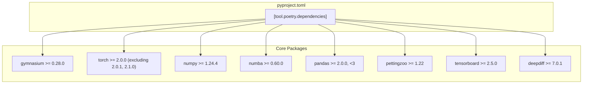
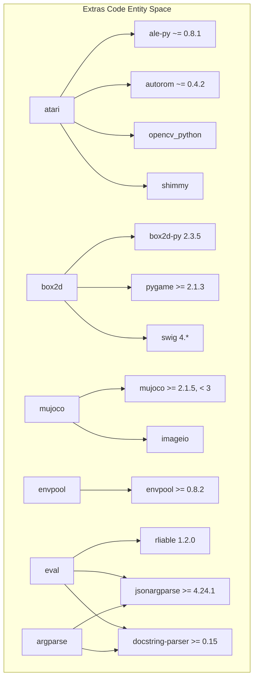
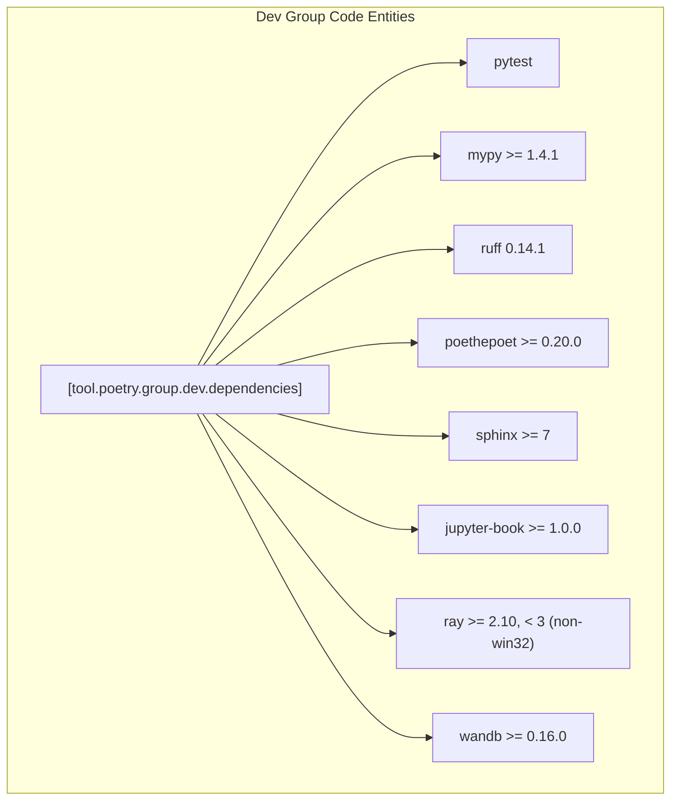
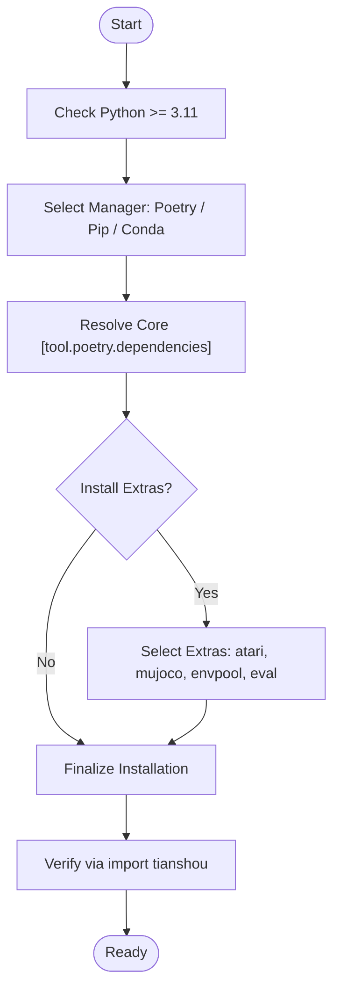

<!-- source: DeepWiki mcp.deepwiki.com · repo thu-ml/tianshou · page 1.2 Installation and Dependencies · fetched 2026-10-30 -->

# Installation and Dependencies

<details>
<summary>Relevant source files</summary>

The following files were used as context for generating this wiki page:

- [docs/.gitignore](docs/.gitignore)
- [docs/_config.yml](docs/_config.yml)
- [docs/autogen_rst.py](docs/autogen_rst.py)
- [poetry.lock](poetry.lock)
- [pyproject.toml](pyproject.toml)

</details>


This document provides comprehensive technical details for installing Tianshou, configuring Poetry dependency groups, and managing optional extras (`atari`, `mujoco`, `envpool`, etc.). It covers system requirements, installation workflows, core and optional dependency mappings, and validation procedures.

Sources: [pyproject.toml:1-185]()

## System Requirements

- **Python Version**: `>=3.11` (`[tool.poetry.dependencies]` specifies `python = "^3.11"`).
- **Supported Operating Systems**: Linux, macOS, Windows (noting platform-specific limitations for certain extras like `envpool` which excludes `darwin`).

Sources: [pyproject.toml:27-48](), [pyproject.toml:63]()

## Installation Methods

Tianshou can be installed via several workflows, with Poetry recommended for development and environment isolation.

### Using Poetry (Recommended)

Clone the repository and install dependencies using Poetry:

```bash
git clone git@github.com:thu-ml/tianshou.git
cd tianshou
poetry install
```

To include development tools or optional extras:

```bash
poetry install --with dev
poetry install --extras "mujoco envpool"
poetry install --all-extras
```

*Important*: When installing multiple extras, include them in a single command. Sequential calls overwrite prior extra installations due to Poetry behavior.

Sources: [pyproject.toml:76-89](), [pyproject.toml:91-130]()

### Using Pip, Conda, or Source

- **PyPI**: `pip install tianshou`
- **Conda**: `conda install tianshou -c conda-forge`
- **Source**: `pip install git+https://github.com/thu-ml/tianshou.git@master --upgrade`

Sources: [pyproject.toml:1-7]()

## Core Dependencies and Configuration

Tianshou's core dependencies are managed in `pyproject.toml` under `[tool.poetry.dependencies]`.



*Note*: PyTorch versions `2.0.1` and `2.1.0` are explicitly excluded via `!=2.0.1, !=2.1.0` due to upstream compatibility issues.

Sources: [pyproject.toml:26-48]()

## Optional Dependencies (Extras)

Tianshou defines optional extras under `[tool.poetry.extras]` to support specific simulation backends and utilities.



Sources: [pyproject.toml:55-89]()

## Poetry Dependency Groups and Development Tooling

Development dependencies are grouped under `[tool.poetry.group.dev.dependencies]`. This includes static analysis tools, documentation generators, and testing frameworks.



Sources: [pyproject.toml:91-130]()

## Installation Workflow and Validation

The installation sequence validates system parameters, resolves dependencies via Poetry or Pip, and verifies package accessibility.



Sources: [pyproject.toml:26-89]()

---

