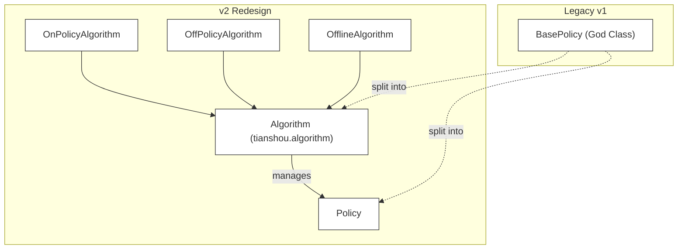
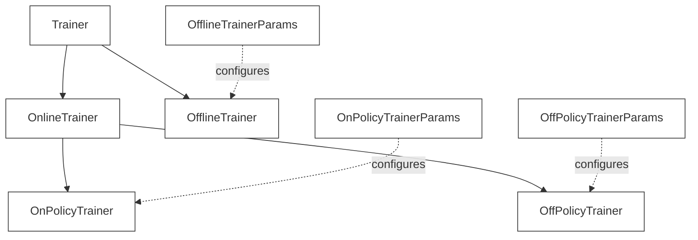

<!-- source: DeepWiki mcp.deepwiki.com · repo thu-ml/tianshou · page 1.3 Migration from v1 to v2 · fetched 2026-10-30 -->

# Migration from v1 to v2

Relevant source files

The following files were used as context for generating this wiki page:

- [CHANGELOG.md](CHANGELOG.md)
- [README.md](README.md)
- [docs/index.rst](docs/index.rst)
- [tianshou/highlevel/algorithm.py](tianshou/highlevel/algorithm.py)

## Purpose and Scope

This document details the architectural and API changes introduced in Tianshou version 2, as documented in [CHANGELOG.md:14-114]() and [README.md:10-21](). Tianshou v2 provides a complete overhaul of the software design, improving type safety, separating learning algorithm logic from action-selection policies, eliminating monolithic "God" classes, introducing explicit parameter configuration objects, and adopting a factory-based initialization paradigm. Because of the extent of these changes, v2 is not backwards compatible with v1 [README.md:20-20](), and persisted agents created in v1 cannot be loaded directly [CHANGELOG.md:18-19]().

Sources: [README.md:10-21](), [CHANGELOG.md:14-114]()

---

## 1. Architectural Redesign: Algorithm and Policy Split

In Tianshou v1, policy classes encapsulated both the neural network forward pass (action selection) and the gradient update computations (learning). In v2, this package is renamed from `tianshou.policy` to `tianshou.algorithm` [CHANGELOG.md:110-114](), and a strict separation is established between:
- **`Algorithm`**: Encapsulates the optimization target, loss computation, and parameter updates.
- **`Policy`**: Encapsulates state preprocessing, action distribution computation, and action selection during data collection.

*Figure 1: Transition from monolithic BasePolicy to decoupled Algorithm and Policy abstractions.*

Sources: [README.md:13-18](), [CHANGELOG.md:110-114]()

---

## 2. Trainer Refactoring and Configuration Objects

The legacy `BaseTrainer` class acted as a monolithic "God" class handling on-policy, off-policy, and offline training paths. In v2, this class has been replaced by specialized trainer subclasses inheriting from an `OnlineTrainer` base class or directly from `Trainer` [CHANGELOG.md:38-44](). Furthermore, direct keyword arguments to trainers have been replaced by dedicated configuration dataclasses [CHANGELOG.md:45-47]().

### Trainer Class Hierarchy and Configuration Dataclasses

*Figure 2: Trainer class hierarchy and their corresponding configuration dataclasses.*

### Parameter Renaming and API Updates

Training parameters are now passed via instances of configuration objects rather than directly as keyword arguments [CHANGELOG.md:89-90](). The parameter names have been standardized for clarity [CHANGELOG.md:92-99]():

| v1 Parameter Name | v2 Configuration Parameter Name | Description |
|---|---|---|
| `max_epoch` | `max_epochs` | Maximum number of training epochs [CHANGELOG.md:93-93]() |
| `step_per_epoch` | `epoch_num_steps` | Number of environment steps per epoch [CHANGELOG.md:94-94]() |
| `episode_per_test` | `test_step_num_episodes` | Number of episodes for testing [CHANGELOG.md:95-95]() |
| `step_per_collect` | `collection_step_num_env_steps` | Number of environment steps per collection step [CHANGELOG.md:96-96]() |
| `episode_per_collect` | `collection_step_num_episodes` | Number of episodes per collection step [CHANGELOG.md:97-97]() |
| `update_per_step` | `update_step_num_gradient_steps_per_sample` | Gradient steps per sample [CHANGELOG.md:98-98]() |
| `repeat_per_collect` | `update_step_num_repetitions` | Number of update repetitions [CHANGELOG.md:99-99]() |

Additionally, trainer iterator semantics (`__next__`) were removed in favor of explicit calls to `reset` followed by `execute_epoch` [CHANGELOG.md:52-53](). The default value for `test_in_train` was changed from `True` to `False` [CHANGELOG.md:57-58]().

Sources: [CHANGELOG.md:38-58](), [CHANGELOG.md:89-107]()

---

## 3. Optimizer and Factory Abstractions

To support declarative experiment setups, high-level algorithm configuration makes extensive use of factory patterns, such as `AlgorithmFactory` [tianshou/highlevel/algorithm.py:110-111]() and `OptimizerFactoryFactory` [tianshou/highlevel/algorithm.py:113](). These factories decouple optimizer construction from the network and algorithm definition, enabling seamless injection of learning rate schedulers, weight decay, and optimizer types across different agent architectures.

Sources: [tianshou/highlevel/algorithm.py:110-116]()

---

## 4. Exploration and Epsilon-Greedy Simplifications

Management of epsilon-greedy exploration for discrete Q-learning algorithms has been restructured [CHANGELOG.md:60-65]():
- Policy implementations (e.g., `DQNPolicy`, `C51Policy`) now accept explicit `eps_training` and `eps_inference` parameters [CHANGELOG.md:60-64]().
- This eliminates the need for callback functions (`train_fn`, `test_fn`) when only constant epsilon values are required [CHANGELOG.md:62-64]().
- The legacy `set_eps` setter method has been replaced with `set_eps_training` and `set_eps_inference` [CHANGELOG.md:65-65]().

Sources: [CHANGELOG.md:60-65]()

---

