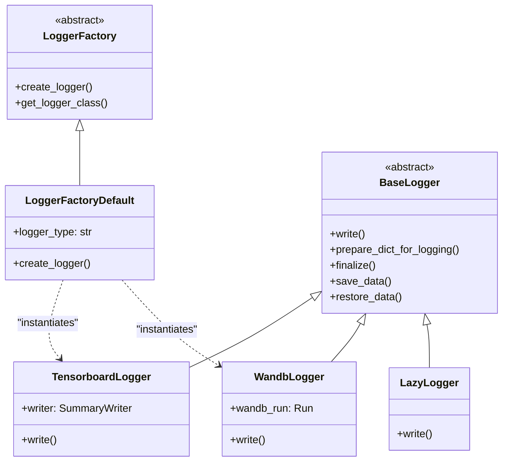
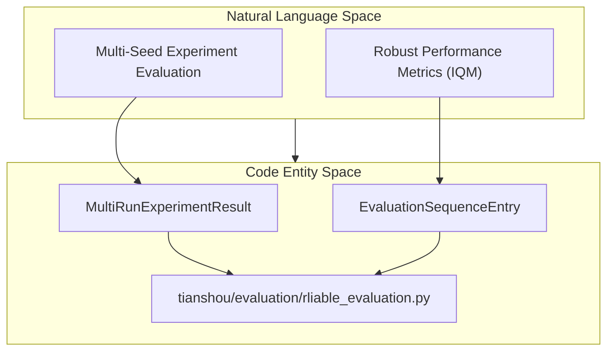
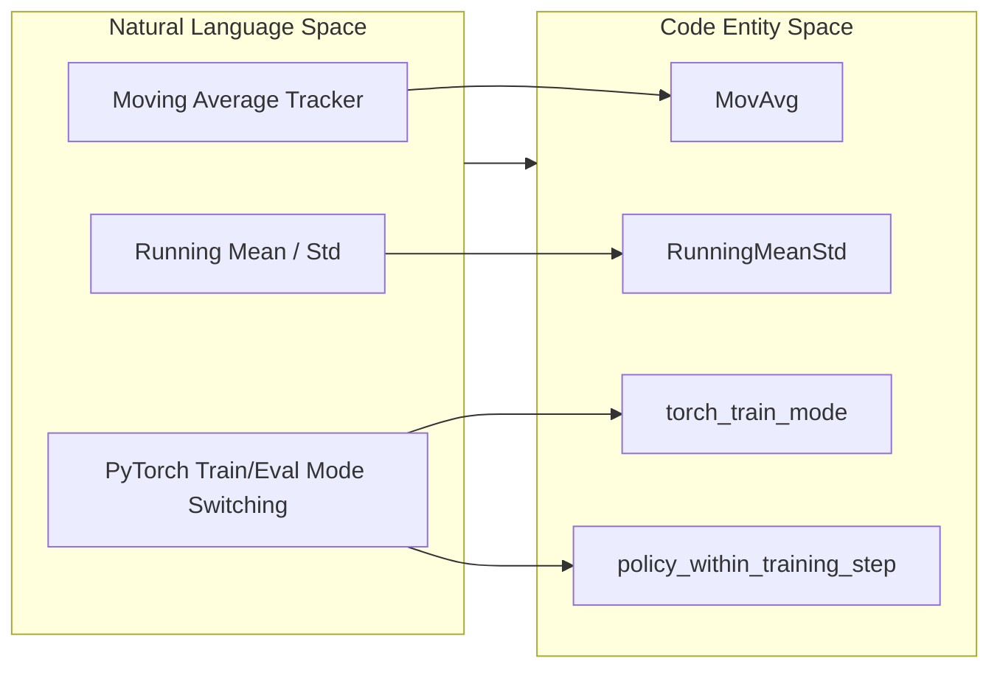

<!-- source: DeepWiki mcp.deepwiki.com · repo thu-ml/tianshou · page 10 Utilities, Logging and Evaluation · fetched 2026-10-30 -->

# Utilities, Logging and Evaluation

Relevant source files

The following files were used as context for generating this wiki page:

- [test/base/test_utils.py](test/base/test_utils.py)
- [tianshou/env/atari/atari_wrapper.py](tianshou/env/atari/atari_wrapper.py)
- [tianshou/evaluation/rliable_evaluation.py](tianshou/evaluation/rliable_evaluation.py)
- [tianshou/highlevel/logger.py](tianshou/highlevel/logger.py)
- [tianshou/utils/__init__.py](tianshou/utils/__init__.py)
- [tianshou/utils/logger/logger_base.py](tianshou/utils/logger/logger_base.py)
- [tianshou/utils/logger/tensorboard.py](tianshou/utils/logger/tensorboard.py)
- [tianshou/utils/logger/wandb.py](tianshou/utils/logger/wandb.py)
- [tianshou/utils/statistics.py](tianshou/utils/statistics.py)
- [tianshou/utils/torch_utils.py](tianshou/utils/torch_utils.py)
- [tianshou/utils/warning.py](tianshou/utils/warning.py)

The purpose of this page is to provide a high-level overview of Tianshou's supporting utilities, logging infrastructure, and evaluation tooling. These modules underpin experiment tracking, metric normalization, PyTorch operation helpers, and robust statistical benchmarking across multi-seed runs. 

As a parent page, this section introduces the core sub-topics and links to detailed child pages. For deep technical reference, see [Logging](#10.1), [Evaluation and Benchmarking](#10.2), and [General Utilities](#10.3).

---

## 10.1 Logging

The logging subsystem standardizes how metrics, checkpoints, and experiment metadata are recorded during training. Tianshou abstracts logging behind an abstract base class (`BaseLogger`) and provides concrete adapters for TensorBoard and Weights & Biases, alongside a high-level `LoggerFactory` for declarative experiment setups.

Sources: [tianshou/highlevel/logger.py:13-111](), [tianshou/utils/logger/logger_base.py:23-170](), [tianshou/utils/logger/tensorboard.py:17-46](), [tianshou/utils/logger/wandb.py:14-94]()

For detailed documentation on logger implementations, interval configurations, artifact syncing, and factory patterns, see [Logging](#10.1).

---

## 10.2 Evaluation and Benchmarking

Tianshou provides evaluation tooling designed to aggregate performance across multi-seed experiments using the `rliable` library. This allows practitioners to compute robust metrics like Interquartile Mean (IQM) and generate confidence intervals for episode returns and environment steps.

Sources: [tianshou/evaluation/rliable_evaluation.py:1-172]()

For complete details on disk restoration, experiment result parsing, and benchmark scripts, see [Evaluation and Benchmarking](#10.2).

---

## 10.3 General Utilities

General-purpose helpers include statistical stream trackers, PyTorch context managers, and action distribution creators. These components assist trainers, collectors, and policies in normalizing observation streams and managing execution modes.

Sources: [tianshou/utils/statistics.py:7-114](), [tianshou/utils/torch_utils.py:14-45]()

For information on `MovAvg`, `RunningMeanStd`, `torch_train_mode`, action distribution factories, progress bars, and warning decorators, see [General Utilities](#10.3).

---

