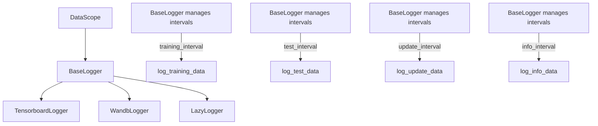
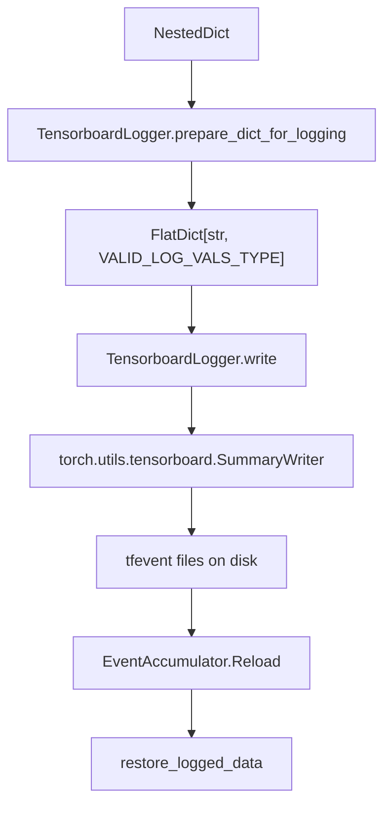
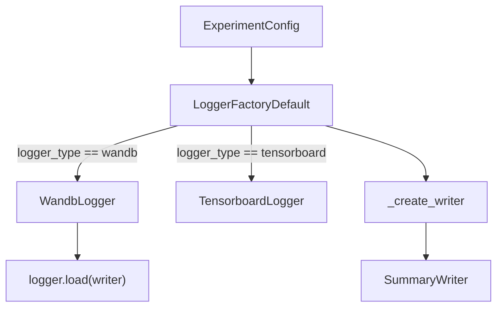
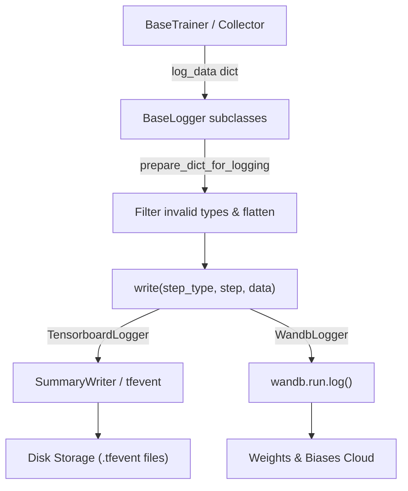

<!-- source: DeepWiki mcp.deepwiki.com · repo thu-ml/tianshou · page 10.1 Logging · fetched 2026-10-30 -->

# Logging

Relevant source files

The following files were used as context for generating this wiki page:

- [tianshou/env/atari/atari_wrapper.py](tianshou/env/atari/atari_wrapper.py)
- [tianshou/evaluation/rliable_evaluation.py](tianshou/evaluation/rliable_evaluation.py)
- [tianshou/highlevel/logger.py](tianshou/highlevel/logger.py)
- [tianshou/utils/logger/logger_base.py](tianshou/utils/logger/logger_base.py)
- [tianshou/utils/logger/tensorboard.py](tianshou/utils/logger/tensorboard.py)
- [tianshou/utils/logger/wandb.py](tianshou/utils/logger/wandb.py)
- [tianshou/utils/logging.py](tianshou/utils/logging.py)
- [tianshou/utils/statistics.py](tianshou/utils/statistics.py)

## Purpose and Scope
This page documents Tianshou's logging system, which tracks, serializes, and visualizes training, testing, update, and epoch-level statistics. The system is built around an abstract base class (`BaseLogger`), concrete implementations for TensorBoard and Weights & Biases (`TensorboardLogger` and `WandbLogger`), and a declarative factory pattern (`LoggerFactory`) for high-level experiment setups.

Sources: `[tianshou/utils/logger/logger_base.py:23-170]`, `[tianshou/utils/logger/tensorboard.py:17-46]`, `[tianshou/utils/logger/wandb.py:14-64]`, `[tianshou/highlevel/logger.py:13-111]()`

---

## 1. Logger Base Architecture (`logger_base.py`)
The foundation of Tianshou's logging framework is defined in `tianshou/utils/logger/logger_base.py`. It establishes the interface required by trainers to record metrics at different frequencies and scopes.

### Key Classes and Enums
*   `DataScope`: An `StrEnum` defining standard namespaces for logged metrics: `TRAINING`, `TEST`, `UPDATE`, and `INFO` `[tianshou/utils/logger/logger_base.py:16-21]`.
*   `BaseLogger`: An abstract base class managing intervals and step counters for different data scopes. It defines abstract methods `write()`, `prepare_dict_for_logging()`, `finalize()`, `save_data()`, `restore_data()`, and `restore_logged_data()` `[tianshou/utils/logger/logger_base.py:23-163]`.
*   `LazyLogger`: A null-object pattern implementation of `BaseLogger` that performs no logging operations, serving as a safe default placeholder in trainers `[tianshou/utils/logger/logger_base.py:165-170]`.

*Sources: `[tianshou/utils/logger/logger_base.py:1-170]()`*

---

## 2. Concrete Loggers: TensorBoard and Weights & Biases

### TensorboardLogger
`TensorboardLogger` utilizes PyTorch's `SummaryWriter` to record scalar metrics, histograms, and figures [tianshou/utils/logger/tensorboard.py:17-46].

*   **Data Flattening and Filtering**: The `prepare_dict_for_logging()` method recursively traverses nested dictionaries, filters out numpy arrays if `exclude_arrays=True`, flattens keys using a configurable delimiter (default `/`), and retains only valid scalar types (`VALID_LOG_VALS`) [tianshou/utils/logger/tensorboard.py:47-86].
*   **Writing & Flushing**: `write()` parses the `step_type` namespace, logs scalars via `writer.add_scalar()`, histograms via `writer.add_histogram()`, and figures via `writer.add_figure()`. It flushes the writer if `write_flush=True` [tianshou/utils/logger/tensorboard.py:88-101].
*   **Restoration**: `restore_logged_data()` uses TensorBoard's `EventAccumulator` to read historical tfevent files from disk and reconstruct nested numerical dictionaries [tianshou/utils/logger/tensorboard.py:146-200].

*Sources: `[tianshou/utils/logger/tensorboard.py:17-199]()`*

### WandbLogger
`WandbLogger` extends `BaseLogger` to forward logs to Weights & Biases (`wandb.ai`) while optionally syncing with a underlying `SummaryWriter` [tianshou/utils/logger/wandb.py:14-94].

*   **Initialization**: Initializes a `wandb` run via `wandb.init()` with configurations, project names, entities, and resume settings [tianshou/utils/logger/wandb.py:41-88].
*   **TensorBoard Syncing**: By leveraging `sync_tensorboard=True` and loading a `SummaryWriter` via `load(writer)`, `WandbLogger` delegates tensorboard calls to a contained `TensorboardLogger` instance [tianshou/utils/logger/wandb.py:95-122].
*   **Artifact Management**: `save_data()` records model checkpoints as `wandb.Artifact` entries with metadata (epoch, env steps, gradient steps) and uploads them to W&B. `restore_data()` downloads latest checkpoint artifacts during training resumption [tianshou/utils/logger/wandb.py:129-198].

Sources: `[tianshou/utils/logger/wandb.py:14-197]()`

---

## 3. High-Level LoggerFactory (`tianshou/highlevel/logger.py`)

The high-level API decouples logger instantiation from experiment configuration via the `LoggerFactory` abstract base class and `LoggerFactoryDefault` implementation [tianshou/highlevel/logger.py:13-112].

### LoggerFactory Classes
*   `LoggerFactory`: Abstract interface declaring `create_logger()` and `get_logger_class()` [tianshou/highlevel/logger.py:13-34].
*   `LoggerFactoryDefault`: Concrete factory that handles creation of either `WandbLogger` or `TensorboardLogger` based on `logger_type` (`"tensorboard"`, `"wandb"`, or `"pandas"`) [tianshou/highlevel/logger.py:36-112].
*   `_create_writer()`: Internal helper method that initializes a `SummaryWriter` at `log_dir` and writes experiment arguments as a text artifact (`writer.add_text("args", ...)`).

*Sources: `[tianshou/highlevel/logger.py:13-111]()`*

---

## 4. End-to-End Logging Data Flow

The following diagram illustrates how metrics flow from collectors and trainers through `BaseLogger` subclasses to persistent storage and visualization backends.

*Sources: `[tianshou/utils/logger/logger_base.py:78-126]`, `[tianshou/utils/logger/tensorboard.py:47-101]`, `[tianshou/utils/logger/wandb.py:95-122]()`*

---

