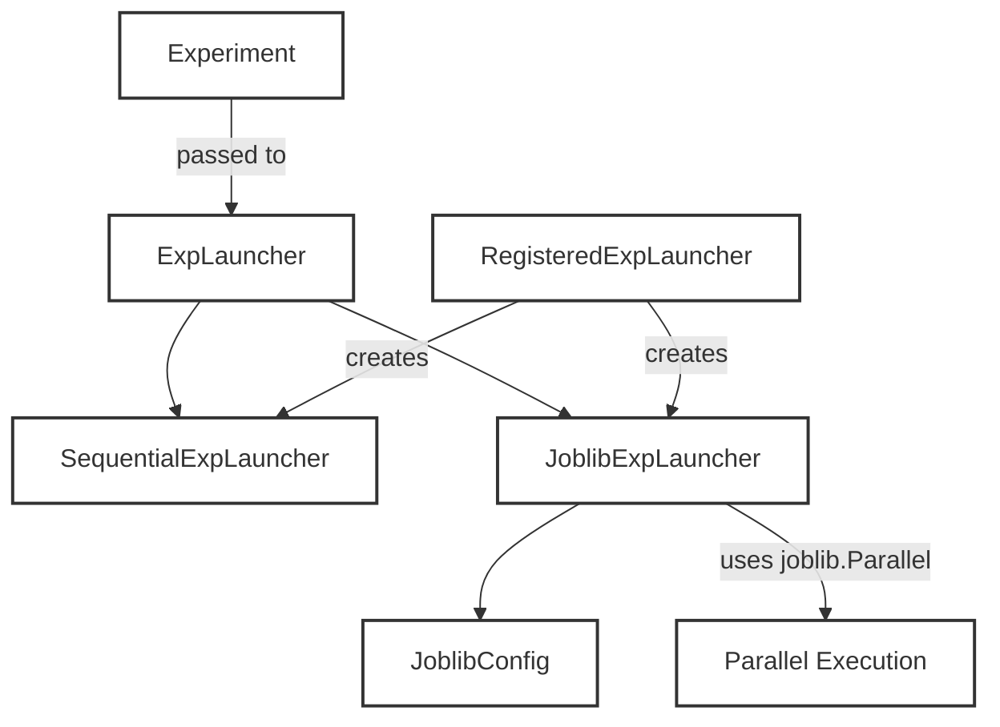
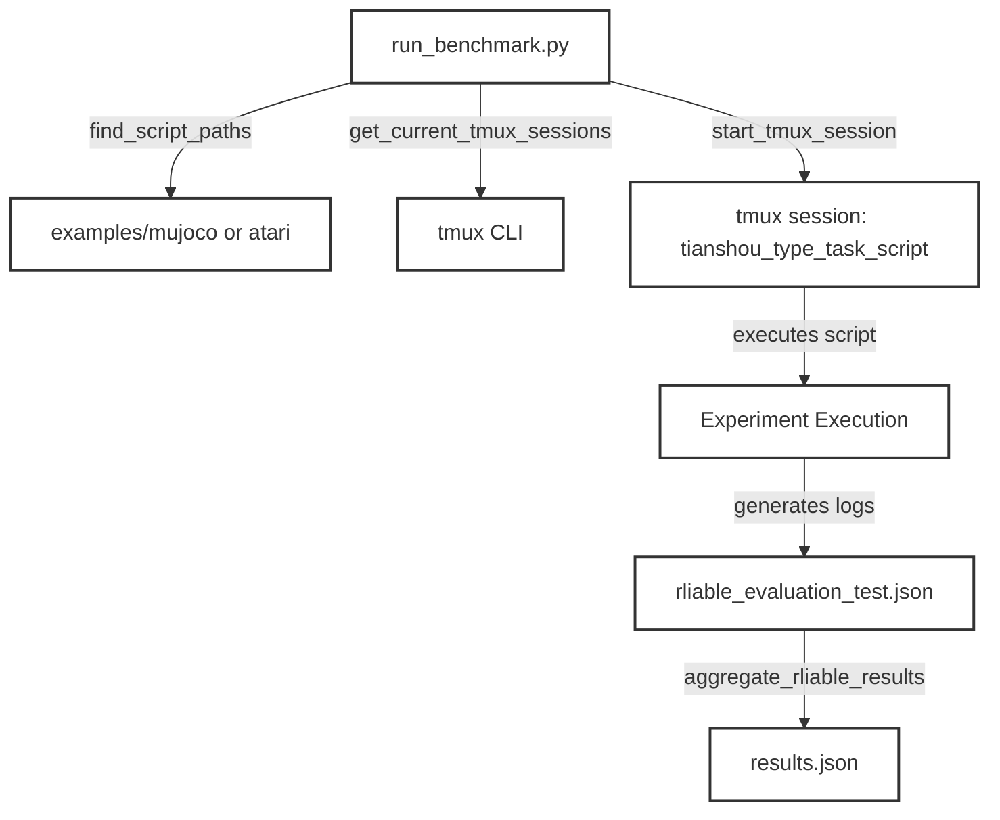

<!-- source: DeepWiki mcp.deepwiki.com · repo thu-ml/tianshou · page 10.2 Evaluation and Benchmarking · fetched 2026-10-30 -->

# Evaluation and Benchmarking

Relevant source files

The following files were used as context for generating this wiki page:

- [benchmark/run_benchmark.py](benchmark/run_benchmark.py)
- [docs/04_benchmarks/benchmarks.rst](docs/04_benchmarks/benchmarks.rst)
- [docs/05_developer_guide/developer_guide.md](docs/05_developer_guide/developer_guide.md)
- [docs/06_contributors/contributors.rst](docs/06_contributors/contributors.rst)
- [docs/_static/js/benchmark.js](docs/_static/js/benchmark.js)
- [docs/_static/js/mujoco/benchmark/Ant-v4/results.json](docs/_static/js/mujoco/benchmark/Ant-v4/results.json)
- [tianshou/evaluation/launcher.py](tianshou/evaluation/launcher.py)

This page documents Tianshou's evaluation infrastructure, robust evaluation practices via the `rliable` library, parallel experiment execution through experiment launchers, and automated benchmarking scripts for environments such as MuJoCo and Atari.

---

## 1. Trustworthy Evaluation with Rliable

Tianshou integrates with the Google Research `rliable` library (`https://github.com/google-research/rliable`) to support best practices for trustworthy reinforcement learning evaluation [docs/04_benchmarks/benchmarks.rst:10-11](). Rather than relying solely on mean performance across seeds—which can be heavily skewed by outliers—benchmarks in Tianshou compute the **Interquartile Mean (IQM)** and **95% confidence intervals** across multiple random seeds (typically 5 seeds) [docs/04_benchmarks/benchmarks.rst:12]().

Evaluation metrics are structured to track performance over environment steps (`env_step`), computing point estimates and uncertainty bounds that are serialized into structured JSON formats for downstream visualization [docs/_static/js/mujoco/benchmark/Ant-v4/results.json:1]().

Sources: [docs/04_benchmarks/benchmarks.rst:1-21](), [docs/_static/js/mujoco/benchmark/Ant-v4/results.json:1]()

---

## 2. Experiment Launchers (`tianshou/evaluation/launcher.py`)

To execute and manage collections of reinforcement learning experiments concurrently or sequentially, Tianshou provides an experiment launcher framework under `tianshou/evaluation/launcher.py`.

### Core Classes and Functions

* **`ExpLauncher`**: An abstract base class defining the interface for launching multiple `Experiment` instances [tianshou/evaluation/launcher.py:36-62](). It manages safe execution (`_safe_execute`) catching base exceptions, and filters results via `_return_from_successful_and_failed_exps` [tianshou/evaluation/launcher.py:64-85](). If a single experiment is provided, it bypasses launcher overhead and runs directly in the main process [tianshou/evaluation/launcher.py:93-97]().
* **`SequentialExpLauncher`**: A concrete subclass that iterates through a sequence of experiments in a simple `for` loop [tianshou/evaluation/launcher.py:101-114]().
* **`JoblibExpLauncher`**: A parallel launcher utilizing `joblib.Parallel` and `delayed` to run experiments concurrently [tianshou/evaluation/launcher.py:117-147](). It accepts a **`JoblibConfig`** dataclass to configure `n_jobs`, `backend` (hard-coded or defaulted to `"loky"`), and `verbose` levels [tianshou/evaluation/launcher.py:21-29, 117-134]().
* **`RegisteredExpLauncher`**: An `Enum` registry mapping string identifiers (`JOBLIB`, `SEQUENTIAL`) to their respective launcher factories [tianshou/evaluation/launcher.py:150-163]().

*Sources: [tianshou/evaluation/launcher.py:1-163]()*

---

## 3. Benchmark Orchestration (`benchmark/run_benchmark.py`)

The `benchmark/run_benchmark.py` script orchestrates automated benchmarking for algorithms across standard suites (Atari and MuJoCo) [benchmark/run_benchmark.py:1-21](). It coordinates parallel execution using isolated `tmux` sessions, manages resource constraints, and aggregates evaluation logs [benchmark/run_benchmark.py:7-12]().

### Key Script Mechanisms

* **Task Discovery**: `find_script_paths()` scans `examples/<benchmark_type>` for high-level experiment scripts matching glob filters (e.g., `**/*_hl.py`), supporting inclusion and exclusion filters [benchmark/run_benchmark.py:67-89]().
* **tmux Session Management**: 
  * `get_current_tmux_sessions()` queries active tmux sessions prefixed with `tianshou_<benchmark_type>` [benchmark/run_benchmark.py:92-104]().
  * `start_tmux_session()` spawns detached tmux sessions (`tmux new-session -d -s <session_name>`) running Python experiment scripts with custom arguments like `--num_experiments`, `--persistence_base_dir`, `--task`, `--max_epochs`, and `--epoch_num_steps` [benchmark/run_benchmark.py:106-161]().
* **Result Aggregation**: `aggregate_rliable_results()` parses individual experiment directories containing `rliable_evaluation_test.json` and consolidates them into task-level `results.json` payloads expected by the documentation viewer [benchmark/run_benchmark.py:163-183]().

*Sources: [benchmark/run_benchmark.py:1-183]()*

---

## 4. Documentation and Visualization Integration

Benchmark results processed via `rliable` and aggregated into `results.json` are rendered in the Sphinx documentation (`docs/04_benchmarks/benchmarks.rst`) using Vega-Lite interactive charts driven by `docs/_static/js/benchmark.js` [docs/_static/js/benchmark.js:15-62]().

The visualization script configures interactive range sliders, confidence interval bands (`iqm_confidence_lower` and `iqm_confidence_upper`), and tooltip bindings for the Interquartile Mean across environment steps [docs/_static/js/benchmark.js:25-61]().

Sources: [docs/04_benchmarks/benchmarks.rst:1-21](), [docs/_static/js/benchmark.js:1-89]()

---

