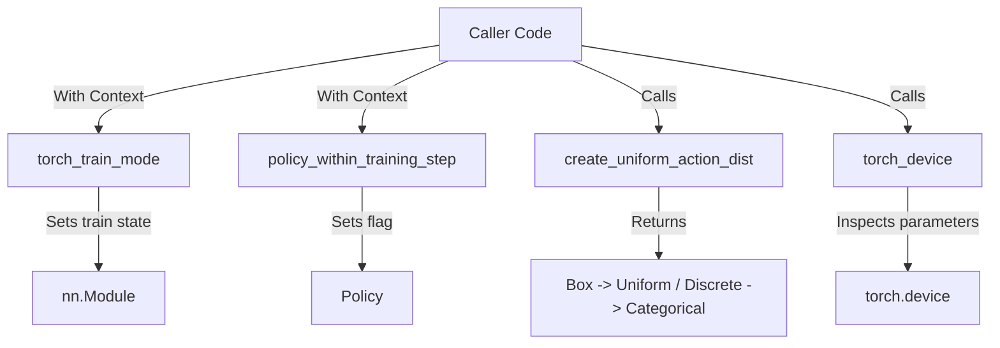
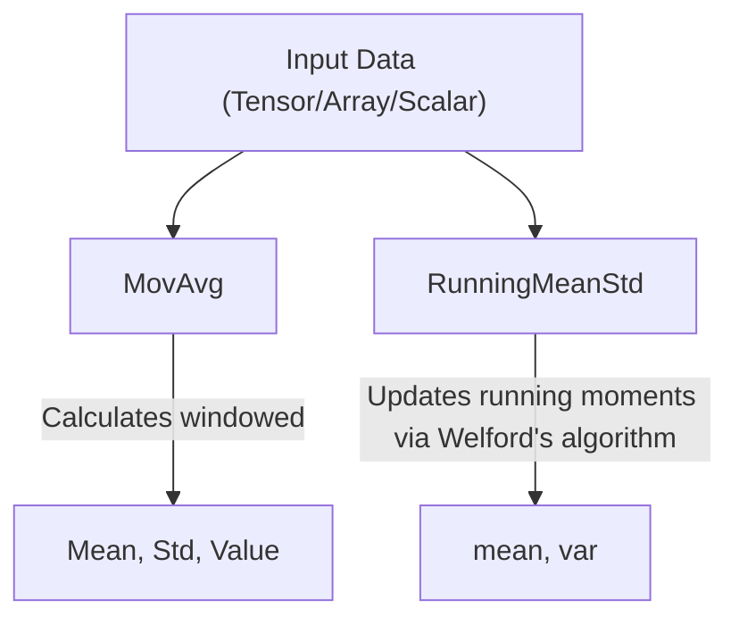
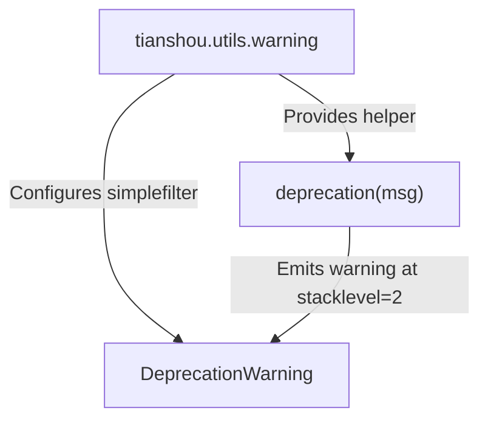
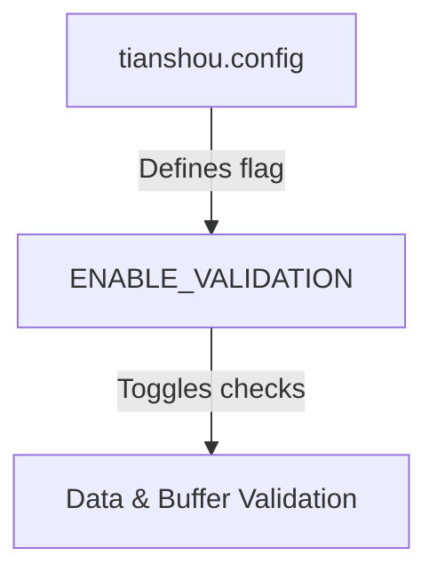

<!-- source: DeepWiki mcp.deepwiki.com · repo thu-ml/tianshou · page 10.3 General Utilities · fetched 2026-10-30 -->

# General Utilities

<details>
<summary>Relevant source files</summary>

The following files were used as context for generating this wiki page:

- [test/base/test_utils.py](test/base/test_utils.py)
- [test/determinism_test.py](test/determinism_test.py)
- [tianshou/config.py](tianshou/config.py)
- [tianshou/utils/__init__.py](tianshou/utils/__init__.py)
- [tianshou/utils/determinism.py](tianshou/utils/determinism.py)
- [tianshou/utils/torch_utils.py](tianshou/utils/torch_utils.py)
- [tianshou/utils/warning.py](tianshou/utils/warning.py)

</details>


This page documents the general-purpose utility modules provided by Tianshou v2 (`tianshou.utils` and related helper files), covering PyTorch training context helpers, deterministic testing and tracking frameworks, statistical running accumulators, warning wrappers, and progress bar configurations.

---

## 1. PyTorch Utilities (`torch_utils`)

The `tianshou.utils.torch_utils` module provides context managers and helper functions for managing PyTorch module states, policy execution flags, and action distributions [tianshou/utils/torch_utils.py:1-88]().

### Key Functions and Context Managers

- **`torch_train_mode(module: nn.Module, enabled: bool = True)`**: A context manager that temporarily switches an `nn.Module` to train or evaluation mode (`module.train(enabled)`), correctly restoring its original mode upon exit [tianshou/utils/torch_utils.py:14-23]().
- **`policy_within_training_step(policy: Policy, enabled: bool = True)`**: Temporarily updates `policy.is_within_training_step`, enabling policies to adjust their action-selection behavior between exploration rollouts and gradient updates [tianshou/utils/torch_utils.py:25-45]().
- **`create_uniform_action_dist(action_space: spaces.Box | spaces.Discrete, batch_size: int = 1)`**: Generates a PyTorch distribution (`torch.distributions.Uniform` or `torch.distributions.Categorical`) matching `action_space.sample()` semantics across a given `batch_size` [tianshou/utils/torch_utils.py:48-77]().
- **`torch_device(module: torch.nn.Module) -> torch.device`**: Determines the device of an `nn.Module` by inspecting its parameters, falling back to `cpu` if no parameters exist [tianshou/utils/torch_utils.py:80-88]().



*Sources: [tianshou/utils/torch_utils.py:1-88](), [test/base/test_utils.py:114-128]() *

---

## 2. Determinism and Trace Logging (`determinism`)

Tianshou provides comprehensive behavioral tracking and determinism testing infrastructure under `tianshou.utils.determinism` and `test/determinism_test.py` [tianshou/utils/determinism.py:1-397](), [test/determinism_test.py:1-123]().

### Core Components

- **`TraceLogger`**: A class supporting behavioral trace logs during agent-environment interactions. Enabled via context managers, it records messages prefixed with `[TRACE]` along with caller frame information [tianshou/utils/determinism.py:57-110]().
- **`TraceLog`**: Encapsulates a list of trace log lines, offering methods to save, print, reduce, and filter messages based on required or ignored substrings [tianshou/utils/determinism.py:112-185]().
- **`TraceLoggerContext` & `TraceDeterminismTest`**: Context managers and testing wrappers used to verify algorithmic determinism against stored reference logs or snapshots [test/determinism_test.py:26-123](), [tianshou/utils/determinism.py:188-397]().

```mermaid
graph TD
    subcode ["Code Entity Space"]
        TL[TraceLogger]
        TLog[TraceLog]
        TLC[TraceLoggerContext]
        TDT[TraceDeterminismTest]
    end
    subnat ["Natural Language Space"]
        TLC -->|Captures traces| TLog
        TLog -->|Filters and compares| TDT
        TDT -->|Asserts equivalence| TL
    end
```

*Sources: [tianshou/utils/determinism.py:1-397](), [test/determinism_test.py:1-123]() *

---

## 3. Statistical Accumulators (`statistics`)

The `tianshou.utils.statistics` package implements online statistical trackers for reinforcement learning metrics [tianshou/utils/__init__.py:7]().

### Classes

- **`MovAvg`**: Maintains a rolling moving average over a fixed window size, supporting additions from scalars, lists, NumPy arrays, and PyTorch tensors [test/base/test_utils.py:26-37]().
- **`RunningMeanStd`**: Computes Welford-based online mean and variance across incoming multi-dimensional batches, commonly used for observation normalization [test/base/test_utils.py:40-47]().



*Sources: [test/base/test_utils.py:26-47](), [tianshou/utils/__init__.py:7]() *

---

## 4. Progress Bars and Warnings

### Progress Bars (`progress_bar`)
Tianshou integrates `tqdm` progress bars with configuration helpers and a `DummyTqdm` fallback when progress bars are disabled [tianshou/utils/__init__.py:6]().

### Deprecation Warnings (`warning`)
The `tianshou.utils.warning` module sets up warning filters and supplies the `deprecation(msg: str)` wrapper to emit `DeprecationWarning` messages with appropriate stack levels [tianshou/utils/warning.py:1-8]().



*Sources: [tianshou/utils/__init__.py:6](), [tianshou/utils/warning.py:1-8]() *

---

## 5. Configuration Constants (`config`)

Global configuration flags such as `ENABLE_VALIDATION` control runtime validation overhead across Tianshou modules [tianshou/config.py:1-2]().



*Sources: [tianshou/config.py:1-2]()*

---

