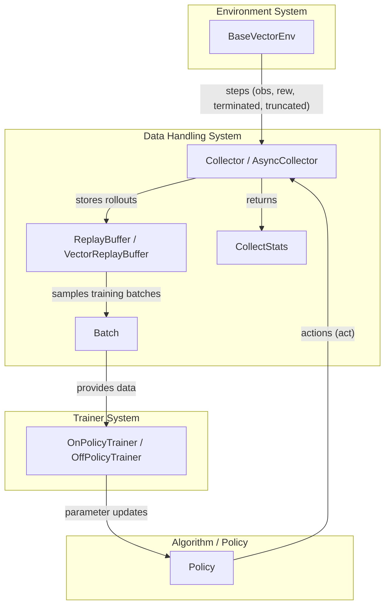

<!-- source: DeepWiki mcp.deepwiki.com · repo thu-ml/tianshou · page 2 Data Handling System · fetched 2026-10-30 -->

# Data Handling System

Relevant source files

The following files were used as context for generating this wiki page:

- [test/base/env.py](test/base/env.py)
- [test/base/test_batch.py](test/base/test_batch.py)
- [test/base/test_buffer.py](test/base/test_buffer.py)
- [test/base/test_collector.py](test/base/test_collector.py)
- [tianshou/__init__.py](tianshou/__init__.py)
- [tianshou/data/__init__.py](tianshou/data/__init__.py)
- [tianshou/data/batch.py](tianshou/data/batch.py)
- [tianshou/data/collector.py](tianshou/data/collector.py)
- [tianshou/env/__init__.py](tianshou/env/__init__.py)
- [tianshou/env/gym_wrappers.py](tianshou/env/gym_wrappers.py)

The Data Handling System is responsible for efficiently managing, storing, and processing data throughout the reinforcement learning lifecycle in Tianshou v2. It coordinates the flow of experience data from environment interactions to policy training, providing robust abstractions for data representation, batching, experience replay, rollout collection, and statistics aggregation.

As a parent overview, this page introduces Tianshou's core data management components. For deep technical details, protocols, and specialized variants, refer to the child pages:
- **Batch**: For details on the flexible container, protocols, and conversion, see [Batch](#2.1).
- **ReplayBuffer**: For experience storage, managers, cached, prioritized, and HER variants, see [ReplayBuffer](#2.2).
- **Collector**: For rollout logic, hooks, and bridging policies and environments, see [Collector](#2.3).
- **Statistics and Collection Metrics**: For `CollectStats`, `EpochStats`, and metric flow, see [Statistics and Collection Metrics](#2.4).

---

## Architecture and Data Flow

The data handling system integrates tightly with policies, vectorized environments, and trainers. The diagram below illustrates how data moves across Tianshou's data entities during training.

Title: Data Flow and Component Architecture

Sources: [tianshou/data/collector.py:1-39](), [tianshou/data/batch.py:1-43](), [tianshou/data/buffer/buffer_base.py:20-50]().

---

## 2.1. Batch

The `Batch` class (`[tianshou/data/batch.py:1-43]`) is Tianshou's primary data carrier, designed to hold heterogeneous data structures such as NumPy arrays, PyTorch tensors, nested dictionaries, and arbitrary objects. It bridges dictionary-like flexibility with array-like operations, supporting slicing, concatenation, stacking, and device conversions.

To maintain type safety and IDE autocompletion without restricting custom user fields, Tianshou implements `BatchProtocol` and derived types like `ActBatchProtocol` and `RolloutBatchProtocol` (`[tianshou/data/collector.py:49-80]()`).

For complete details on protocols, custom transformations, and conversion methods, see [Batch](#2.1).

Sources: [tianshou/data/batch.py:1-43](), [tianshou/data/collector.py:49-80]().

---

## 2.2. ReplayBuffer

The `ReplayBuffer` family handles experience storage and sampling for reinforcement learning algorithms. Base buffers (`[tianshou/data/buffer/buffer_base.py:24-43]()`) implement circular experience storage with support for frame stacking and episode length tracking. 

Tianshou provides several specialized buffer variants for advanced training paradigms:
- `PrioritizedReplayBuffer`: Implements prioritized experience replay using segment trees (`[tianshou/data/buffer/prio.py:12-23]()`).
- `HERReplayBuffer`: Implements Hindsight Experience Replay for goal-conditioned tasks (`[tianshou/data/buffer/her.py:11-32]()`).
- `VectorReplayBuffer`: Manages partitioned buffers corresponding to parallel vectorized environments.

For implementation details on buffer managers, cached buffers, and sampling protocols, see [ReplayBuffer](#2.2).

Sources: [tianshou/data/buffer/buffer_base.py:24-43](), [tianshou/data/buffer/prio.py:12-23](), [tianshou/data/buffer/her.py:11-32]().

---

## 2.3. Collector

The `Collector` class (`[tianshou/data/collector.py:15-35]()`) manages the interaction loop between a `Policy` and a `BaseVectorEnv`, storing generated trajectories into a `ReplayBuffer`. It supports both synchronous execution (`Collector`) and asynchronous parallel rollouts (`AsyncCollector`) across multiple environment instances.

Collectors handle action computation, environment stepping, rollout hook execution, and metric collection during training and evaluation phases.

For details on rollout hooks, custom step functions, and async collection mechanics, see [Collector](#2.3).

Sources: [tianshou/data/collector.py:15-35]().

---

## 2.4. Statistics and Collection Metrics

Data collection and training generate structured metric containers that flow into logging backends (such as Tensorboard or Weights & Biases). The stats subsystem includes `CollectStats` (`[tianshou/data/collector.py:117-150]()`), which tracks episode returns, lengths, collection speeds, and distribution statistics, alongside epoch-level summaries like `EpochStats` and `SequenceSummaryStats` (`[tianshou/data/__init__.py:21-26]()`).

For information on how these metrics are aggregated and reported during training epochs, see [Statistics and Collection Metrics](#2.4).

Sources: [tianshou/data/collector.py:117-150](), [tianshou/data/__init__.py:21-26]().

---

