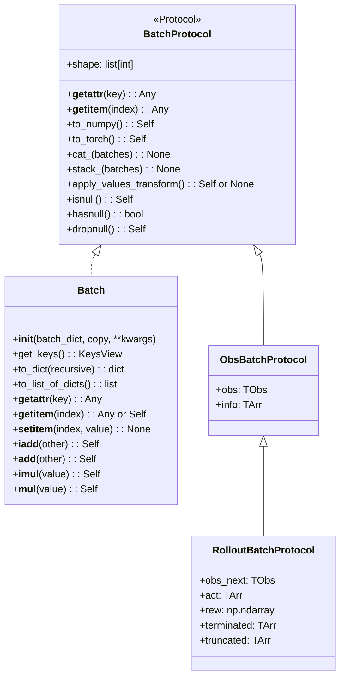
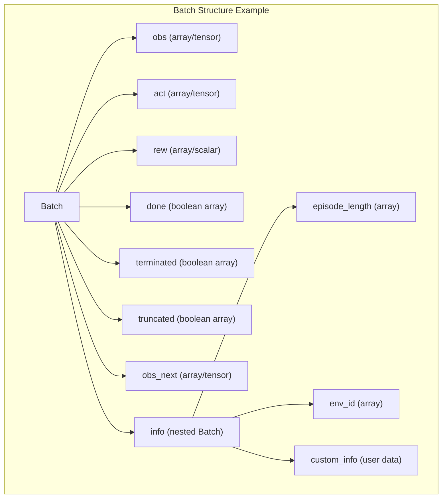
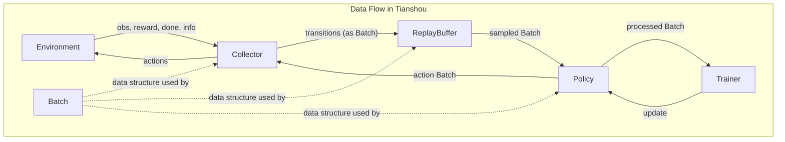

<!-- source: DeepWiki mcp.deepwiki.com · repo thu-ml/tianshou · page 2.1 Batch · fetched 2026-10-30 -->

# Batch

<details>
<summary>Relevant source files</summary>

The following files were used as context for generating this wiki page:

- [docs/01_user_guide/00_training_process.md](docs/01_user_guide/00_training_process.md)
- [docs/01_user_guide/01_apis.md](docs/01_user_guide/01_apis.md)
- [docs/01_user_guide/02_core_abstractions.md](docs/01_user_guide/02_core_abstractions.md)
- [docs/01_user_guide/index.rst](docs/01_user_guide/index.rst)
- [docs/02_deep_dives/0_intro.md](docs/02_deep_dives/0_intro.md)
- [docs/02_deep_dives/L1_Batch.ipynb](docs/02_deep_dives/L1_Batch.ipynb)
- [test/base/env.py](test/base/env.py)
- [test/base/test_batch.py](test/base/test_batch.py)
- [test/base/test_buffer.py](test/base/test_buffer.py)
- [test/base/test_collector.py](test/base/test_collector.py)
- [tianshou/data/batch.py](tianshou/data/batch.py)
- [tianshou/data/collector.py](tianshou/data/collector.py)
- [tianshou/data/types.py](tianshou/data/types.py)
- [tianshou/data/utils/converter.py](tianshou/data/utils/converter.py)

</details>


## Purpose and Scope

The `Batch` class is the fundamental data structure in Tianshou for handling heterogeneous data in reinforcement learning algorithms. It serves as a flexible container that can store and manipulate various types of data including:

- NumPy arrays
- PyTorch tensors
- Python scalars
- Nested `Batch` objects
- PyTorch `Distribution` objects

The `Batch` class provides array-like indexing and slicing operations while maintaining the flexibility of a dictionary, making it ideal for processing the diverse data encountered in reinforcement learning.

For data collection using this structure, see [Collector](#2.3), and for data storage, see [ReplayBuffer](#2.2).

Sources: [tianshou/data/batch.py:1-43](tianshou/data/batch.py:1-43), [docs/02_deep_dives/L1_Batch.ipynb:7-89](docs/02_deep_dives/L1_Batch.ipynb:7-89)

## Structure and Design

The `Batch` class can be thought of as a hybrid between a dictionary and an array. It has key-value pairs like a dictionary, but also supports array-like operations such as indexing, slicing, and batch operations. It supports typing and IDE autocompletion via protocol definitions in `tianshou.data.types`.



Sources: [tianshou/data/batch.py:309-631](tianshou/data/batch.py:309-631), [tianshou/data/types.py:14-37](tianshou/data/types.py:14-37)

### Data Organization

A typical `Batch` object in reinforcement learning contains structured data representing transitions or trajectories:



Sources: [tianshou/data/batch.py:1-43](tianshou/data/batch.py:1-43), [test/base/test_buffer.py:35-47](test/base/test_buffer.py:35-47)

## Creating and Accessing Batch Objects

### Creating Batch Objects

```python
# From dictionary
batch = Batch({"obs": np.array([1, 2, 3]), "act": torch.tensor([0, 1, 0])})

# From keyword arguments
batch = Batch(obs=np.array([1, 2, 3]), act=torch.tensor([0, 1, 0]))

# With nested structure
batch = Batch(
    obs=np.array([1, 2, 3]),
    info={"terminal": np.array([False, False, True])}
)

# From a list of dicts/batches (will stack them)
batch = Batch([
    {"obs": 1, "act": 0},
    {"obs": 2, "act": 1}
])
```

Sources: [tianshou/data/batch.py:632-659](tianshou/data/batch.py:632-659), [test/base/test_batch.py:19-67](test/base/test_batch.py:19-67)

### Accessing Data

```python
# Attribute access (recommended)
obs = batch.obs
terminal = batch.info.terminal

# Dictionary-style access
obs = batch["obs"]
terminal = batch["info"]["terminal"]

# Checking for keys
has_obs = "obs" in batch

# Getting all keys
keys = batch.get_keys()
```

Sources: [tianshou/data/batch.py:685-692](tianshou/data/batch.py:685-692), [test/base/test_batch.py:103-118](test/base/test_batch.py:103-118)

## Core Operations

### Indexing and Slicing

Batch objects support numpy-like indexing and slicing operations, which are applied consistently across all fields:

```python
# Get first element across all fields
first = batch[0]  # Returns a Batch with first element of each field

# Get a slice
subset = batch[1:3]  # Returns a Batch with elements 1 and 2 of each field

# Advanced indexing
mask = np.array([True, False, True])
filtered = batch[mask]  # Returns a Batch with elements 0 and 2
```

Sources: [tianshou/data/batch.py:714-746](tianshou/data/batch.py:714-746), [test/base/test_batch.py:118-142](test/base/test_batch.py:118-142)

### Concatenation and Stacking

```python
# Concatenation (combine along existing dimension)
batch1 = Batch(obs=np.array([1, 2]), act=np.array([0, 1]))
batch2 = Batch(obs=np.array([3, 4]), act=np.array([1, 0]))
result = Batch.cat([batch1, batch2])  
# result.obs = [1, 2, 3, 4], result.act = [0, 1, 1, 0]

# In-place concatenation
batch1.cat_(batch2)  # Modifies batch1 in-place

# Stacking (combine along new dimension)
result = Batch.stack([batch1, batch2])  
# result.obs = [[1, 2], [3, 4]], result.act = [[0, 1], [1, 0]]

# Stack along different axis
result = Batch.stack([batch1, batch2], axis=1)  
# result.obs = [[1, 3], [2, 4]], result.act = [[0, 1], [1, 0]]
```

Sources: [tianshou/data/batch.py:408-430](tianshou/data/batch.py:408-430), [tianshou/data/batch.py:436-458](tianshou/data/batch.py:436-458), [test/base/test_batch.py:237-322](test/base/test_batch.py:237-322)

### Arithmetic Operations

```python
# Addition
result = batch + 1  # Adds 1 to each numeric value
result = batch1 + batch2  # Element-wise addition

# Multiplication
result = batch * 2  # Multiplies each numeric value by 2

# Division
result = batch / 2  # Divides each numeric value by 2

# In-place operations
batch += 1
batch *= 2
batch /= 2
```

Sources: [tianshou/data/batch.py:803-851](tianshou/data/batch.py:803-851), [test/base/test_batch.py:143-147](test/base/test_batch.py:143-147)

## Data Conversion

### NumPy and PyTorch Conversion

Conversion helpers such as `to_numpy` and `to_torch` (defined in `tianshou.data.utils.converter`) handle recursive conversions across all nested tensors and arrays within a `Batch`.

```python
from tianshou.data import to_numpy, to_torch

# Convert to numpy arrays (creates a copy)
numpy_batch = to_numpy(batch)

# Convert to torch tensors (creates a copy)
torch_batch = to_torch(batch, dtype=torch.float32, device="cuda")

# In-place conversion to numpy
batch.to_numpy_()

# In-place conversion to torch
batch.to_torch_(dtype=torch.float32, device="cuda")
```

Sources: [tianshou/data/batch.py:868-914](tianshou/data/batch.py:868-914), [tianshou/data/utils/converter.py:17-61](tianshou/data/utils/converter.py:17-61), [test/base/test_batch.py:669-768](test/base/test_batch.py:669-768)

### Dictionary Conversion

```python
# Convert to dictionary (non-recursive)
dict_representation = batch.to_dict()

# Convert to dictionary recursively
dict_representation = batch.to_dict(recursive=True)

# Convert to list of dictionaries
list_of_dicts = batch.to_list_of_dicts()
```

Sources: [tianshou/data/batch.py:661-680](tianshou/data/batch.py:661-680), [test/base/test_batch.py:597-666](test/base/test_batch.py:597-666)

## Advanced Features

### Value Transformations

```python
# Apply a function to all arrays in the batch
transformed = batch.apply_values_transform(lambda x: x * 2)

# Apply transformation in-place
batch.apply_values_transform(lambda x: x * 2, inplace=True)
```

Sources: [tianshou/data/batch.py:580-613](tianshou/data/batch.py:580-613), [test/base/test_batch.py:710-721](test/base/test_batch.py:710-721)

### Handling Missing Values

```python
# Check for missing values (returns a boolean Batch)
is_null = batch.isnull()

# Check if any value is missing
has_null = batch.hasnull()

# Drop entries with missing values
clean_batch = batch.dropnull()
```

Sources: [tianshou/data/batch.py:553-578](tianshou/data/batch.py:553-578)

## Typed Batch Protocols

To enable IDE autocompletion and type checking without imposing strict class definitions, Tianshou provides a suite of protocols in `tianshou.data.types`:

| Protocol Name | Key Attributes / Extensions | Purpose |
| :--- | :--- | :--- |
| `BatchProtocol` | Base interface (`shape`, `to_numpy`, `to_torch`, etc.) | Base typing contract for all batch-like objects. |
| `ObsBatchProtocol` | `obs`, `info` | Observations generated by environment steps. |
| `RolloutBatchProtocol` | Extends `ObsBatchProtocol` with `obs_next`, `act`, `rew`, `terminated`, `truncated` | Standard transition tuples stored in replay buffers. |
| `ActBatchProtocol` | `act` | Simple action containers (e.g., random policies). |
| `DistBatchProtocol` | Extends `ModelOutputBatchProtocol` with `dist` | Contains action probability distributions. |
| `BatchWithAdvantagesProtocol` | Extends `BatchWithReturnsProtocol` with `adv`, `v_s` | Used in policy gradient methods (e.g., PPO, A2C). |

Sources: [tianshou/data/types.py:1-134](tianshou/data/types.py:1-135)

## Integration with Tianshou

The `Batch` class is central to Tianshou's data flow, serving as the standard format for transitions, episodes, and policy operations:



Sources: [test/base/test_collector.py:87-109](test/base/test_collector.py:87-109), [test/base/test_buffer.py:27-49](test/base/test_buffer.py:27-49)

## Distribution Handling

A unique feature of `Batch` is its ability to handle torch `Distribution` objects when slicing:

```python
batch = Batch(
    obs=torch.tensor([[1, 2], [3, 4]]),
    act=torch.tensor([0, 1]),
    dist=Categorical(probs=torch.tensor([[0.3, 0.7], [0.4, 0.6]]))
)

# When slicing the batch, the distribution is also properly sliced
first = batch[0]  # first.dist is Categorical(probs=torch.tensor([0.3, 0.7]))
```

Sources: [tianshou/data/batch.py:266-278](tianshou/data/batch.py:266-278), [tianshou/data/batch.py:728-745](tianshou/data/batch.py:728-745)

## Best Practices

1. **Use attribute notation** (`batch.obs`) for clarity and better IDE support.
2. **Convert data types consistently** using `to_numpy()` and `to_torch()` as needed.
3. **Check for missing values** with `hasnull()` before operations that may fail.
4. **Use in-place operations** (`cat_`, `to_numpy_`) for performance-critical code.
5. **Leverage batch operations** for concise, vectorized code.
6. **Create batches with appropriate types** - numpy arrays for CPU operations, torch tensors for GPU operations.

Sources: [tianshou/data/batch.py:1-43](tianshou/data/batch.py:1-43), [test/base/test_batch.py:19-67](test/base/test_batch.py:19-67)

## Common Use Cases

### Reinforcement Learning Transitions

```python
transition = Batch(
    obs=current_observation,
    act=action,
    rew=reward,
    terminated=terminated,
    truncated=truncated,
    obs_next=next_observation,
    info=additional_info
)
```

### Batched Policy Inputs/Outputs

```python
# Input batch to policy
obs_batch = Batch(obs=observations)

# Output from policy
action_batch = Batch(
    act=actions,
    logits=logits,
    state=hidden_states
)
```

### Data Processing

```python
# Filter data
positive_rewards = batch[batch.rew > 0]

# Normalize observations
batch.obs = (batch.obs - mean) / std

# Compute discounted returns
batch.returns = discount_cumsum(batch.rew)
```

Sources: [test/base/test_buffer.py:35-47](test/base/test_buffer.py:35-47), [test/base/test_collector.py:35-84](test/base/test_collector.py:35-84)

---

