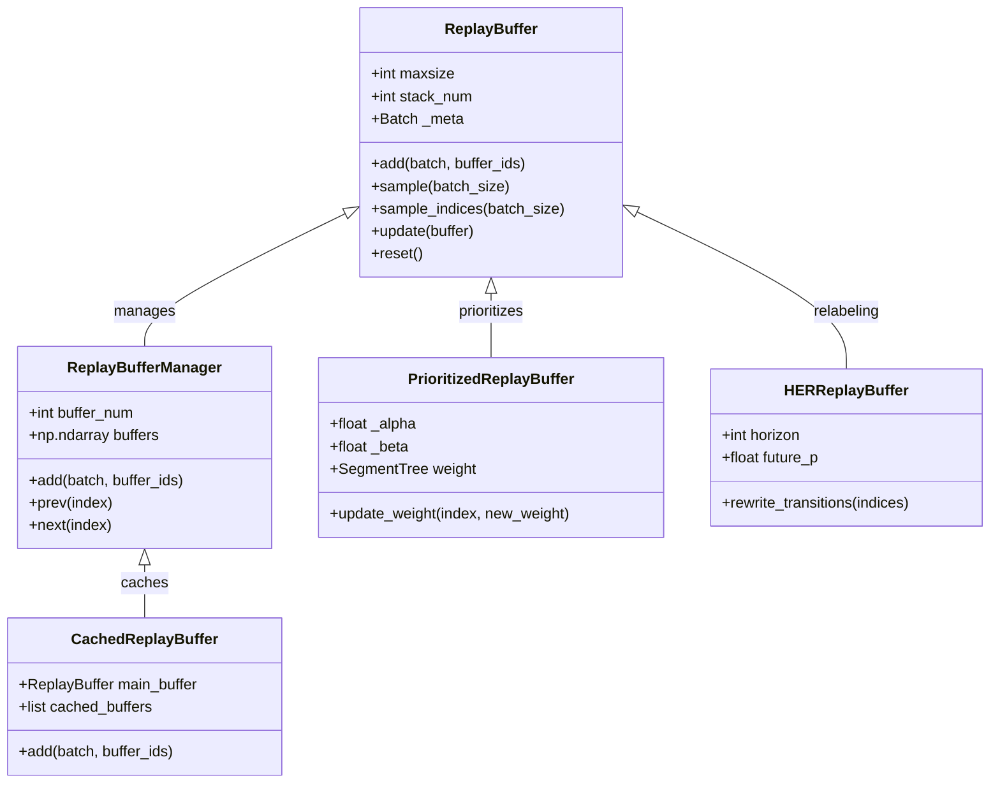
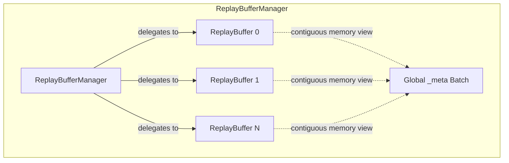
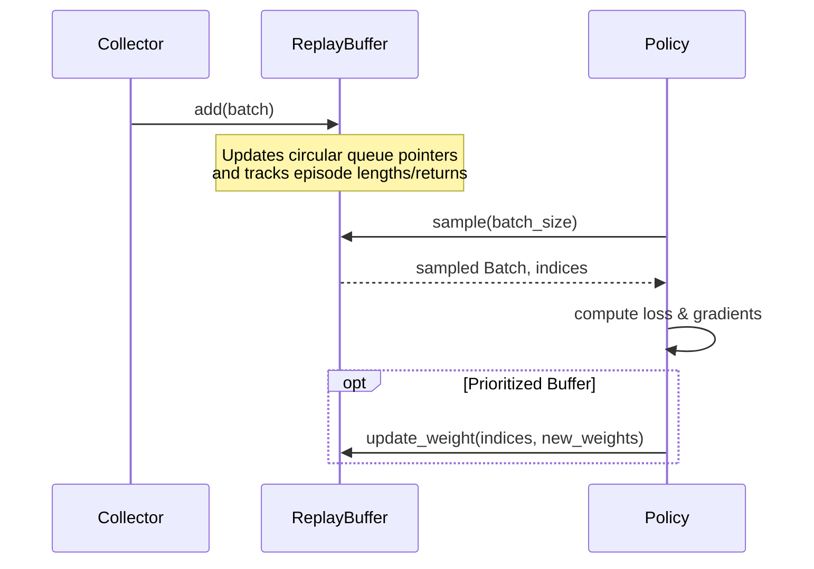

<!-- source: DeepWiki mcp.deepwiki.com · repo thu-ml/tianshou · page 2.2 ReplayBuffer · fetched 2026-10-30 -->

# ReplayBuffer

<details>
<summary>Relevant source files</summary>

The following files were used as context for generating this wiki page:

- [docs/02_deep_dives/L2_Buffer.ipynb](docs/02_deep_dives/L2_Buffer.ipynb)
- [docs/02_deep_dives/L3_Environments.ipynb](docs/02_deep_dives/L3_Environments.ipynb)
- [docs/02_deep_dives/L4_GAE.ipynb](docs/02_deep_dives/L4_GAE.ipynb)
- [tianshou/algorithm/algorithm_base.py](tianshou/algorithm/algorithm_base.py)
- [tianshou/algorithm/imitation/cql.py](tianshou/algorithm/imitation/cql.py)
- [tianshou/data/buffer/buffer_base.py](tianshou/data/buffer/buffer_base.py)
- [tianshou/data/buffer/cached.py](tianshou/data/buffer/cached.py)
- [tianshou/data/buffer/her.py](tianshou/data/buffer/her.py)
- [tianshou/data/buffer/manager.py](tianshou/data/buffer/manager.py)
- [tianshou/data/buffer/prio.py](tianshou/data/buffer/prio.py)

</details>


The `ReplayBuffer` family in Tianshou provides robust data structures for storing, managing, and sampling experiences from agent-environment interactions. Located in the data handling subsystem, buffers bridge the gap between environment rollouts performed by a `Collector` and parameter updates executed by an `Algorithm` or `Policy`.

Sources: [tianshou/data/buffer/buffer_base.py:25-42](), [docs/02_deep_dives/L2_Buffer.ipynb:7-72]()

---

## 1. Core Architecture and Class Hierarchy

Tianshou implements a modular class hierarchy for its replay buffers, supporting single environments, vector environments, priority-based sampling, hindsight relabeling, and cached storage. 


*Figure 1: Code-space class hierarchy mapping concrete buffer classes to their inheritance structures.*

Sources: [tianshou/data/buffer/buffer_base.py:25-104](), [tianshou/data/buffer/manager.py:13-54](), [tianshou/data/buffer/prio.py:12-45](), [tianshou/data/buffer/her.py:11-44](), [tianshou/data/buffer/cached.py:7-33]()

---

## 2. Core `ReplayBuffer` Implementation

The base `ReplayBuffer` class [tianshou/data/buffer/buffer_base.py:25]() manages experiences in a circular-queue format using an internal `Batch` container `self._meta` [tianshou/data/buffer/buffer_base.py:97](). 

### Key Attributes and Initialization Parameters

| Parameter | Type | Default | Description |
|-----------|------|---------|-------------|
| `size` | int | - | Maximum capacity of transitions stored in the buffer |
| `stack_num` | int | `1` | Number of consecutive frames stacked for temporal context |
| `ignore_obs_next` | bool | `False` | Disables storing `obs_next` to conserve memory |
| `save_only_last_obs` | bool | `False` | Stores only the final observation when using temporal stacks |
| `sample_avail` | bool | `False` | Restricts sampling to indices valid for frame stacking |
| `random_seed` | int | `42` | Seed for reproducible random sampling |

Sources: [tianshou/data/buffer/buffer_base.py:71-104]()

---

## 3. Buffer Managers and Vectorized Storage

To support vectorized environments (`BaseVectorEnv`), Tianshou provides `ReplayBufferManager` [tianshou/data/buffer/manager.py:13]() which manages multiple contiguous sub-buffers under a unified interface.


*Data flow diagram showing how `ReplayBufferManager` coordinates multiple underlying buffers into a unified storage space.*

Sources: [tianshou/data/buffer/manager.py:13-54]()

---

## 4. Specialized Replay Buffers

### Prioritized Experience Replay (`PrioritizedReplayBuffer`)

`PrioritizedReplayBuffer` [tianshou/data/buffer/prio.py:12]() implements Prioritized Experience Replay (PER), sampling transitions proportional to their temporal-difference (TD) errors. It utilizes a binary `SegmentTree` for $O(\log N)$ priority-based sampling.

- **`alpha` (`_alpha`)**: Controls the degree of prioritization ($\alpha > 0$).
- **`beta` (`_beta`)**: Controls the amount of importance-sampling correction ($\beta \ge 0$).
- **`SegmentTree`**: Efficiently queries prefix sums of priority weights (`self.weight`) [tianshou/data/buffer/prio.py:41]().

Sources: [tianshou/data/buffer/prio.py:12-45]()

### Hindsight Experience Replay (`HERReplayBuffer`)

`HERReplayBuffer` [tianshou/data/buffer/her.py:11]() supports goal-conditioned reinforcement learning (e.g., sparse-reward robotic environments). Observations are expected to contain dictionaries with `observation`, `achieved_goal`, and `desired_goal`.

- **`future_k`**: Controls the ratio of synthetic goal-relabeled transitions generated during sampling.
- **`compute_reward_fn`**: Callable used to recompute rewards given relabelled achieved and desired goals [tianshou/data/buffer/her.py:19-22]().

Sources: [tianshou/data/buffer/her.py:11-44]()

### Cached Replay Buffer (`CachedReplayBuffer`)

`CachedReplayBuffer` [tianshou/data/buffer/cached.py:7]() maintains a main buffer and multiple episode-length temporary caches. Transitions are initially written to a cached sub-buffer; upon episode termination, the data is flushed and moved into the main buffer.

Sources: [tianshou/data/buffer/cached.py:7-33]()

---

## 5. Key Operations and Data Flow


*Sequence diagram illustrating the interaction loop between `Collector`, `ReplayBuffer`, and `Policy`.*

Sources: [tianshou/data/buffer/buffer_base.py:270-325](), [tianshou/data/buffer/prio.py:54-91]()

### Persistence (HDF5)

Buffers support saving to and loading from HDF5 files using underlying converters:

```python
buffer.save_hdf5("path_to_buffer.hdf5")
loaded_buffer = ReplayBuffer.load_hdf5("path_to_buffer.hdf5")
```

Sources: [tianshou/data/buffer/buffer_base.py:240-255]()

---

