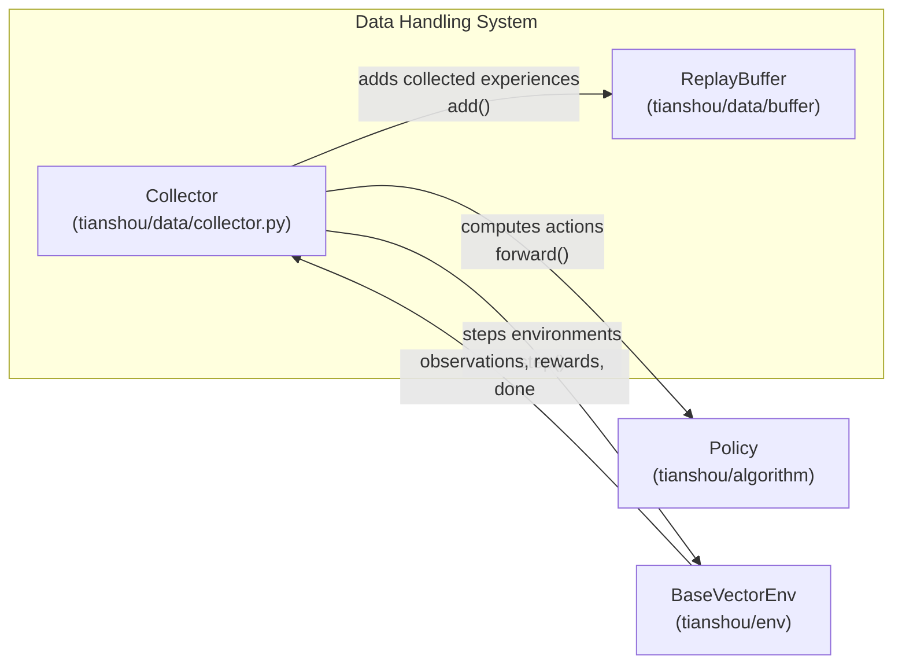
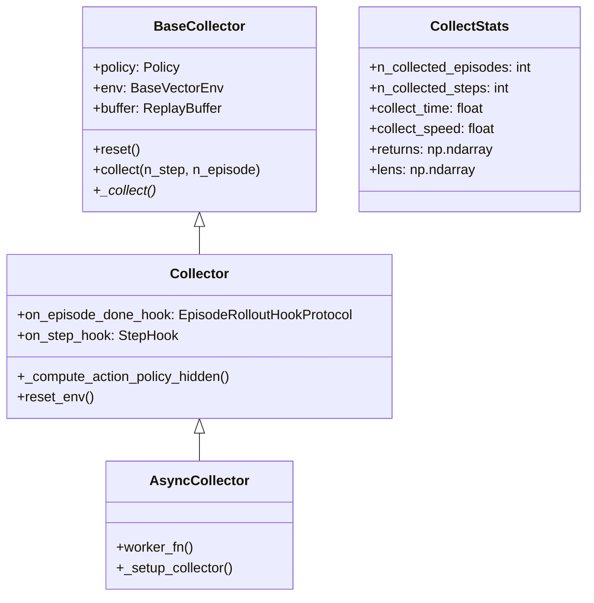
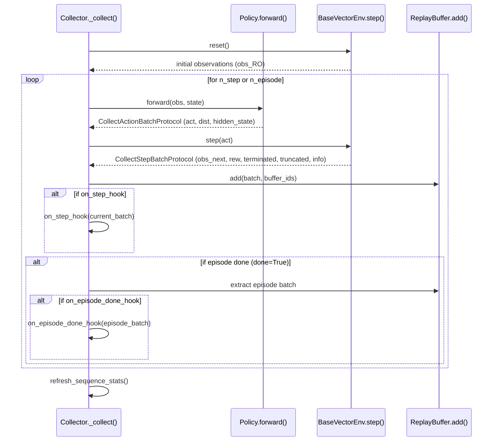
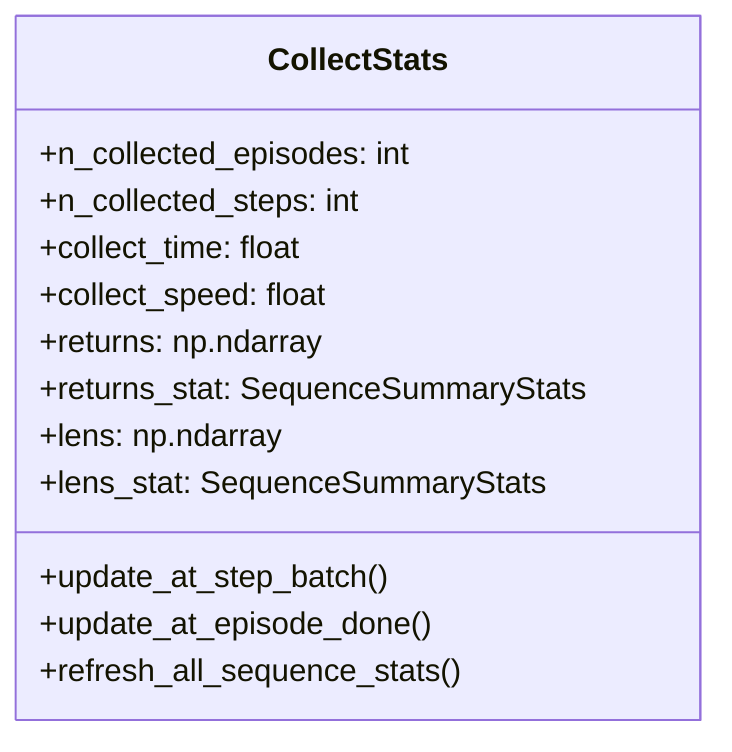

<!-- source: DeepWiki mcp.deepwiki.com · repo thu-ml/tianshou · page 2.3 Collector · fetched 2026-10-30 -->

# Collector

<details>
<summary>Relevant source files</summary>

The following files were used as context for generating this wiki page:

- [docs/02_deep_dives/L5_Collector.ipynb](docs/02_deep_dives/L5_Collector.ipynb)
- [docs/02_deep_dives/L6_MARL.ipynb](docs/02_deep_dives/L6_MARL.ipynb)
- [test/base/env.py](test/base/env.py)
- [test/base/test_batch.py](test/base/test_batch.py)
- [test/base/test_buffer.py](test/base/test_buffer.py)
- [test/base/test_collector.py](test/base/test_collector.py)
- [tianshou/data/batch.py](tianshou/data/batch.py)
- [tianshou/data/collector.py](tianshou/data/collector.py)
- [tianshou/trainer.py](tianshou/trainer.py)

</details>


The Collector component serves as the core orchestration layer in Tianshou's data handling system (`tianshou/data/collector.py`), mediating interactions between policies (`tianshou/algorithm/algorithm_base.py`) and environments (`tianshou/env/`) to gather experiences for reinforcement learning. It efficiently collects transitions, tracks execution metadata, and populates replay buffers (`tianshou/data/buffer/`) used by training algorithms.

## Purpose and Scope

This document covers the Collector architecture and implementation in Tianshou v2, including:
- The role of `BaseCollector`, `Collector`, and `AsyncCollector` in bridging policies, environments, and buffers.
- Collection modes (`n_step` and `n_episode`) and vectorized environment integration.
- Rollout hooks (`StepHook`, `EpisodeRolloutHookMCReturn`) for augmenting trajectories.
- Collection statistics tracking via `CollectStats`.

For details on replay buffers, see [ReplayBuffer](#2.2).

Sources: `[tianshou/data/collector.py:1-40]`, `[tianshou/data/collector.py:296-319]`

## Overview of the Collector System



The Collector sits between policies and environments, managing the rollout loop. It queries actions from a policy based on current observations, steps the vectorized environments, and persists transitions into a replay buffer.

Sources: `[tianshou/data/collector.py:296-319]`, `[tianshou/data/collector.py:520-617]`

## Collector Class Hierarchy and Code Mapping



This diagram maps conceptual collector tiers directly to their implementations in `[tianshou/data/collector.py]()`.

Sources: `[tianshou/data/collector.py:296-431]`, `[tianshou/data/collector.py:520-776]`, `[tianshou/data/collector.py:102-251]`

## Collector Initialization and Configuration

When instantiating a `Collector`, the following parameters are supplied:

```python
collector = Collector(
    policy=my_policy,
    env=my_env,  
    buffer=my_buffer,  # Optional
    exploration_noise=False,
    on_episode_done_hook=None,
    on_step_hook=None,
    raise_on_nan_in_buffer=True,
    collect_stats_class=CollectStats,
)
```

Sources: `[tianshou/data/collector.py:549-600]`

## Data Flow in Collection Process



This sequence details the execution flow inside `Collector._collect()` (`[tianshou/data/collector.py:664-774]()`), showing how batches flow from environment stepping to buffer insertion and stats refresh.

Sources: `[tianshou/data/collector.py:664-774]`, `[tianshou/data/collector.py:49-79]`

## Key Methods in Collector

| Method | Description | Source Reference |
|--------|-------------|------------------|
| `reset()` | Reset environment, buffer, and statistics counters. | `[tianshou/data/collector.py:372-397]()` |
| `reset_env()` | Reset only the vectorized environment. | `[tianshou/data/collector.py:432-450]()` |
| `reset_buffer()` | Reset only the replay buffer storage. | `[tianshou/data/collector.py:451-468]()` |
| `collect(n_step=None, n_episode=None)` | Main entry point to gather steps or episodes. | `[tianshou/data/collector.py:484-518]()` |
| `_collect()` | Internal synchronous rollout loop implementation. | `[tianshou/data/collector.py:664-774]()` |

Sources: `[tianshou/data/collector.py:372-518]`, `[tianshou/data/collector.py:664-774]`

## Collection Statistics (`CollectStats`)

The `CollectStats` dataclass tracks performance metrics during rollouts:



After collection completes, `Collector.collect()` returns a populated `CollectStats` instance containing returns, step counts, speeds, and summary statistics (`[tianshou/data/collector.py:102-251]()`).

Sources: `[tianshou/data/collector.py:102-251]`, `[tianshou/data/collector.py:484-518]`

## Collection Modes

The collector supports two termination conditions:
1. **Step-based collection** (`n_step`): Collects until the total number of environment steps reaches `n_step`.
2. **Episode-based collection** (`n_episode`): Collects until the number of completed episodes reaches `n_episode`.

```python
# Collect 1000 environment steps
stats = collector.collect(n_step=1000)

# Collect 10 complete episodes across all vectorized envs
stats = collector.collect(n_episode=10)
```

Sources: `[tianshou/data/collector.py:484-518]`

## Hooks for Customizing Collection Behavior

Tianshou supports two hook types during collection:
1. **`on_step_hook` (`StepHook`)**: Executed after each environment step, allowing inspection or modification of step transitions before buffer storage (`[tianshou/data/collector.py:555-587]()`).
2. **`on_episode_done_hook`**: Executed upon episode termination. For example, `EpisodeRolloutHookMCReturn` computes Monte Carlo return-to-go and appends it to the episode batch (`[tianshou/data/collector.py:575-586]()`).

Sources: `[tianshou/data/collector.py:555-587]`

## Working with Vectorized Environments

Collectors coordinate with `BaseVectorEnv` subclasses (`DummyVectorEnv`, `SubprocVectorEnv`) via `buffer_ids` indexing (`[tianshou/data/collector.py:520-547]()`). They maintain parallel observation arrays (`obs_RO`) and route policies across ready environments (`ready_env_ids_R`).

Sources: `[tianshou/data/collector.py:520-547]`, `[tianshou/data/collector.py:664-774]`

## AsyncCollector Implementation

For environments with variable latency, `AsyncCollector` (`[tianshou/data/collector.py:777-850]()`) subclasses `Collector` to step environments asynchronously. It accepts a `wait_num` parameter determining how many parallel environments must finish before executing policy inference and buffer updates.

Sources: `[tianshou/data/collector.py:777-850]`

## Integration with ReplayBuffer

Collectors automatically validate buffer compatibility upon initialization (`[tianshou/data/collector.py:327-362]()`). Standard environments utilize `ReplayBuffer`, while vectorized environments integrate with `VectorReplayBuffer` or `CachedReplayBuffer`.

Sources: `[tianshou/data/collector.py:327-362]`

## Common Usage Patterns

```python
env = DummyVectorEnv([lambda: gym.make('CartPole-v1') for _ in range(2)])
policy = MyPolicy(...)
buffer = VectorReplayBuffer(total_size=20000, buffer_num=2)
collector = Collector(policy, env, buffer)

collector.reset()
result = collector.collect(n_step=1000)
```

Sources: `[tianshou/data/collector.py:549-600]`, `[test/base/test_collector.py:85-110]`

## Tips and Best Practices

- Use `n_step` collection for off-policy algorithms and fixed update ratios.
- Use `n_episode` collection for on-policy algorithms (like PPO) requiring complete epoch batches.
- Set `raise_on_nan_in_buffer=True` during debugging to catch numerical instability early (`[tianshou/data/collector.py:555-587]()`).

Sources: `[tianshou/data/collector.py:555-587]`, `[tianshou/data/collector.py:484-518]`

## Implementation Details and Naming Conventions

Internal arrays use strict dimension suffixes:
- `_N`: Size equal to total number of parallel environments (`buffer_num`).
- `_R`: Size equal to number of ready environments.
- `_O`: Observation dimensions.
- `_A`: Action dimensions.

Sources: `[tianshou/data/collector.py:523-547]`

---

