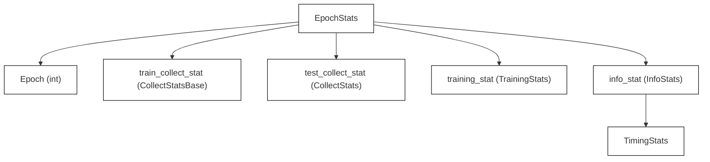

<!-- source: DeepWiki mcp.deepwiki.com · repo thu-ml/tianshou · page 2.4 Statistics and Collection Metrics · fetched 2026-10-30 -->

# Statistics and Collection Metrics

<details>
<summary>Relevant source files</summary>

The following files were used as context for generating this wiki page:

- [test/base/test_stats.py](test/base/test_stats.py)
- [tianshou/data/stats.py](tianshou/data/stats.py)
- [tianshou/env/atari/atari_wrapper.py](tianshou/env/atari/atari_wrapper.py)
- [tianshou/evaluation/rliable_evaluation.py](tianshou/evaluation/rliable_evaluation.py)
- [tianshou/highlevel/logger.py](tianshou/highlevel/logger.py)
- [tianshou/utils/logger/logger_base.py](tianshou/utils/logger/logger_base.py)
- [tianshou/utils/logger/tensorboard.py](tianshou/utils/logger/tensorboard.py)
- [tianshou/utils/logger/wandb.py](tianshou/utils/logger/wandb.py)
- [tianshou/utils/statistics.py](tianshou/utils/statistics.py)

</details>


This page describes Tianshou's data structures for tracking execution metrics, collection statistics, epoch summaries, and how metrics propagate through the logging architecture to backends like TensorBoard and Weights & Biases.

---

## Core Statistics Data Structures

Tianshou encapsulates training progress, timing, and episode summaries into structured dataclasses defined in `tianshou/data/stats.py`. These classes inherit from `DataclassPPrintMixin` for clean formatting [tianshou/data/stats.py:8]().

### `SequenceSummaryStats`
`SequenceSummaryStats` computes and holds summary indicators (`mean`, `std`, `max`, `min`) for a 1D sequence or NumPy array [tianshou/data/stats.py:18-43](). 
- `SequenceSummaryStats.from_sequence()` computes summary statistics over sequences or flattens multi-dimensional inputs with a warning [tianshou/data/stats.py:27-43]().
- `SequenceSummaryStats.from_single_value()` initializes stats where all metrics equal a single scalar value [tianshou/data/stats.py:46-47]().
- `compute_dim_to_summary_stats()` generates a dictionary mapping each dimension index to its respective `SequenceSummaryStats` for multi-dimensional arrays [tianshou/data/stats.py:50-61]().

### `TimingStats`
`TimingStats` tracks elapsed wall-clock times across training phases [tianshou/data/stats.py:65-80]():
- `total_time`: Total elapsed time [tianshou/data/stats.py:68]().
- `train_time`: Total training duration (collection plus update) [tianshou/data/stats.py:70]().
- `train_time_collect`: Time spent collecting training transitions [tianshou/data/stats.py:72]().
- `train_time_update`: Time spent updating model weights [tianshou/data/stats.py:74]().
- `test_time`: Total evaluation duration [tianshou/data/stats.py:76]().
- `update_speed`: Update throughput measured in environment steps per second [tianshou/data/stats.py:78]().

### `InfoStats` and `EpochStats`
- `InfoStats`: Aggregates global training counters including `update_step`, `best_score`, `best_reward`, `best_reward_std`, training/test steps and episodes, and nested `TimingStats` [tianshou/data/stats.py:83-105]().
- `EpochStats`: Bundles per-epoch telemetry, linking `epoch`, `train_collect_stat`, `test_collect_stat`, `training_stat`, and `info_stat` [tianshou/data/stats.py:108-122]().


*Diagram 1: Code Structure of `EpochStats` and Associated Telemetry Classes.*

Sources: `tianshou/data/stats.py` [tianshou/data/stats.py:1-122]()

---

## Collection Statistics (`CollectStats`)

Collectors measure environment rollout metrics and accumulate performance statistics during interaction loops. 

`CollectStats` records:
- `n_collected_steps`: Total environment steps executed during the collect call.
- `n_collected_episodes`: Total completed episodes.
- `collect_time`: Duration of the collection phase.
- `collect_speed`: Steps per second.
- `returns_stat`: A `SequenceSummaryStats` instance summarizing episode returns.
- `lens_stat`: A `SequenceSummaryStats` instance summarizing episode lengths.
- Distribution diagnostics such as `pred_dist_std_array` and `pred_dist_std_array_stat` computed from policy action distributions [test/base/test_stats.py:69-94]().

Sources: `tianshou/data/stats.py` [tianshou/data/stats.py:1-122](), `test/base/test_stats.py` [test/base/test_stats.py:69-94]()

---

## Metric Flow and Logging Architecture

Metrics flow from trainers and collectors into loggers through a unified interface defined in `tianshou/utils/logger/logger_base.py`.

### Logger Abstractions
- `BaseLogger`: Abstract base class managing logging intervals (`training_interval`, `test_interval`, `update_interval`, `info_interval`, `save_interval`) and defining logging methods [tianshou/utils/logger/logger_base.py:23-163]().
- `DataScope`: An enum categorizing log namespaces: `TRAINING`, `TEST`, `UPDATE`, and `INFO` [tianshou/utils/logger/logger_base.py:16-20]().
- `TensorboardLogger`: Uses `torch.utils.tensorboard.SummaryWriter` to write scalars, histograms, and figures to TensorBoard event files [tianshou/utils/logger/tensorboard.py:17-144]().
- `WandbLogger`: Integrates Weights & Biases (`wandb`), synchronizing tensorboard outputs and logging model checkpoints as W&B artifacts [tianshou/utils/logger/wandb.py:14-178]().
- `LoggerFactory` / `LoggerFactoryDefault`: High-level factory classes that instantiate concrete loggers (`TensorboardLogger` or `WandbLogger`) based on configuration settings [tianshou/highlevel/logger.py:13-111]().

```mermaid
graph TD
    Collector["Collector.collect()"] -->|CollectStats| Trainer["BaseTrainer"]
    Trainer -->|log_training_data()| BaseLogger["BaseLogger (Base class)"]
    Trainer -->|log_test_data()| BaseLogger
    Trainer -->|log_update_data()| BaseLogger
    Trainer -->|log_info_data()| BaseLogger
    
    BaseLogger -->|TensorboardLogger| TB["SummaryWriter / TensorBoard"]
    BaseLogger -->|WandbLogger| WB["wandb.init() / W&B Backend"]

    classDef default stroke:#000,fill:none;
```
*Diagram 2: Data Flow from Collectors and Trainers through `BaseLogger` to Logging Backends.*

Sources: `tianshou/utils/logger/logger_base.py` [tianshou/utils/logger/logger_base.py:1-163](), `tianshou/utils/logger/tensorboard.py` [tianshou/utils/logger/tensorboard.py:1-144](), `tianshou/utils/logger/wandb.py` [tianshou/utils/logger/wandb.py:1-178](), `tianshou/highlevel/logger.py` [tianshou/highlevel/logger.py:1-111]()

---

## Supporting Statistical Utilities

Tianshou provides general-purpose statistical helpers in `tianshou/utils/statistics.py` [tianshou/utils/statistics.py:1-114]():

| Utility Class | Description | Key Methods |
| :--- | :--- | :--- |
| `MovAvg` | Computes a sliding window moving average while automatically ignoring `NaN` and `inf` values. | `add()`, `get()`, `mean()`, `std()` [tianshou/utils/statistics.py:7-67]() |
| `RunningMeanStd` | Maintains running mean and variance for data streams using parallel algorithms (Welford's algorithm variant). | `update()`, `norm()` [tianshou/utils/statistics.py:69-114]() |

Sources: `tianshou/utils/statistics.py` [tianshou/utils/statistics.py:1-114]()

---

