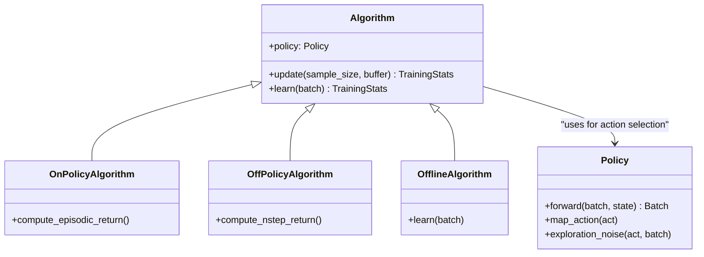

<!-- source: DeepWiki mcp.deepwiki.com · repo thu-ml/tianshou · page 3 Algorithm and Policy Framework · fetched 2026-10-30 -->

# Algorithm and Policy Framework

Relevant source files

The following files were used as context for generating this wiki page:

- [README.md](README.md)
- [docs/index.rst](docs/index.rst)
- [tianshou/algorithm/__init__.py](tianshou/algorithm/__init__.py)
- [tianshou/algorithm/algorithm_base.py](tianshou/algorithm/algorithm_base.py)
- [tianshou/algorithm/imitation/cql.py](tianshou/algorithm/imitation/cql.py)
- [tianshou/algorithm/multiagent/marl.py](tianshou/algorithm/multiagent/marl.py)
- [tianshou/data/buffer/buffer_base.py](tianshou/data/buffer/buffer_base.py)
- [tianshou/env/worker/__init__.py](tianshou/env/worker/__init__.py)
- [tianshou/env/worker/worker_base.py](tianshou/env/worker/worker_base.py)

The purpose of this page is to present Tianshou's v2 architecture, which establishes a clear architectural separation between **Algorithms** (responsible for training, loss computation, and optimization) and **Policies** (responsible for action selection and environment interaction) [README.md:13-18](). This page provides a high-level overview of the algorithm families and interfaces, serving as a parent guide to more detailed child pages.

For details on data handling and collection, see [Data Handling System](#2).

---

## 1. v2 Architecture: Algorithm vs. Policy Separation

In Tianshou v2, the legacy "God class" design where a single class handled both sampling/action selection and weight updates has been fully overhauled. The framework now cleanly separates concerns:

- **`Policy`**: Inherits from `torch.nn.Module` and defines the core mapping from observations to actions via `forward()` [tianshou/algorithm/algorithm_base.py:159-160](). It governs action bounds, scaling, and exploration noise.
- **`Algorithm`**: Encapsulates the training logic, loss functions, optimizer factories, and target network update rules. It operates on experience buffers via an `update()` procedure.

Sources:
- [tianshou/algorithm/algorithm_base.py:159-200]()
- [README.md:13-18]()

---

## 2. Algorithm Base and Policy Interfaces

The foundational base classes define strict type-level distinctions across on-policy, off-policy, and offline paradigms [README.md:17-18](). `Algorithm` subclasses coordinate data preprocessing hooks (`process_fn`), network updates (`learn`), and post-processing steps.

For full details on base classes, preprocessing hooks, and lagged/target network synchronization, see [Algorithm Base and Policy Interfaces](#3.1).

Sources:
- [tianshou/algorithm/algorithm_base.py:1-250]()

---

## 3. Value-Based Algorithms

Value-based algorithms estimate action-value functions ($Q$-functions) or distributional returns to derive discrete or continuous greedy policies. Tianshou implements standard and advanced variants such as DQN, Double DQN, Dueling DQN, Branching DQN, C51, Rainbow, QRDQN, IQN, and FQF.

For full implementation details, architectures, and associated policies, see [Value-Based Algorithms](#3.2).

Sources:
- [README.md:38-46]()
- [docs/index.rst:7-15]()

---

## 4. Policy Gradient Algorithms

Policy gradient methods directly parameterize the policy distribution and optimize objectives via gradient ascent. Tianshou supports vanilla REINFORCE, Advantage Actor-Critic (A2C), Proximal Policy Optimization (PPO), Natural Policy Gradient (NPG), and Trust Region Policy Optimization (TRPO), utilizing Generalized Advantage Estimation (GAE) for return and advantage computations.

For details on return computation and loss formulations, see [Policy Gradient Algorithms](#3.3).

Sources:
- [README.md:47-51]()
- [docs/index.rst:16-20]()

---

## 5. Actor-Critic Off-Policy Algorithms

Continuous and discrete actor-critic algorithms combine policy updates with off-policy sample efficiency via replay buffers and target networks. Supported algorithms include DDPG, TD3, SAC, Discrete SAC, and Randomized Ensembled Double Q-Learning (REDQ), complete with entropy regularization ($\alpha$) tuning and Polyak averaging mixins.

For configuration parameters and target network mixins, see [Actor-Critic Off-Policy Algorithms](#3.4).

Sources:
- [README.md:52-56]()
- [docs/index.rst:21-25]()

---

## 6. Offline and Imitation Learning

Offline and imitation learning algorithms learn policies entirely from static datasets without environment interaction during training. Tianshou provides algorithms such as Behaviour Cloning (`ImitationPolicy`), BCQ, CQL, TD3+BC, Discrete BCQ/CQL/CRR, and Generative Adversarial Imitation Learning (GAIL).

For dataset processing and algorithmic regularizers, see [Offline and Imitation Learning](#3.5).

Sources:
- [README.md:57-64]()
- [docs/index.rst:26-33]()

---

## 7. Model-Based and Exploration Wrappers

To facilitate model-based planning and advanced exploration, Tianshou provides wrappers and algorithms including Posterior Sampling Reinforcement Learning (PSRL) and Intrinsic Curiosity Module (ICM) wrappers for on-policy and off-policy training, alongside custom exploration noise processes.

For wrapper integrations and transition models, see [Model-Based and Exploration Wrappers](#3.6).

Sources:
- [README.md:67-68]()
- [docs/index.rst:34-35]()

---

## 8. Multi-Agent Algorithms

Multi-Agent Reinforcement Learning (MARL) is supported through decentralized/centralized policy managers (`MultiAgentPolicyManager` / `marl.py`) and seamless integration with `PettingZoo` environments, enabling multi-agent coordination and competitive self-play.

For agent observation routing and MARL training loops, see [Multi-Agent Algorithms](#3.7).

Sources:
- [tianshou/algorithm/multiagent/marl.py:1-100]()

---

