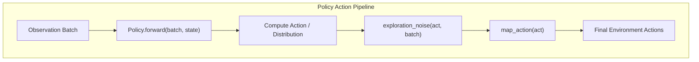
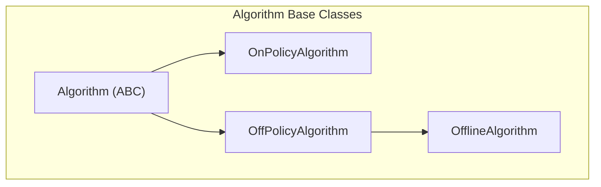
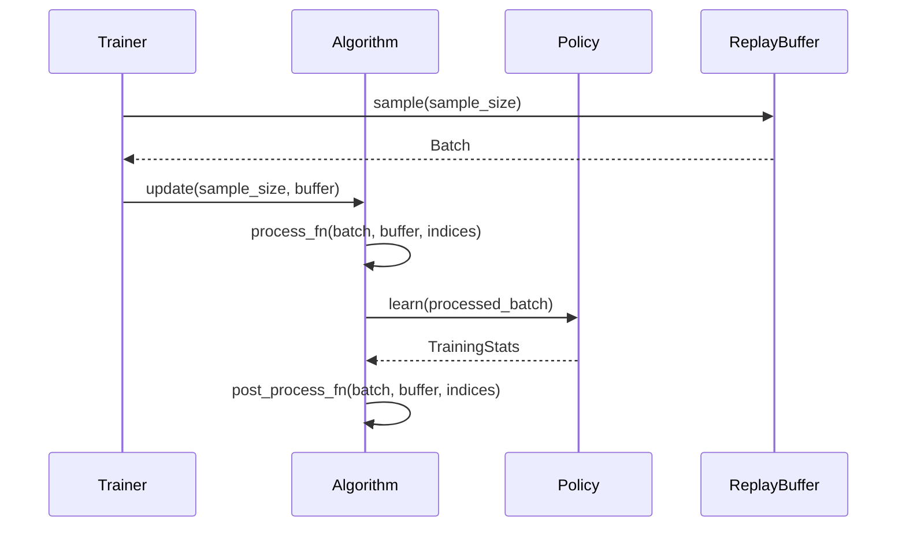

<!-- source: DeepWiki mcp.deepwiki.com · repo thu-ml/tianshou · page 3.1 Algorithm Base and Policy Interfaces · fetched 2026-10-30 -->

# Algorithm Base and Profile Interfaces

<details>
<summary>Relevant source files</summary>

The following files were used as context for generating this wiki page:

- [test/base/test_policy.py](test/base/test_policy.py)
- [test/base/test_returns.py](test/base/test_returns.py)
- [tianshou/algorithm/algorithm_base.py](tianshou/algorithm/algorithm_base.py)
- [tianshou/algorithm/imitation/cql.py](tianshou/algorithm/imitation/cql.py)
- [tianshou/algorithm/modelfree/ddpg.py](tianshou/algorithm/modelfree/ddpg.py)
- [tianshou/algorithm/modelfree/sac.py](tianshou/algorithm/modelfree/sac.py)
- [tianshou/algorithm/modelfree/td3.py](tianshou/algorithm/modelfree/td3.py)
- [tianshou/data/buffer/buffer_base.py](tianshou/data/buffer/buffer_base.py)
- [tianshou/utils/lagged_network.py](tianshou/utils/lagged_network.py)

</details>


## Purpose and Scope
This page details the core architectural separation introduced in Tianshou v2 between **Policies** (stateless or stateful action-selection modules) and **Algorithms** (training engines that handle loss computation, gradient descent, and buffer updates). It covers the base classes (`Algorithm`, `OnPolicyAlgorithm`, `OffPolicyAlgorithm`, `OfflineAlgorithm`), the `Policy` interface, preprocessing and update hooks, and lagged/target network management (`LaggedNetworkCollection`).

Sources: `[tianshou/algorithm/algorithm_base.py:1-250]()`, `[tianshou/utils/lagged_network.py:1-87]()`

---

## 1. Architecture of Policy and Algorithm Separation

In Tianshou v2, the monolithic policy classes of v1 have been decoupled into two distinct component types:
1. **`Policy`**: Inherits from PyTorch's `torch.nn.Module` and focuses strictly on computing actions from observations, handling action scaling, bounding, and optional exploration noise during rollouts.
2. **`Algorithm`**: Manages the training workflow, optimizers (`OptimizerFactory`), loss functions, target network synchronization, and parameter updates given experience batches.

```mermaid
classDiagram
    class "nn.Module" {
      +forward()
      +parameters()
      +train(mode)
      +eval()
    }
    
    class "Policy" {
      +action_space: gym.Space
      +observation_space: gym.Space
      +action_scaling: bool
      +action_bound_method: str
      +forward(batch, state)*
      +map_action(act)
      +exploration_noise(act, batch)
    }
    
    class "Algorithm" {
      +policy: Policy
      +optim: OptimizerFactory
      +learn(batch)*
      +process_fn(batch, buffer, indices)
      +update(sample_size, buffer)
    }
    
    class "OnPolicyAlgorithm" {
      +process_fn()
    }
    
    class "OffPolicyAlgorithm" {
      +critic: nn.Module
      +critic_old: nn.Module
      +tau: float
      +gamma: float
    }
    
    class "OfflineAlgorithm" {
      +learn(batch)
    }
    
    "nn.Module" <|-- "Policy"
    "Algorithm" --> "Policy" : "contains"
    "Algorithm" <|-- "OnPolicyAlgorithm"
    "Algorithm" <|-- "OffPolicyAlgorithm"
    "OffPolicyAlgorithm" <|-- "OfflineAlgorithm"
```

Sources: `[tianshou/algorithm/algorithm_base.py:159-250]()`, `[tianshou/utils/lagged_network.py:1-87]()`

---

## 2. The `Policy` Interface

The `Policy` abstract base class provides the fundamental mapping from observations to actions (`[tianshou/algorithm/algorithm_base.py:159-170]()`). All concrete policy implementations (e.g., discrete actors, probabilistic continuous actors, deterministic policies) inherit from it.

### Core Policy Responsibilities



Sources: `[tianshou/algorithm/algorithm_base.py:159-246]()`, `[tianshou/algorithm/modelfree/ddpg.py:45-112]()`

### Key Methods and Properties

| Method / Attribute | Purpose |
|----------------|---------|
| `forward(batch, state)` | Abstract method returning actions, distributions, and hidden states. |
| `map_action(act)` | Scales normalized actions from `[-1, 1]` to the environment's `action_space` range. |
| `exploration_noise(act, batch)` | Injects noise (e.g., Gaussian or Ornstein-Uhlenbeck) into continuous actions. |
| `is_within_training_step` | Boolean flag indicating whether the policy is currently executing a training step. |

Sources: `[tianshou/algorithm/algorithm_base.py:159-246]()`, `[test/base/test_policy.py:89-105]()`

---

## 3. Algorithm Base Classes

Algorithms encapsulate the learning logic. Tianshou categorizes algorithms into three main training paradigms:

### Algorithm Hierarchy



Sources: `[tianshou/algorithm/algorithm_base.py:1-150]()`

- **`Algorithm`**: The root abstract base class defining optimizers, device management, and state dict loading/saving hooks.
- **`OnPolicyAlgorithm`**: Specialized for on-policy methods (e.g., PPO, A2C) where experience collected by the current policy is used once (or for a few epochs) and then discarded.
- **`OffPolicyAlgorithm`**: Specialized for off-policy methods (e.g., DQN, DDPG, SAC, TD3) utilizing a replay buffer, n-step returns, and lagged target networks.
- **`OfflineAlgorithm`**: Extends off-policy algorithms for static datasets (e.g., CQL, BCQ) without online environment interaction during learning.

Sources: `[tianshou/algorithm/algorithm_base.py:1-150]()`, `[tianshou/algorithm/imitation/cql.py:32-35]()`

---

## 4. Preprocessing and Update Hooks

Algorithms and policies interact with experience buffers via explicit hooks during training loops.



Sources: `[tianshou/algorithm/algorithm_base.py:1-250]()`

- **`process_fn(batch, buffer, indices)`**: Pre-processes sampled batch data (e.g., computing n-step returns or Generalized Advantage Estimation) before feeding it to the optimization step.
- **`learn(batch)`**: Computes loss tensors, performs backpropagation, and steps optimizers. Returns a `TrainingStats` instance.
- **`post_process_fn(batch, buffer, indices)`**: Updates buffer priorities (in Prioritized Experience Replay) based on recent TD-errors.

Sources: `[tianshou/algorithm/algorithm_base.py:1-250]()`

---

## 5. Lagged and Target Networks

Off-policy algorithms rely on target or lagged networks to stabilize Q-learning updates. Tianshou provides a robust utility module `tianshou.utils.lagged_network` to manage target network copies and updates (`[tianshou/utils/lagged_network.py:1-87]()`).

### Lagged Network Management Architecture

```mermaid
classDiagram
    class "LaggedNetworkCollection" {
      -_lagged_network_pairs: list[LaggedNetworkPair]
      +add_lagged_network(source) EvalModeModuleWrapper
      +polyak_parameter_update(tau)
      +full_parameter_update()
    }
    
    class "LaggedNetworkPair" {
      +target: torch.nn.Module
      +source: torch.nn.Module
    }
    
    class "EvalModeModuleWrapper" {
      +module: torch.nn.Module
      +forward(*args, **kwargs)
      +train(mode)
    }
    
    "LaggedNetworkCollection" --> "LaggedNetworkPair" : manages
    "LaggedNetworkPair" --> "EvalModeModuleWrapper" : wraps target
```

Sources: `[tianshou/utils/lagged_network.py:47-87]()`

### Key Components

- **`LaggedNetworkCollection`**: Manages a collection of source-target network pairs, automating parameter synchronization (`[tianshou/utils/lagged_network.py:53-87]()`).
- **`EvalModeModuleWrapper`**: Wraps target networks, forcing them permanently into evaluation mode (`eval()`) regardless of global training state toggles (`[tianshou/utils/lagged_network.py:21-45]()`).
- **Polyak Averaging (`polyak_parameter_update`)**: Soft-updates target network parameters using the formula $\theta_{\text{target}} \leftarrow \tau \theta_{\text{source}} + (1 - \tau) \theta_{\text{target}}$ (`[tianshou/utils/lagged_network.py:8-19]()`).
- **Full Parameter Update (`full_parameter_update`)**: Performs hard periodic copies of source parameters into target networks (`[tianshou/utils/lagged_network.py:81-87]()`).

Sources: `[tianshou/utils/lagged_network.py:1-87]()`

---

## 6. Training Statistics

Training metrics are structured via `TrainingStats` and `TrainingStatsWrapper` dataclasses (`[tianshou/algorithm/algorithm_base.py:64-158]()`).

```mermaid
classDiagram
    class "TrainingStats" {
      +train_time: float
      +smoothed_loss: dict
      +get_loss_stats_dict() dict
    }
    
    class "TrainingStatsWrapper" {
      +wrapped_stats: TrainingStats
      +__getattr__(name)
      +__setattr__(name, value)
    }
    
    class "SACTrainingStats" {
      +actor_loss: float
      +critic1_loss: float
      +critic2_loss: float
      +alpha: float
      +alpha_loss: float
    }
    
    "TrainingStats" <|-- "TrainingStatsWrapper"
    "TrainingStats" <|-- "SACTrainingStats"
```

Sources: `[tianshou/algorithm/algorithm_base.py:64-158]()`, `[tianshou/algorithm/modelfree/sac.py:43-50]()`

Algorithms return specialized stats (e.g., `SACTrainingStats`, `TD3TrainingStats`, `CQLTrainingStats`) containing optimizer losses, entropy coefficients (`alpha`), and timing details which flow directly into loggers (`[tianshou/algorithm/modelfree/sac.py:43-50]()`, `[tianshou/algorithm/imitation/cql.py:23-29]()`).

Sources: `[tianshou/algorithm/algorithm_base.py:64-158]()`, `[tianshou/algorithm/modelfree/sac.py:43-50]()`, `[tianshou/algorithm/imitation/cql.py:23-29]()`

---

