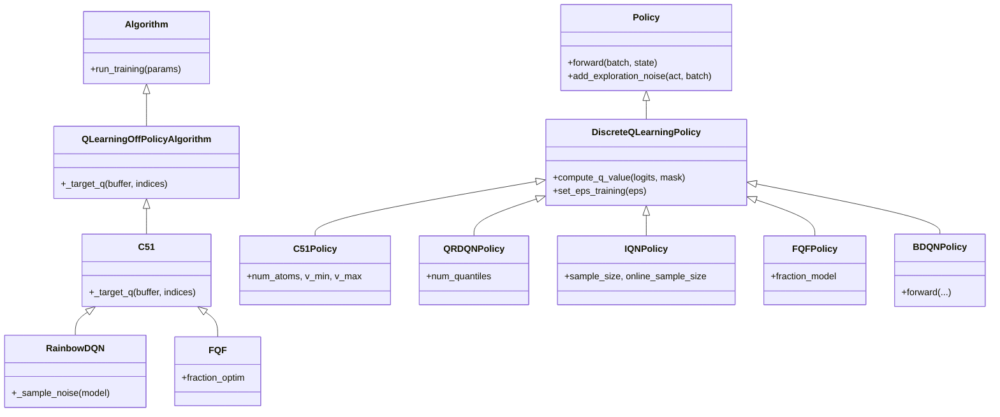
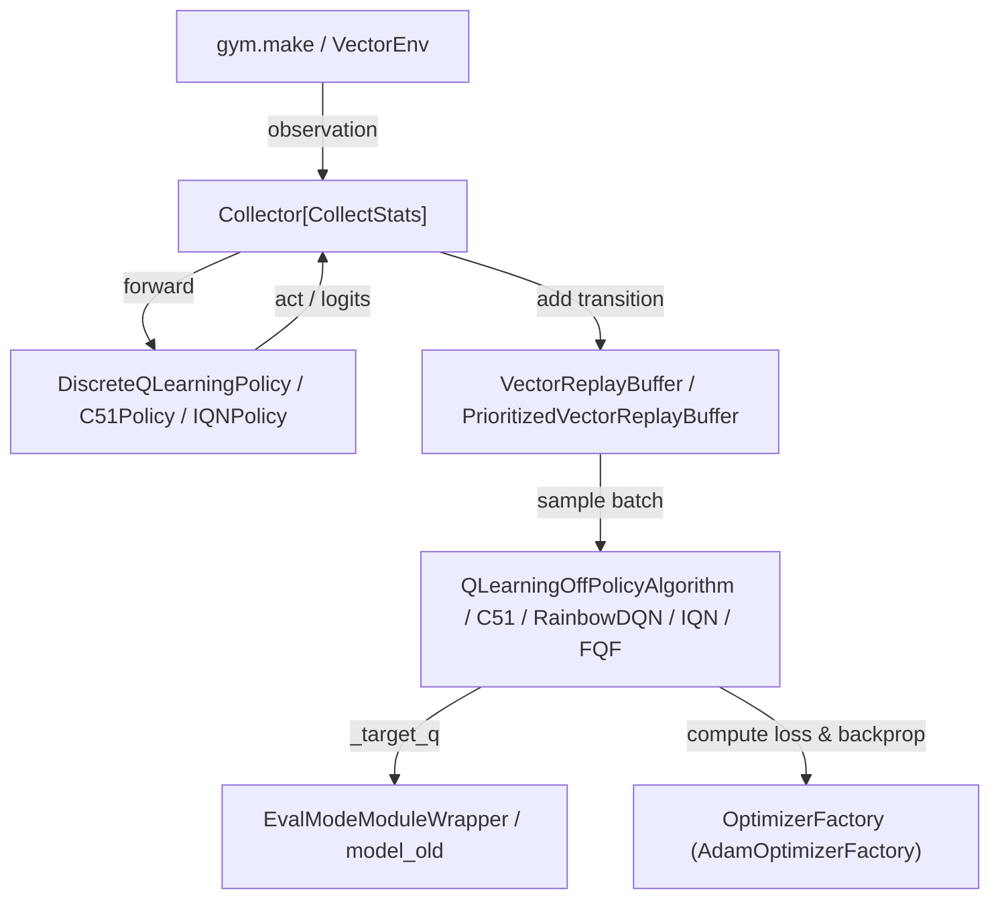

<!-- source: DeepWiki mcp.deepwiki.com · repo thu-ml/tianshou · page 3.2 Value-Based Algorithms · fetched 2026-10-30 -->

# Value-Based Algorithms

Relevant source files

The following files were used as context for generating this wiki page:

- [test/discrete/test_c51.py](test/discrete/test_c51.py)
- [test/discrete/test_fqf.py](test/discrete/test_fqf.py)
- [test/discrete/test_iqn.py](test/discrete/test_iqn.py)
- [test/discrete/test_qrdqn.py](test/discrete/test_qrdqn.py)
- [test/discrete/test_rainbow.py](test/discrete/test_rainbow.py)
- [tianshou/algorithm/imitation/discrete_bcq.py](tianshou/algorithm/imitation/discrete_bcq.py)
- [tianshou/algorithm/modelfree/bdqn.py](tianshou/algorithm/modelfree/bdqn.py)
- [tianshou/algorithm/modelfree/dqn.py](tianshou/algorithm/modelfree/dqn.py)
- [tianshou/algorithm/modelfree/iqn.py](tianshou/algorithm/modelfree/iqn.py)
- [tianshou/algorithm/modelfree/rainbow.py](tianshou/algorithm/modelfree/rainbow.py)
- [tianshou/algorithm/modelfree/reinforce.py](tianshou/algorithm/modelfree/reinforce.py)
- [tianshou/algorithm/random.py](tianshou/algorithm/random.py)
- [tianshou/data/buffer/__init__.py](tianshou/data/buffer/__init__.py)

This page documents the value-based reinforcement learning algorithms and their corresponding policies implemented in Tianshou v2. Value-based methods estimate value functions (such as Q-values or return distributions) over discrete action spaces and derive greedy or epsilon-greedy policies from them. 

In Tianshou v2, value-based methods follow the explicit separation between **Algorithm** (which manages optimization, loss computation, target networks, and batch updates) and **Policy** (which handles action selection, forward evaluation, action masking, and exploration noise).

---

## Core Architecture and Class Hierarchy

Value-based algorithms inherit from `OffPolicyAlgorithm` or specialized subclasses like `C51`, while their policies inherit from `DiscreteQLearningPolicy` or specialized distribution-based policy classes.

### Diagram: Value-Based Algorithm & Policy Class Hierarchy (NLS to CES)

Sources: [tianshou/algorithm/algorithm_base.py:1-50](), [tianshou/algorithm/modelfree/dqn.py:14-143](), [tianshou/algorithm/modelfree/bdqn.py:29-153](), [tianshou/algorithm/modelfree/rainbow.py:18-101](), [test/discrete/test_iqn.py:10-118]()

---

## Data Flow in Value-Based Execution

Value-based algorithms coordinate between environment collectors, replay buffers, policy evaluation, and optimizer updates during training and inference.

### Diagram: Value-Based Execution and Training Data Flow (NLS to CES)

Sources: [test/discrete/test_iqn.py:79-141](), [test/discrete/test_c51.py:80-139](), [test/discrete/test_qrdqn.py:80-136]()

---

## Deep Q-Network (DQN) and Branching Dueling Q-Network (BDQN)

### DQN & DiscreteQLearningPolicy
Standard Deep Q-Learning is represented by `DiscreteQLearningPolicy` combined with an off-policy Q-learning algorithm framework. 
- **Action Selection**: Implements epsilon-greedy exploration via `add_exploration_noise` and handles action masking via `compute_q_value` [tianshou/algorithm/modelfree/dqn.py:101-152]().
- **Double DQN**: Decouples action selection from target evaluation to mitigate overestimation bias [tianshou/algorithm/modelfree/bdqn.py:139-144]().

### BDQN (Branching Dueling Q-Network)
BDQN (`BDQNPolicy` and `BDQN`) is designed for high-dimensional discrete action spaces with factorized action branches [tianshou/algorithm/modelfree/bdqn.py:29-153]().
- **Model**: Utilizes a `BranchingNet` mapping observations to multi-branch action values [tianshou/algorithm/modelfree/bdqn.py:29-40]().
- **Returns**: Implements 1-step returns tailored for branching architectures [tianshou/algorithm/modelfree/bdqn.py:145-152]().

Sources: [tianshou/algorithm/modelfree/dqn.py:39-168](), [tianshou/algorithm/modelfree/bdqn.py:29-153]()

---

## Distributional Reinforcement Learning Algorithms

Tianshou provides comprehensive support for distributional RL algorithms, modeling full return distributions rather than expected values.

### C51 (Categorical DQN)
- **Class**: `C51Policy` and `C51` algorithm [test/discrete/test_c51.py:11-116]().
- **Mechanism**: Approximates the return distribution over a discrete set of fixed atoms (`num_atoms`, `v_min`, `v_max`) [test/discrete/test_c51.py:40-42, 100-116]().

### Quantile Regression DQN (QRDQN)
- **Class**: `QRDQNPolicy` and `QRDQN` algorithm [test/discrete/test_qrdqn.py:10-113]().
- **Mechanism**: Models return distributions using quantile regression with a fixed number of quantiles (`num_quantiles`) [test/discrete/test_qrdqn.py:38, 99-113]().

### Implicit Quantile Networks (IQN)
- **Class**: `IQNPolicy` and `IQN` algorithm [test/discrete/test_iqn.py:10-118]().
- **Mechanism**: Implicitly parameterizes the quantile function by sampling quantile fractions dynamically during training and inference (`sample_size`, `online_sample_size`, `target_sample_size`) [test/discrete/test_iqn.py:40-42, 103-118]().

### Fully Parameterized Quantile Function (FQF)
- **Class**: `FQFPolicy` and `FQF` algorithm [test/discrete/test_fqf.py:10-122]().
- **Mechanism**: Extends IQN by learning the quantile fractions themselves via a `FractionProposalNetwork` optimized with a separate optimizer (`fraction_optim`) [test/discrete/test_fqf.py:104-122]().

### Rainbow DQN
- **Class**: `RainbowDQN` (inheriting from `C51`) [tianshou/algorithm/modelfree/rainbow.py:18-19]().
- **Mechanism**: Integrates C51 distributional RL with Double Q-learning, prioritized experience replay, dueling networks, multi-step returns, and `NoisyLinear` layers for parametric exploration [test/discrete/test_rainbow.py:97-125](), [tianshou/algorithm/modelfree/rainbow.py:67-101]().

Sources: [test/discrete/test_c51.py:11-116](), [test/discrete/test_qrdqn.py:10-113](), [test/discrete/test_iqn.py:10-118](), [test/discrete/test_fqf.py:10-122](), [test/discrete/test_rainbow.py:11-125](), [tianshou/algorithm/modelfree/rainbow.py:18-101]()

---

