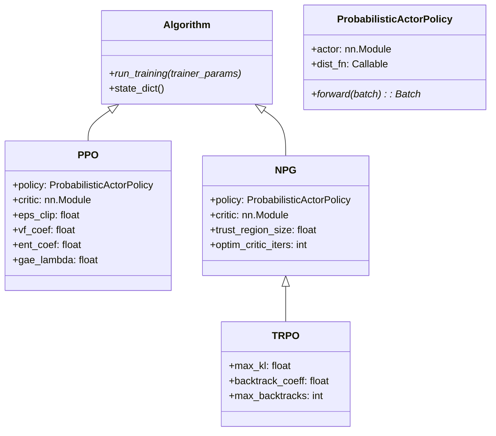
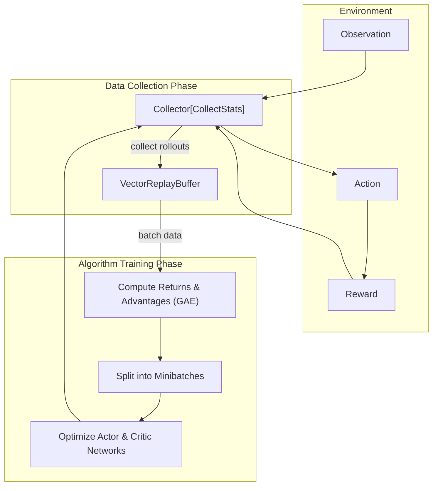
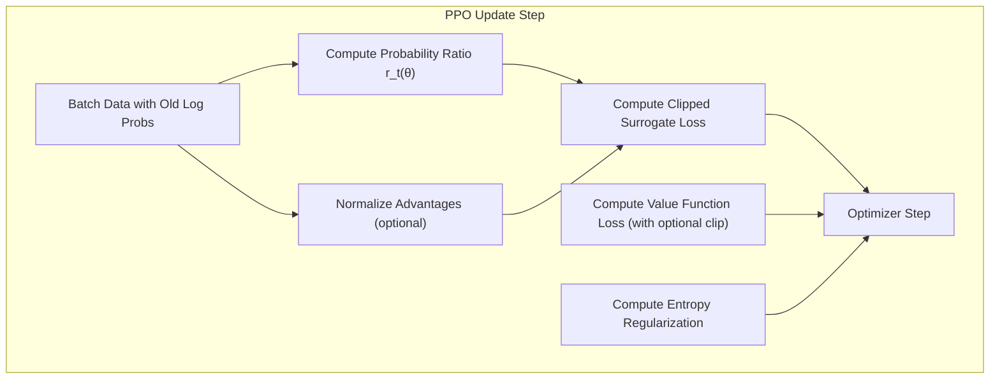
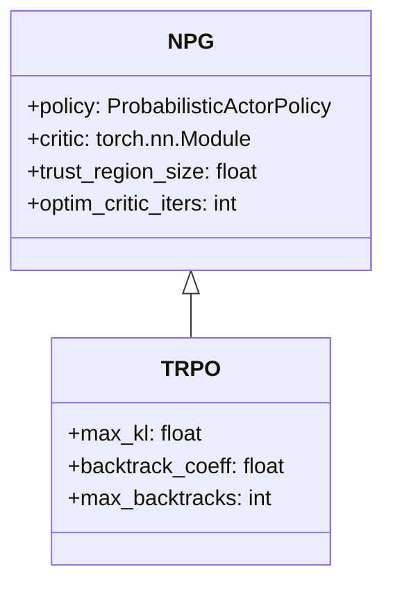

<!-- source: DeepWiki mcp.deepwiki.com · repo thu-ml/tianshou · page 3.3 Policy Gradient Algorithms · fetched 2026-10-30 -->

# Policy Gradient Algorithms

<details>
<summary>Relevant source files</summary>

The following files were used as context for generating this wiki page:

- [test/continuous/test_ddpg.py](test/continuous/test_ddpg.py)
- [test/continuous/test_npg.py](test/continuous/test_npg.py)
- [test/continuous/test_ppo.py](test/continuous/test_ppo.py)
- [test/continuous/test_td3.py](test/continuous/test_td3.py)
- [test/continuous/test_trpo.py](test/continuous/test_trpo.py)
- [test/discrete/test_dqn.py](test/discrete/test_dqn.py)
- [test/discrete/test_drqn.py](test/discrete/test_drqn.py)
- [tianshou/algorithm/imitation/discrete_cql.py](tianshou/algorithm/imitation/discrete_cql.py)
- [tianshou/algorithm/modelfree/discrete_sac.py](tianshou/algorithm/modelfree/discrete_sac.py)
- [tianshou/algorithm/modelfree/fqf.py](tianshou/algorithm/modelfree/fqf.py)
- [tianshou/algorithm/modelfree/qrdqn.py](tianshou/algorithm/modelfree/qrdqn.py)
- [tianshou/algorithm/modelfree/trpo.py](tianshou/algorithm/modelfree/trpo.py)

</details>


This page documents the policy gradient algorithms implemented in Tianshou v2. Policy gradient methods are a family of reinforcement learning algorithms that directly optimize the policy by following the gradient of expected return. This page covers REINFORCE, Advantage Actor-Critic (A2C), Proximal Policy Optimization (PPO), Natural Policy Gradient (NPG), Trust Region Policy Optimization (TRPO), and generalized advantage estimation (GAE). For off-policy actor-critic algorithms, see [Actor-Critic Off-Policy Algorithms](#3.4).

## Policy Gradient Framework in Tianshou

In Tianshou v2, policy gradient algorithms and their corresponding action-selection policies are implemented under `tianshou.algorithm` [test/continuous/test_ppo.py:11-14](). Algorithms encapsulate the training and optimization logic, while policies handle action selection during environment interactions.



Sources: [test/continuous/test_ppo.py:11-130](), [test/continuous/test_npg.py:12-129](), [test/continuous/test_trpo.py:12-131](), [tianshou/algorithm/modelfree/trpo.py:23-120]()

## Policy Gradient Algorithm Workflow

The data collection and optimization workflow for on-policy gradient algorithms in Tianshou relies on collectors gathering complete trajectories or fixed-length rollouts into vector replay buffers, followed by policy updates using advantage estimation.



Sources: [test/continuous/test_ppo.py:131-137](), [test/continuous/test_npg.py:130-136](), [test/continuous/test_trpo.py:133-138]()

## REINFORCE (Vanilla Policy Gradient) and Probabilistic Actor Policy

REINFORCE relies on Monte Carlo return estimation to weight action log probabilities. In Tianshou, probabilistic action selection for policy gradient methods is managed via `ProbabilisticActorPolicy`, which takes an actor network and a distribution function (`dist_fn`) to construct torch distributions (such as `Independent(Normal(...), 1)` or categorical distributions) [test/continuous/test_ppo.py:106-114]().

### Implementation Details

1. **Action Generation**: `ProbabilisticActorPolicy.forward` evaluates the actor network on observation batches to obtain distribution parameters, samples actions (or evaluates deterministic modes during evaluation), and records log probabilities [test/continuous/test_ppo.py:110-114]().
2. **Loss Computation**: The policy gradient loss is weighted by the episodic return-to-go $G_t$:
   $$\mathcal{L}(\theta) = -\mathbb{E} \left[ \sum_t \log \pi_\theta(a_t | s_t) G_t \right]$$

Sources: [test/continuous/test_ppo.py:110-114]()

## Advantage Actor-Critic (A2C)

A2C incorporates a critic network estimating state values $V(s)$ to compute advantages, significantly reducing the variance of policy gradient updates compared to pure Monte Carlo returns.

### Key Features

- **Actor-Critic Separation**: Actor outputs action distribution parameters; critic outputs scalar state values.
- **Generalized Advantage Estimation (GAE)**: Balances bias and variance across temporal differences.
- **Entropy Regularization**: Weighted by `ent_coef` to encourage exploration.
- **Value Function Loss**: Mean squared error between predicted values and target returns, weighted by `vf_coef`.

Sources: [test/continuous/test_ppo.py:90-130]()

## Proximal Policy Optimization (PPO)

PPO is implemented in the `PPO` algorithm class [test/continuous/test_ppo.py:115](). It stabilizes training by clipping the probability ratio between the current and old policies.

### Core Components and Hyperparameters

- **Clipped Surrogate Objective**: Constrains policy updates using `eps_clip` ($\epsilon$) [test/continuous/test_ppo.py:50]():
  $$L^{CLIP}(\theta) = \hat{\mathbb{E}}_t \left[ \min(r_t(\theta)\hat{A}_t, \text{clip}(r_t(\theta), 1-\epsilon, 1+\epsilon)\hat{A}_t) \right]$$
- **Value Clipping**: Option (`value_clip=1`) to clip value function loss and prevent destructive updates [test/continuous/test_ppo.py:55]().
- **Advantage Normalization**: Option (`advantage_normalization=1`) to scale advantages per mini-batch [test/continuous/test_ppo.py:56]().
- **GAE Parameter**: Controlled via `gae_lambda` [test/continuous/test_ppo.py:52]().



Sources: [test/continuous/test_ppo.py:48-60](), [test/continuous/test_ppo.py:115-130]()

## Natural Policy Gradient (NPG) and Trust Region Policy Optimization (TRPO)

Tianshou also implements second-order policy gradient methods that respect trust region constraints: Natural Policy Gradient (`NPG`) [test/continuous/test_npg.py:12]() and Trust Region Policy Optimization (`TRPO`) [tianshou/algorithm/modelfree/trpo.py:23]().

### Trust Region Mechanics

- **NPG**: Uses the Fisher Information Matrix to compute natural gradients, constrained by a trust region size $\delta$ (`trust_region_size`) [test/continuous/test_npg.py:55]().
- **TRPO**: Extends NPG by enforcing a strict KL-divergence constraint (`max_kl`) with backtracking line search (`backtrack_coeff`, `max_backtracks`) to ensure monotonic improvement [tianshou/algorithm/modelfree/trpo.py:32-34]().
- **Critic Optimization**: Performs multiple critic optimization iterations (`optim_critic_iters`) per actor update to ensure accurate value estimation [tianshou/algorithm/modelfree/trpo.py:35]().



Sources: [test/continuous/test_npg.py:12-56](), [tianshou/algorithm/modelfree/trpo.py:23-42]()

## GAE-Based Return Computation

Generalized Advantage Estimation (GAE) computes advantages $\hat{A}_t^{\text{GAE}(\gamma, \lambda)}$ by combining temporal difference residuals $\delta_t^V$:
$$\delta_t^V = r_t + \gamma V(s_{t+1}) - V(s_t)$$
$$\hat{A}_t^{\text{GAE}(\gamma, \lambda)} = \sum_{l=0}^{\infty} (\gamma \lambda)^l \delta_{t+l}^V$$

By adjusting `gae_lambda` ($\lambda$) between $0$ (high bias, low variance TD error) and $1$ (low bias, high variance Monte Carlo return), algorithms like PPO, A2C, NPG, and TRPO achieve optimal bias-variance tradeoffs for policy updates.

Sources: [test/continuous/test_ppo.py:52](), [test/continuous/test_npg.py:51](), [tianshou/algorithm/modelfree/trpo.py:38]()

## Usage Examples

### Setting up PPO in Continuous Control

The following snippet demonstrates setting up PPO with `ProbabilisticActorPolicy` and `ContinuousCritic` for `Pendulum-v1`:

```python
net = Net(state_shape=args.state_shape, hidden_sizes=args.hidden_sizes)
actor = ContinuousActorProbabilistic(
    preprocess_net=net, action_shape=args.action_shape, unbounded=True
).to(args.device)
critic = ContinuousCritic(
    preprocess_net=Net(state_shape=args.state_shape, hidden_sizes=args.hidden_sizes),
).to(args.device)

def dist(loc_scale: tuple[torch.Tensor, torch.Tensor]) -> Distribution:
    loc, scale = loc_scale
    return Independent(Normal(loc, scale), 1)

policy = ProbabilisticActorPolicy(
    actor=actor,
    dist_fn=dist,
    action_space=env.action_space,
)

algorithm = PPO(
    policy=policy,
    critic=critic,
    optim=AdamOptimizerFactory(lr=args.lr),
    gamma=args.gamma,
    eps_clip=args.eps_clip,
    vf_coef=args.vf_coef,
    ent_coef=args.ent_coef,
    gae_lambda=args.gae_lambda,
)
```

Sources: [test/continuous/test_ppo.py:89-130]()

Sources: [test/continuous/test_ppo.py](), [test/continuous/test_npg.py](), [test/continuous/test_trpo.py](), [tianshou/algorithm/modelfree/trpo.py]()

---

