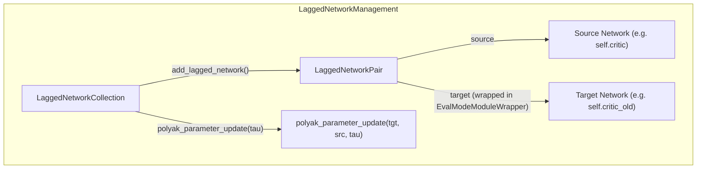
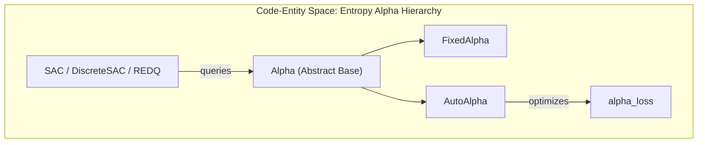
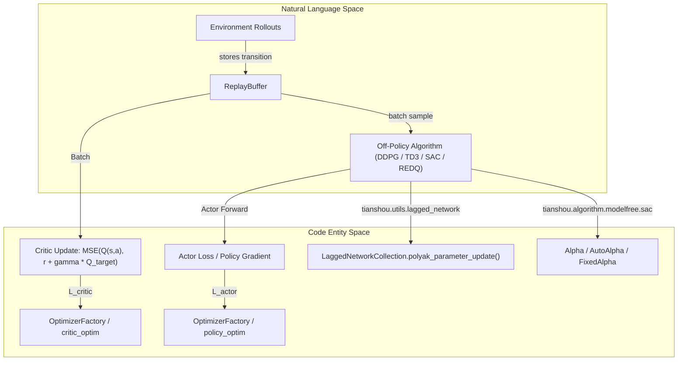

<!-- source: DeepWiki mcp.deepwiki.com · repo thu-ml/tianshou · page 3.4 Actor-Critic Off-Policy Algorithms · fetched 2026-10-30 -->

# Actor-Critic Off-Policy Algorithms

Relevant source files

The following files were used as context for generating this wiki page:

- [test/continuous/test_redq.py](test/continuous/test_redq.py)
- [test/discrete/test_discrete_sac.py](test/discrete/test_discrete_sac.py)
- [test/offline/gather_pendulum_data.py](test/offline/gather_pendulum_data.py)
- [test/offline/test_bcq.py](test/offline/test_bcq.py)
- [test/offline/test_cql.py](test/offline/test_cql.py)
- [tianshou/algorithm/modelfree/ddpg.py](tianshou/algorithm/modelfree/ddpg.py)
- [tianshou/algorithm/modelfree/sac.py](tianshou/algorithm/modelfree/sac.py)
- [tianshou/algorithm/modelfree/td3.py](tianshou/algorithm/modelfree/td3.py)
- [tianshou/utils/lagged_network.py](tianshou/utils/lagged_network.py)

This document details the off-policy actor-critic algorithm implementations in Tianshou v2. Off-policy actor-critic methods leverage experience replay buffers to train parameterized actor (policy) networks and critic (value) networks concurrently. This page covers `DDPG`, `TD3`, `SAC`, `DiscreteSAC`, and `REDQ`, alongside core supporting infrastructure such as target network management (`LaggedNetworkCollection`) and entropy temperature control (`Alpha`, `AutoAlpha`, `FixedAlpha`).

---

## 1. Target Network Management and Mixins

Off-policy algorithms rely on target networks (lagged copies of the source networks) to stabilize temporal difference (TD) target calculations. Tianshou encapsulates target network tracking and updates within `tianshou.utils.lagged_network`.

The core components include:
- `LaggedNetworkPair`: A dataclass holding a reference to a `target` model and a `source` model [tianshou/utils/lagged_network.py:47-50]().
- `LaggedNetworkCollection`: Manages a collection of lagged networks, providing automated Polyak averaging (`polyak_parameter_update`) and exact copying (`full_parameter_update`) [tianshou/utils/lagged_network.py:53-87]().
- `EvalModeModuleWrapper`: Wraps target networks to enforce `eval()` mode during forward passes, ensuring batch normalization and dropout layers behave deterministically [tianshou/utils/lagged_network.py:21-44]().
- `polyak_parameter_update`: Executes soft updates via the formula $\tau \cdot \text{src} + (1 - \tau) \cdot \text{tgt}$ [tianshou/utils/lagged_network.py:8-19]().

Sources: [tianshou/utils/lagged_network.py:8-87]()

---

## 2. Entropy Temperature Alpha Handling (`Alpha`, `AutoAlpha`, `FixedAlpha`)

Entropy regularization is central to Soft Actor-Critic (`SAC`) and related algorithms. Tianshou defines an abstract base class `Alpha` and concrete implementations for static and automatic entropy tuning in `tianshou.algorithm.modelfree.sac`.

- `Alpha`: Abstract base class defining the `value` property and `update(entropy)` method [tianshou/algorithm/modelfree.sac:134-160]().
- `FixedAlpha`: Maintains a constant entropy penalty coefficient [tianshou/algorithm/modelfree.sac:162-170]().
- `AutoAlpha`: Dynamically adjusts $\alpha$ via gradient descent to match a target entropy ($\text{target\_entropy} = -\dim(\mathcal{A})$) [tianshou/algorithm/modelfree.sac:172-200]().
- `correct_log_prob_gaussian_tanh`: Applies the Jacobian correction term when squashing Gaussian samples through $\tanh$ activation [tianshou/algorithm/modelfree.sac:25-40]().

Sources: [tianshou/algorithm/modelfree/sac.py:25-162]()

---

## 3. Off-Policy Algorithm Catalog

### 3.1 DDPG (Deep Deterministic Policy Gradient)

`DDPG` uses a deterministic continuous policy combined with exploration noise and an actor-critic Q-learning update.

- `ContinuousPolicyWithExplorationNoise`: Extends `Policy` to support exploration noise models such as `GaussianNoise` [tianshou/algorithm/modelfree/ddpg.py:45-112]().
- `ContinuousDeterministicPolicy`: Maps states directly to deterministic actions [tianshou/algorithm/modelfree/ddpg.py:114-148]().
- `DDPGTrainingStats`: Dataclass holding `actor_loss` and `critic_loss` [tianshou/algorithm/modelfree/ddpg.py:39-43]().

Sources: [tianshou/algorithm/modelfree/ddpg.py:39-148]()

### 3.2 TD3 (Twin Delayed DDPG)

`TD3` extends DDPG to address overestimation bias using twin critics, target policy smoothing, and delayed actor updates.

- `ActorDualCriticsOffPolicyAlgorithm`: Base class providing dual critic management (`self.critic` and `self.critic2`) alongside lagged targets (`self.critic_old` and `self.critic2_old`), computing target Q-values via `torch.min` [tianshou/algorithm/modelfree/td3.py:32-103]().
- `TD3`: Implements policy noise clipping (`noise_clip`), target policy smoothing, and delayed updates (`update_actor_freq`) [tianshou/algorithm/modelfree/td3.py:105-150]().

Sources: [tianshou/algorithm/modelfree/td3.py:32-150]()

### 3.3 SAC (Soft Actor-Critic) and DiscreteSAC

`SAC` implements maximum entropy reinforcement learning for continuous action spaces, while `DiscreteSAC` adapts the twin-critic entropy-regularized framework for discrete action spaces.

- `SACPolicy`: Evaluates stochastic Gaussian policies with `tanh` squashing, supporting `deterministic_eval` [tianshou/algorithm/modelfree/sac.py:54-132]().
- `DiscreteSAC`: Integrates twin discrete critics (`critic1`, `critic2`) with entropy regularization [test/discrete/test_discrete_sac.py:111-122]().

Sources: [tianshou/algorithm/modelfree/sac.py:54-132](), [test/discrete/test_discrete_sac.py:111-122]()

### 3.4 REDQ (Randomized Ensembled Double Q-Learning)

`REDQ` extends ensemble Q-learning by maintaining an ensemble of multiple critics ($N \ge 2$) and subsampling a smaller subset ($M < N$) to compute target Q-values, mitigating overestimation bias and improving sample efficiency.

- `REDQPolicy`: Action selection policy wrapper for REDQ [test/continuous/test_redq.py:117-120]().
- `REDQ`: Algorithm instance managing `ensemble_size`, `subset_size`, `target_mode` (`"min"` or `"mean"`), and `actor_delay` [test/continuous/test_redq.py:121-134]().

Sources: [test/continuous/test_redq.py:11-140]()

---

## 4. Off-Policy Data Flow and Architecture

The following diagram bridges the high-level off-policy actor-critic architecture to the exact code entities (`ReplayBuffer`, `Collector`, `LaggedNetworkCollection`, `Alpha`) used across `DDPG`, `TD3`, `SAC`, `DiscreteSAC`, and `REDQ`.

Sources: [tianshou/utils/lagged_network.py:53-80](), [tianshou/algorithm/modelfree/sac.py:134-160](), [test/continuous/test_redq.py:117-134]()

---

