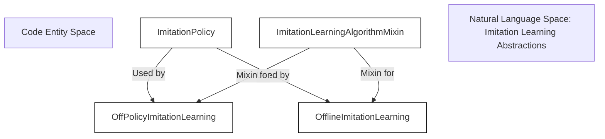
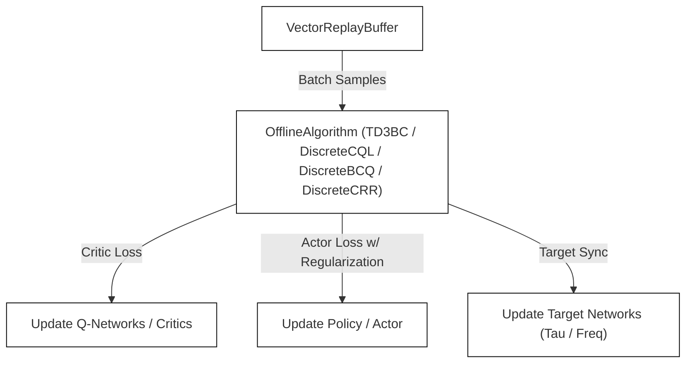
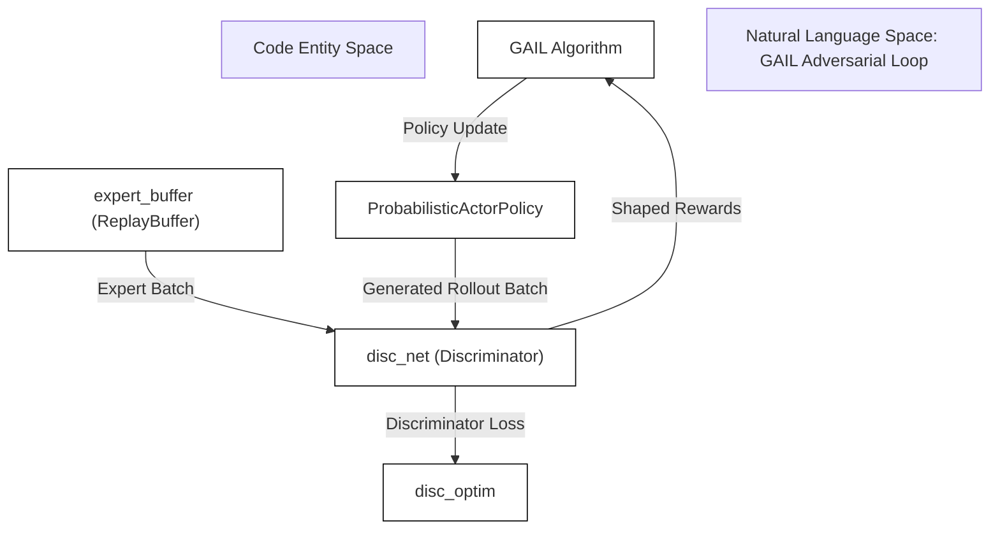

<!-- source: DeepWiki mcp.deepwiki.com · repo thu-ml/tianshou · page 3.5 Offline and Imitation Learning · fetched 2026-10-30 -->

# Offline and Imitation Learning

Relevant source files

The following files were used as context for generating this wiki page:

- [examples/inverse/irl_gail.py](examples/inverse/irl_gail.py)
- [examples/offline/d4rl_td3_bc.py](examples/offline/d4rl_td3_bc.py)
- [test/offline/test_discrete_bcq.py](test/offline/test_discrete_bcq.py)
- [test/offline/test_discrete_cql.py](test/offline/test_discrete_cql.py)
- [test/offline/test_discrete_crr.py](test/offline/test_discrete_crr.py)
- [test/offline/test_gail.py](test/offline/test_gail.py)
- [test/offline/test_td3_bc.py](test/offline/test_td3_bc.py)
- [tianshou/algorithm/imitation/imitation_base.py](tianshou/algorithm/imitation/imitation_base.py)

This section documents Tianshou v2's offline reinforcement learning and imitation learning algorithms. It covers core imitation policy abstractions, standard offline model architectures (BCQ, CQL, TD3+BC, CRR), and inverse reinforcement learning via GAIL.

---

## 3.1 Imitation Policy and Base Abstractions

Tianshou separates action selection (`Policy`) from optimization (`Algorithm`). For imitation learning, `ImitationPolicy` processes states into action logits (for discrete spaces) or distribution parameters (for continuous spaces) [tianshou/algorithm/imitation/imitation_base.py:37-105]().

The training logic is shared via `ImitationLearningAlgorithmMixin`, which computes mean squared error (MSE) loss for continuous regression or negative log-likelihood (NLL) loss for discrete classification [tianshou/algorithm/imitation/imitation_base.py:108-128](). `OffPolicyImitationLearning` and `OfflineImitationLearning` combine this mixin with `OffPolicyAlgorithm` and `OfflineAlgorithm` respectively [tianshou/algorithm/imitation/imitation_base.py:130-172]().

### Imitation Architecture Diagram
The mapping from natural language concepts to code entities for imitation learning is structured as follows:

*Sources: [tianshou/algorithm/imitation/imitation_base.py:37-172]()*

---

## 3.2 Offline RL Algorithms: TD3+BC, BCQ, CQL, and CRR

Offline RL algorithms learn policies from fixed datasets without environment interaction during training. Tianshou provides both continuous and discrete variants.

### TD3+BC (`TD3BC`)
`TD3BC` extends the TD3 continuous off-policy algorithm by adding a behavior cloning (BC) regularization term to the actor loss update, preventing the policy from querying out-of-distribution actions [test/offline/test_td3_bc.py:13](). It requires twin critics (`critic`, `critic2`) and an actor optimizer [test/offline/test_td3_bc.py:134-148]().

### Discrete BCQ (`DiscreteBCQ`)
`DiscreteBCQ` utilizes `DiscreteBCQPolicy` alongside an imitator network to filter out unlikely actions based on an `unlikely_action_threshold` [test/offline/test_discrete_bcq.py:12-101](). The algorithm penalizes logits of actions that deviate significantly from the behavior policy during Q-learning updates [test/offline/test_discrete_bcq.py:102-109]().

### Discrete CQL (`DiscreteCQL`)
`DiscreteCQL` (Conservative Q-Learning) wraps a distributional Q-policy (such as `QRDQNPolicy`) [test/offline/test_discrete_cql.py:13]() and adds a conservative penalty to the Q-values, forcing lower values on out-of-distribution actions while raising values on dataset actions [test/offline/test_discrete_cql.py:93-101]().

### Discrete CRR (`DiscreteCRR`)
`DiscreteCRR` (Critic Regularized Regression) pairs a `DiscreteActorPolicy` with a `DiscreteCritic` [test/offline/test_discrete_crr.py:12-98]() to weigh policy gradient updates using advantage-based weights derived from the critic network [test/offline/test_discrete_crr.py:96-102]().

### Offline Algorithm Data Flow Diagram

*Sources: [test/offline/test_discrete_bcq.py:102-109](), [test/offline/test_td3_bc.py:134-148](), [test/offline/test_discrete_cql.py:93-101](), [test/offline/test_discrete_crr.py:96-102]()*

---

## 3.3 Inverse Reinforcement Learning: GAIL

Generative Adversarial Imitation Learning (`GAIL`) combines an expert dataset buffer with online environment rollouts [examples/inverse/irl_gail.py:17](), [test/offline/test_gail.py:13](). 

### Implementation Details
* **Generator**: A policy (e.g., `ProbabilisticActorPolicy`) trained via PPO/advantage-based updates [examples/inverse/irl_gail.py:19](), [test/offline/test_gail.py:138]().
* **Discriminator**: A neural network (`disc_net`) trained with binary cross-entropy or similar objectives to distinguish state-action pairs generated by the policy from those in the `expert_buffer` [test/offline/test_gail.py:116-150]().
* **Reward Modification**: Environment rewards are replaced or shaped by discriminator outputs (e.g., using `NoRewardEnv` wrappers) [examples/inverse/irl_gail.py:37]().

### GAIL Entity and Data Flow Mapping

*Sources: [examples/inverse/irl_gail.py:17-164](), [test/offline/test_gail.py:13-158]()*

---

