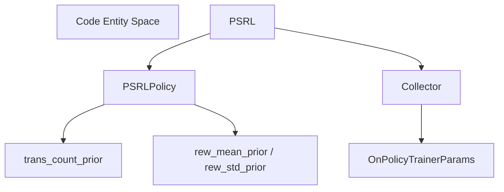
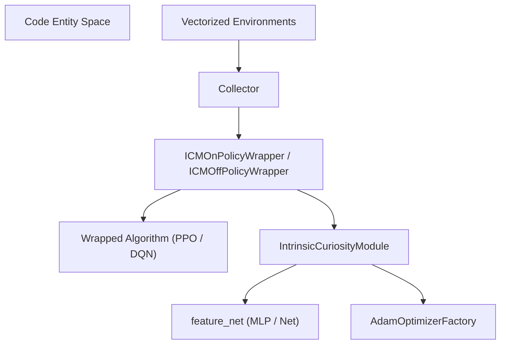
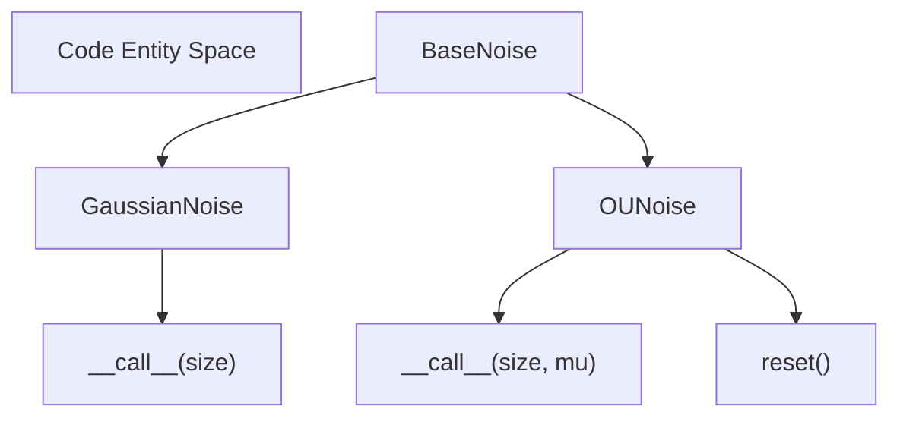

<!-- source: DeepWiki mcp.deepwiki.com · repo thu-ml/tianshou · page 3.6 Model-Based and Exploration Wrappers · fetched 2026-10-30 -->

# Model-Based and Exploration Wrappers

Relevant source files

The following files were used as context for generating this wiki page:

- [test/modelbased/test_dqn_icm.py](test/modelbased/test_dqn_icm.py)
- [test/modelbased/test_ppo_icm.py](test/modelbased/test_ppo_icm.py)
- [test/modelbased/test_psrl.py](test/modelbased/test_psrl.py)
- [test/offline/gather_cartpole_data.py](test/offline/gather_cartpole_data.py)
- [test/pettingzoo/pistonball.py](test/pettingzoo/pistonball.py)
- [test/pettingzoo/pistonball_continuous.py](test/pettingzoo/pistonball_continuous.py)
- [test/pettingzoo/tic_tac_toe.py](test/pettingzoo/tic_tac_toe.py)
- [tianshou/exploration/random.py](tianshou/exploration/random.py)

This page documents model-based reinforcement learning algorithms, intrinsic curiosity wrappers, and exploration noise processes implemented in Tianshou v2. These components are designed to enhance sample efficiency and explore sparse-reward or continuous-control environments effectively.

---

## 3.6.1 Posterior Sampling for Reinforcement Learning (PSRL)

Posterior Sampling for Reinforcement Learning (PSRL) is a model-based Bayesian reinforcement learning approach. PSRL maintains a posterior distribution over the transition probabilities and reward functions of the environment. At the start of an episode or a collection phase, it samples a single Markov Decision Process (MDP) from the posterior distribution and acts greedily or via near-optimal planning with respect to the sampled MDP.

In Tianshou, PSRL is implemented via `PSRLPolicy` and the `PSRL` algorithm structure. It tracks transition counts and reward statistics using prior distributions (e.g., Dirichlet/Beta for transitions and Gaussian for rewards).

### Key Classes and Data Flow
- `PSRLPolicy`: Defined in `[test/modelbased/test_psrl.py:10]()`, this policy handles belief updates over state-transition counts and reward parameters, and generates actions via sampled MDP policies.
- `PSRL`: Defined in `[test/modelbased/test_psrl.py:9](),` the algorithm wrapper coordinates training routines, buffer integration, and policy execution.

*Figure 1: PSRL architectural mapping from high-level concepts to Tianshou classes.*

Sources: `[test/modelbased/test_psrl.py:9-85]()`

---

## 3.6.2 Intrinsic Curiosity Module (ICM) Wrappers

In environments with sparse or delayed extrinsic rewards, reinforcement learning algorithms often struggle to explore effectively. The Intrinsic Curiosity Module (ICM) generates an intrinsic reward based on the prediction error of a forward dynamics model. If an agent visits states whose transitions are difficult to predict given its feature representation and action, it receives a higher intrinsic reward, encouraging exploration.

Tianshou provides algorithm-agnostic wrappers for ICM that modify rewards during collection or training:
- `ICMOnPolicyWrapper`: Used for on-policy algorithms like PPO (see `[test/modelbased/test_ppo_icm.py:12]()`).
- `ICMOffPolicyWrapper`: Used for off-policy algorithms like DQN (see `[test/modelbased/test_dqn_icm.py:9]()`).
- `IntrinsicCuriosityModule`: The core neural network container responsible for feature extraction, inverse dynamics, and forward dynamics loss calculation (see `[test/modelbased/test_dqn_icm.py:22]()`, `[test/modelbased/test_ppo_icm.py:23]()`).

### Mechanics and Configuration
When wrapped, the algorithm computes intrinsic rewards via the ICM network using observed states, actions, and next states. These intrinsic rewards are scaled by `reward_scale` and combined with (or substituted for) extrinsic rewards.

*Figure 2: Component hierarchy for ICM wrappers.*

Sources: `[test/modelbased/test_dqn_icm.py:9-148]()`, `[test/modelbased/test_ppo_icm.py:12-169]()`

---

## 3.6.3 Exploration Noise Processes

For continuous action spaces, off-policy algorithms such as DDPG, TD3, and SAC often require exploration noise added to the policy's deterministic or stochastic actions during collection. Tianshou provides a modular noise hierarchy under `tianshou.exploration`.

### Abstract Base Class and Implementations
- `BaseNoise`: The abstract base class (`[tianshou/exploration/random.py:7-18]`) defining the noise interface through `reset()` and `__call__(size)`.
- `GaussianNoise`: Implements a vanilla Gaussian exploration process (`[tianshou/exploration/random.py:20-33]`) parameterized by mean `mu` and standard deviation `sigma`.
- `OUNoise`: Implements the Ornstein-Uhlenbeck stochastic process (`[tianshou/exploration/random.py:35-83]`), which models temporally correlated exploration noise useful for inertia-heavy physical control tasks.

*Structure of the exploration noise classes in Tianshou.*

Sources: `[tianshou/exploration/random.py:1-82]()`

---

