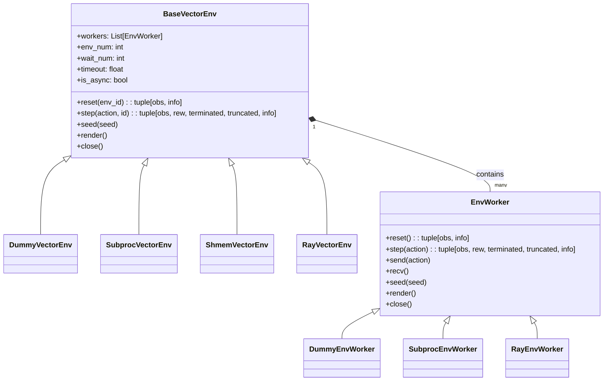
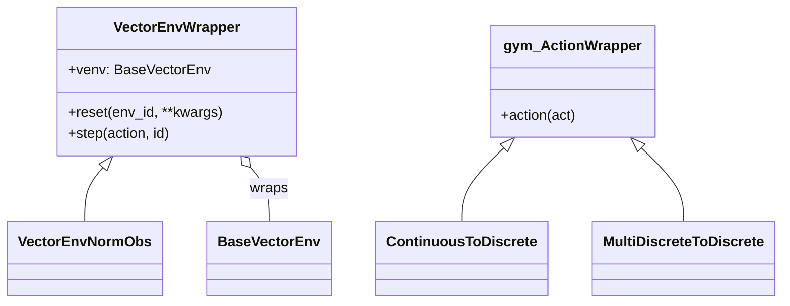
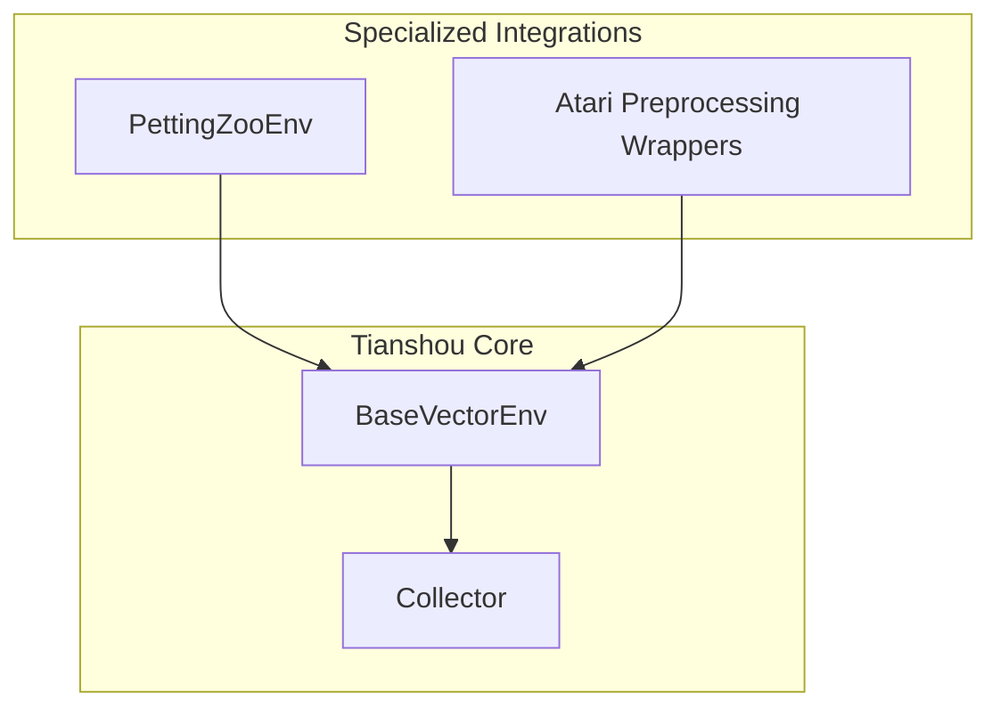

<!-- source: DeepWiki mcp.deepwiki.com · repo thu-ml/tianshou · page 4 Environment System · fetched 2026-10-30 -->

# Environment System

Relevant source files

The following files were used as context for generating this wiki page:

- [test/base/test_env.py](test/base/test_env.py)
- [tianshou/__init__.py](tianshou/__init__.py)
- [tianshou/data/__init__.py](tianshou/data/__init__.py)
- [tianshou/env/__init__.py](tianshou/env/__init__.py)
- [tianshou/env/gym_wrappers.py](tianshou/env/gym_wrappers.py)
- [tianshou/env/venv_wrappers.py](tianshou/env/venv_wrappers.py)
- [tianshou/env/venvs.py](tianshou/env/venvs.py)
- [tianshou/env/worker/dummy.py](tianshou/env/worker/dummy.py)
- [tianshou/env/worker/ray.py](tianshou/env/worker/ray.py)
- [tianshou/env/worker/subproc.py](tianshou/env/worker/subproc.py)

The Environment System in Tianshou provides a comprehensive framework for handling reinforcement learning environments, focusing on vectorized environments that enable parallel execution. It serves as the interface between reinforcement learning agents and the environments they interact with, efficiently collecting experiences through various parallelization strategies.

This is a parent page providing a high-level overview of Tianshou's environment abstractions. For deep technical details, implementation specifics, and advanced usage, please refer to the dedicated child pages:
- [Vectorized Environments and Workers](#4.1)
- [Environment Wrappers](#4.2)
- [Atari and PettingZoo Environments](#4.3)

---

## Core Architecture and Vectorized Environments

At the center of Tianshou's environment architecture is `BaseVectorEnv`, which manages a pool of `EnvWorker` instances to execute multiple environment steps in parallel [tianshou/env/venvs.py:25-363](). Depending on the use case, Tianshou supports sequential execution (`DummyVectorEnv`), multiprocessing execution (`SubprocVectorEnv`), shared-memory optimized multiprocessing (`ShmemVectorEnv`), and distributed execution (`RayVectorEnv`) [tianshou/env/venvs.py:365-473]().

Sources: [tianshou/env/venvs.py:25-363](), [tianshou/env/worker/base.py:11-87]()

For details on base classes, worker communication protocols, asynchronous stepping behavior, and shared-memory array optimization (`ShArray`), see [Vectorized Environments and Workers](#4.1).

---

## Environment Wrappers

Tianshou provides various environment wrappers to modify single-environment or vector environment behaviors to suit reinforcement learning requirements. These include action space transformations such as `ContinuousToDiscrete` and `MultiDiscreteToDiscrete`, time-limit adaptations via `TruncatedAsTerminated` [tianshou/env/gym_wrappers.py:8-80](), and observation normalization via `VectorEnvNormObs` [tianshou/env/venv_wrappers.py:69-120]().

Sources: [tianshou/env/gym_wrappers.py:8-80](), [tianshou/env/venv_wrappers.py:11-120]()

For details on custom wrappers, configuration options, and normalization mechanics, see [Environment Wrappers](#4.2).

---

## Atari and Multi-Agent Integrations

To support specialized domains, Tianshou offers integrations for Atari game preprocessing wrappers and multi-agent reinforcement learning via PettingZoo (`PettingZooEnv`) [tianshou/env/pettingzoo_env.py](). These adapters map multi-agent or complex frame-stacking environments into formats compatible with Tianshou's collectors and batch structures.

Sources: [tianshou/env/pettingzoo_env.py](), [tianshou/env/venvs.py:25-363]()

For details on Atari network backbones, frame stacking, reward clipping, and PettingZoo multi-agent mapping, see [Atari and PettingZoo Environments](#4.3).

---

