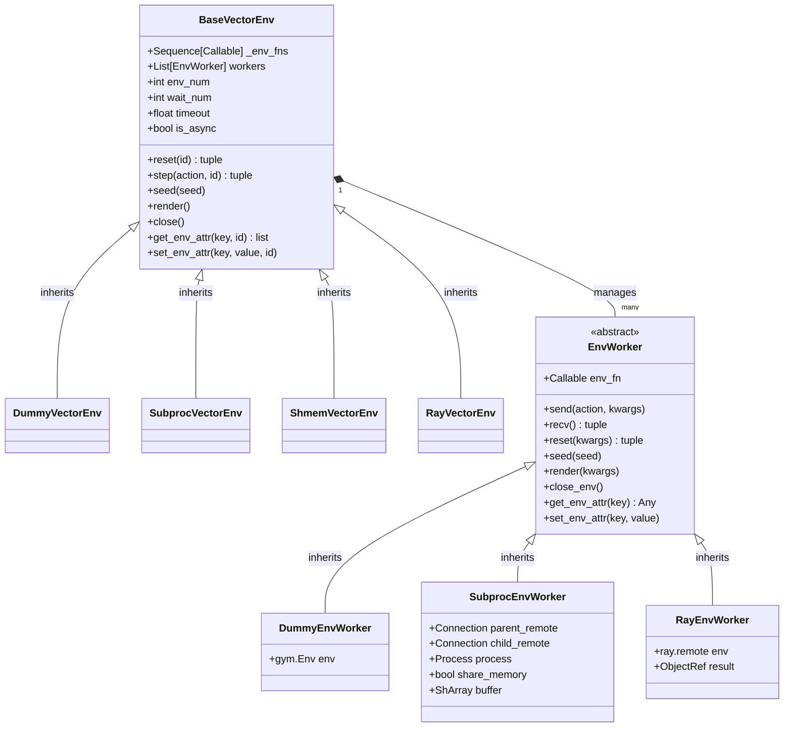
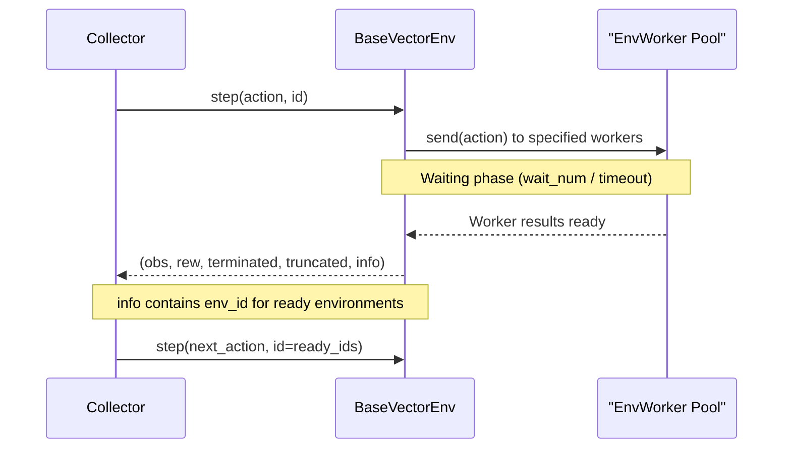

<!-- source: DeepWiki mcp.deepwiki.com · repo thu-ml/tianshou · page 4.1 Vectorized Environments and Workers · fetched 2026-10-30 -->

# Vectorized Environments and Workers

<details>
<summary>Relevant source files</summary>

The following files were used as context for generating this wiki page:

- [test/base/test_env.py](test/base/test_env.py)
- [test/base/test_env_finite.py](test/base/test_env_finite.py)
- [tianshou/env/utils.py](tianshou/env/utils.py)
- [tianshou/env/venv_wrappers.py](tianshou/env/venv_wrappers.py)
- [tianshou/env/venvs.py](tianshou/env/venvs.py)
- [tianshou/env/worker/dummy.py](tianshou/env/worker/dummy.py)
- [tianshou/env/worker/ray.py](tianshou/env/worker/ray.py)
- [tianshou/env/worker/subproc.py](tianshou/env/worker/subproc.py)

</details>


## Purpose and Scope

This document details Tianshou's vectorized environment system, which enables parallel execution of multiple environments simultaneously to maximize throughput for experience collection. The architecture comprises `BaseVectorEnv`, environment worker abstractions (`EnvWorker`), concrete worker implementations (`DummyEnvWorker`, `SubprocEnvWorker`, `RayEnvWorker`), shared memory utilities (`ShArray`), asynchronous stepping mechanisms, and environment utilities.

Sources: [tianshou/env/venvs.py:25-101](), [tianshou/env/worker/base.py:1-87](), [tianshou/env/worker/subproc.py:33-141]()

## Overview and Architecture

Vectorized environments in Tianshou wrap collections of environment instances (`ENV_TYPE`), allowing synchronous or asynchronous execution across in-process sequential loops, multiprocessing subprocesses, shared memory regions, or distributed Ray actors.



Sources: [tianshou/env/venvs.py:25-109](), [tianshou/env/worker/base.py:11-87](), [tianshou/env/worker/dummy.py:10-55](), [tianshou/env/worker/subproc.py:143-274](), [tianshou/env/worker/ray.py:24-77]()

## Core Components and Data Flow

The relationship between `BaseVectorEnv`, `EnvWorker`, and underlying gymnasium/pettingzoo environments involves explicit command passing and shared memory buffer updates.

```mermaid
flowchart TB
    subgraph CodeEntitySpace["Code Entity Space"]
        BVE["BaseVectorEnv"]
        EW["EnvWorker subclasses"]
        DEW["DummyEnvWorker"]
        SEW["SubprocEnvWorker"]
        REW["RayEnvWorker"]
        SH["ShArray"]
        
        BVE -->|"instantiates and calls"| EW
        EW <|-- DEW
        EW <|-- SEW
        EW <|-- REW
        SEW -->|"uses buffer"| SH
    end
    
    subgraph NaturalLanguageSpace["System Operation"]
        direction TB
        User["Agent / Collector"] -->|"venv.step(action)"| BVE
        BVE -->|"worker.send(action)"| EW
        EW -->|"gym.Env.step()"| EnvInstance["gym.Env / PettingZooEnv"]
        EnvInstance -->|"returns obs, rew, term, trunc, info"| EW
        EW -->|"worker.recv()"| BVE
    end
```

Sources: [tianshou/env/venvs.py:131-235](), [tianshou/env/worker/subproc.py:33-141](), [tianshou/env/worker/ray.py:46-64]()

### BaseVectorEnv Class

`BaseVectorEnv` orchestrates multiple `EnvWorker` instances [tianshou/env/venvs.py:76-110](). It tracks environment readiness via `ready_id`, `waiting_id`, and `waiting_conn` to support asynchronous stepping [tianshou/env/venvs.py:100-109](). Attribute lookups on reserved Gym keys (`metadata`, `reward_range`, `spec`, `action_space`, `observation_space`) automatically delegate to underlying workers via `__getattribute__` and `get_env_attr()` [tianshou/env/venvs.py:120-154]().

Sources: [tianshou/env/venvs.py:76-177]()

### Worker Implementations

Tianshou provides four concrete `EnvWorker` subclasses:

1. **`DummyEnvWorker`**: Executes environments sequentially within the main process [tianshou/env/worker/dummy.py:10-15](). All workers are immediately ready [tianshou/env/worker/dummy.py:28-35]().
2. **`SubprocEnvWorker`**: Runs each environment in a separate subprocess communicating via multiprocessing `Pipe` objects [tianshou/env/worker/subproc.py:143-154]().
3. **`ShmemVectorEnv` / `SubprocEnvWorker` (with `share_memory=True`)**: Optimizes observation transfers by allocating shared memory buffers using `ShArray` [tianshou/env/worker/subproc.py:33-75](), [tianshou/env/worker/subproc.py:158-163](). Observation arrays are written directly into shared memory by worker processes, eliminating IPC serialization overhead [tianshou/env/worker/subproc.py:83-112]().
4. **`RayEnvWorker`**: Leverages Ray remote actors (`ray.remote`) for distributed execution across processes or compute nodes [tianshou/env/worker/ray.py:24-38](). Asynchronous waiting utilizes `ray.wait()` [tianshou/env/worker/ray.py:45-54]().

Sources: [tianshou/env/worker/dummy.py:10-55](), [tianshou/env/worker/subproc.py:33-174](), [tianshou/env/worker/ray.py:24-77]()

## Asynchronous Stepping and Execution

When `wait_num` is less than `env_num` or `timeout` is specified, `BaseVectorEnv` operates asynchronously [tianshou/env/venvs.py:100](). Instead of blocking until all environment instances complete their step, `step()` returns as soon as `wait_num` environments finish or the `timeout` elapses [tianshou/env/venvs.py:237-322]().



Sources: [tianshou/env/venvs.py:237-322]()

## Environment Utilities and Wrappers

### Utilities
- `CloudpickleWrapper`: Wraps environment callable functions with `cloudpickle` to ensure robust serialization when spawning multiprocessing subprocesses [tianshou/env/utils.py:14-24]().
- `ShArray`: Manages shared memory NumPy array views over multiprocessing shared memory objects (`ctx.Array`) [tianshou/env/worker/subproc.py:33-66]().

### Wrappers
- `VectorEnvWrapper`: Base class for wrapping vectorized environments while preserving `BaseVectorEnv` and Gym attribute lookup interfaces [tianshou/env/venv_wrappers.py:11-67]().
- `VectorEnvNormObs`: Dynamically maintains running mean and standard deviation (`RunningMeanStd`) of observations across vectorized environments, normalizing observation tensors on `reset()` and `step()` [tianshou/env/venv_wrappers.py:69-120]().

Sources: [tianshou/env/utils.py:14-24](), [tianshou/env/worker/subproc.py:33-66](), [tianshou/env/venv_wrappers.py:11-120]()

Sources: [tianshou/env/venvs.py:25-101](), [tianshou/env/worker/base.py:1-87](), [tianshou/env/worker/dummy.py:10-55](), [tianshou/env/worker/subproc.py:33-174](), [tianshou/env/worker/ray.py:24-77](), [tianshou/env/utils.py:14-24](), [tianshou/env/venv_wrappers.py:11-120]()

---

